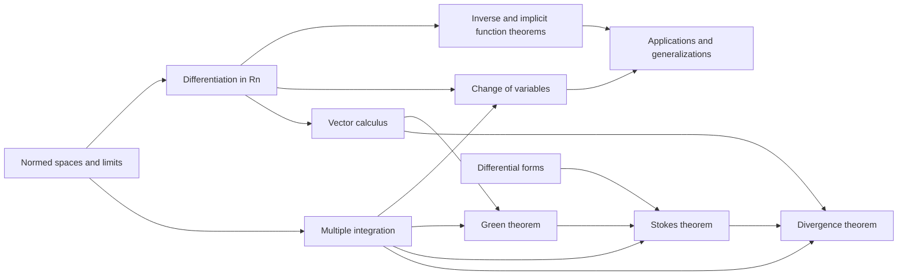

# Meta-Graph: Advanced Calculus

> **Purpose.** This is a subject-level dependency map for planning a future theorem knowledge graph. It shows a representative route through the field; it is not a complete list of prerequisites, a formal proof dependency database, or a claim that every course follows this order.

## How to read this graph

- **Nodes** are foundational ideas, methods, structural results, or major theorems. A node may later expand into its own proof-level graph.
- An arrow `X → Y` means that X commonly supplies language, a method, a hypothesis, or a result used in understanding or proving Y. The edge table says which role it plays.
- Some edges describe a common proof route or conceptual bridge rather than a logically necessary dependency. The eventual theorem graph should record the exact theorem, hypotheses, source, and proof step for every strict dependency.
- The graph is a DAG at this global overview level. Feedback and revision belong inside proof workflows; they should not be mistaken for a theorem depending on itself.

## Global subject map

## Node register

| ID | Idea, theorem, or method | Role in the subject |
|---|---|---|
| A | Normed spaces and limits | Formalize convergence, continuity, and uniform control |
| B | Differentiation in Rn | Build the derivative as a linear approximation |
| C | Inverse and implicit function theorems | Transfer local derivative information into solvability and coordinates |
| D | Multiple integration | Define integration in several variables and control approximation |
| E | Change of variables | Relate integrals under differentiable coordinate maps |
| F | Vector calculus | Connect divergence, curl, and circulation to integral identities |
| G | Green theorem | Relate planar boundary integrals to interior derivatives |
| H | Stokes theorem | Relate differential forms on a manifold to their boundary |
| I | Divergence theorem | Convert flux across a boundary to volume divergence |
| J | Differential forms | Unify line, surface, and volume integration |
| K | Applications and generalizations | Use the core theorems in geometry, physics, and analysis |

## Dependency register

| From → To | Connection type | How the earlier node supports the later node |
|---|---|---|
| A → B (Normed spaces and limits → Differentiation in Rn) | Common mathematical dependency | Limits define differentiability. |
| B → C (Differentiation in Rn → Inverse and implicit function theorems) | Common mathematical dependency | Derivative invertibility yields local maps and constraints. |
| A → D (Normed spaces and limits → Multiple integration) | Common mathematical dependency | Limits and partitions control integration. |
| B → E (Differentiation in Rn → Change of variables) | Common mathematical dependency | Jacobian determinant measures local volume change. |
| D → E (Multiple integration → Change of variables) | Common mathematical dependency | Integration transforms through coordinates. |
| B → F (Differentiation in Rn → Vector calculus) | Common mathematical dependency | Derivatives define vector differential operators. |
| D → G (Multiple integration → Green theorem) | Common mathematical dependency | Integration and planar partitions yield Green's formula. |
| F → G (Vector calculus → Green theorem) | Common mathematical dependency | Curl/divergence structure yields boundary identities. |
| J → H (Differential forms → Stokes theorem) | Common mathematical dependency | Forms provide the coordinate-free Stokes framework. |
| D → H (Multiple integration → Stokes theorem) | Common mathematical dependency | Integration of forms extends line and surface integrals. |
| F → I (Vector calculus → Divergence theorem) | Common mathematical dependency | Divergence operator appears in flux theorem. |
| D → I (Multiple integration → Divergence theorem) | Common mathematical dependency | Volume and boundary integration are linked. |
| G → H (Green theorem → Stokes theorem) | Common mathematical dependency | Green's theorem is the two-dimensional model. |
| H → I (Stokes theorem → Divergence theorem) | Common mathematical dependency | Stokes specialization yields divergence theorem. |
| C → K (Inverse and implicit function theorems → Applications and generalizations) | Common mathematical dependency | Local solvability underlies applications. |
| E → K (Change of variables → Applications and generalizations) | Common mathematical dependency | Coordinate changes support geometric integration. |

## Suggested reading paths

**Core route:** follow the nodes from foundational language toward the central structural theorems, then continue to the advanced endpoint. For a first pass, read the graph left to right and pause at each node to state its hypotheses and output.

**Theorem-focused route:** choose a major theorem node, trace incoming arrows backward to identify imported results, then trace outgoing arrows to see what the theorem enables. Mark which incoming edges are strict dependencies after consulting a proof-level source.

**Bridge route:** follow cross-links between methods and neighboring theories. Treat these as transfer routes: identify exactly what is preserved, what hypotheses are added, and what changes under translation.

## Five-component expansion for each theorem node

When a node is selected for a complete Meta-Math walkthrough, preserve the node ID and expand it into a local five-component proof graph:

| Component | Local responsibility |
|---|---|
| **Contract** | State the precise theorem goal, scope, and proof contract; distinguish the claim from nearby stronger or weaker claims. |
| **Knowledge** | Retrieve definitions, hypotheses, lemmas, source references, and known examples/counterexamples required by this node. |
| **Strategy** | Select and order proof steps; justify each inference and expose dependency on incoming nodes. |
| **Validation** | Check type/notation consistency, hypothesis use, boundary cases, examples, and whether each intermediate claim is actually supported. |
| **Execution** | Execute proof steps, calculations, constructions, or formal checks; emit the verified result and update outgoing dependencies. |

A later graph version should connect global theorem nodes to these local component nodes, with typed edges such as `uses`, `specializes`, `generalizes`, `contradicts`, `analogy-only`, and `verified-by`.

## Expansion record

For each node promoted from this map, add a stable theorem or concept ID, exact statement, source and page/section, prerequisite IDs, proof-step graph, explicit hypothesis checks, known failure modes, examples, and verification status. Keep conjectural or analogy-only links visually distinct from proved dependencies.

**Related syllabus:** [`outline.md`](book-outline.md).
