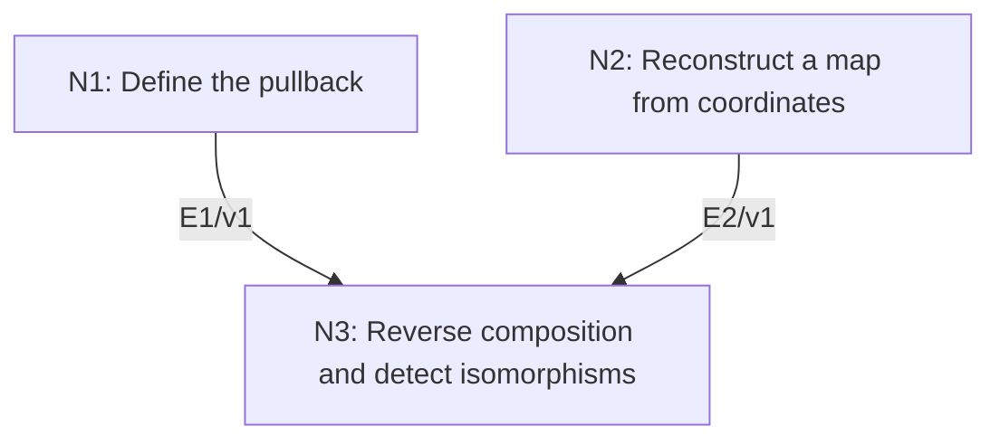

# Affine Polynomial Maps and Coordinate-Ring Duality

## An End-to-End Metacognitive Mathematics Walkthrough

**Problem ID:** AG-05  
**Version:** 1  
**Subject:** Algebraic Geometry  
**Level:** Intermediate  
**Status:** Complete authored exposition relative to the declared imports.  
**Evidence:** Mathematical argument and authored teaching traces; no actual multi-agent run, independent review, or proof-assistant certification is claimed.

## 1. Target, definitions, and import contract

For affine algebraic sets $X\subset k^n$ and $Y\subset k^m$, polynomial maps $F:X\to Y$ are in bijection with unital $k$-algebra homomorphisms $\phi:k[Y]\to k[X]$ via pullback $F^*(h)=h\circ F$. Composition is reversed. A polynomial map is an isomorphism with polynomial inverse if and only if its pullback is a $k$-algebra isomorphism. Here polynomial maps mean maps whose coordinate functions are restrictions of polynomials.

### Permitted imports and conventions

Use quotient rings, the vanishing ideal $I(X)$ of the actual point set, and $V(I(X))=X$ for an algebraic set: if $X=V(S)$, then $S\subset I(X)$ gives $V(I(X))\subset X$, while the reverse inclusion is definitional. Constants are fixed by a $k$-algebra map. No Nullstellensatz or algebraic closure is necessary for this formulation.

## 2. Intuition and node interaction workflow

The images of the coordinate functions determine the point map. Relations in the source coordinate ring guarantee that the reconstructed point lies in the intended target.

Each mathematical node contains **Ego, Memory, Intellect, Sense, and Action**. The diagram records accepted proof dependencies. Requests to repair an argument belong only to §6; they are not backward proof edges.

### Evidence transfer ledger

| Transfer | Producer and export | Receiving activity | Exact claim and compatibility |
|---|---|---|---|
| T1-3 | N1/v1 · E1/v1 | N3.1 | $F^*:k[Y]\to k[X]$ is a well-defined unital $k$-algebra homomorphism. Inputs in N3 retain the producer's assumptions; evidence: §4.N1. |
| T2-3 | N2/v1 · E2/v1 | N3.1 | There is a unique polynomial map $F:X\to Y$ with $F^*=\phi$. Inputs in N3 retain the producer's assumptions; evidence: §4.N2. |

## 3. Node roles and five-faculty contracts

### N1/v1 — Define the pullback

**Object and inputs:** A polynomial map $F=(F_1,\ldots,F_m):X\to Y$.

**Role and strategy:** Compose representative polynomials and show the result is independent of representatives.

**Local obligation:** $F^*:k[Y]\to k[X]$ is a well-defined unital $k$-algebra homomorphism.

| Faculty | Concrete responsibility |
|---|---|
| Ego | Publish E1/v1 only with its stated domain and assumptions: $F^*:k[Y]\to k[X]$ is a well-defined unital $k$-algebra homomorphism. |
| Memory | A polynomial map $F=(F_1,\ldots,F_m):X\to Y$. Preserve the §1 conventions and incoming export versions. |
| Intellect | Compose representative polynomials and show the result is independent of representatives. |
| Sense | Two representatives equal on $Y$ must remain equal after composition because $F(X)\subset Y$. |
| Action | Execute activities N1.1–N1.2 in §4.N1; preserve the displayed calculations as evidence. |

**Export E1/v1:** $F^*:k[Y]\to k[X]$ is a well-defined unital $k$-algebra homomorphism. Evidence: the complete local derivation in §4.N1.

**Acceptance gate:** Establish the local obligation through every numbered activity below and discharge this concrete check: Two representatives equal on $Y$ must remain equal after composition because $F(X)\subset Y$.

**Targeted repair:** If composition is defined before target membership is checked, verify $F(X)\subset Y$; otherwise relations in $I(Y)$ need not vanish. Withhold E1 and its dependent exports until the correction has been checked; a revised export receives a new version.

### N2/v1 — Reconstruct a map from coordinates

**Object and inputs:** A unital $k$-algebra homomorphism $\phi:k[Y]\to k[X]$.

**Role and strategy:** Choose representatives for the images of coordinate classes and verify every defining relation of $Y$.

**Local obligation:** There is a unique polynomial map $F:X\to Y$ with $F^*=\phi$.

| Faculty | Concrete responsibility |
|---|---|
| Ego | Publish E2/v1 only with its stated domain and assumptions: There is a unique polynomial map $F:X\to Y$ with $F^*=\phi$. |
| Memory | A unital $k$-algebra homomorphism $\phi:k[Y]\to k[X]$. Preserve the §1 conventions and incoming export versions. |
| Intellect | Choose representatives for the images of coordinate classes and verify every defining relation of $Y$. |
| Sense | The images are elements of the quotient $k[X]$, so changing representatives must not change the point map. |
| Action | Execute activities N2.1–N2.2 in §4.N2; preserve the displayed calculations as evidence. |

**Export E2/v1:** There is a unique polynomial map $F:X\to Y$ with $F^*=\phi$. Evidence: the complete local derivation in §4.N2.

**Acceptance gate:** Establish the local obligation through every numbered activity below and discharge this concrete check: The images are elements of the quotient $k[X]$, so changing representatives must not change the point map.

**Targeted repair:** If arbitrary polynomial representatives are used without checking relations, apply $\phi$ to every relation in $I(Y)$ before claiming target membership. Withhold E2 and its dependent exports until the correction has been checked; a revised export receives a new version.

### N3/v1 — Reverse composition and detect isomorphisms

**Object and inputs:** E1/v1 and E2/v1; maps $X\xrightarrow{F}Y\xrightarrow{G}Z$. Incoming proof exports: E1/v1 at N3.1, E2/v1 at N3.1.

**Role and strategy:** Compute compositions on functions and use uniqueness of the recovered map.

**Local obligation:** Pullback gives the stated bijection, reverses composition, and identifies polynomial isomorphisms with algebra isomorphisms.

| Faculty | Concrete responsibility |
|---|---|
| Ego | Publish E3/v1 only with its stated domain and assumptions: Pullback gives the stated bijection, reverses composition, and identifies polynomial isomorphisms with algebra isomorphisms. |
| Memory | E1/v1 and E2/v1; maps $X\xrightarrow{F}Y\xrightarrow{G}Z$. Preserve the §1 conventions and incoming export versions. |
| Intellect | Compute compositions on functions and use uniqueness of the recovered map. |
| Sense | The arrow directions reverse: $(G\circ F)^*=F^*\circ G^*$. |
| Action | Execute activities N3.1–N3.2 in §4.N3; preserve the displayed calculations as evidence. |

**Export E3/v1:** Pullback gives the stated bijection, reverses composition, and identifies polynomial isomorphisms with algebra isomorphisms. Evidence: the complete local derivation in §4.N3.

**Acceptance gate:** Establish the local obligation through every numbered activity below and discharge this concrete check: The arrow directions reverse: $(G\circ F)^*=F^*\circ G^*$.

**Targeted repair:** If composition order is reversed incorrectly, evaluate both sides on one function and rebuild the domain/codomain chain. Withhold E3 and its dependent exports until the correction has been checked; a revised export receives a new version.

## 4. Continuous mathematical proof

The following activities form one continuous proof. Intermediate claims are established where used, except for the explicitly permitted imports in §1.

### §4.N1 — Define the pullback

1. **N1.1.** For a polynomial $h$ in the $Y$ coordinates, substitute the polynomial coordinates of $F$ to obtain a polynomial function on $X$. If $h-h'\in I(Y)$, then $(h-h')(F(x))=0$ for every $x\in X$, so the resulting classes in $k[X]$ agree.

2. **N1.2.** Composition preserves addition, multiplication, the constant $1$, and each scalar in $k$. It also does not depend on the representatives chosen for $F_i$, because those representatives agree pointwise on $X$. This proves the pullback assertion.

### §4.N2 — Reconstruct a map from coordinates

1. **N2.1.** Let $\bar y_j$ be the coordinate classes of $k[Y]$. Choose polynomials $p_j$ representing $\phi(\bar y_j)$, and set $F(x)=(p_1(x),\ldots,p_m(x))$. Representatives differing by $I(X)$ give the same map.

2. **N2.2.** For every $h\in I(Y)$, $h(\bar y_1,\ldots,\bar y_m)=0$ in $k[Y]$. Applying $\phi$ gives $h(p_1,\ldots,p_m)\in I(X)$, hence $F(x)\in V(I(Y))=Y$. On all coordinate classes $F^*$ agrees with $\phi$, and these classes and constants generate $k[Y]$, so agreement holds everywhere. The coordinate images also force uniqueness.

### §4.N3 — Reverse composition and detect isomorphisms

1. **N3.1.** For a function $h$ on $Z$, $(G\circ F)^*h=h\circ G\circ F=F^*(G^*h)$. Identity maps pull back to identity homomorphisms. E1 and E2 are inverse constructions, giving the bijection.

2. **N3.2.** If $F$ has polynomial inverse $G$, the composition identities show that $F^*$ and $G^*$ are inverse. Conversely if $F^*$ is invertible, E2 realizes its inverse as $G^*$ for a polynomial map $G:Y\to X$. Both composite pullbacks are identities; uniqueness in E2 forces $G\circ F=\mathrm{id}_X$ and $F\circ G=\mathrm{id}_Y$.

## 5. Worked instance and boundary audit

Over $k=\mathbb C$, for the parabola $Y=V(y-x^2)$, the map $F:\mathbb A^1\to Y$, $t\mapsto(t,t^2)$, induces $F^*:k[x,y]/(y-x^2)\to k[t]$ with $x\mapsto t$, $y\mapsto t^2$. Its inverse sends $t$ to the class of $x$. The corresponding geometric inverse is $(x,y)\mapsto x$. Both compositions are explicitly identities.

### Boundary or failed-inference witness

A pointwise bijective polynomial map need not be an isomorphism. Over an algebraically closed field of characteristic $p>0$, $t\mapsto t^p$ is bijective: roots exist and $(a-b)^p=0$ forces equality. Its pullback $k[t]\to k[t]$, $t\mapsto t^p$, is not surjective because $t$ is absent from $k[t^p]$.

## 6. Illustrative interaction and repair trace

**Trace status:** Authored illustration, not a logged agent execution. The rejected candidate below is outside the accepted DAG.

**Rejected final export:** every bijective polynomial map has a polynomial inverse. **Sense witness:** Frobenius on the affine line in characteristic $p$. **Diagnosis:** Ego promoted a set-theoretic property to an algebraic one. **Repair:** use the actual criterion that the pullback is an algebra isomorphism, as proved in N3. This rejects a stronger claim while preserving the exact §1 theorem; bijectivity alone remains insufficient.

After the corrected argument is supplied, Ego may publish a hypothetical v2 export, Memory replaces the rejected version, and Action rechecks each descendant in §2. The accepted exposition in this file is v1; this scenario does not claim an actual revision or execution occurred.

## 7. Evidence ledger and reusable exports

| Item | Evidence and scope | Remaining limitation |
|---|---|---|
| Target theorem | §4, under exactly the §1 hypotheses and imports | Authored mathematical exposition; no independent or formal verification |
| E1–E3 | Local proofs §4.N1–§4.N3; version 1 | Imports remain attached to each reuse |
| Worked instance | Explicit computation or construction in §5 | Illustrates the mechanism; does not prove the universal theorem |
| Repair | Rejected inference, witness, and correction in §6 | Teaching scenario rather than empirical agent evidence |

**Reusable target:** Preserve `AG-05/v1`, the exact statement in §1, its assumptions, and this proof when reusing the result.

**Next direction:** Extend this affine viewpoint to gluing local coordinate descriptions, while keeping regular maps and pointwise bijections distinct.

## 8. Sources and navigation

The proof and faculty decomposition are authored for this collection. The following primary teaching sources support further study; exact imports are specified in §1.

[J. S. Milne, Algebraic Geometry](https://www.jmilne.org/math/CourseNotes/ag.html), chapters on commutative algebra, algebraic sets, and affine varieties; [author’s mathematics site](https://www.jmilne.org/math/).

**Local imported proof modules:** None. Supporting external results are specified in §1.

[Five-project subject index](problems.md) · [Project README](../README.md) · [Graduate subject outline](../../book/outline.md)
