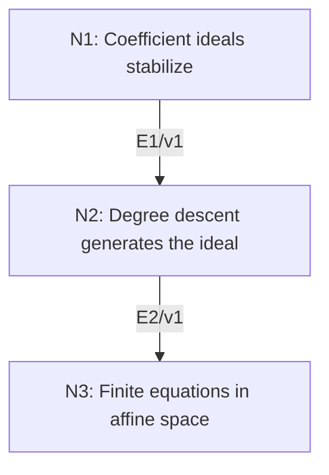

# Hilbert Basis Theorem and Affine Finiteness

## An End-to-End Metacognitive Mathematics Walkthrough

**Problem ID:** AG-01  
**Version:** 1  
**Subject:** Algebraic Geometry  
**Level:** Intermediate  
**Status:** Complete authored exposition relative to the declared imports.  
**Evidence:** Mathematical argument and authored teaching traces; no actual multi-agent run, independent review, or proof-assistant certification is claimed.

## 1. Target, definitions, and import contract

If $R$ is a commutative Noetherian ring with identity (every ideal is finitely generated), then $R[x]$ is Noetherian. Deduce by induction that every ideal of $k[x_1,\ldots,x_n]$ is finitely generated for a field $k$, so every affine algebraic set is cut out by finitely many polynomial equations.

### Permitted imports and conventions

Use elementary ideal arithmetic and polynomial coefficients, including degree reduction by cancellation of a leading coefficient. Noetherianity implies the ascending chain condition: the union of an ascending chain is an ideal; its finitely many generators all lie in one term, which therefore equals the union. For an ideal $I$, $V(I)$ denotes its common zero set over the chosen field. No algebraic closure hypothesis is needed here.

## 2. Intuition and node interaction workflow

Collect possible coefficients at each degree into an ascending chain of ideals. Once that chain stabilizes, finitely many chosen polynomials reduce every other polynomial by decreasing degree.

Each mathematical node contains **Ego, Memory, Intellect, Sense, and Action**. The diagram records accepted proof dependencies. Requests to repair an argument belong only to §6; they are not backward proof edges.

### Evidence transfer ledger

| Transfer | Producer and export | Receiving activity | Exact claim and compatibility |
|---|---|---|---|
| T1-2 | N1/v1 · E1/v1 | N2.1 | There is $N$ with $A_d=A_N$ for all $d\ge N$, and each $A_d$ for $d\le N$ has finitely many chosen polynomial lifts in $I$. Inputs in N2 retain the producer's assumptions; evidence: §4.N1. |
| T2-3 | N2/v1 · E2/v1 | N3.1 | $I=J$, so $R[x]$ is Noetherian. Inputs in N3 retain the producer's assumptions; evidence: §4.N2. |

## 3. Node roles and five-faculty contracts

### N1/v1 — Coefficient ideals stabilize

**Object and inputs:** An ideal $I\subset R[x]$ and $A_d=\{\text{coefficient of }x^d\text{ in }f:f\in I,\deg f\le d\}$, including zero.

**Role and strategy:** Encode infinitely many polynomial constraints in an ascending chain inside the Noetherian coefficient ring.

**Local obligation:** There is $N$ with $A_d=A_N$ for all $d\ge N$, and each $A_d$ for $d\le N$ has finitely many chosen polynomial lifts in $I$.

| Faculty | Concrete responsibility |
|---|---|
| Ego | Publish E1/v1 only with its stated domain and assumptions: There is $N$ with $A_d=A_N$ for all $d\ge N$, and each $A_d$ for $d\le N$ has finitely many chosen polynomial lifts in $I$. |
| Memory | An ideal $I\subset R[x]$ and $A_d=\{\text{coefficient of }x^d\text{ in }f:f\in I,\deg f\le d\}$, including zero. Preserve the §1 conventions and incoming export versions. |
| Intellect | Encode infinitely many polynomial constraints in an ascending chain inside the Noetherian coefficient ring. |
| Sense | Use coefficient ideals at degree at most $d$; a set of leading coefficients at exactly one degree requires care under cancellation. |
| Action | Execute activities N1.1–N1.2 in §4.N1; preserve the displayed calculations as evidence. |

**Export E1/v1:** There is $N$ with $A_d=A_N$ for all $d\ge N$, and each $A_d$ for $d\le N$ has finitely many chosen polynomial lifts in $I$. Evidence: the complete local derivation in §4.N1.

**Acceptance gate:** Establish the local obligation through every numbered activity below and discharge this concrete check: Use coefficient ideals at degree at most $d$; a set of leading coefficients at exactly one degree requires care under cancellation.

**Targeted repair:** If a sum cancels leading coefficients, retain the coefficient-at-degree definition, which includes zero and remains an ideal. Withhold E1 and its dependent exports until the correction has been checked; a revised export receives a new version.

### N2/v1 — Degree descent generates the ideal

**Object and inputs:** E1/v1 and the ideal $J$ generated in $R[x]$ by the finite chosen family. Incoming proof exports: E1/v1 at N2.1.

**Role and strategy:** Cancel the highest coefficient of an arbitrary polynomial in $I$ and use induction on its degree.

**Local obligation:** $I=J$, so $R[x]$ is Noetherian.

| Faculty | Concrete responsibility |
|---|---|
| Ego | Publish E2/v1 only with its stated domain and assumptions: $I=J$, so $R[x]$ is Noetherian. |
| Memory | E1/v1 and the ideal $J$ generated in $R[x]$ by the finite chosen family. Preserve the §1 conventions and incoming export versions. |
| Intellect | Cancel the highest coefficient of an arbitrary polynomial in $I$ and use induction on its degree. |
| Sense | The degree must strictly decrease after cancellation, even when $R$ has zero divisors. |
| Action | Execute activities N2.1–N2.2 in §4.N2; preserve the displayed calculations as evidence. |

**Export E2/v1:** $I=J$, so $R[x]$ is Noetherian. Evidence: the complete local derivation in §4.N2.

**Acceptance gate:** Establish the local obligation through every numbered activity below and discharge this concrete check: The degree must strictly decrease after cancellation, even when $R$ has zero divisors.

**Targeted repair:** If polynomial long division over a field is used for a general ring, replace it by the generator combination above; invertibility is not assumed. Withhold E2 and its dependent exports until the correction has been checked; a revised export receives a new version.

### N3/v1 — Finite equations in affine space

**Object and inputs:** E2/v1 and a field $k$, whose only ideals are $0$ and $k$. Incoming proof exports: E2/v1 at N3.1.

**Role and strategy:** Iterate the one-variable theorem and translate ideal generation into equality of zero sets.

**Local obligation:** Every $I\subset k[x_1,\ldots,x_n]$ has finite generators $g_1,\ldots,g_s$ and $V(I)=V(g_1,\ldots,g_s)$.

| Faculty | Concrete responsibility |
|---|---|
| Ego | Publish E3/v1 only with its stated domain and assumptions: Every $I\subset k[x_1,\ldots,x_n]$ has finite generators $g_1,\ldots,g_s$ and $V(I)=V(g_1,\ldots,g_s)$. |
| Memory | E2/v1 and a field $k$, whose only ideals are $0$ and $k$. Preserve the §1 conventions and incoming export versions. |
| Intellect | Iterate the one-variable theorem and translate ideal generation into equality of zero sets. |
| Sense | Equality of zero sets follows from linear combinations of equations, not from radical-ideal correspondence. |
| Action | Execute activities N3.1–N3.2 in §4.N3; preserve the displayed calculations as evidence. |

**Export E3/v1:** Every $I\subset k[x_1,\ldots,x_n]$ has finite generators $g_1,\ldots,g_s$ and $V(I)=V(g_1,\ldots,g_s)$. Evidence: the complete local derivation in §4.N3.

**Acceptance gate:** Establish the local obligation through every numbered activity below and discharge this concrete check: Equality of zero sets follows from linear combinations of equations, not from radical-ideal correspondence.

**Targeted repair:** If finite generation is claimed for infinitely many variables, restore the finite-variable contract before reusing the induction. Withhold E3 and its dependent exports until the correction has been checked; a revised export receives a new version.

## 4. Continuous mathematical proof

The following activities form one continuous proof. Intermediate claims are established where used, except for the explicitly permitted imports in §1.

### §4.N1 — Coefficient ideals stabilize

1. **N1.1.** Addition and scalar multiplication of polynomials of degree at most $d$ show that $A_d$ is an ideal of $R$. Multiplication by $x$ shows $A_d\subset A_{d+1}$. The ascending chain condition gives stabilization at some $N$.

2. **N1.2.** For $0\le d\le N$, choose generators $a_{d,1},\ldots,a_{d,r_d}$ of $A_d$. Omit zero generators. Choose $f_{d,j}\in I$ of degree at most $d$ whose coefficient at $x^d$ is $a_{d,j}$. A nonzero chosen coefficient makes its degree exactly $d$. There are only finitely many chosen polynomials.

### §4.N2 — Degree descent generates the ideal

1. **N2.1.** Certainly $J\subset I$. Let nonzero $f\in I$ have degree $m$ and leading coefficient $a$. Set $d=\min(m,N)$. Stabilization gives $a\in A_m=A_d$ when $m>N$, and membership is immediate when $m\le N$. Write $a=\sum_j b_j a_{d,j}$ with $b_j\in R$.

2. **N2.2.** The polynomial $h=f-\sum_j b_j x^{m-d}f_{d,j}$ lies in $I$ and has degree less than $m$ or is zero. Strong induction on the nonnegative integer $m$ proves $h\in J$, hence $f\in J$. At $m=0$, cancellation leaves zero, which starts the induction. No division by a leading coefficient was used.

### §4.N3 — Finite equations in affine space

1. **N3.1.** A field is Noetherian. Apply E2 successively to $k$, $k[x_1]$, and so on to obtain Noetherianity of $k[x_1,\ldots,x_n]$. The induction length is the finite number of variables.

2. **N3.2.** If $I=(g_1,\ldots,g_s)$, a point annihilating all generators annihilates each finite polynomial combination of them, hence all of $I$. The reverse implication is immediate because the generators belong to $I$. This proves the finite-equation conclusion.

## 5. Worked instance and boundary audit

In $k[x,y]$, let $I$ be generated by $x^2,xy,xy^2,xy^3,\ldots$. Since $xy^m=y^{m-1}(xy)$ for $m\ge1$, $I=(x^2,xy)$. Its common zeros satisfy $x=0$, hence $V(I)$ is the $y$-axis. Finite generation does not say $I$ is radical: $x$ vanishes on that axis but $x\notin I$.

### Boundary or failed-inference witness

The ring $k[x_1,x_2,\ldots]$ is not Noetherian. If the ideal $(x_1,x_2,\ldots)$ had finitely many generators, they would involve only finitely many variables. Setting those variables to zero would annihilate every proposed generator but leave a later variable nonzero, contradicting generation.

## 6. Illustrative interaction and repair trace

**Trace status:** Authored illustration, not a logged agent execution. The rejected candidate below is outside the accepted DAG.

**Rejected N2 activity:** divide by the leading coefficient of a polynomial over $R$. In $\mathbb Z[x]$, the coefficient $2$ need not be invertible. **Diagnosis:** Intellect substituted a field division algorithm for a ring argument. **Repair:** express the leading coefficient in the ideal generated by the $a_{d,j}$ and subtract the corresponding polynomial combination. The degree falls without division; recheck E2 and the affine consequence. The theorem remains unchanged.

After the corrected argument is supplied, Ego may publish a hypothetical v2 export, Memory replaces the rejected version, and Action rechecks each descendant in §2. The accepted exposition in this file is v1; this scenario does not claim an actual revision or execution occurred.

## 7. Evidence ledger and reusable exports

| Item | Evidence and scope | Remaining limitation |
|---|---|---|
| Target theorem | §4, under exactly the §1 hypotheses and imports | Authored mathematical exposition; no independent or formal verification |
| E1–E3 | Local proofs §4.N1–§4.N3; version 1 | Imports remain attached to each reuse |
| Worked instance | Explicit computation or construction in §5 | Illustrates the mechanism; does not prove the universal theorem |
| Repair | Rejected inference, witness, and correction in §6 | Teaching scenario rather than empirical agent evidence |

**Reusable target:** Preserve `AG-01/v1`, the exact statement in §1, its assumptions, and this proof when reusing the result.

**Next direction:** Use finite polynomial descriptions as input to elimination and local computations; finite generation alone gives no practical degree bound.

## 8. Sources and navigation

The proof and faculty decomposition are authored for this collection. The following primary teaching sources support further study; exact imports are specified in §1.

[J. S. Milne, Algebraic Geometry](https://www.jmilne.org/math/CourseNotes/ag.html), chapters on commutative algebra, algebraic sets, and affine varieties; [author’s mathematics site](https://www.jmilne.org/math/).

**Local imported proof modules:** None. Supporting external results are specified in §1.

[Five-project subject index](problems.md) · [Project README](../README.md) · [Graduate subject outline](../../book/outline.md)
