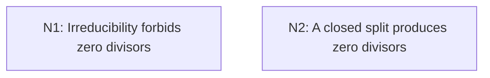

# Irreducibility, Prime Ideals, and Coordinate Domains

## An End-to-End Metacognitive Mathematics Walkthrough

**Problem ID:** AG-04  
**Version:** 1  
**Subject:** Algebraic Geometry  
**Level:** Intermediate  
**Status:** Complete authored exposition relative to the declared imports.  
**Evidence:** Mathematical argument and authored teaching traces; no actual multi-agent run, independent review, or proof-assistant certification is claimed.

## 1. Target, definitions, and import contract

Let $X\subset k^n$ be a nonempty affine algebraic set over a field $k$. With its Zariski subspace topology, $X$ is irreducible if and only if $I(X)$ is prime, equivalently the coordinate ring $k[X]=k[x_1,\ldots,x_n]/I(X)$ is an integral domain. Irreducible means not a union of two proper closed subsets. Algebraic closedness is not needed for this statement about the actual point set and its vanishing ideal.

### Permitted imports and conventions

Use $V(fg)=V(f)\cup V(g)$ over a field, the definition of the Zariski topology, and the quotient criterion: a proper ideal $P$ is prime iff $ab\in P$ implies $a\in P$ or $b\in P$. The quotient is a domain precisely when this implication holds. Relative closed sets in $X$ are $X\cap V(S)$ for collections $S$ of polynomials.

## 2. Intuition and node interaction workflow

A product vanishes at each point exactly when at least one factor does. This translates a geometric split into zero divisors in the coordinate ring.

Each mathematical node contains **Ego, Memory, Intellect, Sense, and Action**. The diagram records accepted proof dependencies. Requests to repair an argument belong only to §6; they are not backward proof edges.

### Evidence transfer ledger

| Transfer | Producer and export | Receiving activity | Exact claim and compatibility |
|---|---|---|---|
| Independent branches | No inter-node import | Each branch starts from §1 | These nodes prove separate directions of the theorem; neither uses the other as a premise. |

## 3. Node roles and five-faculty contracts

### N1/v1 — Irreducibility forbids zero divisors

**Object and inputs:** Nonempty irreducible $X$ and $fg\in I(X)$.

**Role and strategy:** Convert a vanishing product into a two-set closed cover.

**Local obligation:** If $X$ is irreducible then $I(X)$ is prime.

| Faculty | Concrete responsibility |
|---|---|
| Ego | Publish E1/v1 only with its stated domain and assumptions: If $X$ is irreducible then $I(X)$ is prime. |
| Memory | Nonempty irreducible $X$ and $fg\in I(X)$. Preserve the §1 conventions and incoming export versions. |
| Intellect | Convert a vanishing product into a two-set closed cover. |
| Sense | Nonemptiness makes $I(X)$ proper; the empty set has the unit vanishing ideal. |
| Action | Execute activities N1.1–N1.2 in §4.N1; preserve the displayed calculations as evidence. |

**Export E1/v1:** If $X$ is irreducible then $I(X)$ is prime. Evidence: the complete local derivation in §4.N1.

**Acceptance gate:** Establish the local obligation through every numbered activity below and discharge this concrete check: Nonemptiness makes $I(X)$ proper; the empty set has the unit vanishing ideal.

**Targeted repair:** If the empty set is included as irreducible, restore nonemptiness before claiming a proper prime ideal. Withhold E1 and its dependent exports until the correction has been checked; a revised export receives a new version.

### N2/v1 — A closed split produces zero divisors

**Object and inputs:** Prime $I(X)$ and a proposed decomposition $X=Y\cup Z$ into two proper relatively closed subsets.

**Role and strategy:** Choose one polynomial detecting a point outside each closed subset and multiply them.

**Local obligation:** If $I(X)$ is prime then $X$ is irreducible, and both conditions are equivalent to $k[X]$ being a domain.

| Faculty | Concrete responsibility |
|---|---|
| Ego | Publish E2/v1 only with its stated domain and assumptions: If $I(X)$ is prime then $X$ is irreducible, and both conditions are equivalent to $k[X]$ being a domain. |
| Memory | Prime $I(X)$ and a proposed decomposition $X=Y\cup Z$ into two proper relatively closed subsets. Preserve the §1 conventions and incoming export versions. |
| Intellect | Choose one polynomial detecting a point outside each closed subset and multiply them. |
| Sense | A proper closed subset has a defining equation that fails somewhere on $X$; do not assume one equation defines the whole subset. |
| Action | Execute activities N2.1–N2.2 in §4.N2; preserve the displayed calculations as evidence. |

**Export E2/v1:** If $I(X)$ is prime then $X$ is irreducible, and both conditions are equivalent to $k[X]$ being a domain. Evidence: the complete local derivation in §4.N2.

**Acceptance gate:** Establish the local obligation through every numbered activity below and discharge this concrete check: A proper closed subset has a defining equation that fails somewhere on $X$; do not assume one equation defines the whole subset.

**Targeted repair:** If a single defining equation for $Y$ is assumed without justification, select just one member of its defining family that fails at $a$. Withhold E2 and its dependent exports until the correction has been checked; a revised export receives a new version.

## 4. Continuous mathematical proof

The following activities form one continuous proof. Intermediate claims are established where used, except for the explicitly permitted imports in §1.

### §4.N1 — Irreducibility forbids zero divisors

1. **N1.1.** Nonemptiness gives $1\notin I(X)$. If $fg\in I(X)$, each point of $X$ lies in $V(f)$ or $V(g)$, because a field has no zero divisors. Hence $X=(X\cap V(f))\cup(X\cap V(g))$.

2. **N1.2.** Both pieces are closed in $X$. Irreducibility forces one to equal $X$, which says $f\in I(X)$ or $g\in I(X)$. This proves primality.

### §4.N2 — A closed split produces zero divisors

1. **N2.1.** Write $Y=X\cap V(S)$ and choose $a\in X\setminus Y$. Some $f\in S$ has $f(a)\ne0$, so $f$ vanishes on $Y$ but is not in $I(X)$. Similarly choose $g$ vanishing on $Z$ but not on all of $X$.

2. **N2.2.** The product $fg$ vanishes on $Y\cup Z=X$, so $fg\in I(X)$ while neither factor belongs to it, contradicting primality. Thus a proper split is impossible. Finally, multiplication of residue classes in $k[X]$ is zero exactly when the product of representatives lies in $I(X)$; the prime-ideal condition is exactly absence of nonzero zero divisors, with $1\ne0$.

## 5. Worked instance and boundary audit

In $\mathbb C^2$, the set $X=V(xy)$ is the union of the two coordinate axes. The classes of $x$ and $y$ are nonzero functions on $X$, but their product is zero. For the parabola $Y=V(y-x^2)$, evaluation $x\mapsto t$, $y\mapsto t^2$ identifies its coordinate ring with $\mathbb C[t]$: division by the monic polynomial $y-x^2$ leaves a remainder in $x$, which vanishes at every complex $x$ only if zero. Thus the parabola is irreducible.

### Boundary or failed-inference witness

Connectedness is weaker than irreducibility. The two complex coordinate axes meet at the origin, so their union is connected in the usual topology, yet the two proper algebraic axes split it. Algebraic irreducibility is the condition proved here.

## 6. Illustrative interaction and repair trace

**Trace status:** Authored illustration, not a logged agent execution. The rejected candidate below is outside the accepted DAG.

**Rejected N2 inference:** every proper closed subset is a hypersurface. For example the origin in $\mathbb C^2$ requires the simultaneous equations $x=y=0$ as a set of two independent coordinate restrictions. **Repair:** select one defining polynomial nonzero at a chosen outside point; the argument needs a separator, not a single equation for the entire subset. This corrects the proof mechanism without changing the target. Recheck the product witness and domain conclusion.

After the corrected argument is supplied, Ego may publish a hypothetical v2 export, Memory replaces the rejected version, and Action rechecks each descendant in §2. The accepted exposition in this file is v1; this scenario does not claim an actual revision or execution occurred.

## 7. Evidence ledger and reusable exports

| Item | Evidence and scope | Remaining limitation |
|---|---|---|
| Target theorem | §4, under exactly the §1 hypotheses and imports | Authored mathematical exposition; no independent or formal verification |
| E1–E2 | Local proofs §4.N1–§4.N2; version 1 | Imports remain attached to each reuse |
| Worked instance | Explicit computation or construction in §5 | Illustrates the mechanism; does not prove the universal theorem |
| Repair | Rejected inference, witness, and correction in §6 | Teaching scenario rather than empirical agent evidence |

**Reusable target:** Preserve `AG-04/v1`, the exact statement in §1, its assumptions, and this proof when reusing the result.

**Next direction:** Use domain coordinate rings to define function fields of irreducible affine varieties.

## 8. Sources and navigation

The proof and faculty decomposition are authored for this collection. The following primary teaching sources support further study; exact imports are specified in §1.

[J. S. Milne, Algebraic Geometry](https://www.jmilne.org/math/CourseNotes/ag.html), chapters on commutative algebra, algebraic sets, and affine varieties; [author’s mathematics site](https://www.jmilne.org/math/).

**Local imported proof modules:** None. Supporting external results are specified in §1.

[Five-project subject index](problems.md) · [Project README](../README.md) · [Graduate subject outline](../../book/outline.md)
