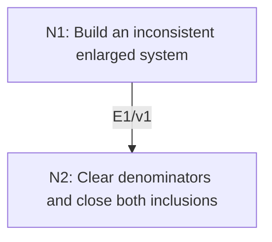

# Strong Nullstellensatz via Rabinowitsch’s Trick

## An End-to-End Metacognitive Mathematics Walkthrough

**Problem ID:** AG-03  
**Version:** 1  
**Subject:** Algebraic Geometry  
**Level:** Advanced  
**Status:** Complete authored exposition relative to the declared imports.  
**Evidence:** Mathematical argument and authored teaching traces; no actual multi-agent run, independent review, or proof-assistant certification is claimed.

## 1. Target, definitions, and import contract

For an algebraically closed field $k$, finite $n$, and any ideal $I\subset k[x_1,\ldots,x_n]$, prove $I(V(I))=\sqrt I$. Here $I(S)$ is the ideal of polynomials vanishing on $S$, and $\sqrt I=\{f:f^m\in I\text{ for some integer }m\ge1\}$.

### Permitted imports and conventions

Import AG-02 in the following exact form: a proper ideal in a finite-variable polynomial ring over algebraically closed $k$ has a common zero. Use localization at the powers of a nonzero polynomial and finite ideal-combination identities. No effective bound on the exponent is assumed or concluded.

## 2. Intuition and node interaction workflow

Turn the assertion that a polynomial never becomes nonzero on the variety into an inconsistent system by adjoining an inverse variable.

Each mathematical node contains **Ego, Memory, Intellect, Sense, and Action**. The diagram records accepted proof dependencies. Requests to repair an argument belong only to §6; they are not backward proof edges.

### Evidence transfer ledger

| Transfer | Producer and export | Receiving activity | Exact claim and compatibility |
|---|---|---|---|
| T1-2 | N1/v1 · E1/v1 | N2.1 | $1\in J$, so $1=\sum_{j=1}^s A_j(x,y)g_j(x)+B(x,y)(1-yf(x))$ for finitely many $g_j\in I$. Inputs in N2 retain the producer's assumptions; evidence: §4.N1. |

## 3. Node roles and five-faculty contracts

### N1/v1 — Build an inconsistent enlarged system

**Object and inputs:** $f\in I(V(I))$ and the ideal $J=(I,1-yf)$ in $k[x_1,\ldots,x_n,y]$.

**Role and strategy:** Combine vanishing of $f$ on the original zeros with the equation that would make it invertible.

**Local obligation:** $1\in J$, so $1=\sum_{j=1}^s A_j(x,y)g_j(x)+B(x,y)(1-yf(x))$ for finitely many $g_j\in I$.

| Faculty | Concrete responsibility |
|---|---|
| Ego | Publish E1/v1 only with its stated domain and assumptions: $1\in J$, so $1=\sum_{j=1}^s A_j(x,y)g_j(x)+B(x,y)(1-yf(x))$ for finitely many $g_j\in I$. |
| Memory | $f\in I(V(I))$ and the ideal $J=(I,1-yf)$ in $k[x_1,\ldots,x_n,y]$. Preserve the §1 conventions and incoming export versions. |
| Intellect | Combine vanishing of $f$ on the original zeros with the equation that would make it invertible. |
| Sense | The new variable $y$ is independent; the weak Nullstellensatz applies in $n+1$ variables over the same algebraically closed field. |
| Action | Execute activities N1.1–N1.2 in §4.N1; preserve the displayed calculations as evidence. |

**Export E1/v1:** $1\in J$, so $1=\sum_{j=1}^s A_j(x,y)g_j(x)+B(x,y)(1-yf(x))$ for finitely many $g_j\in I$. Evidence: the complete local derivation in §4.N1.

**Acceptance gate:** Establish the local obligation through every numbered activity below and discharge this concrete check: The new variable $y$ is independent; the weak Nullstellensatz applies in $n+1$ variables over the same algebraically closed field.

**Targeted repair:** If inconsistency is equated with the unit ideal over an arbitrary field, restore the algebraic-closure hypothesis before invoking AG-02. Withhold E1 and its dependent exports until the correction has been checked; a revised export receives a new version.

### N2/v1 — Clear denominators and close both inclusions

**Object and inputs:** E1/v1; $f\ne0$ for the localization step, with $f=0$ treated separately. Incoming proof exports: E1/v1 at N2.1.

**Role and strategy:** Substitute $y=f^{-1}$, multiply by a sufficiently large power of $f$, and prove the converse directly.

**Local obligation:** $I(V(I))=\sqrt I$.

| Faculty | Concrete responsibility |
|---|---|
| Ego | Publish E2/v1 only with its stated domain and assumptions: $I(V(I))=\sqrt I$. |
| Memory | E1/v1; $f\ne0$ for the localization step, with $f=0$ treated separately. Preserve the §1 conventions and incoming export versions. |
| Intellect | Substitute $y=f^{-1}$, multiply by a sufficiently large power of $f$, and prove the converse directly. |
| Sense | Zero cannot be inverted, and the exponent clearing all denominators must be chosen for the finite entire sum. |
| Action | Execute activities N2.1–N2.2 in §4.N2; preserve the displayed calculations as evidence. |

**Export E2/v1:** $I(V(I))=\sqrt I$. Evidence: the complete local derivation in §4.N2.

**Acceptance gate:** Establish the local obligation through every numbered activity below and discharge this concrete check: Zero cannot be inverted, and the exponent clearing all denominators must be chosen for the finite entire sum.

**Targeted repair:** If the conclusion is $f\in I$ rather than $f^m\in I$, retain the denominator-clearing exponent; discarding it loses multiplicity information. Withhold E2 and its dependent exports until the correction has been checked; a revised export receives a new version.

## 4. Continuous mathematical proof

The following activities form one continuous proof. Intermediate claims are established where used, except for the explicitly permitted imports in §1.

### §4.N1 — Build an inconsistent enlarged system

1. **N1.1.** A common zero $(a,b)$ of $J$ would satisfy $a\in V(I)$, hence $f(a)=0$, while also $1-bf(a)=0$. This would give $1=0$, so $J$ has no common zero.

2. **N1.2.** By the contrapositive of AG-02, $J$ is the whole ring. Membership of $1$ in the generated ideal means exactly a finite polynomial-combination identity of the displayed form; finite generation of all of $I$ is not required for this individual identity.

### §4.N2 — Clear denominators and close both inclusions

1. **N2.1.** If $f=0$, it is already in $\sqrt I$. Otherwise evaluate the E1 identity in $k[x_1,\ldots,x_n,1/f]$ at $y=1/f$. The last term vanishes, leaving $1=\sum_j A_j(x,1/f)g_j(x)$.

2. **N2.2.** Choose $m\ge1$ at least the largest $y$-degree of the finitely many $A_j$. Multiplication by $f^m$ yields $f^m=\sum_j h_j(x)g_j(x)$ with polynomial $h_j$, so $f\in\sqrt I$. Conversely, if $f^m\in I$ and $a\in V(I)$, then $f(a)^m=0$ in the field $k$, hence $f(a)=0$. This proves both inclusions, including $I$ equal to the unit ideal.

## 5. Worked instance and boundary audit

For $I=(x^2,y)$ in $\mathbb C[x,y]$, $V(I)=\{(0,0)\}$ and $I(V(I))=(x,y)$. The polynomial $x$ is not in $I$, but $x^2\in I$. The enlarged identity for $f=x$ is $1=(1+tx)(1-tx)+t^2x^2$, illustrating exactly how substitution $t=1/x$ recovers the square.

### Boundary or failed-inference witness

Over $\mathbb R$, $I=(x^2+1)$ has empty real zero set, so $I(V(I))=\mathbb R[x]$ while $\sqrt I=I$. Over an algebraically closed field the theorem concerns radicals, not equality with arbitrary nonradical ideals.

## 6. Illustrative interaction and repair trace

**Trace status:** Authored illustration, not a logged agent execution. The rejected candidate below is outside the accepted DAG.

**Rejected N2 export:** every polynomial vanishing on $V(I)$ belongs to $I$. The worked example $x\notin(x^2,y)$ refutes it. **Diagnosis:** Action discarded the power introduced when clearing denominators. **Repair:** export $f^m\in I$ and hence $f\in\sqrt I$. This narrows the rejected overclaim to the theorem actually stated in §1; the proof there already includes the correct exponent.

After the corrected argument is supplied, Ego may publish a hypothetical v2 export, Memory replaces the rejected version, and Action rechecks each descendant in §2. The accepted exposition in this file is v1; this scenario does not claim an actual revision or execution occurred.

## 7. Evidence ledger and reusable exports

| Item | Evidence and scope | Remaining limitation |
|---|---|---|
| Target theorem | §4, under exactly the §1 hypotheses and imports | Authored mathematical exposition; no independent or formal verification |
| E1–E2 | Local proofs §4.N1–§4.N2; version 1 | Imports remain attached to each reuse |
| Worked instance | Explicit computation or construction in §5 | Illustrates the mechanism; does not prove the universal theorem |
| Repair | Rejected inference, witness, and correction in §6 | Teaching scenario rather than empirical agent evidence |

**Reusable target:** Preserve `AG-03/v1`, the exact statement in §1, its assumptions, and this proof when reusing the result.

**Next direction:** Deduce the inclusion-reversing correspondence between affine algebraic sets and radical ideals; then compare reduced coordinate rings with nonreduced schemes.

## 8. Sources and navigation

The proof and faculty decomposition are authored for this collection. The following primary teaching sources support further study; exact imports are specified in §1.

[J. S. Milne, Algebraic Geometry](https://www.jmilne.org/math/CourseNotes/ag.html), chapters on commutative algebra, algebraic sets, and affine varieties; [author’s mathematics site](https://www.jmilne.org/math/).

**Local imported proof modules:** [AG-02 — Weak Nullstellensatz](weak-nullstellensatz.md)

[Five-project subject index](problems.md) · [Project README](../README.md) · [Graduate subject outline](../../book/outline.md)
