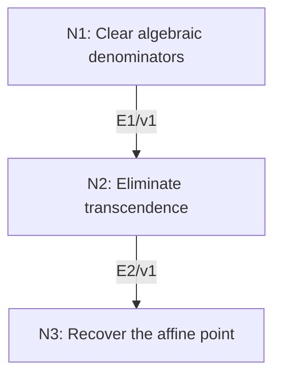

# Weak Nullstellensatz

## An End-to-End Metacognitive Mathematics Walkthrough

**Problem ID:** AG-02  
**Version:** 1  
**Subject:** Algebraic Geometry  
**Level:** Advanced  
**Status:** Complete authored exposition relative to the declared imports.  
**Evidence:** Mathematical argument and authored teaching traces; no actual multi-agent run, independent review, or proof-assistant certification is claimed.

## 1. Target, definitions, and import contract

Let $k$ be algebraically closed and $A=k[x_1,\ldots,x_n]$, with finite $n\ge0$. Every maximal ideal is $(x_1-a_1,\ldots,x_n-a_n)$ for a unique point $a\in k^n$. Consequently every proper ideal of $A$ has a common zero in $k^n$.

### Permitted imports and conventions

Use existence of maximal ideals containing proper ideals (Zorn’s lemma), finite transcendence bases chosen from a finite generating set, and elementary field algebra. Import the integrality facts: finitely many integral elements generate a finite module; every element of a finite-module algebra is integral, by the determinant trick. An element is integral over a ring if it satisfies a monic polynomial with coefficients in that ring. The finite-generation field lemma needed below is proved here, not imported as the target.

## 2. Intuition and node interaction workflow

A field that is finitely generated as a $k$-algebra cannot contain a transcendental generator: integrality would force a polynomial ring with only one denominator inverted to be a field.

Each mathematical node contains **Ego, Memory, Intellect, Sense, and Action**. The diagram records accepted proof dependencies. Requests to repair an argument belong only to §6; they are not backward proof edges.

### Evidence transfer ledger

| Transfer | Producer and export | Receiving activity | Exact claim and compatibility |
|---|---|---|---|
| T1-2 | N1/v1 · E1/v1 | N2.1 | For algebraically independent $t_1,\ldots,t_r$, there is nonzero $d\in k[t_1,\ldots,t_r]$ such that $K$ is integral over $B=k[t_1,\ldots,t_r,1/d]$. Inputs in N2 retain the producer's assumptions; evidence: §4.N1. |
| T2-3 | N2/v1 · E2/v1 | N3.1 | $r=0$, and hence $K=k$ for every finitely generated $k$-algebra that is a field. Inputs in N3 retain the producer's assumptions; evidence: §4.N2. |

## 3. Node roles and five-faculty contracts

### N1/v1 — Clear algebraic denominators

**Object and inputs:** A field $K=k[b_1,\ldots,b_m]$ over the algebraically closed field $k$.

**Role and strategy:** Separate a maximal algebraically independent subset and make the remaining generators integral after one localization.

**Local obligation:** For algebraically independent $t_1,\ldots,t_r$, there is nonzero $d\in k[t_1,\ldots,t_r]$ such that $K$ is integral over $B=k[t_1,\ldots,t_r,1/d]$.

| Faculty | Concrete responsibility |
|---|---|
| Ego | Publish E1/v1 only with its stated domain and assumptions: For algebraically independent $t_1,\ldots,t_r$, there is nonzero $d\in k[t_1,\ldots,t_r]$ such that $K$ is integral over $B=k[t_1,\ldots,t_r,1/d]$. |
| Memory | A field $K=k[b_1,\ldots,b_m]$ over the algebraically closed field $k$. Preserve the §1 conventions and incoming export versions. |
| Intellect | Separate a maximal algebraically independent subset and make the remaining generators integral after one localization. |
| Sense | Finite generation is as an algebra, not merely as a field; only finitely many denominators need to be inverted. |
| Action | Execute activities N1.1–N1.2 in §4.N1; preserve the displayed calculations as evidence. |

**Export E1/v1:** For algebraically independent $t_1,\ldots,t_r$, there is nonzero $d\in k[t_1,\ldots,t_r]$ such that $K$ is integral over $B=k[t_1,\ldots,t_r,1/d]$. Evidence: the complete local derivation in §4.N1.

**Acceptance gate:** Establish the local obligation through every numbered activity below and discharge this concrete check: Finite generation is as an algebra, not merely as a field; only finitely many denominators need to be inverted.

**Targeted repair:** If arbitrary rational coefficients are treated as polynomial coefficients, explicitly collect their finitely many denominators into $d$. Withhold E1 and its dependent exports until the correction has been checked; a revised export receives a new version.

### N2/v1 — Eliminate transcendence

**Object and inputs:** E1/v1, with $K$ a field integral over the domain $B$. Incoming proof exports: E1/v1 at N2.1.

**Role and strategy:** First force $B$ to be a field, then find a polynomial that cannot become a unit in that localization.

**Local obligation:** $r=0$, and hence $K=k$ for every finitely generated $k$-algebra that is a field.

| Faculty | Concrete responsibility |
|---|---|
| Ego | Publish E2/v1 only with its stated domain and assumptions: $r=0$, and hence $K=k$ for every finitely generated $k$-algebra that is a field. |
| Memory | E1/v1, with $K$ a field integral over the domain $B$. Preserve the §1 conventions and incoming export versions. |
| Intellect | First force $B$ to be a field, then find a polynomial that cannot become a unit in that localization. |
| Sense | The field $k$ is infinite; choose $c$ so that $t_1-c$ does not divide $d$. |
| Action | Execute activities N2.1–N2.3 in §4.N2; preserve the displayed calculations as evidence. |

**Export E2/v1:** $r=0$, and hence $K=k$ for every finitely generated $k$-algebra that is a field. Evidence: the complete local derivation in §4.N2.

**Acceptance gate:** Establish the local obligation through every numbered activity below and discharge this concrete check: The field $k$ is infinite; choose $c$ so that $t_1-c$ does not divide $d$.

**Targeted repair:** If the localization is declared a field without proof, derive inverses from monic equations; if transcendence is ignored, use the nonunit $t_1-c$ witness. Withhold E2 and its dependent exports until the correction has been checked; a revised export receives a new version.

### N3/v1 — Recover the affine point

**Object and inputs:** A maximal ideal $\mathfrak m\subset A$ and E2/v1 applied to $K=A/\mathfrak m$. Incoming proof exports: E2/v1 at N3.1.

**Role and strategy:** Identify each coordinate residue with a scalar and identify the kernel of evaluation.

**Local obligation:** Maximal ideals are exactly point ideals, and every proper ideal has a common zero.

| Faculty | Concrete responsibility |
|---|---|
| Ego | Publish E3/v1 only with its stated domain and assumptions: Maximal ideals are exactly point ideals, and every proper ideal has a common zero. |
| Memory | A maximal ideal $\mathfrak m\subset A$ and E2/v1 applied to $K=A/\mathfrak m$. Preserve the §1 conventions and incoming export versions. |
| Intellect | Identify each coordinate residue with a scalar and identify the kernel of evaluation. |
| Sense | The quotient is a field because the ideal is maximal; the scalar identification must respect the given embedding of $k$. |
| Action | Execute activities N3.1–N3.3 in §4.N3; preserve the displayed calculations as evidence. |

**Export E3/v1:** Maximal ideals are exactly point ideals, and every proper ideal has a common zero. Evidence: the complete local derivation in §4.N3.

**Acceptance gate:** Establish the local obligation through every numbered activity below and discharge this concrete check: The quotient is a field because the ideal is maximal; the scalar identification must respect the given embedding of $k$.

**Targeted repair:** If a nonmaximal ideal is treated as having a field quotient, first pass to a maximal ideal containing it. Withhold E3 and its dependent exports until the correction has been checked; a revised export receives a new version.

## 4. Continuous mathematical proof

The following activities form one continuous proof. Intermediate claims are established where used, except for the explicitly permitted imports in §1.

### §4.N1 — Clear algebraic denominators

1. **N1.1.** Choose a maximal algebraically independent subset $t_1,\ldots,t_r$ of the generators. Every remaining generator $u_j$ is algebraic over $F=k(t_1,\ldots,t_r)$: otherwise the subset could be enlarged. Each $u_j$ satisfies a monic polynomial over $F$.

2. **N1.2.** Let $d\ne0$ be the product of the finitely many polynomial denominators in these monic equations (take $d=1$ if there are none). The $u_j$ are integral over $B=k[t_1,\ldots,t_r,1/d]$. Because $K$ is a field, $1/d\in K$; because $K=k[t_1,\ldots,t_r,u_1,\ldots,u_s]$ as an algebra, $B[u_1,\ldots,u_s]=K$. The stated integrality facts now show $K$ is integral over $B$.

### §4.N2 — Eliminate transcendence

1. **N2.1.** For $0\ne b\in B$, the element $b^{-1}\in K$ is integral: $(b^{-1})^q+c_{q-1}(b^{-1})^{q-1}+\cdots+c_0=0$. Multiplying by $b^{q-1}$ expresses $b^{-1}$ as an element of $B$. Thus $B$ is a field.

2. **N2.2.** If $r\ge1$, choose $c\in k$ with $t_1-c\nmid d$. Such a $c$ exists because a nonzero polynomial has only finitely many distinct factors $t_1-c$, whereas an algebraically closed field is infinite. If $t_1-c$ were invertible in $B$, then $(t_1-c)q=d^s$ for some polynomial $q$ and integer $s\ge0$. Substituting $t_1=c$ gives a contradiction since $d(c,t_2,\ldots,t_r)\ne0$. Thus $B$ would not be a field. Therefore $r=0$.

3. **N2.3.** All generators are now algebraic over $k$, and finitely many algebraic generators give a finite algebraic extension. Algebraic closedness implies that extension is $k$ itself. This proves the required finite-generation field lemma for this base field.

### §4.N3 — Recover the affine point

1. **N3.1.** The field $A/\mathfrak m$ is generated as a $k$-algebra by the coordinate residues. E2 identifies it with $k$ as a $k$-algebra. Write the residue of $x_i$ as $a_i$. Then every $x_i-a_i\in\mathfrak m$.

2. **N3.2.** Evaluation at $a$ has kernel $(x_1-a_1,\ldots,x_n-a_n)$: repeatedly replace coordinates by their values, so $f(x)-f(a)$ is a sum of multiples of $x_i-a_i$. That point ideal is maximal, since evaluation has quotient $k$, and inclusion forces equality with $\mathfrak m$. Uniqueness follows by comparing coordinate values.

3. **N3.3.** If $I$ is proper, place it inside a maximal ideal and use its point $a$. Every polynomial in $I$ vanishes at $a$. For $n=0$, the only proper ideal of $k$ is zero, and the unique empty coordinate tuple gives the same statement.

## 5. Worked instance and boundary audit

Over $\mathbb C$, take $I=(x^2+1,y-x)$. The points $(i,i)$ and $(-i,-i)$ both annihilate $I$. A maximal ideal above $I$ can be $(x-i,y-i)$; the theorem guarantees a point for each maximal ideal, not uniqueness of the common zero of an arbitrary proper ideal.

### Boundary or failed-inference witness

Over $\mathbb R$, the ideal $(x^2+1)$ is maximal but has no real zero. Its quotient is $\mathbb C$, a proper finite algebraic extension of $\mathbb R$. This pinpoints the algebraic-closure assumption.

## 6. Illustrative interaction and repair trace

**Trace status:** Authored illustration, not a logged agent execution. The rejected candidate below is outside the accepted DAG.

**Rejected N2 claim:** a field finitely generated as a field extension must be algebraic. The field $k(t)$ is generated by $t$ as a field and is transcendental. **Diagnosis:** Memory confused field generation with algebra generation. **Repair:** use the actual quotient presentation as a finitely generated algebra in N1; it is precisely what yields $K=B[u_1,\ldots,u_s]$. No change to the theorem is needed. Recheck E1, E2, and the maximal-ideal identification.

After the corrected argument is supplied, Ego may publish a hypothetical v2 export, Memory replaces the rejected version, and Action rechecks each descendant in §2. The accepted exposition in this file is v1; this scenario does not claim an actual revision or execution occurred.

## 7. Evidence ledger and reusable exports

| Item | Evidence and scope | Remaining limitation |
|---|---|---|
| Target theorem | §4, under exactly the §1 hypotheses and imports | Authored mathematical exposition; no independent or formal verification |
| E1–E3 | Local proofs §4.N1–§4.N3; version 1 | Imports remain attached to each reuse |
| Worked instance | Explicit computation or construction in §5 | Illustrates the mechanism; does not prove the universal theorem |
| Repair | Rejected inference, witness, and correction in §6 | Teaching scenario rather than empirical agent evidence |

**Reusable target:** Preserve `AG-02/v1`, the exact statement in §1, its assumptions, and this proof when reusing the result.

**Next direction:** Use the maximal-ideal result in AG-03 to recover the full vanishing ideal by the Rabinowitsch construction.

## 8. Sources and navigation

The proof and faculty decomposition are authored for this collection. The following primary teaching sources support further study; exact imports are specified in §1.

[J. S. Milne, Algebraic Geometry](https://www.jmilne.org/math/CourseNotes/ag.html), chapters on commutative algebra, algebraic sets, and affine varieties; [author’s mathematics site](https://www.jmilne.org/math/).

**Local imported proof modules:** None. Supporting external results are specified in §1.

[Five-project subject index](problems.md) · [Project README](../README.md) · [Graduate subject outline](../../book/outline.md)
