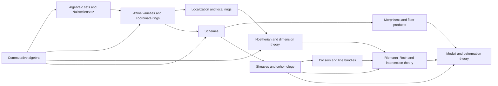

# Meta-Graph: Algebraic Geometry

> **Purpose.** This is a subject-level dependency map for planning a future theorem knowledge graph. It shows a representative route through the field; it is not a complete list of prerequisites, a formal proof dependency database, or a claim that every course follows this order.

## How to read this graph

- **Nodes** are foundational ideas, methods, structural results, or major theorems. A node may later expand into its own proof-level graph.
- An arrow `X → Y` means that X commonly supplies language, a method, a hypothesis, or a result used in understanding or proving Y. The edge table says which role it plays.
- Some edges describe a common proof route or conceptual bridge rather than a logically necessary dependency. The eventual theorem graph should record the exact theorem, hypotheses, source, and proof step for every strict dependency.
- The graph is a DAG at this global overview level. Feedback and revision belong inside proof workflows; they should not be mistaken for a theorem depending on itself.

## Global subject map

## Node register

| ID | Idea, theorem, or method | Role in the subject |
|---|---|---|
| A | Commutative algebra | Develop rings, ideals, localization, and modules |
| B | Algebraic sets and Nullstellensatz | Translate polynomial equations into ideals |
| C | Affine varieties and coordinate rings | Encode geometry algebraically |
| D | Localization and local rings | Study geometry near a point |
| E | Noetherian and dimension theory | Measure finiteness and geometric dimension |
| F | Schemes | Glue affine spectra into a flexible geometric language |
| G | Morphisms and fiber products | Express maps and parameterized constructions |
| H | Sheaves and cohomology | Track local-to-global algebraic data |
| I | Divisors and line bundles | Encode codimension-one geometry and invertible sheaves |
| J | Riemann–Roch and intersection theory | Extract numerical consequences of geometric data |
| K | Moduli and deformation theory | Organize families and infinitesimal variation |

## Dependency register

| From → To | Connection type | How the earlier node supports the later node |
|---|---|---|
| A → B (Commutative algebra → Algebraic sets and Nullstellensatz) | Common mathematical dependency | Ideals encode polynomial constraints. |
| B → C (Algebraic sets and Nullstellensatz → Affine varieties and coordinate rings) | Common mathematical dependency | Coordinate rings recover affine geometry. |
| A → C (Commutative algebra → Affine varieties and coordinate rings) | Common mathematical dependency | Ring-geometry correspondence uses algebraic structure. |
| C → D (Affine varieties and coordinate rings → Localization and local rings) | Common mathematical dependency | Localization zooms in on points. |
| A → E (Commutative algebra → Noetherian and dimension theory) | Common mathematical dependency | Noetherian algebra controls chains and dimension. |
| D → E (Localization and local rings → Noetherian and dimension theory) | Common mathematical dependency | Local rings measure local dimension. |
| C → F (Affine varieties and coordinate rings → Schemes) | Common mathematical dependency | Affine schemes generalize affine varieties. |
| A → F (Commutative algebra → Schemes) | Common mathematical dependency | Prime spectra and localization build schemes. |
| F → G (Schemes → Morphisms and fiber products) | Common mathematical dependency | Scheme morphisms and fiber products organize maps. |
| F → H (Schemes → Sheaves and cohomology) | Common mathematical dependency | Sheaves globalize local algebraic data. |
| H → I (Sheaves and cohomology → Divisors and line bundles) | Common mathematical dependency | Invertible sheaves and divisors enter geometric classification. |
| E → J (Noetherian and dimension theory → Riemann–Roch and intersection theory) | Common mathematical dependency | Dimension and intersection multiplicities underpin intersection theory. |
| I → J (Divisors and line bundles → Riemann–Roch and intersection theory) | Common mathematical dependency | Line bundles feed Riemann–Roch formulas. |
| H → J (Sheaves and cohomology → Riemann–Roch and intersection theory) | Common mathematical dependency | Cohomology measures global sections and obstructions. |
| G → K (Morphisms and fiber products → Moduli and deformation theory) | Common mathematical dependency | Families are encoded by moduli functors. |
| H → K (Sheaves and cohomology → Moduli and deformation theory) | Common mathematical dependency | Deformations are controlled by cohomology. |
| J → K (Riemann–Roch and intersection theory → Moduli and deformation theory) | Common mathematical dependency | Numerical invariants help organize moduli spaces. |

## Suggested reading paths

**Core route:** follow the nodes from foundational language toward the central structural theorems, then continue to the advanced endpoint. For a first pass, read the graph left to right and pause at each node to state its hypotheses and output.

**Theorem-focused route:** choose a major theorem node, trace incoming arrows backward to identify imported results, then trace outgoing arrows to see what the theorem enables. Mark which incoming edges are strict dependencies after consulting a proof-level source.

**Bridge route:** follow cross-links between methods and neighboring theories. Treat these as transfer routes: identify exactly what is preserved, what hypotheses are added, and what changes under translation.

## Five-component expansion for each theorem node

When a node is selected for a complete Meta-Math walkthrough, preserve the node ID and expand it into a local five-component proof graph:

| Component | Local responsibility |
|---|---|
| **Contract** | State the precise theorem goal, scope, and proof contract; distinguish the claim from nearby stronger or weaker claims. |
| **Knowledge** | Retrieve definitions, hypotheses, lemmas, source references, and known examples/counterexamples required by this node. |
| **Strategy** | Select and order proof steps; justify each inference and expose dependency on incoming nodes. |
| **Validation** | Check type/notation consistency, hypothesis use, boundary cases, examples, and whether each intermediate claim is actually supported. |
| **Execution** | Execute proof steps, calculations, constructions, or formal checks; emit the verified result and update outgoing dependencies. |

A later graph version should connect global theorem nodes to these local component nodes, with typed edges such as `uses`, `specializes`, `generalizes`, `contradicts`, `analogy-only`, and `verified-by`.

## Expansion record

For each node promoted from this map, add a stable theorem or concept ID, exact statement, source and page/section, prerequisite IDs, proof-step graph, explicit hypothesis checks, known failure modes, examples, and verification status. Keep conjectural or analogy-only links visually distinct from proved dependencies.

**Related syllabus:** [`outline.md`](book-outline.md).
