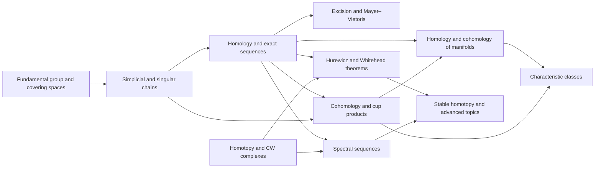

# Meta-Graph: Algebraic Topology

> **Purpose.** This is a subject-level dependency map for planning a future theorem knowledge graph. It shows a representative route through the field; it is not a complete list of prerequisites, a formal proof dependency database, or a claim that every course follows this order.

## How to read this graph

- **Nodes** are foundational ideas, methods, structural results, or major theorems. A node may later expand into its own proof-level graph.
- An arrow `X → Y` means that X commonly supplies language, a method, a hypothesis, or a result used in understanding or proving Y. The edge table says which role it plays.
- Some edges describe a common proof route or conceptual bridge rather than a logically necessary dependency. The eventual theorem graph should record the exact theorem, hypotheses, source, and proof step for every strict dependency.
- The graph is a DAG at this global overview level. Feedback and revision belong inside proof workflows; they should not be mistaken for a theorem depending on itself.

## Global subject map

## Node register

| ID | Idea, theorem, or method | Role in the subject |
|---|---|---|
| A | Fundamental group and covering spaces | Capture loops and lift paths |
| B | Simplicial and singular chains | Linearize spaces into chain complexes |
| C | Homology and exact sequences | Measure cycles modulo boundaries and organize maps |
| D | Excision and Mayer–Vietoris | Compute invariants by decomposing spaces |
| E | Cohomology and cup products | Add dual invariants and multiplicative structure |
| F | Homotopy and CW complexes | Build spaces by cells and study homotopy equivalence |
| G | Hurewicz and Whitehead theorems | Relate homotopy groups to homology and detect equivalences |
| H | Homology and cohomology of manifolds | Use duality and orientation |
| I | Spectral sequences | Compute filtered or assembled invariants in stages |
| J | Characteristic classes | Detect vector-bundle and manifold structure |
| K | Stable homotopy and advanced topics | Extend invariants beyond ordinary homology |

## Dependency register

| From → To | Connection type | How the earlier node supports the later node |
|---|---|---|
| A → B (Fundamental group and covering spaces → Simplicial and singular chains) | Common mathematical dependency | Loops and paths are captured by chains and coverings. |
| B → C (Simplicial and singular chains → Homology and exact sequences) | Common mathematical dependency | Cycles modulo boundaries define homology. |
| C → D (Homology and exact sequences → Excision and Mayer–Vietoris) | Common mathematical dependency | Chain exactness supports excision computations. |
| B → E (Simplicial and singular chains → Cohomology and cup products) | Common mathematical dependency | Cochains dualize chains. |
| C → E (Homology and exact sequences → Cohomology and cup products) | Common mathematical dependency | Cohomology adds a product structure. |
| F → G (Homotopy and CW complexes → Hurewicz and Whitehead theorems) | Common mathematical dependency | Cellular approximation and connectivity enter comparison theorems. |
| C → G (Homology and exact sequences → Hurewicz and Whitehead theorems) | Common mathematical dependency | Hurewicz relates homotopy to homology. |
| E → H (Cohomology and cup products → Homology and cohomology of manifolds) | Common mathematical dependency | Cup products and orientation support manifold invariants. |
| C → H (Homology and exact sequences → Homology and cohomology of manifolds) | Common mathematical dependency | Homology underlies duality. |
| F → I (Homotopy and CW complexes → Spectral sequences) | Common mathematical dependency | Filtrations of cell structures yield spectral sequences. |
| C → I (Homology and exact sequences → Spectral sequences) | Common mathematical dependency | Filtered chain complexes compute homology in stages. |
| E → J (Cohomology and cup products → Characteristic classes) | Common mathematical dependency | Characteristic classes live in cohomology. |
| H → J (Homology and cohomology of manifolds → Characteristic classes) | Common mathematical dependency | Manifold geometry constrains characteristic classes. |
| I → K (Spectral sequences → Stable homotopy and advanced topics) | Common mathematical dependency | Spectral sequences extend to stable computations. |
| G → K (Hurewicz and Whitehead theorems → Stable homotopy and advanced topics) | Common mathematical dependency | Homotopy equivalence theorems feed stable theory. |

## Suggested reading paths

**Core route:** follow the nodes from foundational language toward the central structural theorems, then continue to the advanced endpoint. For a first pass, read the graph left to right and pause at each node to state its hypotheses and output.

**Theorem-focused route:** choose a major theorem node, trace incoming arrows backward to identify imported results, then trace outgoing arrows to see what the theorem enables. Mark which incoming edges are strict dependencies after consulting a proof-level source.

**Bridge route:** follow cross-links between methods and neighboring theories. Treat these as transfer routes: identify exactly what is preserved, what hypotheses are added, and what changes under translation.

## Five-faculty expansion for each theorem node

When a node is selected for a complete Meta-Math walkthrough, preserve the node ID and expand it into a local five-faculty proof graph:

| Faculty | Local responsibility |
|---|---|
| **Ego** | State the precise theorem goal, scope, and proof contract; distinguish the claim from nearby stronger or weaker claims. |
| **Memory** | Retrieve definitions, hypotheses, lemmas, source references, and known examples/counterexamples required by this node. |
| **Intellect** | Select and order proof steps; justify each inference and expose dependency on incoming nodes. |
| **Sense** | Check type/notation consistency, hypothesis use, boundary cases, examples, and whether each intermediate claim is actually supported. |
| **Action** | Execute proof steps, calculations, constructions, or formal checks; emit the verified result and update outgoing dependencies. |

A later graph version should connect global theorem nodes to these local faculty nodes, with typed edges such as `uses`, `specializes`, `generalizes`, `contradicts`, `analogy-only`, and `verified-by`.

## Expansion record

For each node promoted from this map, add a stable theorem or concept ID, exact statement, source and page/section, prerequisite IDs, proof-step graph, explicit hypothesis checks, known failure modes, examples, and verification status. Keep conjectural or analogy-only links visually distinct from proved dependencies.

**Related syllabus:** [`outline.md`](book-outline.md).
