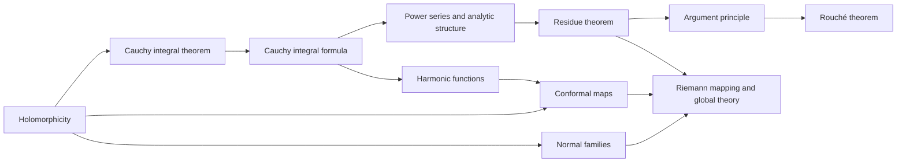

# Meta-Graph: Complex Analysis

> **Purpose.** This is a subject-level dependency map for planning a future theorem knowledge graph. It shows a representative route through the field; it is not a complete list of prerequisites, a formal proof dependency database, or a claim that every course follows this order.

## How to read this graph

- **Nodes** are foundational ideas, methods, structural results, or major theorems. A node may later expand into its own proof-level graph.
- An arrow `X → Y` means that X commonly supplies language, a method, a hypothesis, or a result used in understanding or proving Y. The edge table says which role it plays.
- Some edges describe a common proof route or conceptual bridge rather than a logically necessary dependency. The eventual theorem graph should record the exact theorem, hypotheses, source, and proof step for every strict dependency.
- The graph is a DAG at this global overview level. Feedback and revision belong inside proof workflows; they should not be mistaken for a theorem depending on itself.

## Global subject map

## Node register

| ID | Idea, theorem, or method | Role in the subject |
|---|---|---|
| A | Holomorphicity | Establish complex differentiability and the Cauchy–Riemann equations |
| B | Cauchy integral theorem | Control integrals around null-homologous contours |
| C | Cauchy integral formula | Recover interior values and derivatives from boundary data |
| D | Power series and analytic structure | Connect holomorphicity to local expansions and isolated zeros |
| E | Residue theorem | Convert contour integrals into local singularity data |
| F | Argument principle | Count zeros and poles by boundary winding |
| G | Rouché theorem | Compare zero counts under controlled perturbation |
| H | Conformal maps | Use holomorphic bijections to transfer planar geometry |
| I | Harmonic functions | Connect real potential theory to holomorphic functions |
| J | Normal families | Obtain compactness of families of holomorphic maps |
| K | Riemann mapping and global theory | Reach global mapping and classification results |

## Dependency register

| From → To | Connection type | How the earlier node supports the later node |
|---|---|---|
| A → B (Holomorphicity → Cauchy integral theorem) | Common mathematical dependency | Holomorphicity enables contour deformation. |
| B → C (Cauchy integral theorem → Cauchy integral formula) | Common mathematical dependency | Cauchy theorem yields the integral formula. |
| C → D (Cauchy integral formula → Power series and analytic structure) | Common mathematical dependency | The formula yields Taylor expansions. |
| D → E (Power series and analytic structure → Residue theorem) | Common mathematical dependency | Laurent expansions isolate singularity coefficients. |
| E → F (Residue theorem → Argument principle) | Common mathematical dependency | Residues compute logarithmic derivative integrals. |
| F → G (Argument principle → Rouché theorem) | Common mathematical dependency | Zero counts are stable under boundary perturbation. |
| A → H (Holomorphicity → Conformal maps) | Common mathematical dependency | Nonzero derivative gives local conformality. |
| C → I (Cauchy integral formula → Harmonic functions) | Common mathematical dependency | Real and imaginary parts inherit harmonicity. |
| I → H (Harmonic functions → Conformal maps) | Common mathematical dependency | Harmonic conjugates generate local conformal maps. |
| A → J (Holomorphicity → Normal families) | Common mathematical dependency | Holomorphic estimates support compactness. |
| J → K (Normal families → Riemann mapping and global theory) | Common mathematical dependency | Normal-family compactness supports global existence arguments. |
| H → K (Conformal maps → Riemann mapping and global theory) | Common mathematical dependency | Conformal equivalence leads to Riemann mapping. |
| E → K (Residue theorem → Riemann mapping and global theory) | Common mathematical dependency | Singularity classification informs global theory. |

## Suggested reading paths

**Core route:** follow the nodes from foundational language toward the central structural theorems, then continue to the advanced endpoint. For a first pass, read the graph left to right and pause at each node to state its hypotheses and output.

**Theorem-focused route:** choose a major theorem node, trace incoming arrows backward to identify imported results, then trace outgoing arrows to see what the theorem enables. Mark which incoming edges are strict dependencies after consulting a proof-level source.

**Bridge route:** follow cross-links between methods and neighboring theories. Treat these as transfer routes: identify exactly what is preserved, what hypotheses are added, and what changes under translation.

## Five-faculty expansion for each theorem node

When a node is selected for a complete Meta-Math walkthrough, preserve the node ID and expand it into a local five-faculty proof graph:

| Faculty | Local responsibility |
|---|---|
| **Ego** | State the precise theorem goal, scope, and proof contract; distinguish the claim from nearby stronger or weaker claims. |
| **Memory** | Retrieve definitions, hypotheses, lemmas, source references, and known examples/counterexamples required by this node. |
| **Intellect** | Select and order proof steps; justify each inference and expose dependency on incoming nodes. |
| **Sense** | Check type/notation consistency, hypothesis use, boundary cases, examples, and whether each intermediate claim is actually supported. |
| **Action** | Execute proof steps, calculations, constructions, or formal checks; emit the verified result and update outgoing dependencies. |

A later graph version should connect global theorem nodes to these local faculty nodes, with typed edges such as `uses`, `specializes`, `generalizes`, `contradicts`, `analogy-only`, and `verified-by`.

## Expansion record

For each node promoted from this map, add a stable theorem or concept ID, exact statement, source and page/section, prerequisite IDs, proof-step graph, explicit hypothesis checks, known failure modes, examples, and verification status. Keep conjectural or analogy-only links visually distinct from proved dependencies.

**Related syllabus:** [`outline.md`](book-outline.md).
