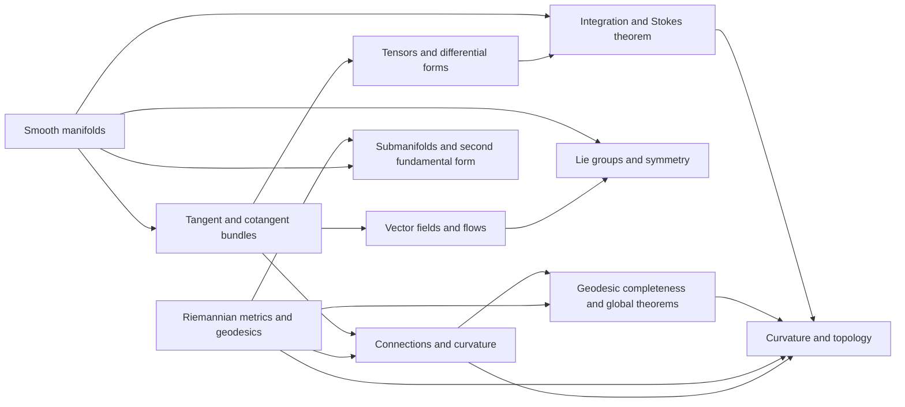

# Meta-Graph: Differential Geometry

> **Purpose.** This is a subject-level dependency map for planning a future theorem knowledge graph. It shows a representative route through the field; it is not a complete list of prerequisites, a formal proof dependency database, or a claim that every course follows this order.

## How to read this graph

- **Nodes** are foundational ideas, methods, structural results, or major theorems. A node may later expand into its own proof-level graph.
- An arrow `X → Y` means that X commonly supplies language, a method, a hypothesis, or a result used in understanding or proving Y. The edge table says which role it plays.
- Some edges describe a common proof route or conceptual bridge rather than a logically necessary dependency. The eventual theorem graph should record the exact theorem, hypotheses, source, and proof step for every strict dependency.
- The graph is a DAG at this global overview level. Feedback and revision belong inside proof workflows; they should not be mistaken for a theorem depending on itself.

## Global subject map

## Node register

| ID | Idea, theorem, or method | Role in the subject |
|---|---|---|
| A | Smooth manifolds | Define spaces locally modeled on Euclidean space |
| B | Tangent and cotangent bundles | Encode directions and covectors intrinsically |
| C | Vector fields and flows | Turn differential equations into geometric motion |
| D | Tensors and differential forms | Build coordinate-independent multilinear objects |
| E | Integration and Stokes theorem | Relate differential forms to boundary integration |
| F | Riemannian metrics and geodesics | Measure lengths and define intrinsic shortest paths |
| G | Connections and curvature | Differentiate tensor fields and quantify noncommutativity |
| H | Submanifolds and second fundamental form | Describe embedded geometry and extrinsic curvature |
| I | Lie groups and symmetry | Combine smooth structure with group operations |
| J | Geodesic completeness and global theorems | Connect local metric data to global structure |
| K | Curvature and topology | Relate curvature hypotheses to topological conclusions |

## Dependency register

| From → To | Connection type | How the earlier node supports the later node |
|---|---|---|
| A → B (Smooth manifolds → Tangent and cotangent bundles) | Common mathematical dependency | Charts define tangent and cotangent bundles. |
| B → C (Tangent and cotangent bundles → Vector fields and flows) | Common mathematical dependency | Vector fields are sections of tangent bundle. |
| B → D (Tangent and cotangent bundles → Tensors and differential forms) | Common mathematical dependency | Tensors and forms are bundle sections. |
| D → E (Tensors and differential forms → Integration and Stokes theorem) | Common mathematical dependency | Forms admit integration and exterior derivative. |
| A → E (Smooth manifolds → Integration and Stokes theorem) | Common mathematical dependency | Oriented charts define integration. |
| F → G (Riemannian metrics and geodesics → Connections and curvature) | Common mathematical dependency | Metric compatibility supports Levi-Civita connection. |
| B → G (Tangent and cotangent bundles → Connections and curvature) | Common mathematical dependency | Connections differentiate tensor fields. |
| G → K (Connections and curvature → Curvature and topology) | Common mathematical dependency | Curvature is built from connection commutators. |
| F → K (Riemannian metrics and geodesics → Curvature and topology) | Common mathematical dependency | Metric curvature yields global geometric constraints. |
| A → H (Smooth manifolds → Submanifolds and second fundamental form) | Common mathematical dependency | Immersions define submanifolds. |
| F → H (Riemannian metrics and geodesics → Submanifolds and second fundamental form) | Common mathematical dependency | Metric induces second fundamental form. |
| C → I (Vector fields and flows → Lie groups and symmetry) | Common mathematical dependency | Lie algebras are invariant vector fields with flows. |
| A → I (Smooth manifolds → Lie groups and symmetry) | Common mathematical dependency | Lie groups are smooth manifolds with compatible operations. |
| F → J (Riemannian metrics and geodesics → Geodesic completeness and global theorems) | Common mathematical dependency | Metric completeness governs geodesic extension. |
| G → J (Connections and curvature → Geodesic completeness and global theorems) | Common mathematical dependency | Curvature comparison controls global geodesics. |
| J → K (Geodesic completeness and global theorems → Curvature and topology) | Common mathematical dependency | Global theorems turn curvature into topology. |
| E → K (Integration and Stokes theorem → Curvature and topology) | Common mathematical dependency | Characteristic integrals link geometry and topology. |

## Suggested reading paths

**Core route:** follow the nodes from foundational language toward the central structural theorems, then continue to the advanced endpoint. For a first pass, read the graph left to right and pause at each node to state its hypotheses and output.

**Theorem-focused route:** choose a major theorem node, trace incoming arrows backward to identify imported results, then trace outgoing arrows to see what the theorem enables. Mark which incoming edges are strict dependencies after consulting a proof-level source.

**Bridge route:** follow cross-links between methods and neighboring theories. Treat these as transfer routes: identify exactly what is preserved, what hypotheses are added, and what changes under translation.

## Five-faculty expansion for each theorem node

When a node is selected for a complete Meta-Math walkthrough, preserve the node ID and expand it into a local five-faculty proof graph:

| Faculty | Local responsibility |
|---|---|
| **Ego** | State the precise theorem goal, scope, and proof contract; distinguish the claim from nearby stronger or weaker claims. |
| **Memory** | Retrieve definitions, hypotheses, lemmas, source references, and known examples/counterexamples required by this node. |
| **Intellect** | Select and order proof steps; justify each inference and expose dependency on incoming nodes. |
| **Sense** | Check type/notation consistency, hypothesis use, boundary cases, examples, and whether each intermediate claim is actually supported. |
| **Action** | Execute proof steps, calculations, constructions, or formal checks; emit the verified result and update outgoing dependencies. |

A later graph version should connect global theorem nodes to these local faculty nodes, with typed edges such as `uses`, `specializes`, `generalizes`, `contradicts`, `analogy-only`, and `verified-by`.

## Expansion record

For each node promoted from this map, add a stable theorem or concept ID, exact statement, source and page/section, prerequisite IDs, proof-step graph, explicit hypothesis checks, known failure modes, examples, and verification status. Keep conjectural or analogy-only links visually distinct from proved dependencies.

**Related syllabus:** [`outline.md`](book-outline.md).
