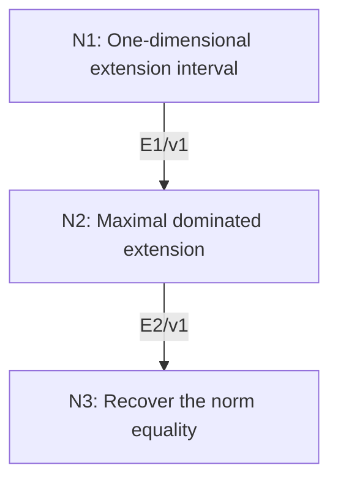

# Hahn–Banach Norm-Preserving Extension

## An End-to-End Metacognitive Mathematics Walkthrough

**Problem ID:** FA-05  
**Version:** 1  
**Subject:** Functional Analysis and Measure Theory  
**Level:** Advanced  
**Status:** Complete authored exposition relative to the declared imports.  
**Evidence:** Mathematical argument and authored teaching traces; no actual multi-agent run, independent review, or proof-assistant certification is claimed.

## 1. Target, definitions, and import contract

Let $X$ be a real normed space, $M\subset X$ any linear subspace, and $f:M\to\mathbb R$ bounded linear. There exists bounded linear $F:X\to\mathbb R$ with $F|_M=f$ and $\|F\|=\|f\|$. Neither completeness of $X$ nor closedness of $M$ is assumed.

### Permitted imports and conventions

Work in set theory with Zorn’s lemma: a nonempty partially ordered set in which every chain has an upper bound has a maximal element. Let $C=\|f\|$ and $p(x)=C\|x\|$, a finite-valued sublinear function: $p(x+y)\le p(x)+p(y)$ and $p(tx)=tp(x)$ for $t\ge0$. Use completeness of the real order to select a number between a bounded supremum and infimum.

## 2. Intuition and node interaction workflow

The key finite step extends a dominated functional by one direction. A chain-union argument then extends it to the entire space without claiming countably many directions suffice.

Each mathematical node contains **Ego, Memory, Intellect, Sense, and Action**. The diagram records accepted proof dependencies. Requests to repair an argument belong only to §6; they are not backward proof edges.

### Evidence transfer ledger

| Transfer | Producer and export | Receiving activity | Exact claim and compatibility |
|---|---|---|---|
| T1-2 | N1/v1 · E1/v1 | N2.2 | $g$ extends linearly to $D+\mathbb Rz$ while remaining dominated by $p$. Inputs in N2 retain the producer's assumptions; evidence: §4.N1. |
| T2-3 | N2/v1 · E2/v1 | N3.1 | There is a linear $F:X\to\mathbb R$ extending $f$ with $F\le p$. Inputs in N3 retain the producer's assumptions; evidence: §4.N2. |

## 3. Node roles and five-faculty contracts

### N1/v1 — One-dimensional extension interval

**Object and inputs:** A linear $g:D\to\mathbb R$ with $g\le p$ on a subspace $D$, and $z\notin D$.

**Role and strategy:** Turn domination of $g(d)+ta$ into compatible lower and upper bounds for the new value $a=G(z)$.

**Local obligation:** $g$ extends linearly to $D+\mathbb Rz$ while remaining dominated by $p$.

| Faculty | Concrete responsibility |
|---|---|
| Ego | Publish E1/v1 only with its stated domain and assumptions: $g$ extends linearly to $D+\mathbb Rz$ while remaining dominated by $p$. |
| Memory | A linear $g:D\to\mathbb R$ with $g\le p$ on a subspace $D$, and $z\notin D$. Preserve the §1 conventions and incoming export versions. |
| Intellect | Turn domination of $g(d)+ta$ into compatible lower and upper bounds for the new value $a=G(z)$. |
| Sense | Both signs of $t$ must be checked, and the choice interval must be nonempty and finite. |
| Action | Execute activities N1.1–N1.3 in §4.N1; preserve the displayed calculations as evidence. |

**Export E1/v1:** $g$ extends linearly to $D+\mathbb Rz$ while remaining dominated by $p$. Evidence: the complete local derivation in §4.N1.

**Acceptance gate:** Establish the local obligation through every numbered activity below and discharge this concrete check: Both signs of $t$ must be checked, and the choice interval must be nonempty and finite.

**Targeted repair:** If only positive scalars were considered, restore the lower endpoint $L$ and the negative-scalar calculation before extending the domain. Withhold E1 and its dependent exports until the correction has been checked; a revised export receives a new version.

### N2/v1 — Maximal dominated extension

**Object and inputs:** E1/v1 and all extensions of $f$ dominated by $p$. Incoming proof exports: E1/v1 at N2.2.

**Role and strategy:** Order compatible extensions by domain inclusion and take unions along chains.

**Local obligation:** There is a linear $F:X\to\mathbb R$ extending $f$ with $F\le p$.

| Faculty | Concrete responsibility |
|---|---|
| Ego | Publish E2/v1 only with its stated domain and assumptions: There is a linear $F:X\to\mathbb R$ extending $f$ with $F\le p$. |
| Memory | E1/v1 and all extensions of $f$ dominated by $p$. Preserve the §1 conventions and incoming export versions. |
| Intellect | Order compatible extensions by domain inclusion and take unions along chains. |
| Sense | A union is a function only because the extensions agree on overlaps; a maximal proper domain can still be extended by E1. |
| Action | Execute activities N2.1–N2.2 in §4.N2; preserve the displayed calculations as evidence. |

**Export E2/v1:** There is a linear $F:X\to\mathbb R$ extending $f$ with $F\le p$. Evidence: the complete local derivation in §4.N2.

**Acceptance gate:** Establish the local obligation through every numbered activity below and discharge this concrete check: A union is a function only because the extensions agree on overlaps; a maximal proper domain can still be extended by E1.

**Targeted repair:** If a union of incomparable extensions is used, restrict to chains before invoking Zorn; arbitrary extensions can assign conflicting values. Withhold E2 and its dependent exports until the correction has been checked; a revised export receives a new version.

### N3/v1 — Recover the norm equality

**Object and inputs:** E2/v1 and $p(x)=C\|x\|$. Incoming proof exports: E2/v1 at N3.1.

**Role and strategy:** Apply the one-sided domination to $x$ and $-x$, then compare with the restriction.

**Local obligation:** $F|_M=f$ and $\|F\|=\|f\|$.

| Faculty | Concrete responsibility |
|---|---|
| Ego | Publish E3/v1 only with its stated domain and assumptions: $F\|_M=f$ and $\VertF\Vert=\Vertf\Vert$. |
| Memory | E2/v1 and $p(x)=C\Vertx\Vert$. Preserve the §1 conventions and incoming export versions. |
| Intellect | Apply the one-sided domination to $x$ and $-x$, then compare with the restriction. |
| Sense | One-sided domination alone must be converted to an absolute bound; the zero-functional case is included. |
| Action | Execute activities N3.1–N3.2 in §4.N3; preserve the displayed calculations as evidence. |

**Export E3/v1:** $F|_M=f$ and $\|F\|=\|f\|$. Evidence: the complete local derivation in §4.N3.

**Acceptance gate:** Establish the local obligation through every numbered activity below and discharge this concrete check: One-sided domination alone must be converted to an absolute bound; the zero-functional case is included.

**Targeted repair:** If the norm conclusion is inferred directly from $F\le p$, add the $-x$ bound and the restriction inequality. Withhold E3 and its dependent exports until the correction has been checked; a revised export receives a new version.

## 4. Continuous mathematical proof

The following activities form one continuous proof. Intermediate claims are established where used, except for the explicitly permitted imports in §1.

### §4.N1 — One-dimensional extension interval

1. **N1.1.** For $u,v\in D$, linearity and domination give $g(u)+g(v)=g(u+v)\le p(u+v)\le p(u-z)+p(v+z)$. Therefore $g(u)-p(u-z)\le p(v+z)-g(v)$. Set $L=\sup_u[g(u)-p(u-z)]$ and $U=\inf_v[p(v+z)-g(v)]$. The preceding inequality gives $L\le U$; choosing $u=0$ and $v=0$ bounds both endpoints between finite numbers.

2. **N1.2.** Choose $a\in[L,U]$ and define $G(d+tz)=g(d)+ta$. The representation is unique because $z\notin D$, so $G$ is well defined and linear. For $t>0$, $a\le p(d/t+z)-g(d/t)$ implies $G(d+tz)\le p(d+tz)$.

3. **N1.3.** For $t=-s<0$, $a\ge g(d/s)-p(d/s-z)$ gives $g(d)-sa\le s p(d/s-z)=p(d-sz)$. The case $t=0$ uses $g\le p$. Thus domination holds for every real scalar.

### §4.N2 — Maximal dominated extension

1. **N2.1.** The set of pairs $(D,g)$ with $M\subset D\subset X$, $g|_M=f$, and $g\le p$ is nonempty. Order it by extension. For a chain, the union of its domains is a subspace: any two vectors and their values occur together in one chain member. The union map is consequently well defined, linear, and dominated by $p$.

2. **N2.2.** This union is an upper bound, so Zorn supplies a maximal pair $(D,g)$. If $D\ne X$, choose $z\in X\setminus D$ and apply E1, contradicting maximality. Thus $D=X$; denote the resulting map by $F$.

### §4.N3 — Recover the norm equality

1. **N3.1.** For every $x$, $F(x)\le C\|x\|$ and $-F(x)=F(-x)\le C\|x\|$. Hence $|F(x)|\le C\|x\|$, so $F$ is bounded and $\|F\|\le C$.

2. **N3.2.** Restricting $F$ to the unit ball of $M$ gives $\|f\|\le\|F\|$. Since $C=\|f\|$, equality follows. If $C=0$, this argument yields $F=0$ and still applies.

## 5. Worked instance and boundary audit

In $\mathbb R^2$ with the Euclidean norm, take $M=\{(t,t)\}$ and $f(t,t)=2t$. The norm on $M$ is $\sqrt2$. The extension $F(x,y)=x+y$ has norm $\sqrt2$ and restricts correctly. This is a concrete certificate; the general construction does not promise a unique extension.

### Boundary or failed-inference witness

Uniqueness is false. In $\mathbb R^2$ with the $\ell^1$ norm, let $M$ be the first coordinate axis and $f(x,0)=x$. Every $F_a(x,y)=x+ay$ with $|a|\le1$ extends $f$ and has norm one.

## 6. Illustrative interaction and repair trace

**Trace status:** Authored illustration, not a logged agent execution. The rejected candidate below is outside the accepted DAG.

**Rejected N1 candidate:** choose any $a$ below the upper bound and ignore the lower bound. For $X=\mathbb R$, $D=\{0\}$, $p(t)=|t|$, choosing $a=-2$ satisfies $a\le1$ but fails domination at $-1$, where $G(-1)=2>1$. **Repair:** require $a\in[-1,1]$, the actual two-sided interval. This corrects the extension argument under the same theorem. Recheck the maximal-extension and norm exports.

After the corrected argument is supplied, Ego may publish a hypothetical v2 export, Memory replaces the rejected version, and Action rechecks each descendant in §2. The accepted exposition in this file is v1; this scenario does not claim an actual revision or execution occurred.

## 7. Evidence ledger and reusable exports

| Item | Evidence and scope | Remaining limitation |
|---|---|---|
| Target theorem | §4, under exactly the §1 hypotheses and imports | Authored mathematical exposition; no independent or formal verification |
| E1–E3 | Local proofs §4.N1–§4.N3; version 1 | Imports remain attached to each reuse |
| Worked instance | Explicit computation or construction in §5 | Illustrates the mechanism; does not prove the universal theorem |
| Repair | Rejected inference, witness, and correction in §6 | Teaching scenario rather than empirical agent evidence |

**Reusable target:** Preserve `FA-05/v1`, the exact statement in §1, its assumptions, and this proof when reusing the result.

**Next direction:** Deduce that every nonzero vector has a norming continuous linear functional by first defining it on its one-dimensional span.

## 8. Sources and navigation

The proof and faculty decomposition are authored for this collection. The following primary teaching sources support further study; exact imports are specified in §1.

[MIT OpenCourseWare, Introduction to Functional Analysis: lecture notes](https://ocw.mit.edu/courses/18-102-introduction-to-functional-analysis-spring-2021/resources/lecture-notes/). See the lectures on integration, Hilbert spaces, Baire category, and Hahn–Banach.

**Local imported proof modules:** None. Supporting external results are specified in §1.

[Five-project subject index](problems.md) · [Project README](../README.md) · [Graduate subject outline](../../book/outline.md)
