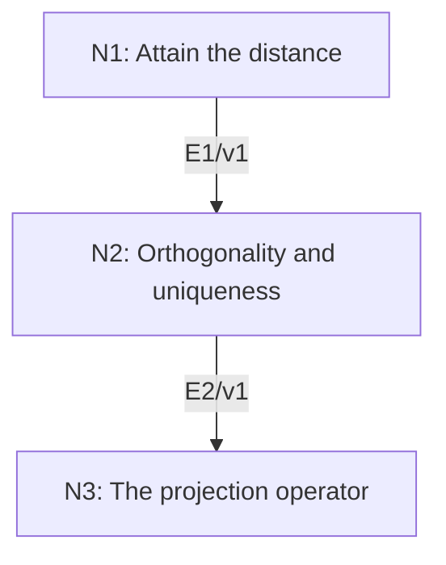

# Hilbert Projection Theorem

## An End-to-End Metacognitive Mathematics Walkthrough

**Problem ID:** FA-02  
**Version:** 1  
**Subject:** Functional Analysis and Measure Theory  
**Level:** Intermediate  
**Status:** Complete authored exposition relative to the declared imports.  
**Evidence:** Mathematical argument and authored teaching traces; no actual multi-agent run, independent review, or proof-assistant certification is claimed.

## 1. Target, definitions, and import contract

Let $H$ be a real or complex Hilbert space and $M\subset H$ a closed linear subspace. For each $x\in H$ there exists a unique $m\in M$ minimizing $\|x-m\|$. Moreover $x-m\perp M$, and the map $P_Mx=m$ is linear with $\|P_Mx\|\le\|x\|$. Inner products are linear in the first variable.

### Permitted imports and conventions

Use completeness of $H$, the parallelogram identity, Cauchy–Schwarz, and the polarization rules for a complex inner product. A closed subspace contains limits of its convergent sequences. The infimum property supplies a sequence approaching a finite infimum.

## 2. Intuition and node interaction workflow

A minimizing sequence need not converge merely because its distances converge. The parallelogram identity converts near-minimality into the missing Cauchy estimate.

Each mathematical node contains **Ego, Memory, Intellect, Sense, and Action**. The diagram records accepted proof dependencies. Requests to repair an argument belong only to §6; they are not backward proof edges.

### Evidence transfer ledger

| Transfer | Producer and export | Receiving activity | Exact claim and compatibility |
|---|---|---|---|
| T1-2 | N1/v1 · E1/v1 | N2.1 | There is $m\in M$ with $\Vertx-m\Vert=d$. Inputs in N2 retain the producer's assumptions; evidence: §4.N1. |
| T2-3 | N2/v1 · E2/v1 | N3.1 | $x-m\perp M$, and this condition characterizes the unique minimizer. Inputs in N3 retain the producer's assumptions; evidence: §4.N2. |

## 3. Node roles and five-faculty contracts

### N1/v1 — Attain the distance

**Object and inputs:** $d=\inf_{m\in M}\|x-m\|$ and a sequence $m_n\in M$ with $\|x-m_n\|\to d$.

**Role and strategy:** Use the midpoint in the subspace to control differences of two minimizing terms.

**Local obligation:** There is $m\in M$ with $\|x-m\|=d$.

| Faculty | Concrete responsibility |
|---|---|
| Ego | Publish E1/v1 only with its stated domain and assumptions: There is $m\in M$ with $\Vertx-m\Vert=d$. |
| Memory | $d=\inf_{m\in M}\Vertx-m\Vert$ and a sequence $m_n\in M$ with $\Vertx-m_n\Vert\to d$. Preserve the §1 conventions and incoming export versions. |
| Intellect | Use the midpoint in the subspace to control differences of two minimizing terms. |
| Sense | The midpoint lies in $M$; completeness gives a limit in $H$ and closedness places it in $M$. |
| Action | Execute activities N1.1–N1.2 in §4.N1; preserve the displayed calculations as evidence. |

**Export E1/v1:** There is $m\in M$ with $\|x-m\|=d$. Evidence: the complete local derivation in §4.N1.

**Acceptance gate:** Establish the local obligation through every numbered activity below and discharge this concrete check: The midpoint lies in $M$; completeness gives a limit in $H$ and closedness places it in $M$.

**Targeted repair:** If the minimizing sequence is declared convergent without an estimate, insert the parallelogram bound; if $M$ is not closed, the original attainment claim needs a changed hypothesis. Withhold E1 and its dependent exports until the correction has been checked; a revised export receives a new version.

### N2/v1 — Orthogonality and uniqueness

**Object and inputs:** E1/v1, a minimizer $m$, and each $v\in M$. Incoming proof exports: E1/v1 at N2.1.

**Role and strategy:** Vary the minimizer along real and imaginary scalar multiples of $v$.

**Local obligation:** $x-m\perp M$, and this condition characterizes the unique minimizer.

| Faculty | Concrete responsibility |
|---|---|
| Ego | Publish E2/v1 only with its stated domain and assumptions: $x-m\perp M$, and this condition characterizes the unique minimizer. |
| Memory | E1/v1, a minimizer $m$, and each $v\in M$. Preserve the §1 conventions and incoming export versions. |
| Intellect | Vary the minimizer along real and imaginary scalar multiples of $v$. |
| Sense | In a complex space, real variations alone only eliminate the real part of the inner product. |
| Action | Execute activities N2.1–N2.2 in §4.N2; preserve the displayed calculations as evidence. |

**Export E2/v1:** $x-m\perp M$, and this condition characterizes the unique minimizer. Evidence: the complete local derivation in §4.N2.

**Acceptance gate:** Establish the local obligation through every numbered activity below and discharge this concrete check: In a complex space, real variations alone only eliminate the real part of the inner product.

**Targeted repair:** If only real orthogonality has been checked, add the $iv$ variation and revalidate uniqueness. Withhold E2 and its dependent exports until the correction has been checked; a revised export receives a new version.

### N3/v1 — The projection operator

**Object and inputs:** E2/v1 for every $x\in H$. Incoming proof exports: E2/v1 at N3.1.

**Role and strategy:** Apply uniqueness of the orthogonal decomposition to sums and scalar multiples.

**Local obligation:** $P_M$ is linear and contractive: $\|P_Mx\|\le\|x\|$.

| Faculty | Concrete responsibility |
|---|---|
| Ego | Publish E3/v1 only with its stated domain and assumptions: $P_M$ is linear and contractive: $\VertP_Mx\Vert\le\Vertx\Vert$. |
| Memory | E2/v1 for every $x\in H$. Preserve the §1 conventions and incoming export versions. |
| Intellect | Apply uniqueness of the orthogonal decomposition to sums and scalar multiples. |
| Sense | The argument uses that $M$ is a linear subspace, not merely a closed set. |
| Action | Execute activities N3.1–N3.2 in §4.N3; preserve the displayed calculations as evidence. |

**Export E3/v1:** $P_M$ is linear and contractive: $\|P_Mx\|\le\|x\|$. Evidence: the complete local derivation in §4.N3.

**Acceptance gate:** Establish the local obligation through every numbered activity below and discharge this concrete check: The argument uses that $M$ is a linear subspace, not merely a closed set.

**Targeted repair:** If projection onto a nonlinear closed set is claimed linear, restore the subspace contract; linearity is not part of the general convex projection theorem. Withhold E3 and its dependent exports until the correction has been checked; a revised export receives a new version.

## 4. Continuous mathematical proof

The following activities form one continuous proof. Intermediate claims are established where used, except for the explicitly permitted imports in §1.

### §4.N1 — Attain the distance

1. **N1.1.** Since $0\in M$, $0\le d\le\|x\|$. Choose $m_n$ with $\|x-m_n\|<d+1/n$. The parallelogram identity gives $\|m_n-m_k\|^2=2\|x-m_n\|^2+2\|x-m_k\|^2-4\|x-(m_n+m_k)/2\|^2$. The final squared norm is at least $d^2$.

2. **N1.2.** The resulting upper bound tends to zero as $n,k\to\infty$. Thus $(m_n)$ is Cauchy and converges in $H$ to some $m$. Closedness gives $m\in M$, and continuity of the norm gives $\|x-m\|=d$.

### §4.N2 — Orthogonality and uniqueness

1. **N2.1.** Write $r=x-m$. For real $t$, minimality implies $0\le\|r-tv\|^2-\|r\|^2=-2t\operatorname{Re}\langle r,v\rangle+t^2\|v\|^2$. Taking small positive and negative $t$ forces $\operatorname{Re}\langle r,v\rangle=0$. In the complex case repeat with $iv$ to get the imaginary part zero.

2. **N2.2.** For any $w\in M$, orthogonality gives $\|x-w\|^2=\|r\|^2+\|m-w\|^2$. Hence equality with the minimum holds only for $w=m$. Conversely an orthogonal residual gives this identity and therefore a minimizer.

### §4.N3 — The projection operator

1. **N3.1.** For $x,y\in H$ and scalars $a,b$, $aP_Mx+bP_My$ lies in $M$, while $a(x-P_Mx)+b(y-P_My)$ is orthogonal to $M$. E2 identifies this as the unique decomposition of $ax+by$, proving linearity.

2. **N3.2.** The decomposition $x=P_Mx+(x-P_Mx)$ is orthogonal, so $\|x\|^2=\|P_Mx\|^2+\|x-P_Mx\|^2$. This proves the norm bound and completes all assertions.

## 5. Worked instance and boundary audit

In $\mathbb R^3$, let $M=\{(a,b,0):a,b\in\mathbb R\}$ and $x=(2,-1,3)$. The candidate $m=(2,-1,0)$ has residual $(0,0,3)$ perpendicular to $M$. For $(a,b,0)$ the squared distance is $9+(2-a)^2+(-1-b)^2$, certifying the unique minimizer and $d=3$.

### Boundary or failed-inference witness

Let $H=\ell^2$ and $M=c_{00}$, the finitely supported sequences. For $x=(1/n)_{n\ge1}$, truncations in $M$ approach $x$, so the infimum distance is zero. It is not attained because $x\notin M$. This isolates closedness.

## 6. Illustrative interaction and repair trace

**Trace status:** Authored illustration, not a logged agent execution. The rejected candidate below is outside the accepted DAG.

**Rejected export (N1):** every subspace admits a closest point. **Sense witness:** the $c_{00}$ example above. **Memory diagnosis:** closedness was dropped when moving from a limit in $H$ to membership in $M$. **Repair:** keep the stated closed-subspace hypothesis and explicitly invoke it in N1.2. This repairs the proof of the stated theorem; extending it to all subspaces is false. N2 and N3 must consume the corrected membership export.

After the corrected argument is supplied, Ego may publish a hypothetical v2 export, Memory replaces the rejected version, and Action rechecks each descendant in §2. The accepted exposition in this file is v1; this scenario does not claim an actual revision or execution occurred.

## 7. Evidence ledger and reusable exports

| Item | Evidence and scope | Remaining limitation |
|---|---|---|
| Target theorem | §4, under exactly the §1 hypotheses and imports | Authored mathematical exposition; no independent or formal verification |
| E1–E3 | Local proofs §4.N1–§4.N3; version 1 | Imports remain attached to each reuse |
| Worked instance | Explicit computation or construction in §5 | Illustrates the mechanism; does not prove the universal theorem |
| Repair | Rejected inference, witness, and correction in §6 | Teaching scenario rather than empirical agent evidence |

**Reusable target:** Preserve `FA-02/v1`, the exact statement in §1, its assumptions, and this proof when reusing the result.

**Next direction:** Construct orthogonal decompositions and then the Hilbert-space representation of continuous linear functionals in FA-03.

## 8. Sources and navigation

The proof and faculty decomposition are authored for this collection. The following primary teaching sources support further study; exact imports are specified in §1.

[MIT OpenCourseWare, Introduction to Functional Analysis: lecture notes](https://ocw.mit.edu/courses/18-102-introduction-to-functional-analysis-spring-2021/resources/lecture-notes/). See the lectures on integration, Hilbert spaces, Baire category, and Hahn–Banach.

**Local imported proof modules:** None. Supporting external results are specified in §1.

[Five-project subject index](problems.md) · [Project README](../README.md) · [Graduate subject outline](../../book/outline.md)
