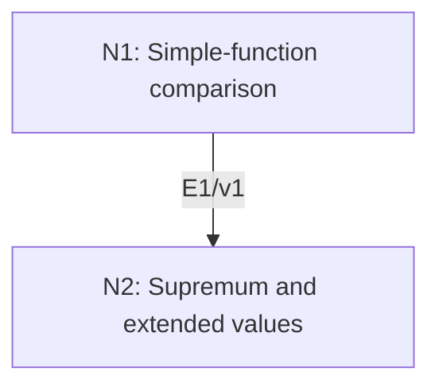

# Monotone Convergence Theorem

## An End-to-End Metacognitive Mathematics Walkthrough

**Problem ID:** FA-01  
**Version:** 1  
**Subject:** Functional Analysis and Measure Theory  
**Level:** Introductory  
**Status:** Complete authored exposition relative to the declared imports.  
**Evidence:** Mathematical argument and authored teaching traces; no actual multi-agent run, independent review, or proof-assistant certification is claimed.

## 1. Target, definitions, and import contract

On any measure space $(X,\Sigma,\mu)$, let $f_n:X\to[0,\infty]$ be measurable with $f_n\le f_{n+1}$ everywhere. For $f=\sup_n f_n$, prove $\int f\,d\mu=\lim_n\int f_n\,d\mu$, allowing $+\infty$. No finiteness or sigma-finiteness of $\mu$ is assumed.

### Permitted imports and conventions

Use countable additivity, continuity from below for measures, and the definition $\int h=\sup\{\int s:0\le s\le h,\ s\text{ finite-valued measurable simple}\}$. For disjoint measurable $A_i$ and $a_i\ge0$, $\int\sum_i a_i1_{A_i}=\sum_i a_i\mu(A_i)$, with $0\cdot\infty=0$. Continuity from below follows by decomposing an increasing union into disjoint successive differences. Integral monotonicity follows directly from the supremum definition.

## 2. Intuition and node interaction workflow

Test the limit against one simple function at a time. A factor $c<1$ makes the eventual comparison with $f_n$ valid even where the limit equals the test function.

Each mathematical node contains **Ego, Memory, Intellect, Sense, and Action**. The diagram records accepted proof dependencies. Requests to repair an argument belong only to §6; they are not backward proof edges.

### Evidence transfer ledger

| Transfer | Producer and export | Receiving activity | Exact claim and compatibility |
|---|---|---|---|
| T1-2 | N1/v1 · E1/v1 | N2.1 | For every such $s$ and $c$, $\lim_n\int f_n\ge c\int s$. Inputs in N2 retain the producer's assumptions; evidence: §4.N1. |

## 3. Node roles and five-faculty contracts

### N1/v1 — Simple-function comparison

**Object and inputs:** A fixed simple $s=\sum_{i=1}^m a_i1_{A_i}\le f$ with disjoint $A_i$, and $0<c<1$.

**Role and strategy:** Approximate the support of each positive level from below by places where $f_n$ has reached $cs$.

**Local obligation:** For every such $s$ and $c$, $\lim_n\int f_n\ge c\int s$.

| Faculty | Concrete responsibility |
|---|---|
| Ego | Publish E1/v1 only with its stated domain and assumptions: For every such $s$ and $c$, $\lim_n\int f_n\ge c\int s$. |
| Memory | A fixed simple $s=\sum_{i=1}^m a_i1_{A_i}\le f$ with disjoint $A_i$, and $0<c<1$. Preserve the §1 conventions and incoming export versions. |
| Intellect | Approximate the support of each positive level from below by places where $f_n$ has reached $cs$. |
| Sense | At a point with $s>0$, the strict margin $cs<s\le f$ is essential; do not claim eventual attainment of $s$ itself. |
| Action | Execute activities N1.1–N1.2 in §4.N1; preserve the displayed calculations as evidence. |

**Export E1/v1:** For every such $s$ and $c$, $\lim_n\int f_n\ge c\int s$. Evidence: the complete local derivation in §4.N1.

**Acceptance gate:** Establish the local obligation through every numbered activity below and discharge this concrete check: At a point with $s>0$, the strict margin $cs<s\le f$ is essential; do not claim eventual attainment of $s$ itself.

**Targeted repair:** If a candidate uses $c=1$, restore $0<c<1$ and repeat the support exhaustion before taking any limit. Withhold E1 and its dependent exports until the correction has been checked; a revised export receives a new version.

### N2/v1 — Supremum and extended values

**Object and inputs:** E1/v1 and $0\le f_n\le f$; the integral is defined by simple minorants. Incoming proof exports: E1/v1 at N2.1.

**Role and strategy:** Take the scalar limit $c\uparrow1$, then the supremum over simple functions.

**Local obligation:** $\lim_n\int f_n=\int f$ in $[0,\infty]$.

| Faculty | Concrete responsibility |
|---|---|
| Ego | Publish E2/v1 only with its stated domain and assumptions: $\lim_n\int f_n=\int f$ in $[0,\infty]$. |
| Memory | E1/v1 and $0\le f_n\le f$; the integral is defined by simple minorants. Preserve the §1 conventions and incoming export versions. |
| Intellect | Take the scalar limit $c\uparrow1$, then the supremum over simple functions. |
| Sense | Never subtract two infinite integrals; handle the extended-real comparison directly. |
| Action | Execute activities N2.1–N2.2 in §4.N2; preserve the displayed calculations as evidence. |

**Export E2/v1:** $\lim_n\int f_n=\int f$ in $[0,\infty]$. Evidence: the complete local derivation in §4.N2.

**Acceptance gate:** Establish the local obligation through every numbered activity below and discharge this concrete check: Never subtract two infinite integrals; handle the extended-real comparison directly.

**Targeted repair:** If infinity is treated as an ordinary real number, replace that manipulation with the two order inequalities just proved. Withhold E2 and its dependent exports until the correction has been checked; a revised export receives a new version.

## 4. Continuous mathematical proof

The following activities form one continuous proof. Intermediate claims are established where used, except for the explicitly permitted imports in §1.

### §4.N1 — Simple-function comparison

1. **N1.1.** The supremum of measurable functions is measurable, so $f$ is measurable. Set $B_n=\{x:f_n(x)\ge c s(x)\}$. These measurable sets increase. Every point with $s(x)>0$ lies in their union, since otherwise $f(x)\le cs(x)<s(x)$; points with $s(x)=0$ already lie in every $B_n$.

2. **N1.2.** Because $cs1_{B_n}\le f_n$, monotonicity gives $\int f_n\ge c\sum_i a_i\mu(A_i\cap B_n)$. Continuity from below gives $\mu(A_i\cap B_n)\uparrow\mu(A_i)$. The sum has finitely many nonnegative terms, so its limit is $\int s$, also when a positive term is infinite. This proves the export.

### §4.N2 — Supremum and extended values

1. **N2.1.** Put $L=\lim_n\int f_n$, which exists in $[0,\infty]$ because the integrals increase. E1 gives $L\ge c\int s$. If $\int s<\infty$, let $c\uparrow1$ to obtain $L\ge\int s$. If $\int s=\infty$, any fixed $c>0$ already gives $L=\infty$.

2. **N2.2.** Taking the supremum over all simple $s\le f$ yields $L\ge\int f$. Conversely $f_n\le f$ gives $\int f_n\le\int f$ for every $n$, so $L\le\int f$. The two comparisons prove the asserted equality without an infinity subtraction.

## 5. Worked instance and boundary audit

For Lebesgue measure on $(0,1)$, take $f_n(x)=\min(n,1/x)$. It increases to $1/x$. Splitting at $1/n$ gives $\int_0^1 f_n=1+\log n$ for $n\ge1$, hence the theorem correctly returns $\int_0^1 dx/x=\infty$. This exercises the extended-valued conclusion.

### Boundary or failed-inference witness

On $(0,1)$, $g_n=n1_{(0,1/n)}$ tends pointwise to zero but has integral one. The sequence is not increasing; pointwise convergence alone cannot replace the monotonicity hypothesis.

## 6. Illustrative interaction and repair trace

**Trace status:** Authored illustration, not a logged agent execution. The rejected candidate below is outside the accepted DAG.

**Rejected candidate (N1.1):** $s\le f$ implies eventually $s\le f_n$. Take $s=f=1$ and $f_n=1-1/(n+1)$. **Diagnosis:** Intellect lost the strict comparison margin. **Repair:** compare $cs$ for $c<1$, then use N2 to pass $c\uparrow1$. This fills the proof under the original hypotheses. Recheck E1 and E2; the target is unchanged.

After the corrected argument is supplied, Ego may publish a hypothetical v2 export, Memory replaces the rejected version, and Action rechecks each descendant in §2. The accepted exposition in this file is v1; this scenario does not claim an actual revision or execution occurred.

## 7. Evidence ledger and reusable exports

| Item | Evidence and scope | Remaining limitation |
|---|---|---|
| Target theorem | §4, under exactly the §1 hypotheses and imports | Authored mathematical exposition; no independent or formal verification |
| E1–E2 | Local proofs §4.N1–§4.N2; version 1 | Imports remain attached to each reuse |
| Worked instance | Explicit computation or construction in §5 | Illustrates the mechanism; does not prove the universal theorem |
| Repair | Rejected inference, witness, and correction in §6 | Teaching scenario rather than empirical agent evidence |

**Reusable target:** Preserve `FA-01/v1`, the exact statement in §1, its assumptions, and this proof when reusing the result.

**Next direction:** Use this export to prove Fatou’s lemma by applying it to the increasing tail infima of a nonnegative sequence.

## 8. Sources and navigation

The proof and faculty decomposition are authored for this collection. The following primary teaching sources support further study; exact imports are specified in §1.

[MIT OpenCourseWare, Introduction to Functional Analysis: lecture notes](https://ocw.mit.edu/courses/18-102-introduction-to-functional-analysis-spring-2021/resources/lecture-notes/). See the lectures on integration, Hilbert spaces, Baire category, and Hahn–Banach.

**Local imported proof modules:** None. Supporting external results are specified in §1.

[Five-project subject index](problems.md) · [Project README](../README.md) · [Graduate subject outline](../../book/outline.md)
