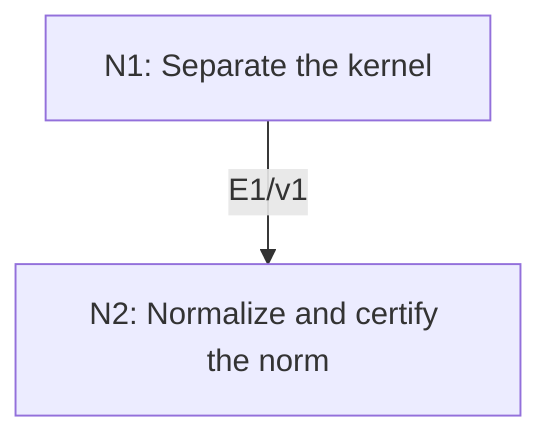

# Riesz Representation in Hilbert Spaces

## An End-to-End Metacognitive Mathematics Walkthrough

**Problem ID:** FA-03  
**Version:** 1  
**Subject:** Functional Analysis and Measure Theory  
**Level:** Intermediate  
**Status:** Complete authored exposition relative to the declared imports.  
**Evidence:** Mathematical argument and authored teaching traces; no actual multi-agent run, independent review, or proof-assistant certification is claimed.

## 1. Target, definitions, and import contract

For a real or complex Hilbert space $H$ with inner product linear in its first variable, every bounded linear functional $\ell:H\to\mathbb F$ has a unique $y\in H$ such that $\ell(x)=\langle x,y\rangle$ for all $x\in H$. Also $\|\ell\|=\|y\|$.

### Permitted imports and conventions

Import FA-02: every vector has a unique orthogonal decomposition relative to a closed linear subspace. Use Cauchy–Schwarz and continuity of bounded linear maps. The operator norm is $\|\ell\|=\sup_{\|x\|\le1}|\ell(x)|$. This is the Hilbert-space Riesz theorem, not the measure representation theorem on spaces of continuous functions.

## 2. Intuition and node interaction workflow

The kernel has an orthogonal direction that captures every value of the functional; scaling that direction gives the representing vector.

Each mathematical node contains **Ego, Memory, Intellect, Sense, and Action**. The diagram records accepted proof dependencies. Requests to repair an argument belong only to §6; they are not backward proof edges.

### Evidence transfer ledger

| Transfer | Producer and export | Receiving activity | Exact claim and compatibility |
|---|---|---|---|
| T1-2 | N1/v1 · E1/v1 | N2.1 | There is $z\in K^\perp$ with $\ell(z)\ne0$, and $x-\ell(x)z/\ell(z)\in K$ for every $x$. Inputs in N2 retain the producer's assumptions; evidence: §4.N1. |

## 3. Node roles and five-faculty contracts

### N1/v1 — Separate the kernel

**Object and inputs:** A nonzero bounded functional $\ell$; its kernel $K$.

**Role and strategy:** Project a vector outside the kernel and retain its nonzero perpendicular remainder.

**Local obligation:** There is $z\in K^\perp$ with $\ell(z)\ne0$, and $x-\ell(x)z/\ell(z)\in K$ for every $x$.

| Faculty | Concrete responsibility |
|---|---|
| Ego | Publish E1/v1 only with its stated domain and assumptions: There is $z\in K^\perp$ with $\ell(z)\ne0$, and $x-\ell(x)z/\ell(z)\in K$ for every $x$. |
| Memory | A nonzero bounded functional $\ell$; its kernel $K$. Preserve the §1 conventions and incoming export versions. |
| Intellect | Project a vector outside the kernel and retain its nonzero perpendicular remainder. |
| Sense | The remainder cannot vanish or lie in the kernel, because its functional value equals the original nonzero value. |
| Action | Execute activities N1.1–N1.2 in §4.N1; preserve the displayed calculations as evidence. |

**Export E1/v1:** There is $z\in K^\perp$ with $\ell(z)\ne0$, and $x-\ell(x)z/\ell(z)\in K$ for every $x$. Evidence: the complete local derivation in §4.N1.

**Acceptance gate:** Establish the local obligation through every numbered activity below and discharge this concrete check: The remainder cannot vanish or lie in the kernel, because its functional value equals the original nonzero value.

**Targeted repair:** If division by $\ell(z)$ occurs before nonvanishing is shown, restore the separate zero-functional case and the equality $\ell(z)=\ell(w)$. Withhold E1 and its dependent exports until the correction has been checked; a revised export receives a new version.

### N2/v1 — Normalize and certify the norm

**Object and inputs:** E1/v1; the first-variable linear convention. Incoming proof exports: E1/v1 at N2.1.

**Role and strategy:** Choose the conjugate scalar in the second argument, then test at the normalized representing vector.

**Local obligation:** A unique $y$ represents $\ell$, and $\|\ell\|=\|y\|$.

| Faculty | Concrete responsibility |
|---|---|
| Ego | Publish E2/v1 only with its stated domain and assumptions: A unique $y$ represents $\ell$, and $\Vert\ell\Vert=\Verty\Vert$. |
| Memory | E1/v1; the first-variable linear convention. Preserve the §1 conventions and incoming export versions. |
| Intellect | Choose the conjugate scalar in the second argument, then test at the normalized representing vector. |
| Sense | The scalar in the second inner-product argument is conjugated; omitting it changes the represented functional over $\mathbb C$. |
| Action | Execute activities N2.1–N2.2 in §4.N2; preserve the displayed calculations as evidence. |

**Export E2/v1:** A unique $y$ represents $\ell$, and $\|\ell\|=\|y\|$. Evidence: the complete local derivation in §4.N2.

**Acceptance gate:** Establish the local obligation through every numbered activity below and discharge this concrete check: The scalar in the second inner-product argument is conjugated; omitting it changes the represented functional over $\mathbb C$.

**Targeted repair:** If conjugation is absent, recompute the second-argument scalar and check the one-dimensional complex example before releasing the norm and representation. Withhold E2 and its dependent exports until the correction has been checked; a revised export receives a new version.

## 4. Continuous mathematical proof

The following activities form one continuous proof. Intermediate claims are established where used, except for the explicitly permitted imports in §1.

### §4.N1 — Separate the kernel

1. **N1.1.** If $\ell=0$, take $y=0$ and the representation and norm equality are immediate; uniqueness follows from testing the difference against itself as in N2. For the remaining case choose $w$ with $\ell(w)\ne0$. Continuity makes $K$ closed, so FA-02 gives $w=P_Kw+z$ with $z\perp K$.

2. **N1.2.** Linearity gives $\ell(z)=\ell(w)\ne0$. For each $x$, set $k=x-\ell(x)z/\ell(z)$. Then $\ell(k)=0$, so $k\in K$. Thus $\langle x,z\rangle=\ell(x)\|z\|^2/\ell(z)$.

### §4.N2 — Normalize and certify the norm

1. **N2.1.** Define $y=\overline{\ell(z)}z/\|z\|^2$ (drop conjugation over $\mathbb R$). Then $\langle x,y\rangle=\ell(z)\langle x,z\rangle/\|z\|^2=\ell(x)$ by E1.

2. **N2.2.** If $y_1,y_2$ represent the same functional, $\langle x,y_1-y_2\rangle=0$ for all $x$. Taking $x=y_1-y_2$ proves equality. Cauchy–Schwarz gives $\|\ell\|\le\|y\|$; if $y\ne0$, testing $x=y/\|y\|$ gives the reverse inequality. The zero case has both norms zero.

## 5. Worked instance and boundary audit

On $\mathbb C^2$ with $\langle x,y\rangle=x_1\overline{y_1}+x_2\overline{y_2}$, let $\ell(x)=x_1+2i x_2$. Its representing vector is $y=(1,-2i)$, so $\|\ell\|=\sqrt5$. The unit vector $y/\sqrt5$ attains the operator norm. This checks the conjugation convention directly.

### Boundary or failed-inference witness

Completeness matters: on $c_{00}$ with the $\ell^2$ norm, $\ell(x)=\sum_n x_n/n$ is bounded by Cauchy–Schwarz. A representing vector within $c_{00}$ would have coordinates $1/n$ by testing the standard basis, an impossibility. The completion $\ell^2$ supplies that vector.

## 6. Illustrative interaction and repair trace

**Trace status:** Authored illustration, not a logged agent execution. The rejected candidate below is outside the accepted DAG.

**Rejected N2 candidate:** $y=\ell(z)z/\|z\|^2$ under the first-variable linear convention. For $H=\mathbb C$, $\ell(x)=ix$, and $z=1$, it gives $\langle x,i\rangle=-ix$. **Diagnosis:** Memory used the wrong scalar convention. **Repair:** conjugate $\ell(z)$ as in N2.1. The statement is unchanged; recheck both the representation and its norm certificate.

After the corrected argument is supplied, Ego may publish a hypothetical v2 export, Memory replaces the rejected version, and Action rechecks each descendant in §2. The accepted exposition in this file is v1; this scenario does not claim an actual revision or execution occurred.

## 7. Evidence ledger and reusable exports

| Item | Evidence and scope | Remaining limitation |
|---|---|---|
| Target theorem | §4, under exactly the §1 hypotheses and imports | Authored mathematical exposition; no independent or formal verification |
| E1–E2 | Local proofs §4.N1–§4.N2; version 1 | Imports remain attached to each reuse |
| Worked instance | Explicit computation or construction in §5 | Illustrates the mechanism; does not prove the universal theorem |
| Repair | Rejected inference, witness, and correction in §6 | Teaching scenario rather than empirical agent evidence |

**Reusable target:** Preserve `FA-03/v1`, the exact statement in §1, its assumptions, and this proof when reusing the result.

**Next direction:** Apply the representation to bounded variational functionals, as in the weak Poisson existence project.

## 8. Sources and navigation

The proof and faculty decomposition are authored for this collection. The following primary teaching sources support further study; exact imports are specified in §1.

[MIT OpenCourseWare, Introduction to Functional Analysis: lecture notes](https://ocw.mit.edu/courses/18-102-introduction-to-functional-analysis-spring-2021/resources/lecture-notes/). See the lectures on integration, Hilbert spaces, Baire category, and Hahn–Banach.

**Local imported proof modules:** [FA-02 — Hilbert Projection Theorem](hilbert-projection-theorem.md)

[Five-project subject index](problems.md) · [Project README](../README.md) · [Graduate subject outline](../../book/outline.md)
