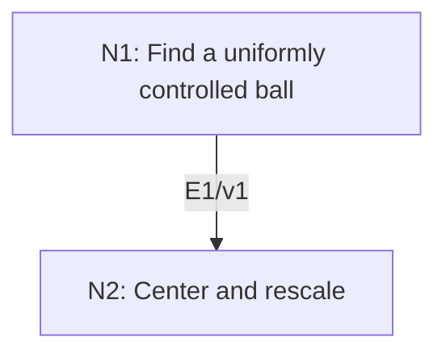

# Uniform Boundedness Principle

## An End-to-End Metacognitive Mathematics Walkthrough

**Problem ID:** FA-04  
**Version:** 1  
**Subject:** Functional Analysis and Measure Theory  
**Level:** Intermediate  
**Status:** Complete authored exposition relative to the declared imports.  
**Evidence:** Mathematical argument and authored teaching traces; no actual multi-agent run, independent review, or proof-assistant certification is claimed.

## 1. Target, definitions, and import contract

Let $X$ be a Banach space, $Y$ a normed space, and $\mathcal T$ a family of bounded linear maps $X\to Y$. If for every $x\in X$ the number $\sup_{T\in\mathcal T}\|Tx\|$ is finite, prove $\sup_{T\in\mathcal T}\|T\|<\infty$. The family need not be countable, and $Y$ need not be complete.

### Permitted imports and conventions

Import the Baire category theorem: a nonempty complete metric space cannot be a countable union of closed sets with empty interior. Use continuity of bounded operators, the triangle inequality, and the operator norm. The empty family satisfies the boundedness conclusion vacuously; treat the nonempty case below.

## 2. Intuition and node interaction workflow

Convert bounds depending on the point into one common bound on a ball, then subtract its center and rescale.

Each mathematical node contains **Ego, Memory, Intellect, Sense, and Action**. The diagram records accepted proof dependencies. Requests to repair an argument belong only to §6; they are not backward proof edges.

### Evidence transfer ledger

| Transfer | Producer and export | Receiving activity | Exact claim and compatibility |
|---|---|---|---|
| T1-2 | N1/v1 · E1/v1 | N2.1 | There are $N$, $x_0$, and $r>0$ with $B(x_0,r)\subset F_N$. Inputs in N2 retain the producer's assumptions; evidence: §4.N1. |

## 3. Node roles and five-faculty contracts

### N1/v1 — Find a uniformly controlled ball

**Object and inputs:** $F_n=\{x:\sup_{T\in\mathcal T}\|Tx\|\le n\}$ for integers $n\ge1$.

**Role and strategy:** Apply Baire to the countable collection of level sets, even when the operator family is uncountable.

**Local obligation:** There are $N$, $x_0$, and $r>0$ with $B(x_0,r)\subset F_N$.

| Faculty | Concrete responsibility |
|---|---|
| Ego | Publish E1/v1 only with its stated domain and assumptions: There are $N$, $x_0$, and $r>0$ with $B(x_0,r)\subset F_N$. |
| Memory | $F_n=\{x:\sup_{T\in\mathcal T}\VertTx\Vert\le n\}$ for integers $n\ge1$. Preserve the §1 conventions and incoming export versions. |
| Intellect | Apply Baire to the countable collection of level sets, even when the operator family is uncountable. |
| Sense | Each $F_n$ is an arbitrary intersection of closed inverse images; countability is needed for the cover by $F_n$, not for $\mathcal T$. |
| Action | Execute activities N1.1–N1.2 in §4.N1; preserve the displayed calculations as evidence. |

**Export E1/v1:** There are $N$, $x_0$, and $r>0$ with $B(x_0,r)\subset F_N$. Evidence: the complete local derivation in §4.N1.

**Acceptance gate:** Establish the local obligation through every numbered activity below and discharge this concrete check: Each $F_n$ is an arbitrary intersection of closed inverse images; countability is needed for the cover by $F_n$, not for $\mathcal T$.

**Targeted repair:** If Baire is applied to the operator index set, rebuild the countable level-set cover of the complete space $X$. Withhold E1 and its dependent exports until the correction has been checked; a revised export receives a new version.

### N2/v1 — Center and rescale

**Object and inputs:** E1/v1 and linearity of every $T$. Incoming proof exports: E1/v1 at N2.1.

**Role and strategy:** Use a difference of two points in the controlled ball to bound the unit ball.

**Local obligation:** For every $T\in\mathcal T$, $\|T\|\le4N/r$.

| Faculty | Concrete responsibility |
|---|---|
| Ego | Publish E2/v1 only with its stated domain and assumptions: For every $T\in\mathcal T$, $\VertT\Vert\le4N/r$. |
| Memory | E1/v1 and linearity of every $T$. Preserve the §1 conventions and incoming export versions. |
| Intellect | Use a difference of two points in the controlled ball to bound the unit ball. |
| Sense | The ball is not necessarily centered at zero, so its center must be subtracted before scaling. |
| Action | Execute activities N2.1–N2.2 in §4.N2; preserve the displayed calculations as evidence. |

**Export E2/v1:** For every $T\in\mathcal T$, $\|T\|\le4N/r$. Evidence: the complete local derivation in §4.N2.

**Acceptance gate:** Establish the local obligation through every numbered activity below and discharge this concrete check: The ball is not necessarily centered at zero, so its center must be subtracted before scaling.

**Targeted repair:** If a candidate rescales $x_0+h$ directly, replace it by the difference $h$ first; retain the factor two from the triangle inequality. Withhold E2 and its dependent exports until the correction has been checked; a revised export receives a new version.

## 4. Continuous mathematical proof

The following activities form one continuous proof. Intermediate claims are established where used, except for the explicitly permitted imports in §1.

### §4.N1 — Find a uniformly controlled ball

1. **N1.1.** For each $T$, the set $\{x:\|Tx\|\le n\}$ is closed by continuity, so their intersection $F_n$ is closed. Pointwise boundedness says $X=\bigcup_{n\ge1}F_n$.

2. **N1.2.** The Banach space $X$ is a nonempty complete metric space. Baire therefore gives an $F_N$ with nonempty interior, which contains some open ball $B(x_0,r)$. In particular $x_0\in F_N$.

### §4.N2 — Center and rescale

1. **N2.1.** For $\|h\|<r$, both $x_0+h$ and $x_0$ belong to $F_N$, so $\|Th\|\le\|T(x_0+h)\|+\|Tx_0\|\le2N$ for every $T$.

2. **N2.2.** For $\|u\|\le1$, choose $h=(r/2)u$. Then $\|Tu\|=(2/r)\|Th\|\le4N/r$. Taking the supremum over the unit ball and then the family proves the theorem. Completeness of $Y$ was never used.

## 5. Worked instance and boundary audit

On $\ell^2$, take $T_nx=x_n$. For each $x$, $\sup_n|x_n|\le\|x\|_2$. Testing the standard basis gives $\|T_n\|=1$, so the pointwise and uniform bounds agree. The theorem also applies when a direct formula for the common norm bound is unavailable.

### Boundary or failed-inference witness

On the incomplete normed space $c_{00}$ with the sup norm, set $T_nx=n x_n$. Each $T_n$ is bounded with norm $n$. For each finitely supported $x$, only finitely many $T_nx$ are nonzero, so pointwise boundedness holds while uniform boundedness fails.

## 6. Illustrative interaction and repair trace

**Trace status:** Authored illustration, not a logged agent execution. The rejected candidate below is outside the accepted DAG.

**Rejected generalization (N1.2):** the theorem works for every normed domain. **Sense:** $c_{00}$ and $T_nx=nx_n$ refute it. **Diagnosis:** the Baire import requires completeness. **Repair:** retain the original Banach-domain contract and apply Baire exactly there; extending the target to arbitrary normed spaces would require new assumptions. N2 may consume only the ball export proved under completeness.

After the corrected argument is supplied, Ego may publish a hypothetical v2 export, Memory replaces the rejected version, and Action rechecks each descendant in §2. The accepted exposition in this file is v1; this scenario does not claim an actual revision or execution occurred.

## 7. Evidence ledger and reusable exports

| Item | Evidence and scope | Remaining limitation |
|---|---|---|
| Target theorem | §4, under exactly the §1 hypotheses and imports | Authored mathematical exposition; no independent or formal verification |
| E1–E2 | Local proofs §4.N1–§4.N2; version 1 | Imports remain attached to each reuse |
| Worked instance | Explicit computation or construction in §5 | Illustrates the mechanism; does not prove the universal theorem |
| Repair | Rejected inference, witness, and correction in §6 | Teaching scenario rather than empirical agent evidence |

**Reusable target:** Preserve `FA-04/v1`, the exact statement in §1, its assumptions, and this proof when reusing the result.

**Next direction:** Combine this with pointwise convergence of bounded operators to control their norms; convergence in operator norm still requires additional hypotheses.

## 8. Sources and navigation

The proof and faculty decomposition are authored for this collection. The following primary teaching sources support further study; exact imports are specified in §1.

[MIT OpenCourseWare, Introduction to Functional Analysis: lecture notes](https://ocw.mit.edu/courses/18-102-introduction-to-functional-analysis-spring-2021/resources/lecture-notes/). See the lectures on integration, Hilbert spaces, Baire category, and Hahn–Banach.

**Local imported proof modules:** None. Supporting external results are specified in §1.

[Five-project subject index](problems.md) · [Project README](../README.md) · [Graduate subject outline](../../book/outline.md)
