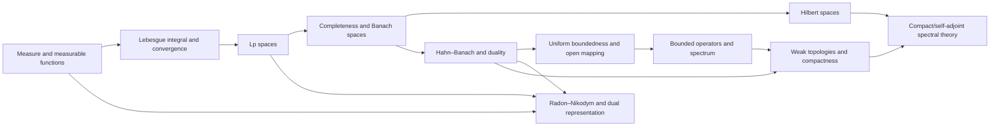

# Meta-Graph: Functional Analysis and Measure Theory

> **Purpose.** This is a subject-level dependency map for planning a future theorem knowledge graph. It shows a representative route through the field; it is not a complete list of prerequisites, a formal proof dependency database, or a claim that every course follows this order.

## How to read this graph

- **Nodes** are foundational ideas, methods, structural results, or major theorems. A node may later expand into its own proof-level graph.
- An arrow `X → Y` means that X commonly supplies language, a method, a hypothesis, or a result used in understanding or proving Y. The edge table says which role it plays.
- Some edges describe a common proof route or conceptual bridge rather than a logically necessary dependency. The eventual theorem graph should record the exact theorem, hypotheses, source, and proof step for every strict dependency.
- The graph is a DAG at this global overview level. Feedback and revision belong inside proof workflows; they should not be mistaken for a theorem depending on itself.

## Global subject map

## Node register

| ID | Idea, theorem, or method | Role in the subject |
|---|---|---|
| A | Measure and measurable functions | Construct the integration framework |
| B | Lebesgue integral and convergence | Prove monotone, Fatou, and dominated convergence theorems |
| C | Lp spaces | Build normed spaces of measurable functions and inequalities |
| D | Completeness and Banach spaces | Establish limits of Cauchy sequences in function spaces |
| E | Hilbert spaces | Add inner products, orthogonality, and projection geometry |
| F | Hahn–Banach and duality | Extend functionals and identify dual structures |
| G | Uniform boundedness and open mapping | Derive global operator bounds from pointwise or surjective data |
| H | Bounded operators and spectrum | Study linear maps through resolvents and spectral values |
| I | Radon–Nikodym and dual representation | Represent absolutely continuous measures and functionals |
| J | Weak topologies and compactness | Use duality to obtain compactness and existence |
| K | Compact/self-adjoint spectral theory | Diagonalize operators under compactness or symmetry |

## Dependency register

| From → To | Connection type | How the earlier node supports the later node |
|---|---|---|
| A → B (Measure and measurable functions → Lebesgue integral and convergence) | Common mathematical dependency | Integration theory depends on measure construction. |
| B → C (Lebesgue integral and convergence → Lp spaces) | Common mathematical dependency | Integrability defines Lp classes. |
| C → D (Lp spaces → Completeness and Banach spaces) | Common mathematical dependency | Lp completeness is a fundamental theorem. |
| D → E (Completeness and Banach spaces → Hilbert spaces) | Common mathematical dependency | Hilbert spaces are complete inner-product spaces. |
| D → F (Completeness and Banach spaces → Hahn–Banach and duality) | Common mathematical dependency | Banach structure supports extension theorems. |
| F → G (Hahn–Banach and duality → Uniform boundedness and open mapping) | Common mathematical dependency | Hahn–Banach and Baire arguments yield operator principles. |
| G → H (Uniform boundedness and open mapping → Bounded operators and spectrum) | Common mathematical dependency | Bounded operator estimates support spectral analysis. |
| A → I (Measure and measurable functions → Radon–Nikodym and dual representation) | Common mathematical dependency | Radon–Nikodym compares measures. |
| F → I (Hahn–Banach and duality → Radon–Nikodym and dual representation) | Common mathematical dependency | Duality identifies functionals as integrals. |
| H → J (Bounded operators and spectrum → Weak topologies and compactness) | Common mathematical dependency | Weak operator viewpoints organize compactness. |
| F → J (Hahn–Banach and duality → Weak topologies and compactness) | Common mathematical dependency | Duality defines weak topologies. |
| J → K (Weak topologies and compactness → Compact/self-adjoint spectral theory) | Common mathematical dependency | Compactness supports spectral extraction. |
| E → K (Hilbert spaces → Compact/self-adjoint spectral theory) | Common mathematical dependency | Self-adjointness gives orthogonal spectral structure. |
| C → I (Lp spaces → Radon–Nikodym and dual representation) | Common mathematical dependency | Lp duality invokes measure representation. |

## Suggested reading paths

**Core route:** follow the nodes from foundational language toward the central structural theorems, then continue to the advanced endpoint. For a first pass, read the graph left to right and pause at each node to state its hypotheses and output.

**Theorem-focused route:** choose a major theorem node, trace incoming arrows backward to identify imported results, then trace outgoing arrows to see what the theorem enables. Mark which incoming edges are strict dependencies after consulting a proof-level source.

**Bridge route:** follow cross-links between methods and neighboring theories. Treat these as transfer routes: identify exactly what is preserved, what hypotheses are added, and what changes under translation.

## Five-component expansion for each theorem node

When a node is selected for a complete Meta-Math walkthrough, preserve the node ID and expand it into a local five-component proof graph:

| Component | Local responsibility |
|---|---|
| **Contract** | State the precise theorem goal, scope, and proof contract; distinguish the claim from nearby stronger or weaker claims. |
| **Knowledge** | Retrieve definitions, hypotheses, lemmas, source references, and known examples/counterexamples required by this node. |
| **Strategy** | Select and order proof steps; justify each inference and expose dependency on incoming nodes. |
| **Validation** | Check type/notation consistency, hypothesis use, boundary cases, examples, and whether each intermediate claim is actually supported. |
| **Execution** | Execute proof steps, calculations, constructions, or formal checks; emit the verified result and update outgoing dependencies. |

A later graph version should connect global theorem nodes to these local component nodes, with typed edges such as `uses`, `specializes`, `generalizes`, `contradicts`, `analogy-only`, and `verified-by`.

## Expansion record

For each node promoted from this map, add a stable theorem or concept ID, exact statement, source and page/section, prerequisite IDs, proof-step graph, explicit hypothesis checks, known failure modes, examples, and verification status. Keep conjectural or analogy-only links visually distinct from proved dependencies.

**Related syllabus:** [`outline.md`](book-outline.md).
