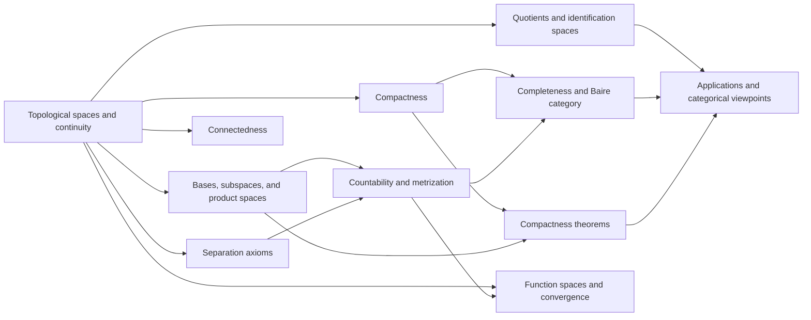

# Meta-Graph: General Topology

> **Purpose.** This is a subject-level dependency map for planning a future theorem knowledge graph. It shows a representative route through the field; it is not a complete list of prerequisites, a formal proof dependency database, or a claim that every course follows this order.

## How to read this graph

- **Nodes** are foundational ideas, methods, structural results, or major theorems. A node may later expand into its own proof-level graph.
- An arrow `X → Y` means that X commonly supplies language, a method, a hypothesis, or a result used in understanding or proving Y. The edge table says which role it plays.
- Some edges describe a common proof route or conceptual bridge rather than a logically necessary dependency. The eventual theorem graph should record the exact theorem, hypotheses, source, and proof step for every strict dependency.
- The graph is a DAG at this global overview level. Feedback and revision belong inside proof workflows; they should not be mistaken for a theorem depending on itself.

## Global subject map

## Node register

| ID | Idea, theorem, or method | Role in the subject |
|---|---|---|
| A | Topological spaces and continuity | Set the language of open sets and continuous maps |
| B | Bases, subspaces, and product spaces | Build and compare topologies |
| C | Separation axioms | Distinguish points and closed sets by neighborhoods |
| D | Compactness | Generalize finite subcover behavior |
| E | Connectedness | Capture indecomposability under separation |
| F | Countability and metrization | Relate topology to sequences and metrics |
| G | Completeness and Baire category | Derive genericity and fixed-point tools |
| H | Compactness theorems | Use Tychonoff and product arguments |
| I | Quotients and identification spaces | Construct spaces by gluing points |
| J | Function spaces and convergence | Study spaces of continuous maps |
| K | Applications and categorical viewpoints | Connect topology to analysis, geometry, and foundations |

## Dependency register

| From → To | Connection type | How the earlier node supports the later node |
|---|---|---|
| A → B (Topological spaces and continuity → Bases, subspaces, and product spaces) | Common mathematical dependency | Bases generate topologies and product constructions. |
| A → C (Topological spaces and continuity → Separation axioms) | Common mathematical dependency | Separation properties refine topology. |
| A → D (Topological spaces and continuity → Compactness) | Common mathematical dependency | Open covers define compactness. |
| A → E (Topological spaces and continuity → Connectedness) | Common mathematical dependency | Separation into disjoint opens defines connectedness. |
| B → F (Bases, subspaces, and product spaces → Countability and metrization) | Common mathematical dependency | Countable bases support metrization criteria. |
| C → F (Separation axioms → Countability and metrization) | Common mathematical dependency | Separation axioms are hypotheses in metrization. |
| D → G (Compactness → Completeness and Baire category) | Common mathematical dependency | Compactness and completeness interact in Baire settings. |
| F → G (Countability and metrization → Completeness and Baire category) | Common mathematical dependency | Complete metric spaces satisfy Baire theorem. |
| D → H (Compactness → Compactness theorems) | Common mathematical dependency | Compact factors yield compact products. |
| B → H (Bases, subspaces, and product spaces → Compactness theorems) | Common mathematical dependency | Product topologies are needed for Tychonoff. |
| A → I (Topological spaces and continuity → Quotients and identification spaces) | Common mathematical dependency | Equivalence relations induce quotient topology. |
| I → K (Quotients and identification spaces → Applications and categorical viewpoints) | Common mathematical dependency | Quotients construct manifolds and classification spaces. |
| A → J (Topological spaces and continuity → Function spaces and convergence) | Common mathematical dependency | Compact-open and related topologies on function spaces. |
| F → J (Countability and metrization → Function spaces and convergence) | Common mathematical dependency | Sequences and nets characterize function convergence. |
| G → K (Completeness and Baire category → Applications and categorical viewpoints) | Common mathematical dependency | Baire category supports analysis and genericity. |
| H → K (Compactness theorems → Applications and categorical viewpoints) | Common mathematical dependency | Product compactness underlies functional analysis. |

## Suggested reading paths

**Core route:** follow the nodes from foundational language toward the central structural theorems, then continue to the advanced endpoint. For a first pass, read the graph left to right and pause at each node to state its hypotheses and output.

**Theorem-focused route:** choose a major theorem node, trace incoming arrows backward to identify imported results, then trace outgoing arrows to see what the theorem enables. Mark which incoming edges are strict dependencies after consulting a proof-level source.

**Bridge route:** follow cross-links between methods and neighboring theories. Treat these as transfer routes: identify exactly what is preserved, what hypotheses are added, and what changes under translation.

## Five-component expansion for each theorem node

When a node is selected for a complete Meta-Math walkthrough, preserve the node ID and expand it into a local five-component proof graph:

| Component | Local responsibility |
|---|---|
| **Contract** | State the precise theorem goal, scope, and proof contract; distinguish the claim from nearby stronger or weaker claims. |
| **Knowledge** | Retrieve definitions, hypotheses, lemmas, source references, and known examples/counterexamples required by this node. |
| **Strategy** | Select and order proof steps; justify each inference and expose dependency on incoming nodes. |
| **Validation** | Check type/notation consistency, hypothesis use, boundary cases, examples, and whether each intermediate claim is actually supported. |
| **Execution** | Execute proof steps, calculations, constructions, or formal checks; emit the verified result and update outgoing dependencies. |

A later graph version should connect global theorem nodes to these local component nodes, with typed edges such as `uses`, `specializes`, `generalizes`, `contradicts`, `analogy-only`, and `verified-by`.

## Expansion record

For each node promoted from this map, add a stable theorem or concept ID, exact statement, source and page/section, prerequisite IDs, proof-step graph, explicit hypothesis checks, known failure modes, examples, and verification status. Keep conjectural or analogy-only links visually distinct from proved dependencies.

**Related syllabus:** [`outline.md`](book-outline.md).
