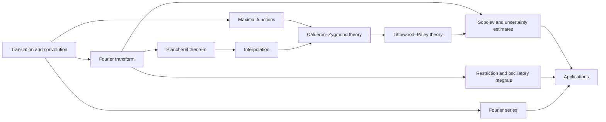

# Meta-Graph: Harmonic Analysis

> **Purpose.** This is a subject-level dependency map for planning a future theorem knowledge graph. It shows a representative route through the field; it is not a complete list of prerequisites, a formal proof dependency database, or a claim that every course follows this order.

## How to read this graph

- **Nodes** are foundational ideas, methods, structural results, or major theorems. A node may later expand into its own proof-level graph.
- An arrow `X → Y` means that X commonly supplies language, a method, a hypothesis, or a result used in understanding or proving Y. The edge table says which role it plays.
- Some edges describe a common proof route or conceptual bridge rather than a logically necessary dependency. The eventual theorem graph should record the exact theorem, hypotheses, source, and proof step for every strict dependency.
- The graph is a DAG at this global overview level. Feedback and revision belong inside proof workflows; they should not be mistaken for a theorem depending on itself.

## Global subject map

## Node register

| ID | Idea, theorem, or method | Role in the subject |
|---|---|---|
| A | Translation and convolution | Set up symmetry, averaging, and approximate identities |
| B | Fourier series | Analyze periodic functions by frequencies |
| C | Fourier transform | Transfer functions on Euclidean space to frequency space |
| D | Plancherel theorem | Extend Fourier transform isometrically on L2 |
| E | Interpolation | Transfer operator bounds between Lp spaces |
| F | Maximal functions | Control local averages and exceptional sets |
| G | Calderón–Zygmund theory | Prove singular-integral bounds through decomposition and cancellation |
| H | Sobolev and uncertainty estimates | Relate frequency localization to regularity and concentration |
| I | Restriction and oscillatory integrals | Study Fourier transforms on curved sets and phases |
| J | Littlewood–Paley theory | Decompose scales and quantify smoothness |
| K | Applications | Connect harmonic tools to PDE, ergodic theory, and number theory |

## Dependency register

| From → To | Connection type | How the earlier node supports the later node |
|---|---|---|
| A → B (Translation and convolution → Fourier series) | Common mathematical dependency | Periodic convolution is diagonalized by Fourier modes. |
| A → C (Translation and convolution → Fourier transform) | Common mathematical dependency | Translation invariance motivates Fourier transform. |
| C → D (Fourier transform → Plancherel theorem) | Common mathematical dependency | Density and Parseval extend transform to L2. |
| D → E (Plancherel theorem → Interpolation) | Common mathematical dependency | L2 bounds provide interpolation endpoints. |
| F → G (Maximal functions → Calderón–Zygmund theory) | Common mathematical dependency | Maximal estimates control singular-integral decompositions. |
| A → F (Translation and convolution → Maximal functions) | Common mathematical dependency | Averaging defines maximal operators. |
| G → J (Calderón–Zygmund theory → Littlewood–Paley theory) | Common mathematical dependency | Singular-integral bounds combine with dyadic frequency decomposition. |
| C → H (Fourier transform → Sobolev and uncertainty estimates) | Common mathematical dependency | Frequency weights characterize Sobolev regularity. |
| J → H (Littlewood–Paley theory → Sobolev and uncertainty estimates) | Common mathematical dependency | Scale decomposition yields smoothness estimates. |
| C → I (Fourier transform → Restriction and oscillatory integrals) | Common mathematical dependency | Oscillatory Fourier integrals motivate restriction estimates. |
| E → G (Interpolation → Calderón–Zygmund theory) | Common mathematical dependency | Interpolation upgrades weak and strong operator bounds. |
| H → K (Sobolev and uncertainty estimates → Applications) | Common mathematical dependency | Regularity estimates feed PDE applications. |
| I → K (Restriction and oscillatory integrals → Applications) | Common mathematical dependency | Restriction estimates inform dispersive equations. |
| B → K (Fourier series → Applications) | Common mathematical dependency | Fourier series support periodic PDE and equidistribution. |

## Suggested reading paths

**Core route:** follow the nodes from foundational language toward the central structural theorems, then continue to the advanced endpoint. For a first pass, read the graph left to right and pause at each node to state its hypotheses and output.

**Theorem-focused route:** choose a major theorem node, trace incoming arrows backward to identify imported results, then trace outgoing arrows to see what the theorem enables. Mark which incoming edges are strict dependencies after consulting a proof-level source.

**Bridge route:** follow cross-links between methods and neighboring theories. Treat these as transfer routes: identify exactly what is preserved, what hypotheses are added, and what changes under translation.

## Five-component expansion for each theorem node

When a node is selected for a complete Meta-Math walkthrough, preserve the node ID and expand it into a local five-component proof graph:

| Component | Local responsibility |
|---|---|
| **Contract** | State the precise theorem goal, scope, and proof contract; distinguish the claim from nearby stronger or weaker claims. |
| **Knowledge** | Retrieve definitions, hypotheses, lemmas, source references, and known examples/counterexamples required by this node. |
| **Strategy** | Select and order proof steps; justify each inference and expose dependency on incoming nodes. |
| **Validation** | Check type/notation consistency, hypothesis use, boundary cases, examples, and whether each intermediate claim is actually supported. |
| **Execution** | Execute proof steps, calculations, constructions, or formal checks; emit the verified result and update outgoing dependencies. |

A later graph version should connect global theorem nodes to these local component nodes, with typed edges such as `uses`, `specializes`, `generalizes`, `contradicts`, `analogy-only`, and `verified-by`.

## Expansion record

For each node promoted from this map, add a stable theorem or concept ID, exact statement, source and page/section, prerequisite IDs, proof-step graph, explicit hypothesis checks, known failure modes, examples, and verification status. Keep conjectural or analogy-only links visually distinct from proved dependencies.

**Related syllabus:** [`outline.md`](book-outline.md).
