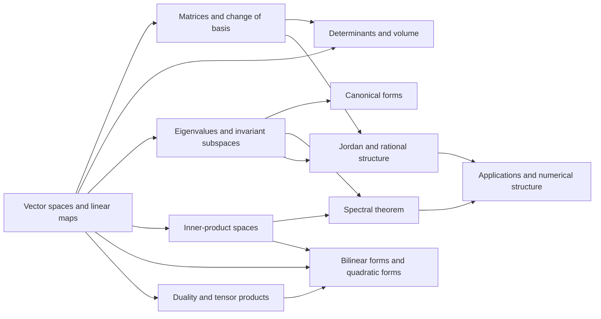

# Meta-Graph: Linear Algebra

> **Purpose.** This is a subject-level dependency map for planning a future theorem knowledge graph. It shows a representative route through the field; it is not a complete list of prerequisites, a formal proof dependency database, or a claim that every course follows this order.

## How to read this graph

- **Nodes** are foundational ideas, methods, structural results, or major theorems. A node may later expand into its own proof-level graph.
- An arrow `X → Y` means that X commonly supplies language, a method, a hypothesis, or a result used in understanding or proving Y. The edge table says which role it plays.
- Some edges describe a common proof route or conceptual bridge rather than a logically necessary dependency. The eventual theorem graph should record the exact theorem, hypotheses, source, and proof step for every strict dependency.
- The graph is a DAG at this global overview level. Feedback and revision belong inside proof workflows; they should not be mistaken for a theorem depending on itself.

## Global subject map

## Node register

| ID | Idea, theorem, or method | Role in the subject |
|---|---|---|
| A | Vector spaces and linear maps | Set the algebraic language of dimension and maps |
| B | Matrices and change of basis | Represent maps and track coordinate dependence |
| C | Determinants and volume | Measure invertibility and oriented volume scaling |
| D | Eigenvalues and invariant subspaces | Decompose maps through characteristic data |
| E | Canonical forms | Classify linear maps up to similarity |
| F | Inner-product spaces | Add geometry, orthogonality, and projections |
| G | Spectral theorem | Diagonalize normal or self-adjoint operators |
| H | Bilinear forms and quadratic forms | Classify geometric structures on vector spaces |
| I | Duality and tensor products | Build covariant constructions and multilinear maps |
| J | Jordan and rational structure | Handle operators beyond diagonalization |
| K | Applications and numerical structure | Connect theory to computation, differential equations, and optimization |

## Dependency register

| From → To | Connection type | How the earlier node supports the later node |
|---|---|---|
| A → B (Vector spaces and linear maps → Matrices and change of basis) | Common mathematical dependency | Bases give matrix representations. |
| B → C (Matrices and change of basis → Determinants and volume) | Common mathematical dependency | Determinants are coordinate invariants of matrices. |
| A → C (Vector spaces and linear maps → Determinants and volume) | Common mathematical dependency | Volume and invertibility are intrinsic map properties. |
| A → D (Vector spaces and linear maps → Eigenvalues and invariant subspaces) | Common mathematical dependency | Eigenvectors define invariant subspaces. |
| D → E (Eigenvalues and invariant subspaces → Canonical forms) | Common mathematical dependency | Eigenspace structure drives canonical forms. |
| A → F (Vector spaces and linear maps → Inner-product spaces) | Common mathematical dependency | Inner products add metric structure. |
| F → G (Inner-product spaces → Spectral theorem) | Common mathematical dependency | Orthogonality and completeness yield spectral theorem. |
| D → G (Eigenvalues and invariant subspaces → Spectral theorem) | Common mathematical dependency | Eigenstructure characterizes diagonalizable normal maps. |
| A → H (Vector spaces and linear maps → Bilinear forms and quadratic forms) | Common mathematical dependency | Bilinear maps define forms. |
| F → H (Inner-product spaces → Bilinear forms and quadratic forms) | Common mathematical dependency | Inner products are positive definite forms. |
| A → I (Vector spaces and linear maps → Duality and tensor products) | Common mathematical dependency | Dual spaces and tensor products extend linear constructions. |
| I → H (Duality and tensor products → Bilinear forms and quadratic forms) | Common mathematical dependency | Forms are tensors of type (0,2). |
| D → J (Eigenvalues and invariant subspaces → Jordan and rational structure) | Common mathematical dependency | Generalized eigenspaces build Jordan form. |
| B → J (Matrices and change of basis → Jordan and rational structure) | Common mathematical dependency | Polynomial invariants support rational canonical form. |
| G → K (Spectral theorem → Applications and numerical structure) | Common mathematical dependency | Spectral decompositions support applications. |
| J → K (Jordan and rational structure → Applications and numerical structure) | Common mathematical dependency | Canonical structure informs stable computation. |

## Suggested reading paths

**Core route:** follow the nodes from foundational language toward the central structural theorems, then continue to the advanced endpoint. For a first pass, read the graph left to right and pause at each node to state its hypotheses and output.

**Theorem-focused route:** choose a major theorem node, trace incoming arrows backward to identify imported results, then trace outgoing arrows to see what the theorem enables. Mark which incoming edges are strict dependencies after consulting a proof-level source.

**Bridge route:** follow cross-links between methods and neighboring theories. Treat these as transfer routes: identify exactly what is preserved, what hypotheses are added, and what changes under translation.

## Five-faculty expansion for each theorem node

When a node is selected for a complete Meta-Math walkthrough, preserve the node ID and expand it into a local five-faculty proof graph:

| Faculty | Local responsibility |
|---|---|
| **Ego** | State the precise theorem goal, scope, and proof contract; distinguish the claim from nearby stronger or weaker claims. |
| **Memory** | Retrieve definitions, hypotheses, lemmas, source references, and known examples/counterexamples required by this node. |
| **Intellect** | Select and order proof steps; justify each inference and expose dependency on incoming nodes. |
| **Sense** | Check type/notation consistency, hypothesis use, boundary cases, examples, and whether each intermediate claim is actually supported. |
| **Action** | Execute proof steps, calculations, constructions, or formal checks; emit the verified result and update outgoing dependencies. |

A later graph version should connect global theorem nodes to these local faculty nodes, with typed edges such as `uses`, `specializes`, `generalizes`, `contradicts`, `analogy-only`, and `verified-by`.

## Expansion record

For each node promoted from this map, add a stable theorem or concept ID, exact statement, source and page/section, prerequisite IDs, proof-step graph, explicit hypothesis checks, known failure modes, examples, and verification status. Keep conjectural or analogy-only links visually distinct from proved dependencies.

**Related syllabus:** [`outline.md`](book-outline.md).
