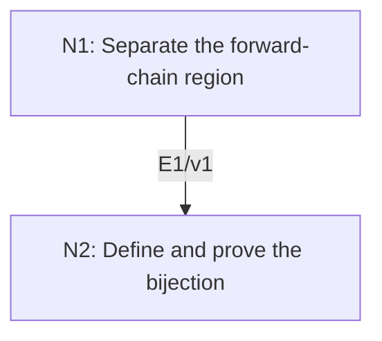

# Cantor–Schröder–Bernstein Theorem

## An End-to-End Metacognitive Mathematics Walkthrough

**Problem ID:** LF-02  
**Version:** 1  
**Subject:** Mathematical Logic and Set Theory  
**Level:** Intermediate  
**Status:** Complete authored exposition relative to the declared imports.  
**Evidence:** Mathematical argument and authored teaching traces; no actual multi-agent run, independent review, or proof-assistant certification is claimed.

## 1. Target, definitions, and import contract

If injections $f:A\to B$ and $g:B\to A$ exist, prove there is a bijection $h:A\to B$. The construction works for arbitrary sets and does not need a choice of preimages beyond the unique preimages already supplied by an injection.

### Permitted imports and conventions

Use ordinary set operations, recursion over $\mathbb N$, and injectivity. The notation $g^{-1}(a)$ below refers to the unique preimage of $a\in g(B)$; it is not defined on all of $A$. No cardinal arithmetic or axiom of choice is needed for the proof.

## 2. Intuition and node interaction workflow

Start chains at the part of $A$ not hit by $g$. Follow $g\circ f$ forward from those starts; use $f$ on that chain region and reverse $g$ everywhere else.

Each mathematical node contains **Ego, Memory, Intellect, Sense, and Action**. The diagram records accepted proof dependencies. Requests to repair an argument belong only to §6; they are not backward proof edges.

### Evidence transfer ledger

| Transfer | Producer and export | Receiving activity | Exact claim and compatibility |
|---|---|---|---|
| T1-2 | N1/v1 · E1/v1 | N2.1 | $C\cap g(B)=g(f(C))$ and $A\setminus C\subset g(B)$. Inputs in N2 retain the producer's assumptions; evidence: §4.N1. |

## 3. Node roles and five-faculty contracts

### N1/v1 — Separate the forward-chain region

**Object and inputs:** $A_0=A\setminus g(B)$, $A_{n+1}=g(f(A_n))$, and $C=\bigcup_{n\ge0}A_n$.

**Role and strategy:** Identify exactly which elements of the chain region lie in the image of $g$.

**Local obligation:** $C\cap g(B)=g(f(C))$ and $A\setminus C\subset g(B)$.

| Faculty | Concrete responsibility |
|---|---|
| Ego | Publish E1/v1 only with its stated domain and assumptions: $C\cap g(B)=g(f(C))$ and $A\setminus C\subset g(B)$. |
| Memory | $A_0=A\setminus g(B)$, $A_{n+1}=g(f(A_n))$, and $C=\bigcup_{n\ge0}A_n$. Preserve the §1 conventions and incoming export versions. |
| Intellect | Identify exactly which elements of the chain region lie in the image of $g$. |
| Sense | Every point outside $C$ is in $g(B)$ because $A_0\subset C$. |
| Action | Execute activities N1.1–N1.2 in §4.N1; preserve the displayed calculations as evidence. |

**Export E1/v1:** $C\cap g(B)=g(f(C))$ and $A\setminus C\subset g(B)$. Evidence: the complete local derivation in §4.N1.

**Acceptance gate:** Establish the local obligation through every numbered activity below and discharge this concrete check: Every point outside $C$ is in $g(B)$ because $A_0\subset C$.

**Targeted repair:** If $g^{-1}$ is used outside its image, first prove the complement inclusion; it is what makes the second branch legitimate. Withhold E1 and its dependent exports until the correction has been checked; a revised export receives a new version.

### N2/v1 — Define and prove the bijection

**Object and inputs:** E1/v1 and $h(a)=f(a)$ for $a\in C$, $h(a)=g^{-1}(a)$ for $a\notin C$. Incoming proof exports: E1/v1 at N2.1.

**Role and strategy:** Prove the two branch images are disjoint and together exhaust $B$.

**Local obligation:** The piecewise-defined $h:A\to B$ is a bijection.

| Faculty | Concrete responsibility |
|---|---|
| Ego | Publish E2/v1 only with its stated domain and assumptions: The piecewise-defined $h:A\to B$ is a bijection. |
| Memory | E1/v1 and $h(a)=f(a)$ for $a\in C$, $h(a)=g^{-1}(a)$ for $a\notin C$. Preserve the §1 conventions and incoming export versions. |
| Intellect | Prove the two branch images are disjoint and together exhaust $B$. |
| Sense | Injectivity on each branch alone does not rule out collisions across branches. |
| Action | Execute activities N2.1–N2.2 in §4.N2; preserve the displayed calculations as evidence. |

**Export E2/v1:** The piecewise-defined $h:A\to B$ is a bijection. Evidence: the complete local derivation in §4.N2.

**Acceptance gate:** Establish the local obligation through every numbered activity below and discharge this concrete check: Injectivity on each branch alone does not rule out collisions across branches.

**Targeted repair:** If surjectivity is asserted from the two original injections, explicitly split $b$ according to membership in $f(C)$ and use E1 to identify its branch. Withhold E2 and its dependent exports until the correction has been checked; a revised export receives a new version.

## 4. Continuous mathematical proof

The following activities form one continuous proof. Intermediate claims are established where used, except for the explicitly permitted imports in §1.

### §4.N1 — Separate the forward-chain region

1. **N1.1.** Every $A_n$ with $n\ge1$ lies in $g(B)$, whereas $A_0$ is disjoint from $g(B)$. Hence $C\cap g(B)=\bigcup_{n\ge1}A_n$.

2. **N1.2.** Images commute with unions, so $g(f(C))=\bigcup_{n\ge0}g(f(A_n))=\bigcup_{n\ge1}A_n$. This proves the equality. Also if $a\notin C$, it cannot belong to $A_0=A\setminus g(B)$, so it lies in $g(B)$.

### §4.N2 — Define and prove the bijection

1. **N2.1.** E1 makes $h$ well defined. Each branch is injective. If $a\in C$ and $a'\notin C$ had $f(a)=g^{-1}(a')$, then $a'=g(f(a))\in g(f(C))\subset C$, a contradiction. Thus cross-branch collisions are impossible.

2. **N2.2.** For $b\in B$, if $b\in f(C)$ it is hit by the first branch. Otherwise $g(b)\notin C$: if it were in $C\cap g(B)=g(f(C))$, injectivity of $g$ would force $b\in f(C)$. Thus $g(b)\in A\setminus C$, and the second branch maps it to $b$. This proves surjectivity and hence bijectivity.

## 5. Worked instance and boundary audit

Take $A=B=\mathbb N_0$, $f(n)=n+1$, and $g(n)=n+1$. Then $A_0=\{0\}$, $A_n=\{2n\}$, and $C$ is the set of even numbers. The constructed bijection sends even $n$ to $n+1$ and odd $n$ to $n-1$, swapping every adjacent pair. This verifies both branches and their disjoint images.

### Boundary or failed-inference witness

A piecewise choice of two injective rules can fail globally: on $\{0,1\}$, assign $0\mapsto0$ on the first singleton branch and $1\mapsto0$ on the second. Each restricted map is injective, but the combined map is not. The cross-branch argument above is therefore an essential proof obligation.

## 6. Illustrative interaction and repair trace

**Trace status:** Authored illustration, not a logged agent execution. The rejected candidate below is outside the accepted DAG.

**Rejected N2 proof:** both pieces are injective, so $h$ is injective. **Sense:** the two-singleton example isolates the missing cross-case. **Repair:** assume a cross collision and apply $g$ to derive $a'\in g(f(C))\subset C$, contradicting its branch membership. This fills the gap with no change of assumptions; recheck bijectivity after surjectivity is also established.

After the corrected argument is supplied, Ego may publish a hypothetical v2 export, Memory replaces the rejected version, and Action rechecks each descendant in §2. The accepted exposition in this file is v1; this scenario does not claim an actual revision or execution occurred.

## 7. Evidence ledger and reusable exports

| Item | Evidence and scope | Remaining limitation |
|---|---|---|
| Target theorem | §4, under exactly the §1 hypotheses and imports | Authored mathematical exposition; no independent or formal verification |
| E1–E2 | Local proofs §4.N1–§4.N2; version 1 | Imports remain attached to each reuse |
| Worked instance | Explicit computation or construction in §5 | Illustrates the mechanism; does not prove the universal theorem |
| Repair | Rejected inference, witness, and correction in §6 | Teaching scenario rather than empirical agent evidence |

**Reusable target:** Preserve `LF-02/v1`, the exact statement in §1, its assumptions, and this proof when reusing the result.

**Next direction:** Use explicit injections to compare infinite structures while retaining this construction as the justification for turning two inequalities into a bijection.

## 8. Sources and navigation

The proof and faculty decomposition are authored for this collection. The following primary teaching sources support further study; exact imports are specified in §1.

[Andrew Marks, Set Theory notes](https://math.berkeley.edu/~marks/notes/set_theory_notes_4.pdf) for sets and ultraproducts; [Berkeley, Mathematical Logic for Mathematicians, Part I](https://math.berkeley.edu/~antonio/math125A/mathlogicP1.pdf) for first-order semantics; [Andrew Marks, Computability Theory notes](https://math.berkeley.edu/~marks/notes/computability_notes_v1.pdf) for effective procedures and undecidability. The proofs below specify their own set-theoretic and semantic assumptions.

**Local imported proof modules:** None. Supporting external results are specified in §1.

[Five-project subject index](problems.md) · [Project README](../README.md) · [Graduate subject outline](../../book/outline.md)
