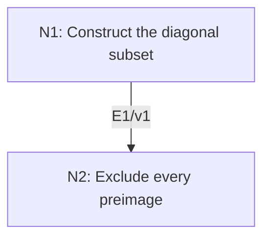

# Cantor’s Theorem and the Power-Set Hierarchy

## An End-to-End Metacognitive Mathematics Walkthrough

**Problem ID:** LF-01  
**Version:** 1  
**Subject:** Mathematical Logic and Set Theory  
**Level:** Introductory  
**Status:** Complete authored exposition relative to the declared imports.  
**Evidence:** Mathematical argument and authored teaching traces; no actual multi-agent run, independent review, or proof-assistant certification is claimed.

## 1. Target, definitions, and import contract

For every set $A$, prove there is no surjection $f:A\to\mathcal P(A)$, where $\mathcal P(A)$ is the set of all subsets of $A$. Since $a\mapsto\{a\}$ is an injection, conclude that $A$ has strictly smaller cardinality than its power set, in the sense of injection plus absence of a bijection. The diagonal argument does not require the axiom of choice.

### Permitted imports and conventions

Use the power-set and separation axioms of ordinary set theory, the definitions of injective, surjective, and bijective functions, and classical propositional logic. Separation permits forming a subset of an already given set by a formula. No unrestricted “set of all sets” comprehension is used.

## 2. Intuition and node interaction workflow

For any proposed enumeration of subsets, choose a new subset that disagrees with the assigned subset at each element’s own membership test.

Each mathematical node contains **Ego, Memory, Intellect, Sense, and Action**. The diagram records accepted proof dependencies. Requests to repair an argument belong only to §6; they are not backward proof edges.

### Evidence transfer ledger

| Transfer | Producer and export | Receiving activity | Exact claim and compatibility |
|---|---|---|---|
| T1-2 | N1/v1 · E1/v1 | N2.1 | $D=\{a\in A:a\notin f(a)\}$ is a well-defined member of $\mathcal P(A)$. Inputs in N2 retain the producer's assumptions; evidence: §4.N1. |

## 3. Node roles and five-faculty contracts

### N1/v1 — Construct the diagonal subset

**Object and inputs:** An arbitrary function $f:A\to\mathcal P(A)$.

**Role and strategy:** Use bounded separation to reverse each element’s own membership decision.

**Local obligation:** $D=\{a\in A:a\notin f(a)\}$ is a well-defined member of $\mathcal P(A)$.

| Faculty | Concrete responsibility |
|---|---|
| Ego | Publish E1/v1 only with its stated domain and assumptions: $D=\{a\in A:a\notin f(a)\}$ is a well-defined member of $\mathcal P(A)$. |
| Memory | An arbitrary function $f:A\to\mathcal P(A)$. Preserve the §1 conventions and incoming export versions. |
| Intellect | Use bounded separation to reverse each element’s own membership decision. |
| Sense | The definition produces a subset of $A$, so it belongs to the codomain; no self-containing universal set is needed. |
| Action | Execute activities N1.1–N1.2 in §4.N1; preserve the displayed calculations as evidence. |

**Export E1/v1:** $D=\{a\in A:a\notin f(a)\}$ is a well-defined member of $\mathcal P(A)$. Evidence: the complete local derivation in §4.N1.

**Acceptance gate:** Establish the local obligation through every numbered activity below and discharge this concrete check: The definition produces a subset of $A$, so it belongs to the codomain; no self-containing universal set is needed.

**Targeted repair:** If the construction is made over all sets rather than $A$, restrict it to $A$; bounded separation is the actual permitted axiom. Withhold E1 and its dependent exports until the correction has been checked; a revised export receives a new version.

### N2/v1 — Exclude every preimage

**Object and inputs:** E1/v1 and a hypothetical $b\in A$ with $f(b)=D$. Incoming proof exports: E1/v1 at N2.1.

**Role and strategy:** Specialize the membership equivalence at the alleged preimage and derive a contradiction.

**Local obligation:** No $f:A\to\mathcal P(A)$ is surjective; the singleton map establishes strict cardinal growth.

| Faculty | Concrete responsibility |
|---|---|
| Ego | Publish E2/v1 only with its stated domain and assumptions: No $f:A\to\mathcal P(A)$ is surjective; the singleton map establishes strict cardinal growth. |
| Memory | E1/v1 and a hypothetical $b\in A$ with $f(b)=D$. Preserve the §1 conventions and incoming export versions. |
| Intellect | Specialize the membership equivalence at the alleged preimage and derive a contradiction. |
| Sense | The contradiction applies to every proposed surjection, including finite and empty domains. |
| Action | Execute activities N2.1–N2.2 in §4.N2; preserve the displayed calculations as evidence. |

**Export E2/v1:** No $f:A\to\mathcal P(A)$ is surjective; the singleton map establishes strict cardinal growth. Evidence: the complete local derivation in §4.N2.

**Acceptance gate:** Establish the local obligation through every numbered activity below and discharge this concrete check: The contradiction applies to every proposed surjection, including finite and empty domains.

**Targeted repair:** If a contradiction is interpreted as showing the power set is inconsistent, identify the rejected assumption: only the proposed surjectivity fails. Withhold E2 and its dependent exports until the correction has been checked; a revised export receives a new version.

## 4. Continuous mathematical proof

The following activities form one continuous proof. Intermediate claims are established where used, except for the explicitly permitted imports in §1.

### §4.N1 — Construct the diagonal subset

1. **N1.1.** For each $a\in A$, $f(a)$ is a subset of $A$, so the membership statement $a\in f(a)$ is meaningful. By separation, the elements of $A$ for which this statement is false form a set $D\subset A$.

2. **N1.2.** The definition gives, for each $a\in A$, the exact equivalence $a\in D\iff a\notin f(a)$. In particular $D$ is in the stated codomain $\mathcal P(A)$.

### §4.N2 — Exclude every preimage

1. **N2.1.** If $f(b)=D$, the equivalence in E1 reads $b\in D\iff b\notin D$, impossible in classical logic. Thus no element of $A$ maps to $D$, and the arbitrary function $f$ is not surjective.

2. **N2.2.** The singleton map $a\mapsto\{a\}$ is injective because equal singleton sets have equal elements. A bijection would in particular be a surjection, already ruled out. This proves the claimed strict cardinal comparison. For $A=\varnothing$, $\mathcal P(A)=\{\varnothing\}$ and the same lack of surjection is immediate.

## 5. Worked instance and boundary audit

For $A=\{1,2,3\}$, consider $f(1)=\{1,2\}$, $f(2)=\{1\}$, and $f(3)=\{3\}$. The diagonal rule includes $2$ but excludes $1$ and $3$, so $D=\{2\}$. It is different from all three listed images, illustrating the exact self-index disagreement.

### Boundary or failed-inference witness

Listing all finite subsets of $\mathbb N$ is possible and does not contradict Cantor: the codomain is then only a proper part of $\mathcal P(\mathbb N)$. The diagonal subset for such a list cannot be one of its listed finite subsets. Replacing “all subsets” by “finite subsets” changes the target.

## 6. Illustrative interaction and repair trace

**Trace status:** Authored illustration, not a logged agent execution. The rejected candidate below is outside the accepted DAG.

**Rejected scope (N1):** form the set of all sets that do not contain themselves. **Diagnosis:** Memory replaced separation over $A$ by unrestricted comprehension. **Repair:** construct only $D\subset A$ using the given map; its existence is licensed by separation. Then N2 contradicts surjectivity, not the set axioms. Recheck the codomain membership and final cardinal comparison.

After the corrected argument is supplied, Ego may publish a hypothetical v2 export, Memory replaces the rejected version, and Action rechecks each descendant in §2. The accepted exposition in this file is v1; this scenario does not claim an actual revision or execution occurred.

## 7. Evidence ledger and reusable exports

| Item | Evidence and scope | Remaining limitation |
|---|---|---|
| Target theorem | §4, under exactly the §1 hypotheses and imports | Authored mathematical exposition; no independent or formal verification |
| E1–E2 | Local proofs §4.N1–§4.N2; version 1 | Imports remain attached to each reuse |
| Worked instance | Explicit computation or construction in §5 | Illustrates the mechanism; does not prove the universal theorem |
| Repair | Rejected inference, witness, and correction in §6 | Teaching scenario rather than empirical agent evidence |

**Reusable target:** Preserve `LF-01/v1`, the exact statement in §1, its assumptions, and this proof when reusing the result.

**Next direction:** Apply the construction to $A=\mathbb N$ to obtain an uncountable power set and to explain why no single list can enumerate all binary sequences.

## 8. Sources and navigation

The proof and faculty decomposition are authored for this collection. The following primary teaching sources support further study; exact imports are specified in §1.

[Andrew Marks, Set Theory notes](https://math.berkeley.edu/~marks/notes/set_theory_notes_4.pdf) for sets and ultraproducts; [Berkeley, Mathematical Logic for Mathematicians, Part I](https://math.berkeley.edu/~antonio/math125A/mathlogicP1.pdf) for first-order semantics; [Andrew Marks, Computability Theory notes](https://math.berkeley.edu/~marks/notes/computability_notes_v1.pdf) for effective procedures and undecidability. The proofs below specify their own set-theoretic and semantic assumptions.

**Local imported proof modules:** None. Supporting external results are specified in §1.

[Five-project subject index](problems.md) · [Project README](../README.md) · [Graduate subject outline](../../book/outline.md)
