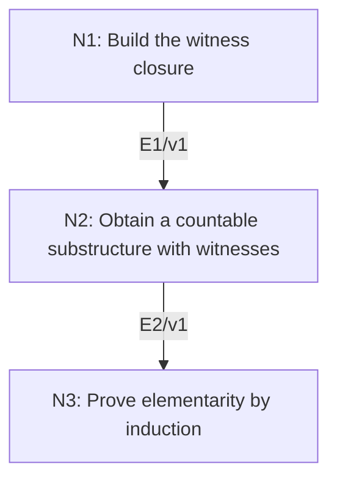

# Downward Löwenheim–Skolem for Countable Languages

## An End-to-End Metacognitive Mathematics Walkthrough

**Problem ID:** LF-04  
**Version:** 1  
**Subject:** Mathematical Logic and Set Theory  
**Level:** Advanced  
**Status:** Complete authored exposition relative to the declared imports.  
**Evidence:** Mathematical argument and authored teaching traces; no actual multi-agent run, independent review, or proof-assistant certification is claimed.

## 1. Target, definitions, and import contract

Let $L$ be a countable first-order language with finite-arity symbols, $M$ a nonempty $L$-structure, and $A\subset M$ at most countable. Prove there is an at most countable elementary substructure $N\preccurlyeq M$ containing $A$. Elementary means every first-order formula with parameters in $N$ has the same truth value in $N$ and $M$. If $M$ is infinite, $N$ can and must in this construction be countably infinite. Work in classical set theory with countable choices of witnesses.

### Permitted imports and conventions

Use countability of finite strings over a countable alphabet and of finite Cartesian powers of a countable set, and countable unions of countable sets. Interpret functions and relations of a substructure by restriction. The existential witness criterion for elementarity is proved here by formula induction; it is not imported as an unchecked theorem.

## 2. Intuition and node interaction workflow

Close a countable seed not only under functions, but also under witnesses for every existential statement with existing parameters. Repeat countably many times so newly added parameters receive their witnesses too.

Each mathematical node contains **Ego, Memory, Intellect, Sense, and Action**. The diagram records accepted proof dependencies. Requests to repair an argument belong only to §6; they are not backward proof edges.

### Evidence transfer ledger

| Transfer | Producer and export | Receiving activity | Exact claim and compatibility |
|---|---|---|---|
| T1-2 | N1/v1 · E1/v1 | N2.1 | There are increasing countable sets $B_n$ such that $B_{n+1}$ contains all function values on $B_n$ and witnesses for all true existential formulas with parameters in $B_n$. Inputs in N2 retain the producer's assumptions; evidence: §4.N1. |
| T2-3 | N2/v1 · E2/v1 | N3.1 | The restricted structure $N$ on $B$ is countable, contains $A$, and every existential formula true in $M$ with parameters in $N$ has a witness in $N$. Inputs in N3 retain the producer's assumptions; evidence: §4.N2. |

## 3. Node roles and five-faculty contracts

### N1/v1 — Build the witness closure

**Object and inputs:** A countable seed $B_0\supset A$ containing one element of $M$, and all formulas and language symbols.

**Role and strategy:** At each stage add function values and one witness for each true existential formula over the current parameter set.

**Local obligation:** There are increasing countable sets $B_n$ such that $B_{n+1}$ contains all function values on $B_n$ and witnesses for all true existential formulas with parameters in $B_n$.

| Faculty | Concrete responsibility |
|---|---|
| Ego | Publish E1/v1 only with its stated domain and assumptions: There are increasing countable sets $B_n$ such that $B_{n+1}$ contains all function values on $B_n$ and witnesses for all true existential formulas with parameters in $B_n$. |
| Memory | A countable seed $B_0\supset A$ containing one element of $M$, and all formulas and language symbols. Preserve the §1 conventions and incoming export versions. |
| Intellect | At each stage add function values and one witness for each true existential formula over the current parameter set. |
| Sense | Each stage makes only countably many requests; parameters added later require new stages. |
| Action | Execute activities N1.1–N1.2 in §4.N1; preserve the displayed calculations as evidence. |

**Export E1/v1:** There are increasing countable sets $B_n$ such that $B_{n+1}$ contains all function values on $B_n$ and witnesses for all true existential formulas with parameters in $B_n$. Evidence: the complete local derivation in §4.N1.

**Acceptance gate:** Establish the local obligation through every numbered activity below and discharge this concrete check: Each stage makes only countably many requests; parameters added later require new stages.

**Targeted repair:** If closure is performed just once, repeat it through all natural-number stages so formulas involving newly added witnesses are covered. Withhold E1 and its dependent exports until the correction has been checked; a revised export receives a new version.

### N2/v1 — Obtain a countable substructure with witnesses

**Object and inputs:** E1/v1 and $B=\bigcup_{n\ge0}B_n$. Incoming proof exports: E1/v1 at N2.1.

**Role and strategy:** Use finiteness of parameter tuples to locate all their entries in one stage.

**Local obligation:** The restricted structure $N$ on $B$ is countable, contains $A$, and every existential formula true in $M$ with parameters in $N$ has a witness in $N$.

| Faculty | Concrete responsibility |
|---|---|
| Ego | Publish E2/v1 only with its stated domain and assumptions: The restricted structure $N$ on $B$ is countable, contains $A$, and every existential formula true in $M$ with parameters in $N$ has a witness in $N$. |
| Memory | E1/v1 and $B=\bigcup_{n\ge0}B_n$. Preserve the §1 conventions and incoming export versions. |
| Intellect | Use finiteness of parameter tuples to locate all their entries in one stage. |
| Sense | Closure under functions alone is insufficient for elementarity; retain the existential witness closure as a distinct export. |
| Action | Execute activities N2.1–N2.2 in §4.N2; preserve the displayed calculations as evidence. |

**Export E2/v1:** The restricted structure $N$ on $B$ is countable, contains $A$, and every existential formula true in $M$ with parameters in $N$ has a witness in $N$. Evidence: the complete local derivation in §4.N2.

**Acceptance gate:** Establish the local obligation through every numbered activity below and discharge this concrete check: Closure under functions alone is insufficient for elementarity; retain the existential witness closure as a distinct export.

**Targeted repair:** If the proof assumes the union is closed under an operation with infinitely many arguments, restore the finite-arity language contract; the common-stage argument depends on it. Withhold E2 and its dependent exports until the correction has been checked; a revised export receives a new version.

### N3/v1 — Prove elementarity by induction

**Object and inputs:** E2/v1 and recursive first-order semantics. Incoming proof exports: E2/v1 at N3.1.

**Role and strategy:** Induct through atomic formulas, Boolean operations, and existential quantification in both directions.

**Local obligation:** $N\preccurlyeq M$; if $M$ is infinite, $N$ is countably infinite.

| Faculty | Concrete responsibility |
|---|---|
| Ego | Publish E3/v1 only with its stated domain and assumptions: $N\preccurlyeq M$; if $M$ is infinite, $N$ is countably infinite. |
| Memory | E2/v1 and recursive first-order semantics. Preserve the §1 conventions and incoming export versions. |
| Intellect | Induct through atomic formulas, Boolean operations, and existential quantification in both directions. |
| Sense | An existential witness true in $M$ must be transferred using the induction hypothesis for its matrix, not simply declared true in $N$. |
| Action | Execute activities N3.1–N3.3 in §4.N3; preserve the displayed calculations as evidence. |

**Export E3/v1:** $N\preccurlyeq M$; if $M$ is infinite, $N$ is countably infinite. Evidence: the complete local derivation in §4.N3.

**Acceptance gate:** Establish the local obligation through every numbered activity below and discharge this concrete check: An existential witness true in $M$ must be transferred using the induction hypothesis for its matrix, not simply declared true in $N$.

**Targeted repair:** If elementarity is inferred from function closure, add the witness property and the two directions of the existential induction; substructure alone does not imply elementary substructure. Withhold E3 and its dependent exports until the correction has been checked; a revised export receives a new version.

## 4. Continuous mathematical proof

The following activities form one continuous proof. Intermediate claims are established where used, except for the explicitly permitted imports in §1.

### §4.N1 — Build the witness closure

1. **N1.1.** Choose one element of $M$ and adjoin it to $A$ to make $B_0$ nonempty. Given $B_n$, include in $B_{n+1}$ the interpretations of all constants and of all finite-arity function symbols applied to tuples from $B_n$. There are countably many such requests.

2. **N1.2.** Also list every existential formula $\exists x\,\psi(x,\bar b)$ with a finite tuple $\bar b$ from $B_n$ that is true in $M$. There are countably many formulas and parameter tuples. Choose one witness in $M$ for each true request and add it. With $B_n$ itself included, the result remains countable and the construction can be repeated.

### §4.N2 — Obtain a countable substructure with witnesses

1. **N2.1.** The union $B$ is nonempty and at most countable. Any finite tuple from $B$ lies entirely in some $B_n$, so each language function evaluated there lies in $B_{n+1}\subset B$. Constants also lie in $B$. Thus restriction defines an $L$-substructure $N$ containing $A$.

2. **N2.2.** If $M\models\exists x\,\psi(x,\bar b)$ with $\bar b$ in $B$, choose a stage containing the whole finite tuple. N1 added a witness at the next stage. Hence such a witness is in $B$, with the matrix formula true in $M$. This is the precise witness property needed next.

### §4.N3 — Prove elementarity by induction

1. **N3.1.** Terms evaluate identically in $N$ and $M$ on tuples from $N$, by induction and function restriction. Atomic equalities and relations therefore agree. If formulas agree, their negations and conjunctions agree by the same truth tables.

2. **N3.2.** For an existential formula, a witness in $N$ makes its matrix true in $M$ by the induction hypothesis, proving the forward implication. Conversely, if the existential formula is true in $M$, E2 supplies a witness in $N$ whose matrix is true in $M$; the induction hypothesis makes that matrix true in $N$. Thus the existential formula is true in $N$. This completes the induction for all formulas and proves elementarity.

3. **N3.3.** If $M$ is infinite, for every positive integer $r$ it satisfies the sentence asserting $r$ pairwise distinct elements. Elementarity transfers each such sentence to $N$, so $N$ is infinite. Since it is at most countable, it is countably infinite.

## 5. Worked instance and boundary audit

Apply the construction to $(\mathbb R,+,\cdot,<,0,1)$ with seed $A=\mathbb Q$. The true formula $\exists x\,(x>0\wedge x^2=2)$ demands a witness, so the closure adds $\sqrt2$. Repeated stages supply witnesses for all formulas over the growing set. The resulting countable elementary substructure is more than the initial rational field; the construction does not assert that it equals a particular named subfield.

### Boundary or failed-inference witness

The subfield $\mathbb Q\subset\mathbb R$ is a substructure of ordered fields but not an elementary substructure, because $\exists x\,(x^2=2)$ is false in $\mathbb Q$ and true in $\mathbb R$. Countability of the language also matters: if a distinct constant names every element of an uncountable structure, every substructure must contain all those named elements.

## 6. Illustrative interaction and repair trace

**Trace status:** Authored illustration, not a logged agent execution. The rejected candidate below is outside the accepted DAG.

**Rejected N2 conclusion:** closing the seed under field operations is enough. Starting with $\mathbb Q$ leaves $\mathbb Q$, which fails the square-root existential sentence. **Diagnosis:** Memory recorded function closure but omitted existential witnesses. **Repair:** add one witness for every true existential request at every stage, then prove formula agreement by N3. The original theorem and seed are preserved; recheck countability and the elementarity induction.

After the corrected argument is supplied, Ego may publish a hypothetical v2 export, Memory replaces the rejected version, and Action rechecks each descendant in §2. The accepted exposition in this file is v1; this scenario does not claim an actual revision or execution occurred.

## 7. Evidence ledger and reusable exports

| Item | Evidence and scope | Remaining limitation |
|---|---|---|
| Target theorem | §4, under exactly the §1 hypotheses and imports | Authored mathematical exposition; no independent or formal verification |
| E1–E3 | Local proofs §4.N1–§4.N3; version 1 | Imports remain attached to each reuse |
| Worked instance | Explicit computation or construction in §5 | Illustrates the mechanism; does not prove the universal theorem |
| Repair | Rejected inference, witness, and correction in §6 | Teaching scenario rather than empirical agent evidence |

**Reusable target:** Preserve `LF-04/v1`, the exact statement in §1, its assumptions, and this proof when reusing the result.

**Next direction:** Explore the distinction between internal and external countability in models of set theory, without interpreting the theorem as a contradiction about cardinality.

## 8. Sources and navigation

The proof and faculty decomposition are authored for this collection. The following primary teaching sources support further study; exact imports are specified in §1.

[Andrew Marks, Set Theory notes](https://math.berkeley.edu/~marks/notes/set_theory_notes_4.pdf) for sets and ultraproducts; [Berkeley, Mathematical Logic for Mathematicians, Part I](https://math.berkeley.edu/~antonio/math125A/mathlogicP1.pdf) for first-order semantics; [Andrew Marks, Computability Theory notes](https://math.berkeley.edu/~marks/notes/computability_notes_v1.pdf) for effective procedures and undecidability. The proofs below specify their own set-theoretic and semantic assumptions.

**Local imported proof modules:** None. Supporting external results are specified in §1.

[Five-project subject index](problems.md) · [Project README](../README.md) · [Graduate subject outline](../../book/outline.md)
