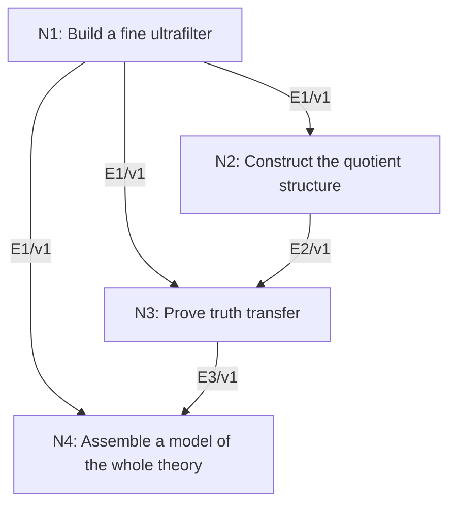

# First-Order Compactness via Ultraproducts

## An End-to-End Metacognitive Mathematics Walkthrough

**Problem ID:** LF-03  
**Version:** 1  
**Subject:** Mathematical Logic and Set Theory  
**Level:** Advanced  
**Status:** Complete authored exposition relative to the declared imports.  
**Evidence:** Mathematical argument and authored teaching traces; no actual multi-agent run, independent review, or proof-assistant certification is claimed.

## 1. Target, definitions, and import contract

Let $T$ be a set of sentences in a first-order language $L$ with finite-arity relation and function symbols and nonempty structures. If every finite subset of $T$ has a model, prove $T$ has a model. Work in classical ZFC set theory, including choice. The proof constructs an ultraproduct and proves the required truth-transfer lemma rather than importing first-order completeness.

### Permitted imports and conventions

Use Zorn’s lemma, choice of structures and witnesses from set-indexed nonempty families, finite-intersection filters, and the recursive semantics of first-order formulas. A proper filter on an index set contains the whole set, not the empty set, and is closed under finite intersections and supersets. An ultrafilter is a maximal proper filter. Function symbols may include zero-arity constants. General formulas can be expressed using atomic formulas, negation, conjunction, and existential quantification.

## 2. Intuition and node interaction workflow

Each finite fragment gets its own model. An ultrafilter regards all fragments containing any chosen sentence as large; the quotient product then makes every sentence in the theory true at once.

Each mathematical node contains **Ego, Memory, Intellect, Sense, and Action**. The diagram records accepted proof dependencies. Requests to repair an argument belong only to §6; they are not backward proof edges.

### Evidence transfer ledger

| Transfer | Producer and export | Receiving activity | Exact claim and compatibility |
|---|---|---|---|
| T1-2 | N1/v1 · E1/v1 | N2.1 | There is an ultrafilter $\mathcal U$ on $I$ containing every $C_\varphi$, and exactly one of $A,I\setminus A$ belongs to $\mathcal U$ for each $A\subset I$. Inputs in N2 retain the producer's assumptions; evidence: §4.N1. |
| T1-3 | N1/v1 · E1/v1 | N3.1 | There is an ultrafilter $\mathcal U$ on $I$ containing every $C_\varphi$, and exactly one of $A,I\setminus A$ belongs to $\mathcal U$ for each $A\subset I$. Inputs in N3 retain the producer's assumptions; evidence: §4.N1. |
| T2-3 | N2/v1 · E2/v1 | N3.1 | The product modulo $a\sim b\iff\{s:a_s=b_s\}\in\mathcal U$ is a well-defined nonempty $L$-structure $M$. Inputs in N3 retain the producer's assumptions; evidence: §4.N2. |
| T1-4 | N1/v1 · E1/v1 | N4.1 | There is an ultrafilter $\mathcal U$ on $I$ containing every $C_\varphi$, and exactly one of $A,I\setminus A$ belongs to $\mathcal U$ for each $A\subset I$. Inputs in N4 retain the producer's assumptions; evidence: §4.N1. |
| T3-4 | N3/v1 · E3/v1 | N4.2 | $M\models\theta([a^1],\ldots,[a^r])$ iff $\{s:M_s\models\theta(a_s^1,\ldots,a_s^r)\}\in\mathcal U$. Inputs in N4 retain the producer's assumptions; evidence: §4.N3. |

## 3. Node roles and five-faculty contracts

### N1/v1 — Build a fine ultrafilter

**Object and inputs:** $I=\{s\subset T:s\text{ finite}\}$ and $C_\varphi=\{s\in I:\varphi\in s\}$ for $\varphi\in T$.

**Role and strategy:** Extend the filter generated by the cones to an ultrafilter and derive its complement decision property.

**Local obligation:** There is an ultrafilter $\mathcal U$ on $I$ containing every $C_\varphi$, and exactly one of $A,I\setminus A$ belongs to $\mathcal U$ for each $A\subset I$.

| Faculty | Concrete responsibility |
|---|---|
| Ego | Publish E1/v1 only with its stated domain and assumptions: There is an ultrafilter $\mathcal U$ on $I$ containing every $C_\varphi$, and exactly one of $A,I\setminus A$ belongs to $\mathcal U$ for each $A\subset I$. |
| Memory | $I=\{s\subset T:s\text{ finite}\}$ and $C_\varphi=\{s\in I:\varphi\in s\}$ for $\varphi\in T$. Preserve the §1 conventions and incoming export versions. |
| Intellect | Extend the filter generated by the cones to an ultrafilter and derive its complement decision property. |
| Sense | Every finite intersection of cones contains their finite list of sentences as an index, so it is nonempty. |
| Action | Execute activities N1.1–N1.2 in §4.N1; preserve the displayed calculations as evidence. |

**Export E1/v1:** There is an ultrafilter $\mathcal U$ on $I$ containing every $C_\varphi$, and exactly one of $A,I\setminus A$ belongs to $\mathcal U$ for each $A\subset I$. Evidence: the complete local derivation in §4.N1.

**Acceptance gate:** Establish the local obligation through every numbered activity below and discharge this concrete check: Every finite intersection of cones contains their finite list of sentences as an index, so it is nonempty.

**Targeted repair:** If maximality is used without a chain upper bound, supply the union-of-chain argument and check that the empty set never enters. Withhold E1 and its dependent exports until the correction has been checked; a revised export receives a new version.

### N2/v1 — Construct the quotient structure

**Object and inputs:** E1/v1; choose a nonempty model $M_s\models s$ for each $s\in I$. Incoming proof exports: E1/v1 at N2.1.

**Role and strategy:** Quotient the product by agreement on an ultrafilter-large set and define symbols coordinatewise.

**Local obligation:** The product modulo $a\sim b\iff\{s:a_s=b_s\}\in\mathcal U$ is a well-defined nonempty $L$-structure $M$.

| Faculty | Concrete responsibility |
|---|---|
| Ego | Publish E2/v1 only with its stated domain and assumptions: The product modulo $a\sim b\iff\{s:a_s=b_s\}\in\mathcal U$ is a well-defined nonempty $L$-structure $M$. |
| Memory | E1/v1; choose a nonempty model $M_s\models s$ for each $s\in I$. Preserve the §1 conventions and incoming export versions. |
| Intellect | Quotient the product by agreement on an ultrafilter-large set and define symbols coordinatewise. |
| Sense | Finite intersections, not countable intersections, suffice for each finite-arity symbol; representatives must not affect truth or function values. |
| Action | Execute activities N2.1–N2.2 in §4.N2; preserve the displayed calculations as evidence. |

**Export E2/v1:** The product modulo $a\sim b\iff\{s:a_s=b_s\}\in\mathcal U$ is a well-defined nonempty $L$-structure $M$. Evidence: the complete local derivation in §4.N2.

**Acceptance gate:** Establish the local obligation through every numbered activity below and discharge this concrete check: Finite intersections, not countable intersections, suffice for each finite-arity symbol; representatives must not affect truth or function values.

**Targeted repair:** If infinitely many representative agreements are intersected for one formula, use only its finite tuple of free variables and the finite arities actually present. Withhold E2 and its dependent exports until the correction has been checked; a revised export receives a new version.

### N3/v1 — Prove truth transfer

**Object and inputs:** E1/v1 and E2/v1, a first-order formula $\theta$, and product representatives for its finitely many parameters. Incoming proof exports: E1/v1 at N3.1, E2/v1 at N3.1.

**Role and strategy:** Induct on terms and formula construction; use chosen witnesses for the existential direction.

**Local obligation:** $M\models\theta([a^1],\ldots,[a^r])$ iff $\{s:M_s\models\theta(a_s^1,\ldots,a_s^r)\}\in\mathcal U$.

| Faculty | Concrete responsibility |
|---|---|
| Ego | Publish E3/v1 only with its stated domain and assumptions: $M\models\theta([a^1],\ldots,[a^r])$ iff $\{s:M_s\models\theta(a_s^1,\ldots,a_s^r)\}\in\mathcal U$. |
| Memory | E1/v1 and E2/v1, a first-order formula $\theta$, and product representatives for its finitely many parameters. Preserve the §1 conventions and incoming export versions. |
| Intellect | Induct on terms and formula construction; use chosen witnesses for the existential direction. |
| Sense | Existential witnesses may vary with the index. Requiring one common element of all models would be an invalid strengthening. |
| Action | Execute activities N3.1–N3.3 in §4.N3; preserve the displayed calculations as evidence. |

**Export E3/v1:** $M\models\theta([a^1],\ldots,[a^r])$ iff $\{s:M_s\models\theta(a_s^1,\ldots,a_s^r)\}\in\mathcal U$. Evidence: the complete local derivation in §4.N3.

**Acceptance gate:** Establish the local obligation through every numbered activity below and discharge this concrete check: Existential witnesses may vary with the index. Requiring one common element of all models would be an invalid strengthening.

**Targeted repair:** If the existential case is dismissed as automatic, construct the coordinatewise witnesses and explicitly use the induction hypothesis for the matrix formula. Withhold E3 and its dependent exports until the correction has been checked; a revised export receives a new version.

### N4/v1 — Assemble a model of the whole theory

**Object and inputs:** E1/v1 cones and E3/v1 truth transfer for sentences. Incoming proof exports: E1/v1 at N4.1, E3/v1 at N4.2.

**Role and strategy:** Use each sentence’s cone as a subset of its satisfaction set.

**Local obligation:** $M\models T$, proving compactness.

| Faculty | Concrete responsibility |
|---|---|
| Ego | Publish E4/v1 only with its stated domain and assumptions: $M\models T$, proving compactness. |
| Memory | E1/v1 cones and E3/v1 truth transfer for sentences. Preserve the §1 conventions and incoming export versions. |
| Intellect | Use each sentence’s cone as a subset of its satisfaction set. |
| Sense | The final assertion quantifies over every sentence separately; no infinite intersection in the ultrafilter is required. |
| Action | Execute activities N4.1–N4.2 in §4.N4; preserve the displayed calculations as evidence. |

**Export E4/v1:** $M\models T$, proving compactness. Evidence: the complete local derivation in §4.N4.

**Acceptance gate:** Establish the local obligation through every numbered activity below and discharge this concrete check: The final assertion quantifies over every sentence separately; no infinite intersection in the ultrafilter is required.

**Targeted repair:** If all cones are intersected and assumed large, replace that step by one-sentence-at-a-time truth transfer; filters are only finitely intersection-closed. Withhold E4 and its dependent exports until the correction has been checked; a revised export receives a new version.

## 4. Continuous mathematical proof

The following activities form one continuous proof. Intermediate claims are established where used, except for the explicitly permitted imports in §1.

### §4.N1 — Build a fine ultrafilter

1. **N1.1.** Finite intersections of the cones are nonempty: the finite union of the required sentences is itself an index. They therefore generate a proper filter (if $T$ is empty use the filter containing $I$). The union of a chain of proper filters is again a proper filter, because any finitely many of its members occur together in one member of the chain. Zorn supplies a maximal proper filter $\mathcal U$.

2. **N1.2.** If $A\notin\mathcal U$, adjoining it cannot generate a proper larger filter. Thus some $F\in\mathcal U$ has $F\cap A=\varnothing$; otherwise its intersections with old filter members would give a proper extension. Therefore $I\setminus A\in\mathcal U$. Both complementary sets cannot belong, since their intersection is empty. This is the required decision property.

### §4.N2 — Construct the quotient structure

1. **N2.1.** Choice gives the family of models and an element in each domain, so their product is nonempty. Agreement is reflexive and symmetric; transitivity follows because the intersection of two large agreement sets is large and is contained in the third agreement set. Thus $\sim$ is an equivalence relation.

2. **N2.2.** Interpret a function on classes by applying it in each $M_s$, and interpret a relation $R([a^1],\ldots,[a^r])$ as true when $\{s:M_s\models R(a_s^1,\ldots,a_s^r)\}\in\mathcal U$. If representatives change, they agree on the finite intersection of their large agreement sets. Function outputs and relation truth agree there, so their quotient value or largeness is unchanged. Equality is the equivalence relation itself; constants are their coordinatewise classes. This defines $M$.

### §4.N3 — Prove truth transfer

1. **N3.1.** Induction on terms shows evaluation is coordinatewise up to $\sim$: variables and constants have this property by definition, and applying a function preserves it. Atomic equality and relations therefore satisfy the asserted transfer by N2. Negation corresponds to complement, handled by the ultrafilter decision property. Conjunction corresponds to intersection; a finite intersection is large exactly when both factors are large, by filter closure and upward closure.

2. **N3.2.** For $\exists z\,\psi(z,\bar a)$, first suppose $M$ has a witnessing class $[b]$. By the induction hypothesis, $\{s:M_s\models\psi(b_s,\bar a_s)\}$ is large. It is contained in the set of indices satisfying the existential formula, so that set is large.

3. **N3.3.** Conversely, if the existential satisfaction set is large, choose a witness $b_s$ in each of its models, and choose an arbitrary domain element at the remaining indices. Choice and nonempty domains permit this product element. The set where $\psi(b_s,\bar a_s)$ holds contains the large existential set. The induction hypothesis then makes $[b]$ a witness in $M$. These cases complete the structural induction and prove truth transfer.

### §4.N4 — Assemble a model of the whole theory

1. **N4.1.** Fix $\varphi\in T$. Whenever $s\in C_\varphi$, the chosen $M_s$ is a model of $s$, so it satisfies $\varphi$. Therefore $C_\varphi\subset\{s:M_s\models\varphi\}$. The left side is large by N1, hence so is the right side.

2. **N4.2.** By N3, $M\models\varphi$. Since this holds for every $\varphi\in T$, $M\models T$. No common index need satisfy all of $T$; the quotient construction is what supplies the new model.

## 5. Worked instance and boundary audit

In the language of ordered fields, add a constant $c$ and all sentences $c>\underbrace{1+\cdots+1}_{n\text{ terms}}$ for $n\ge1$, together with the ordered-field axioms. Every finite fragment has a model in $\mathbb R$ by choosing $c$ larger than the finitely many listed integers. Compactness gives an ordered field with an element larger than every standard positive integer. This is a non-Archimedean model, not an infinitely large real number.

### Boundary or failed-inference witness

Compactness fails if one insists that the resulting model be finite. The sentences “there are at least $n$ distinct elements” have every finite fragment satisfiable in a finite set, but no single finite model satisfies them all. The theorem permits arbitrary nonempty models.

## 6. Illustrative interaction and repair trace

**Trace status:** Authored illustration, not a logged agent execution. The rejected candidate below is outside the accepted DAG.

**Rejected N4 argument:** intersect all cones and choose one finite-fragment model satisfying everything. For the increasing-cardinality example that intersection contains no suitable finite index. **Diagnosis:** Intellect used infinite intersection closure that an ultrafilter need not possess. **Repair:** form the quotient product and use the proven truth-transfer lemma separately for each sentence. The original first-order compactness theorem is unchanged; recheck every sentence via its own cone.

After the corrected argument is supplied, Ego may publish a hypothetical v2 export, Memory replaces the rejected version, and Action rechecks each descendant in §2. The accepted exposition in this file is v1; this scenario does not claim an actual revision or execution occurred.

## 7. Evidence ledger and reusable exports

| Item | Evidence and scope | Remaining limitation |
|---|---|---|
| Target theorem | §4, under exactly the §1 hypotheses and imports | Authored mathematical exposition; no independent or formal verification |
| E1–E4 | Local proofs §4.N1–§4.N4; version 1 | Imports remain attached to each reuse |
| Worked instance | Explicit computation or construction in §5 | Illustrates the mechanism; does not prove the universal theorem |
| Repair | Rejected inference, witness, and correction in §6 | Teaching scenario rather than empirical agent evidence |

**Reusable target:** Preserve `LF-03/v1`, the exact statement in §1, its assumptions, and this proof when reusing the result.

**Next direction:** Use compactness to build models with prescribed finite consistency patterns, keeping nonstandard objects distinct from objects in the original structure.

## 8. Sources and navigation

The proof and faculty decomposition are authored for this collection. The following primary teaching sources support further study; exact imports are specified in §1.

[Andrew Marks, Set Theory notes](https://math.berkeley.edu/~marks/notes/set_theory_notes_4.pdf) for sets and ultraproducts; [Berkeley, Mathematical Logic for Mathematicians, Part I](https://math.berkeley.edu/~antonio/math125A/mathlogicP1.pdf) for first-order semantics; [Andrew Marks, Computability Theory notes](https://math.berkeley.edu/~marks/notes/computability_notes_v1.pdf) for effective procedures and undecidability. The proofs below specify their own set-theoretic and semantic assumptions.

**Local imported proof modules:** None. Supporting external results are specified in §1.

[Five-project subject index](problems.md) · [Project README](../README.md) · [Graduate subject outline](../../book/outline.md)
