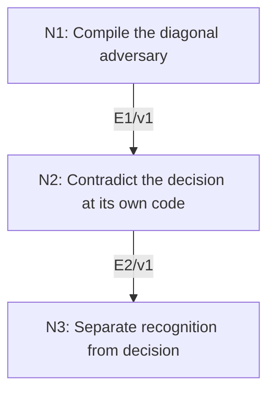

# Undecidability of the Halting Problem

## An End-to-End Metacognitive Mathematics Walkthrough

**Problem ID:** LF-05  
**Version:** 1  
**Subject:** Mathematical Logic and Set Theory  
**Level:** Intermediate  
**Status:** Complete authored exposition relative to the declared imports.  
**Evidence:** Mathematical argument and authored teaching traces; no actual multi-agent run, independent review, or proof-assistant certification is claimed.

## 1. Target, definitions, and import contract

Fix an effective encoding of deterministic Turing machines by finite strings. Prove no total computable function $H(e,x)\in\{0,1\}$ correctly decides for every valid machine code $e$ and input string $x$ whether that machine eventually halts on $x$. Also prove the halting set is computably enumerable: there is a procedure that halts and accepts exactly the halting pairs. Invalid codes can be assigned a fixed decidable convention and do not affect the result.

### Permitted imports and conventions

Use a universal step-by-step simulator for the fixed Turing-machine model, effective composition and conditional branching of finite programs, and the ability to implement an infinite loop. Every such finite program has an encoding in the same model. These are elementary properties of the computational model, not an oracle or a solution of the target decision problem.

## 2. Intuition and node interaction workflow

Assuming a decider allows construction of a machine that reverses its answer on the diagonal input. The contradiction concerns a total decision procedure; direct simulation still provides a one-sided recognition procedure.

Each mathematical node contains **Ego, Memory, Intellect, Sense, and Action**. The diagram records accepted proof dependencies. Requests to repair an argument belong only to §6; they are not backward proof edges.

### Evidence transfer ledger

| Transfer | Producer and export | Receiving activity | Exact claim and compatibility |
|---|---|---|---|
| T1-2 | N1/v1 · E1/v1 | N2.1 | There is a machine $D$ with a valid code $d$ such that $D(z)$ loops if $H(z,z)=1$ and halts if $H(z,z)=0$. Inputs in N2 retain the producer's assumptions; evidence: §4.N1. |
| T2-3 | N2/v1 · E2/v1 | N3.2 | No total computable halting decider exists. Inputs in N3 retain the producer's assumptions; evidence: §4.N2. |

## 3. Node roles and five-faculty contracts

### N1/v1 — Compile the diagonal adversary

**Object and inputs:** A hypothetical total computable correct decider $H$.

**Role and strategy:** Construct a finite machine that consults $H(z,z)$ and then deliberately does the opposite.

**Local obligation:** There is a machine $D$ with a valid code $d$ such that $D(z)$ loops if $H(z,z)=1$ and halts if $H(z,z)=0$.

| Faculty | Concrete responsibility |
|---|---|
| Ego | Publish E1/v1 only with its stated domain and assumptions: There is a machine $D$ with a valid code $d$ such that $D(z)$ loops if $H(z,z)=1$ and halts if $H(z,z)=0$. |
| Memory | A hypothetical total computable correct decider $H$. Preserve the §1 conventions and incoming export versions. |
| Intellect | Construct a finite machine that consults $H(z,z)$ and then deliberately does the opposite. |
| Sense | Totality makes the branch selection terminate; the constructed machine may itself loop, which is permitted for an ordinary machine. |
| Action | Execute activities N1.1–N1.2 in §4.N1; preserve the displayed calculations as evidence. |

**Export E1/v1:** There is a machine $D$ with a valid code $d$ such that $D(z)$ loops if $H(z,z)=1$ and halts if $H(z,z)=0$. Evidence: the complete local derivation in §4.N1.

**Acceptance gate:** Establish the local obligation through every numbered activity below and discharge this concrete check: Totality makes the branch selection terminate; the constructed machine may itself loop, which is permitted for an ordinary machine.

**Targeted repair:** If the argument assumes a possibly nonterminating test before branching, restore the total-decider hypothesis; without it the reversal would not be implemented on every input. Withhold E1 and its dependent exports until the correction has been checked; a revised export receives a new version.

### N2/v1 — Contradict the decision at its own code

**Object and inputs:** E1/v1 and the purported correctness of $H$ on the valid pair $(d,d)$. Incoming proof exports: E1/v1 at N2.1.

**Role and strategy:** Exhaust both possible Boolean answers and compare them with the constructed behavior.

**Local obligation:** No total computable halting decider exists.

| Faculty | Concrete responsibility |
|---|---|
| Ego | Publish E2/v1 only with its stated domain and assumptions: No total computable halting decider exists. |
| Memory | E1/v1 and the purported correctness of $H$ on the valid pair $(d,d)$. Preserve the §1 conventions and incoming export versions. |
| Intellect | Exhaust both possible Boolean answers and compare them with the constructed behavior. |
| Sense | The contradiction is to the existence of a correct total $H$, not to the existence of the perfectly valid looping machine $D$. |
| Action | Execute activities N2.1–N2.2 in §4.N2; preserve the displayed calculations as evidence. |

**Export E2/v1:** No total computable halting decider exists. Evidence: the complete local derivation in §4.N2.

**Acceptance gate:** Establish the local obligation through every numbered activity below and discharge this concrete check: The contradiction is to the existence of a correct total $H$, not to the existence of the perfectly valid looping machine $D$.

**Targeted repair:** If only one answer branch is analyzed, check the other explicitly; undecidability requires defeating every possible returned answer. Withhold E2 and its dependent exports until the correction has been checked; a revised export receives a new version.

### N3/v1 — Separate recognition from decision

**Object and inputs:** A valid encoded machine-input pair and the universal simulator; E2/v1 for the distinction from decision. Incoming proof exports: E2/v1 at N3.2.

**Role and strategy:** Simulate one step at a time and accept when a halt is observed.

**Local obligation:** The halting set is computably enumerable but not decidable.

| Faculty | Concrete responsibility |
|---|---|
| Ego | Publish E3/v1 only with its stated domain and assumptions: The halting set is computably enumerable but not decidable. |
| Memory | A valid encoded machine-input pair and the universal simulator; E2/v1 for the distinction from decision. Preserve the §1 conventions and incoming export versions. |
| Intellect | Simulate one step at a time and accept when a halt is observed. |
| Sense | Failure to observe a halt by a finite time does not certify nonhalting. |
| Action | Execute activities N3.1–N3.2 in §4.N3; preserve the displayed calculations as evidence. |

**Export E3/v1:** The halting set is computably enumerable but not decidable. Evidence: the complete local derivation in §4.N3.

**Acceptance gate:** Establish the local obligation through every numbered activity below and discharge this concrete check: Failure to observe a halt by a finite time does not certify nonhalting.

**Targeted repair:** If simulation is presented as a decision procedure, state its nonterminating behavior on negative instances and keep the recognition/decision distinction. Withhold E3 and its dependent exports until the correction has been checked; a revised export receives a new version.

## 4. Continuous mathematical proof

The following activities form one continuous proof. Intermediate claims are established where used, except for the explicitly permitted imports in §1.

### §4.N1 — Compile the diagonal adversary

1. **N1.1.** Define a program on input $z$: compute $H(z,z)$; if the result is one, execute an infinite loop; if the result is zero, halt. Under the hypothesis, the computation of $H$ always finishes and this is an effective finite program.

2. **N1.2.** By the fixed model’s effective composition and encoding, this program is a Turing machine with some valid code $d$. Giving a program its own code as an input is legal: codes are finite strings and machines accept finite strings. No machine needs to discover its own code internally.

### §4.N2 — Contradict the decision at its own code

1. **N2.1.** If $H(d,d)=1$, correctness predicts that $D(d)$ halts. But by construction that branch loops forever, a contradiction.

2. **N2.2.** If $H(d,d)=0$, correctness predicts that $D(d)$ never halts. But the other branch halts immediately after the completed call to $H$, also a contradiction. These exhaust the two outputs, so the supposed decider cannot exist.

### §4.N3 — Separate recognition from decision

1. **N3.1.** On input $(e,x)$, simulate the machine coded by $e$ on $x$ one step at a time. If the simulated machine reaches a halting state, accept. If it never halts, the simulator continues forever. Thus the procedure accepts exactly the halting pairs.

2. **N3.2.** This is a recognizer, not a decider, because nonhalting inputs need not return an answer. In conjunction with E2, it proves that the halting set is computably enumerable and undecidable.

## 5. Worked instance and boundary audit

A machine that immediately halts on any input is accepted by the simulator after finitely many steps. A machine with a single transition back to the same nonhalting state is simulated indefinitely. If a hypothetical decider labels the diagonal machine $D(d)$ as halting, its prescribed branch is the loop; if it labels it nonhalting, its branch halts. The contradiction is symbolic and does not claim that such a decider was run.

### Boundary or failed-inference witness

The theorem does not say no individual nonhalting behavior can be proved. The one-state self-loop is easy to certify, and any fixed finite collection of known examples can be classified. What is impossible is one total computable procedure that is correct on every machine-input pair in the stated unbounded model.

## 6. Illustrative interaction and repair trace

**Trace status:** Authored illustration, not a logged agent execution. The rejected candidate below is outside the accepted DAG.

**Rejected N3 rule:** after a million simulated steps without halting, return “never halts.” A finite program can count to a million plus one and then halt. **Diagnosis:** Sense identifies finite observation being promoted to an unbounded universal claim. **Repair:** let the recognizer keep running on unresolved inputs; it remains a valid semidecision procedure but no longer claims totality. This is an explicit weakening of the rejected algorithmic claim, consistent with the proved impossibility theorem.

After the corrected argument is supplied, Ego may publish a hypothetical v2 export, Memory replaces the rejected version, and Action rechecks each descendant in §2. The accepted exposition in this file is v1; this scenario does not claim an actual revision or execution occurred.

## 7. Evidence ledger and reusable exports

| Item | Evidence and scope | Remaining limitation |
|---|---|---|
| Target theorem | §4, under exactly the §1 hypotheses and imports | Authored mathematical exposition; no independent or formal verification |
| E1–E3 | Local proofs §4.N1–§4.N3; version 1 | Imports remain attached to each reuse |
| Worked instance | Explicit computation or construction in §5 | Illustrates the mechanism; does not prove the universal theorem |
| Repair | Rejected inference, witness, and correction in §6 | Teaching scenario rather than empirical agent evidence |

**Reusable target:** Preserve `LF-05/v1`, the exact statement in §1, its assumptions, and this proof when reusing the result.

**Next direction:** Develop many-one reductions to transfer undecidability to other decision problems, recording the computability and correctness of each reduction.

## 8. Sources and navigation

The proof and faculty decomposition are authored for this collection. The following primary teaching sources support further study; exact imports are specified in §1.

[Andrew Marks, Set Theory notes](https://math.berkeley.edu/~marks/notes/set_theory_notes_4.pdf) for sets and ultraproducts; [Berkeley, Mathematical Logic for Mathematicians, Part I](https://math.berkeley.edu/~antonio/math125A/mathlogicP1.pdf) for first-order semantics; [Andrew Marks, Computability Theory notes](https://math.berkeley.edu/~marks/notes/computability_notes_v1.pdf) for effective procedures and undecidability. The proofs below specify their own set-theoretic and semantic assumptions.

**Local imported proof modules:** None. Supporting external results are specified in §1.

[Five-project subject index](problems.md) · [Project README](../README.md) · [Graduate subject outline](../../book/outline.md)
