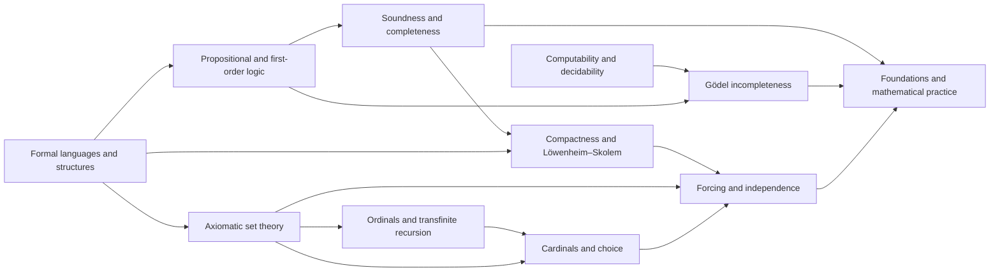

# Meta-Graph: Mathematical Logic and Set Theory

> **Purpose.** This is a subject-level dependency map for planning a future theorem knowledge graph. It shows a representative route through the field; it is not a complete list of prerequisites, a formal proof dependency database, or a claim that every course follows this order.

## How to read this graph

- **Nodes** are foundational ideas, methods, structural results, or major theorems. A node may later expand into its own proof-level graph.
- An arrow `X → Y` means that X commonly supplies language, a method, a hypothesis, or a result used in understanding or proving Y. The edge table says which role it plays.
- Some edges describe a common proof route or conceptual bridge rather than a logically necessary dependency. The eventual theorem graph should record the exact theorem, hypotheses, source, and proof step for every strict dependency.
- The graph is a DAG at this global overview level. Feedback and revision belong inside proof workflows; they should not be mistaken for a theorem depending on itself.

## Global subject map

## Node register

| ID | Idea, theorem, or method | Role in the subject |
|---|---|---|
| A | Formal languages and structures | Define syntax, semantics, and models |
| B | Propositional and first-order logic | Develop inference and quantification |
| C | Soundness and completeness | Relate derivability to semantic truth |
| D | Compactness and Löwenheim–Skolem | Derive model-existence and size consequences |
| E | Computability and decidability | Classify effective procedures and limits |
| F | Gödel incompleteness | Show limits of sufficiently expressive formal theories |
| G | Axiomatic set theory | Build mathematics in ZFC-style foundations |
| H | Ordinals and transfinite recursion | Extend induction and recursion beyond naturals |
| I | Cardinals and choice | Study infinite size and equivalent forms of choice |
| J | Forcing and independence | Construct models separating set-theoretic statements |
| K | Foundations and mathematical practice | Compare formal systems and foundational consequences |

## Dependency register

| From → To | Connection type | How the earlier node supports the later node |
|---|---|---|
| A → B (Formal languages and structures → Propositional and first-order logic) | Common mathematical dependency | Syntax defines formulas and semantics defines truth. |
| B → C (Propositional and first-order logic → Soundness and completeness) | Common mathematical dependency | Proof systems are assessed by soundness and completeness. |
| C → D (Soundness and completeness → Compactness and Löwenheim–Skolem) | Common mathematical dependency | Completeness enables compactness arguments. |
| A → D (Formal languages and structures → Compactness and Löwenheim–Skolem) | Common mathematical dependency | Model theory studies structures and elementary equivalence. |
| E → F (Computability and decidability → Gödel incompleteness) | Common mathematical dependency | Effective axiomatization enables incompleteness results. |
| B → F (Propositional and first-order logic → Gödel incompleteness) | Common mathematical dependency | Formal arithmetic supplies expressive theories. |
| G → H (Axiomatic set theory → Ordinals and transfinite recursion) | Common mathematical dependency | Ordinals are sets in the cumulative hierarchy. |
| H → I (Ordinals and transfinite recursion → Cardinals and choice) | Common mathematical dependency | Transfinite methods classify cardinal structure. |
| G → I (Axiomatic set theory → Cardinals and choice) | Common mathematical dependency | Cardinals are initial ordinals in set theory. |
| A → G (Formal languages and structures → Axiomatic set theory) | Common mathematical dependency | Axioms specify the universe of sets. |
| D → J (Compactness and Löwenheim–Skolem → Forcing and independence) | Common mathematical dependency | Model theory provides tools to build extensions. |
| G → J (Axiomatic set theory → Forcing and independence) | Common mathematical dependency | Forcing extends models of set theory. |
| I → J (Cardinals and choice → Forcing and independence) | Common mathematical dependency | Cardinal arithmetic is changed or preserved by forcing. |
| C → K (Soundness and completeness → Foundations and mathematical practice) | Common mathematical dependency | Proof semantics inform foundations. |
| F → K (Gödel incompleteness → Foundations and mathematical practice) | Common mathematical dependency | Incompleteness shapes formalist expectations. |
| J → K (Forcing and independence → Foundations and mathematical practice) | Common mathematical dependency | Independence results delimit axiomatic resolution. |

## Suggested reading paths

**Core route:** follow the nodes from foundational language toward the central structural theorems, then continue to the advanced endpoint. For a first pass, read the graph left to right and pause at each node to state its hypotheses and output.

**Theorem-focused route:** choose a major theorem node, trace incoming arrows backward to identify imported results, then trace outgoing arrows to see what the theorem enables. Mark which incoming edges are strict dependencies after consulting a proof-level source.

**Bridge route:** follow cross-links between methods and neighboring theories. Treat these as transfer routes: identify exactly what is preserved, what hypotheses are added, and what changes under translation.

## Five-component expansion for each theorem node

When a node is selected for a complete Meta-Math walkthrough, preserve the node ID and expand it into a local five-component proof graph:

| Component | Local responsibility |
|---|---|
| **Contract** | State the precise theorem goal, scope, and proof contract; distinguish the claim from nearby stronger or weaker claims. |
| **Knowledge** | Retrieve definitions, hypotheses, lemmas, source references, and known examples/counterexamples required by this node. |
| **Strategy** | Select and order proof steps; justify each inference and expose dependency on incoming nodes. |
| **Validation** | Check type/notation consistency, hypothesis use, boundary cases, examples, and whether each intermediate claim is actually supported. |
| **Execution** | Execute proof steps, calculations, constructions, or formal checks; emit the verified result and update outgoing dependencies. |

A later graph version should connect global theorem nodes to these local component nodes, with typed edges such as `uses`, `specializes`, `generalizes`, `contradicts`, `analogy-only`, and `verified-by`.

## Expansion record

For each node promoted from this map, add a stable theorem or concept ID, exact statement, source and page/section, prerequisite IDs, proof-step graph, explicit hypothesis checks, known failure modes, examples, and verification status. Keep conjectural or analogy-only links visually distinct from proved dependencies.

**Related syllabus:** [`outline.md`](book-outline.md).
