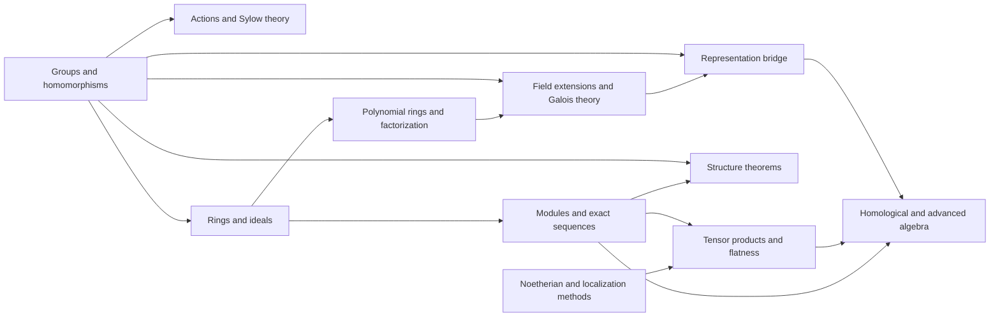

# Meta-Graph: Modern Algebra

> **Purpose.** This is a subject-level dependency map for planning a future theorem knowledge graph. It shows a representative route through the field; it is not a complete list of prerequisites, a formal proof dependency database, or a claim that every course follows this order.

## How to read this graph

- **Nodes** are foundational ideas, methods, structural results, or major theorems. A node may later expand into its own proof-level graph.
- An arrow `X → Y` means that X commonly supplies language, a method, a hypothesis, or a result used in understanding or proving Y. The edge table says which role it plays.
- Some edges describe a common proof route or conceptual bridge rather than a logically necessary dependency. The eventual theorem graph should record the exact theorem, hypotheses, source, and proof step for every strict dependency.
- The graph is a DAG at this global overview level. Feedback and revision belong inside proof workflows; they should not be mistaken for a theorem depending on itself.

## Global subject map

## Node register

| ID | Idea, theorem, or method | Role in the subject |
|---|---|---|
| A | Groups and homomorphisms | Study symmetry through operations and structure-preserving maps |
| B | Actions and Sylow theory | Analyze groups via orbits and prime-power subgroups |
| C | Rings and ideals | Extend algebraic structure to addition and multiplication |
| D | Polynomial rings and factorization | Study extensions and irreducibility |
| E | Modules and exact sequences | Generalize vector spaces over rings |
| F | Field extensions and Galois theory | Relate roots, automorphisms, and intermediate fields |
| G | Noetherian and localization methods | Control ring structure locally and finitely |
| H | Tensor products and flatness | Transport algebra across base change |
| I | Structure theorems | Classify finite abelian groups and modules over principal ideal domains |
| J | Representation bridge | Translate algebra into linear actions |
| K | Homological and advanced algebra | Use derived invariants and cohomology to detect obstructions |

## Dependency register

| From → To | Connection type | How the earlier node supports the later node |
|---|---|---|
| A → B (Groups and homomorphisms → Actions and Sylow theory) | Common mathematical dependency | Group actions expose subgroup structure. |
| A → C (Groups and homomorphisms → Rings and ideals) | Common mathematical dependency | Group rings and structural analogies link algebraic operations. |
| C → D (Rings and ideals → Polynomial rings and factorization) | Common mathematical dependency | Polynomial rings are central examples of rings. |
| D → F (Polynomial rings and factorization → Field extensions and Galois theory) | Common mathematical dependency | Irreducible polynomials construct field extensions. |
| A → F (Groups and homomorphisms → Field extensions and Galois theory) | Common mathematical dependency | Galois groups encode field symmetries. |
| C → E (Rings and ideals → Modules and exact sequences) | Common mathematical dependency | Modules are additive groups with scalar action. |
| E → I (Modules and exact sequences → Structure theorems) | Common mathematical dependency | Module structure theorems classify objects under hypotheses. |
| A → I (Groups and homomorphisms → Structure theorems) | Common mathematical dependency | Finite abelian groups are classified by invariant factors. |
| G → H (Noetherian and localization methods → Tensor products and flatness) | Common mathematical dependency | Localization informs tensor and base-change behavior. |
| E → H (Modules and exact sequences → Tensor products and flatness) | Common mathematical dependency | Tensor products are built from module bilinearity. |
| F → J (Field extensions and Galois theory → Representation bridge) | Common mathematical dependency | Field automorphisms act on vector spaces. |
| A → J (Groups and homomorphisms → Representation bridge) | Common mathematical dependency | Group representations linearize symmetry. |
| E → K (Modules and exact sequences → Homological and advanced algebra) | Common mathematical dependency | Exact sequences motivate homological invariants. |
| H → K (Tensor products and flatness → Homological and advanced algebra) | Common mathematical dependency | Tensor-derived constructions lead to Tor and Ext. |
| J → K (Representation bridge → Homological and advanced algebra) | Common mathematical dependency | Representations connect to cohomology and advanced structure. |

## Suggested reading paths

**Core route:** follow the nodes from foundational language toward the central structural theorems, then continue to the advanced endpoint. For a first pass, read the graph left to right and pause at each node to state its hypotheses and output.

**Theorem-focused route:** choose a major theorem node, trace incoming arrows backward to identify imported results, then trace outgoing arrows to see what the theorem enables. Mark which incoming edges are strict dependencies after consulting a proof-level source.

**Bridge route:** follow cross-links between methods and neighboring theories. Treat these as transfer routes: identify exactly what is preserved, what hypotheses are added, and what changes under translation.

## Five-component expansion for each theorem node

When a node is selected for a complete Meta-Math walkthrough, preserve the node ID and expand it into a local five-component proof graph:

| Component | Local responsibility |
|---|---|
| **Contract** | State the precise theorem goal, scope, and proof contract; distinguish the claim from nearby stronger or weaker claims. |
| **Knowledge** | Retrieve definitions, hypotheses, lemmas, source references, and known examples/counterexamples required by this node. |
| **Strategy** | Select and order proof steps; justify each inference and expose dependency on incoming nodes. |
| **Validation** | Check type/notation consistency, hypothesis use, boundary cases, examples, and whether each intermediate claim is actually supported. |
| **Execution** | Execute proof steps, calculations, constructions, or formal checks; emit the verified result and update outgoing dependencies. |

A later graph version should connect global theorem nodes to these local component nodes, with typed edges such as `uses`, `specializes`, `generalizes`, `contradicts`, `analogy-only`, and `verified-by`.

## Expansion record

For each node promoted from this map, add a stable theorem or concept ID, exact statement, source and page/section, prerequisite IDs, proof-step graph, explicit hypothesis checks, known failure modes, examples, and verification status. Keep conjectural or analogy-only links visually distinct from proved dependencies.

**Related syllabus:** [`outline.md`](book-outline.md).
