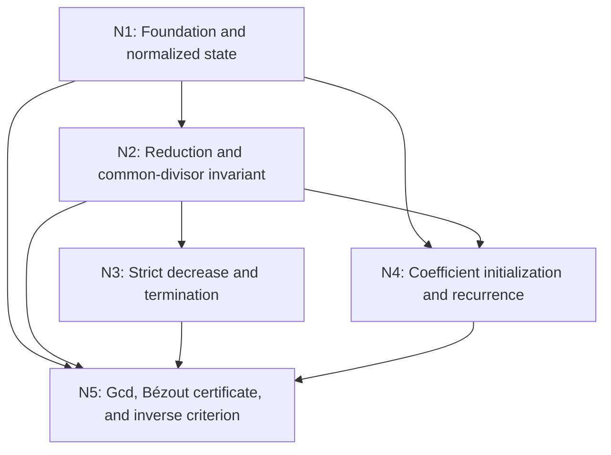

# Euclidean Algorithm and Bézout's Identity

## An End-to-End Meta-Math Demonstration

**Problem:** NT-01 in the [Number Theory problem bank](problems.md).  
**Architecture:** a Hybrid Five-Faculty Knowledge Graph with five mathematical agents.  
**Deliverable:** a complete mathematical proof, a worked orchestration trace, an explicit repair episode, and reusable theorem outputs.

The agent interactions below are an authored demonstration of how the system can operate. They are not a transcript of deployed agents. The proof is given in full; formal kernel verification is a future stage.

## 1. The Target Problem

> **Theorem — Euclidean algorithm and Bézout's identity.** Let $a,b\in\mathbb Z$ be not both zero. The Euclidean algorithm terminates and produces the positive greatest common divisor $d=\gcd(a,b)$. Its extended form also produces integers $u,v$ satisfying
>
> $$au+bv=d.$$
>
> **Corollary — Modular inverse criterion.** For an integer $a$ and a modulus $m\ge2$, the residue of $a$ has a multiplicative inverse modulo $m$ if and only if $\gcd(a,m)=1$.

The system must establish four separate facts: each reduction preserves common divisors; reductions stop; the terminal value is the gcd; and the terminal value remains an integer linear combination of the original inputs. The corollary then turns that combination into a modular inverse.

### Why this problem reveals the architecture

Consider $252$ and $198$. Their difference is $54$. Any integer dividing both original numbers divides $54$; conversely, any integer dividing $198$ and $54$ divides $252$. The numerical problem becomes smaller while its common divisors stay the same.

That observation suggests a strategy, but leaves obligations: what makes the process stop, how do we recognize its answer, and how do we preserve a certificate relating the answer to the original numbers? Different agents own those obligations. Their outputs meet at a synthesis node.

The faculties make those agents reflective: they retain evidence, inspect boundary conditions, select strategies, perform deductions, and keep their local work aligned with the theorem.

## 2. Definitions, Assumptions, and Output Contract

### Memory's foundational repository

- **Divisibility:** $c\mid x$ means $x=ck$ for some $k\in\mathbb Z$.
- **Greatest common divisor:** for inputs not both zero, $\gcd(a,b)$ is the largest positive integer dividing both. A largest one exists: $1$ is a common divisor, and positive common divisors are bounded by the absolute value of any nonzero input.
- **Division with remainder:** for $A\ge0$ and $B>0$, there are unique integers $q,r$ with $A=qB+r$ and $0\le r<B$.
- **Well-ordering:** every nonempty subset of the nonnegative integers has a least element. In particular, there is no infinite strictly decreasing sequence of nonnegative integers.
- **Congruence:** $x\equiv y\pmod m$ means $m\mid(x-y)$.
- **Modular inverse:** $w$ is an inverse of $a$ modulo $m$ if $aw\equiv1\pmod m$.

No prime factorization, Euclid's lemma, or Bézout theorem is imported. Importing Bézout here would assume the result we are constructing.

### Contract

| Item | Required meaning |
|---|---|
| Input | Integers $a,b$, with $(a,b)\ne(0,0)$ |
| Output | Integers $(d,u,v)$ |
| Positivity | $d>0$ |
| Divisibility | $d\mid a$ and $d\mid b$ |
| Greatest-divisor property | Every positive common divisor $c$ satisfies $c\le d$ |
| Bézout certificate | $au+bv=d$ |
| Termination | Finitely many valid remainder reductions |
| Inverse extension | For $m\ge2$, return an inverse exactly when the gcd is $1$ |

An equation $au+bv=d$ alone is insufficient to identify the gcd: $0a+0b=0$ always holds. The synthesis agent must also establish positivity and common divisibility.

## 3. Knowledge Graph Topology: Five Mathematical Agents

| Node | Mathematical object owned | Main exported result |
|---|---|---|
| N1 — Foundation | Input domain, signs, and initial state | A valid normalized starting state |
| N2 — Reduction | Division step and common-divisor invariant | Every valid reduction preserves common divisors |
| N3 — Termination | Decreasing remainder sequence | A finite run ends at a positive last nonzero remainder |
| N4 — Certificate | Integer coefficient recurrence | Every remainder is a combination of the original inputs |
| N5 — Synthesis | Gcd identification and modular inversion | The complete theorem and corollary |

**Every node contains Ego, Memory, Intellect, Sense, and Action.** N3 is a termination agent with all five faculties; it is not merely a standalone Sense agent. N5 likewise owns synthesis while retaining all five faculties internally.



N3 and N4 are separate proof branches: one establishes that a terminal state is reached; the other establishes what the coefficient state means. The numerical execution itself advances sequentially because each division needs the previous remainder pair.

### Proof edges and feedback loops

The diagram represents logical dependencies. These are acyclic. The execution controller may repeatedly invoke N2 and N4, while N3 checks progress. A repair diagnostic may travel back to a producer, but it supplies a request for new evidence, not a premise proving the producer's claim.

For a particular run, iterations can be unfolded into successive states:

```text
State 0 → State 1 → State 2 → ... → Terminal state
```

There is no circular proof. If a repaired claim changes, dependent outputs are marked stale and rechecked before export.

## 4. Node-by-Node Execution Through All Five Faculties

### N1 — Foundation and Sign Normalization

**Mathematical object:** a nonnegative input pair and coefficient seeds expressed in the original signed integers.

**Memory.** Retrieve integer arithmetic, absolute value, divisibility, and the input contract. Define

$$\varepsilon(x)=\begin{cases}1&x>0,\\0&x=0,\\-1&x<0.\end{cases}$$

Then $\varepsilon(x)x=|x|$.

**Sense.** Reject $(0,0)$ under this theorem's contract. Accept a single zero input. Ensure sign normalization does not lose the connection to the original numbers.

**Intellect.** Work with $A=|a|$ and $B=|b|$, while carrying coefficients relative to $a,b$. This makes remainder bounds straightforward and preserves a signed Bézout certificate.

**Action.** Initialize

$$r_0=A,\qquad r_1=B,$$

$$s_0=\varepsilon(a),\quad t_0=0,\qquad s_1=0,\quad t_1=\varepsilon(b).$$

Check $r_0=s_0a+t_0b$ and $r_1=s_1a+t_1b$. Since dividing $a$ is equivalent to dividing $|a|$, normalization preserves all common divisors. No ordering assumption $A\ge B$ is needed; if $A<B$, the first quotient is zero.

**Ego.** Fix the goal: obtain a positive gcd and coefficients for the original inputs. Publish the normalized state and its two seed identities.

**Outgoing message:** “The input is admissible. Here are the starting remainders and their original-input coefficient certificates.”

### N2 — Remainder Reduction and the Divisor Invariant

**Mathematical object:** the transformation $(A,B)\mapsto(B,r)$ where $A=qB+r$.

**Memory.** Retrieve the division algorithm and the fact that divisibility is preserved under integer linear combinations.

**Sense.** Require $B>0$ before dividing. Verify both the equation $A=qB+r$ and the bound $0\le r<B$. A numerical equality without the remainder bound does not establish progress.

**Intellect.** Compare the common-divisor sets in both directions. This preserves more information than an unexplained assertion that the gcd is unchanged.

**Action.** For every positive integer $c$:

1. If $c\mid A$ and $c\mid B$, then $c\mid(A-qB)=r$.
2. If $c\mid B$ and $c\mid r$, then $c\mid(qB+r)=A$.

Therefore

$$\{c>0:c\mid A,\ c\mid B\}=\{c>0:c\mid B,\ c\mid r\}.$$

It follows that $\gcd(A,B)=\gcd(B,r)$.

For the running example, $252=1\cdot198+54$, so the first reduction produces $(198,54)$ with the same common divisors.

**Ego.** Export the divisor-set equality and the quotient/remainder certificate. Keep the result local: N2 has proved preservation, not termination or Bézout's identity.

**Outgoing message:** “This reduction preserves exactly the positive common divisors. The new remainder satisfies the strict upper bound required for progress.”

### N3 — Termination and the Terminal Boundary

**Mathematical object:** the nonnegative remainder sequence and its stopping condition.

**Memory.** Retrieve well-ordering and the remainder bounds certified by N2.

**Sense.** Distinguish a zero remainder from a divisor eligible for the next division. Check that each continuing iteration has a positive divisor and that its successor is strictly smaller.

**Intellect.** Use the current positive divisor as the decreasing measure. Avoid the unsupported argument “the numbers look smaller in our example.”

**Action.** If $r_1>0$, every division satisfies

$$r_{j-1}=q_jr_j+r_{j+1},\qquad0\le r_{j+1}<r_j.$$

An infinite run would produce an infinite strictly decreasing sequence of positive integers $r_1,r_2,\ldots$, contradicting well-ordering. Hence a remainder becomes zero after finitely many steps.

If $r_1=0$, stop immediately. N1's input contract guarantees $r_0>0$. Otherwise, the terminal pair is $(r_\ell,0)$ with $r_\ell>0$ because its first entry was the positive divisor in the final valid division.

**Ego.** Export a finite terminal state and its positivity certificate. Leave identification of the terminal value as the original gcd to N5.

**Outgoing message:** “The run terminates at a pair $(d,0)$ with $d>0$. Division must stop here.”

### N4 — Extended Coefficients and the Bézout Certificate

**Mathematical object:** a coefficient pair $(s_j,t_j)$ for each remainder $r_j$.

**Memory.** Retain N1's seed identities and N2's quotient sequence. The invariant is

$$r_j=s_ja+t_jb.$$

**Sense.** Check signs and indices. Each update must use both old coefficient pairs; overwriting one before computing the next can corrupt the certificate.

**Intellect.** Transport the remainder recurrence into the coefficient space. If $r_{j+1}=r_{j-1}-q_jr_j$, apply the same subtraction to its coefficients.

**Action.** Define

$$s_{j+1}=s_{j-1}-q_js_j,\qquad t_{j+1}=t_{j-1}-q_jt_j.$$

Assuming the identities for the preceding two remainders,

$$\begin{aligned}
r_{j+1}
&=r_{j-1}-q_jr_j\\
&=(s_{j-1}a+t_{j-1}b)-q_j(s_ja+t_jb)\\
&=(s_{j-1}-q_js_j)a+(t_{j-1}-q_jt_j)b\\
&=s_{j+1}a+t_{j+1}b.
\end{aligned}$$

The seed identities and induction prove this invariant for every generated remainder. At termination, take $u=s_\ell$ and $v=t_\ell$. Then $au+bv=d$.

**Ego.** Export coefficients for the last nonzero remainder, attached to the original input and terminal-state identifiers. The coefficient branch cannot independently declare that its value is the gcd.

**Outgoing message:** “The terminal remainder equals $ua+vb$. Here are the coefficient recurrence and the resulting certificate.”

### N5 — Master Synthesis and Modular Inversion

**Mathematical object:** a complete theorem assembled from the four predecessor obligations.

**Memory.** Import the admissible starting state, divisor preservation, finite termination, positivity, and coefficient invariant. Retrieve the definition of congruence for the corollary.

**Sense.** Confirm that all outputs refer to the same inputs and run. Check $d>0$, check common divisibility, and directly recompute $au+bv=d$. Require $m\ge2$ for the inverse task.

**Intellect.** At the terminal pair $(d,0)$, every positive common divisor is precisely a positive divisor of $d$. This connects N2's invariant with N3's stopping result. Then use N4's combination to prove the inverse criterion.

**Action — gcd closure.** The terminal number $d$ divides both entries of $(d,0)$. Divisor preservation implies $d\mid a,b$. Any positive common divisor $c$ of $a,b$ also divides $d$. Because $d>0$, this implies $c\le d$. Thus $d=\gcd(a,b)$, and N4 gives $au+bv=d$.

**Action — inverse criterion.** If $\gcd(a,m)=1$, Bézout provides $au+mv=1$. Reducing modulo $m$ gives $au\equiv1\pmod m$, so $u$ is an inverse.

Conversely, suppose $aw\equiv1\pmod m$. There is an integer $k$ such that $aw-1=km$, hence $aw-km=1$. Every positive common divisor of $a,m$ divides this combination and therefore divides $1$. The gcd is consequently $1$.

**Ego.** Export the full theorem and corollary only after the obligations converge. Label the proof evidence accurately: a mathematical proof is present; a Lean certificate has not been produced.

**Outgoing message:** “The terminal value is the positive gcd; its coefficients certify Bézout's identity. Coprimality is exactly the condition for modular inversion.”

## 5. Worked Orchestration: From $(252,198)$ to a Certified Result

### Numerical and coefficient trace

For positive inputs, N1 initializes coefficient pairs $(1,0)$ and $(0,1)$.

| Remainder | Division producing it | Coefficients $(s,t)$ | Certificate in original inputs |
|---|---|---|---|
| $252$ | Initial input | $(1,0)$ | $252=1\cdot252+0\cdot198$ |
| $198$ | Initial input | $(0,1)$ | $198=0\cdot252+1\cdot198$ |
| $54$ | $252=1\cdot198+54$ | $(1,-1)$ | $54=252-198$ |
| $36$ | $198=3\cdot54+36$ | $(-3,4)$ | $36=-3\cdot252+4\cdot198$ |
| $18$ | $54=1\cdot36+18$ | $(4,-5)$ | $18=4\cdot252-5\cdot198$ |
| $0$ | $36=2\cdot18+0$ | $(-11,14)$ | $0=-11\cdot252+14\cdot198$ |

The last nonzero remainder is $18$, not the final generated remainder $0$. Its coefficient pair is $(4,-5)$.

### Agent interaction trace

| Event | Agent interaction | Mathematical consequence |
|---|---|---|
| 1 | N1 publishes normalized inputs and seed coefficients | Both starting certificate identities hold |
| 2 | N2 publishes quotient $1$, remainder $54$, and divisor preservation | The gcd obligation moves to $(198,54)$ |
| 3 | N3 checks $54<198$; N4 publishes $(1,-1)$ | Progress and certificate obligations both pass |
| 4 | N2 reduces to $(54,36)$; N4 uses quotient $3$ | $36=-3\cdot252+4\cdot198$ |
| 5 | N2 reduces to $(36,18)$; N4 uses quotient $1$ | $18=4\cdot252-5\cdot198$ |
| 6 | N2 reduces to $(18,0)$; N3 closes the run | No further division is permitted |
| 7 | N4 exports the coefficient pair belonging to $18$ | The terminal positive value has a Bézout certificate |
| 8 | N5 joins all obligations and checks the certificate | $\gcd(252,198)=18$ and $18=4\cdot252-5\cdot198$ |

N5's final arithmetic audit is

$$4\cdot252-5\cdot198=1008-990=18.$$

It also checks $252=14\cdot18$ and $198=11\cdot18$. These establish common divisibility in this instance; the divisor invariant establishes the universal greatest-divisor argument.

## 6. A Failed Branch and Its Metacognitive Repair

### Failure: dividing after the terminal state

Suppose a controller checks whether the first entry is positive and, seeing $(18,0)$, asks N2 to divide $18$ by $0$. The first entry's positivity is the wrong continuation condition.

N2's **Sense** notices that the division algorithm's hypothesis $B>0$ fails. It blocks the requested transition and sends a diagnostic:

```json
{
  "run_id": "NT-01-example-252-198",
  "node": "N2",
  "state": "STALLED",
  "failing_faculty": "Sense",
  "attempted_operation": "divide 18 by 0",
  "required_hypothesis": "current divisor B > 0",
  "observed_state": {"A": 18, "B": 0},
  "dependency_trace": ["controller continuation decision", "N3 stop contract"],
  "repair_target": "controller",
  "blocked_output": "next remainder state"
}
```

### Repair through the five faculties

1. **Memory:** retrieve N3's terminal contract: stop when the second remainder is zero.
2. **Sense:** identify which condition failed; the existing state is valid, while the requested operation is inadmissible.
3. **Intellect:** change the continuation guard to `B != 0` and select the first entry as the answer after the loop.
4. **Action:** replay the final boundary: $(36,18)$ reduces to $(18,0)$, and no further division occurs. Preserve the coefficients $(4,-5)$ belonging to $18$.
5. **Ego:** retain the target theorem and route the existing terminal evidence to N5. Recheck any outputs depending on the repaired controller behavior.

The repair fixes the operation rather than changing the valid mathematical state. If an invalid descendant had already been proposed, it would be discarded.

### A separate certificate failure

If N4 proposes $(u,v)=(4,5)$, N5's Action computes $4\cdot252+5\cdot198=1998$, which fails the claimed identity. The diagnostic goes to N4's coefficient recurrence. Recomputing from the preceding pair restores $(4,-5)$.

This illustrates distinct checks: Sense protects the domain of an operation; Action checks the result of a proposed calculation. Ego coordinates publication but cannot override either failure by declaring the proof complete.

## 7. Constructive Application: Invert $17$ Modulo $43$

Run the same architecture on $(17,43)$. The first quotient is zero because the inputs need not be ordered:

$$\begin{aligned}
17&=0\cdot43+17,\\
43&=2\cdot17+9,\\
17&=1\cdot9+8,\\
9&=1\cdot8+1,\\
8&=8\cdot1+0.
\end{aligned}$$

Back-substitution, equivalent to N4's recurrence, yields

$$\begin{aligned}
1&=9-8\\
 &=9-(17-9)\\
 &=2\cdot9-17\\
 &=2(43-2\cdot17)-17\\
 &=2\cdot43-5\cdot17.
\end{aligned}$$

Thus $\gcd(17,43)=1$ and a Bézout pair relative to $(17,43)$ is $(-5,2)$. The inverse of $17$ modulo $43$ is

$$-5\equiv38\pmod{43}.$$

Action checks $17\cdot38=646=15\cdot43+1$. Ego exports the inverse residue $38$ together with this certificate.

For comparison, $6$ has no inverse modulo $15$: its gcd with $15$ is $3$. If $6w-15k=1$ existed, its left side would be divisible by $3$, while its right side would not. The system returns a proved nonexistence result rather than a guessed inverse.

## 8. A Compact Executable Specification

This specification expresses the numerical mechanism whose correctness the five nodes establish. The assignments are simultaneous: all right-hand sides use the old state.

```text
EXTENDED_EUCLID(a, b):
    require a, b are integers and (a, b) != (0, 0)

    A, B = abs(a), abs(b)
    sA, tA = sign(a), 0
    sB, tB = 0, sign(b)

    while B != 0:
        q, r = quotient_and_remainder(A, B)
        require A = q*B + r and 0 <= r < B

        nextS = sA - q*sB
        nextT = tA - q*tB
        require r = nextS*a + nextT*b

        A, B, sA, tA, sB, tB = B, r, sB, tB, nextS, nextT

    require A > 0 and A = sA*a + tA*b
    return (A, sA, tA)
```

The coefficient assertions make corruption visible. The proof of common-divisor preservation supplies the gcd guarantee beyond those assertions. A concrete multi-agent implementation can attach run identifiers, dependency versions, and evidence to these transitions.

## 9. Boundary Cases and Verification Obligations

| Input or situation | Required behavior | Faculty emphasis |
|---|---|---|
| $(0,0)$ | Reject under the stated contract | Sense checks admissibility |
| $(a,0)$, $a\ne0$ | Return $(|a|,\varepsilon(a),0)$ without division | Ego selects immediate closure; Action checks the identity |
| $(0,b)$, $b\ne0$ | One valid division of $0$ by $|b|$ reaches the answer | Sense permits a zero dividend and forbids a zero divisor |
| Negative inputs | Normalize magnitudes and preserve signed coefficients | Memory retains original inputs |
| First magnitude smaller than the second | Allow a first quotient of zero | Intellect preserves the general algorithm |
| Equal nonzero magnitudes | First remainder is zero; return their common magnitude | Action verifies exact division |
| Gcd greater than $1$ in an inverse task | Prove that an inverse cannot exist | Intellect applies the converse criterion |
| Multiple valid Bézout pairs | Accept any pair meeting the theorem contract | Ego avoids imposing unclaimed uniqueness |

For instance, replacing $252$ by $-252$ gives

$$18=(-4)(-252)+(-5)(198).$$

The gcd remains $18$, while the coefficient attached to the changed input reverses sign.

The proof above establishes correctness for every admissible integer pair. Arithmetic checks of examples provide additional execution evidence, not a replacement for that universal proof. A future formalization must check the exact statement, the coefficient recurrence, and all imported assumptions in a proof assistant before calling the result kernel-verified.

**Numerical verification performed for this document:** an implementation of the displayed recurrence checked all 10,200 admissible ordered pairs with $-50\le a,b\le50$. At every step it checked the remainder bound and coefficient identity; at termination it compared the result with an independent gcd routine. It also checked the inverse criterion for all 4,949 pairs with $-50\le a\le50$ and $2\le m\le50$, comparing inverse existence with an exhaustive search over residue representatives. All checks passed, including the specific coefficients and inverse reported in Sections 5 and 7. These are bounded execution checks; the agent messages remain illustrative.

## 10. The Resulting Proof Output

### A continuous proof extracted from the graph

Let $a,b\in\mathbb Z$ be not both zero, and initialize $r_0=|a|$, $r_1=|b|$. If $r_1=0$, take $d=r_0>0$; the gcd and coefficient conclusions follow immediately from the seed coefficients.

Otherwise repeatedly divide the preceding remainder by the current positive remainder. Each step has the form $r_{j-1}=q_jr_j+r_{j+1}$ with $0\le r_{j+1}<r_j$. An integer divides both $r_{j-1},r_j$ exactly when it divides both $r_j,r_{j+1}$, by subtraction in one direction and addition in the other. Thus every step preserves the original positive common-divisor set.

The positive remainders strictly decrease, so the process reaches a terminal pair $(d,0)$ with $d>0$. The positive common divisors of this pair are the positive divisors of $d$. Consequently $d$ divides the original inputs and every positive common divisor of those inputs divides $d$, making $d$ their greatest common divisor.

Initialize coefficient pairs $(\varepsilon(a),0)$ and $(0,\varepsilon(b))$. Whenever a remainder is updated by subtraction of $q_j$ times its predecessor, update its coefficients by the same operation. Induction shows that every remainder is an integer linear combination of $a,b$. In particular, the last nonzero remainder has the form $d=ua+vb$ for integers $u,v$.

Finally, if $\gcd(a,m)=1$, this identity yields $au+mv=1$ and therefore $au\equiv1\pmod m$. Conversely, an inverse produces a combination $aw-km=1$, so every positive common divisor of $a,m$ must be $1$. This proves both the theorem and the inverse criterion. $\square$

### Reusable theorem modules

| Module | Hypotheses | Exported claim | Next use |
|---|---|---|---|
| Remainder preservation | $A\ge0$, $B>0$, $A=qB+r$, $0\le r<B$ | The pairs $(A,B)$ and $(B,r)$ have the same positive common divisors | Further Euclidean constructions |
| Bézout identity | Integer inputs not both zero | $\exists u,v\in\mathbb Z:\ au+bv=\gcd(a,b)>0$ | NT-02: Euclid's lemma |
| Modular inverse criterion | $a\in\mathbb Z$, $m\ge2$ | An inverse exists exactly when $\gcd(a,m)=1$ | NT-03: Chinese remainder theorem; NT-04: Fermat's little theorem |

Each module exports its statement together with dependencies and proof evidence. Exporting a proved theorem makes it reusable; it does not turn it into a new axiom.

## 11. What the Metacognitive Record Adds

The final theorem compresses the mathematical argument. The Meta-Math record additionally explains who owns each obligation, how a numerical invariant connects to a certificate invariant, why a loop terminates, where an invalid operation is blocked, and which exact evidence permits synthesis.

The problem's five agents contribute different mathematical objects while sharing the same cognitive anatomy. Their coordination turns a familiar algorithm into a transparent proof process: local claims are checked, failures are routed to their causes, and the completed theorem becomes a foundation for later Number Theory graphs.

**Framework sources:** [Meta-Math essay](../../Agentic-Math/Essay.md), [Agentic Math book](../../Agentic-Math/Book.md), and [the local problem proposals](problems.md). The mathematical proof is developed explicitly in this document from the definitions and elementary results listed in Section 2.
