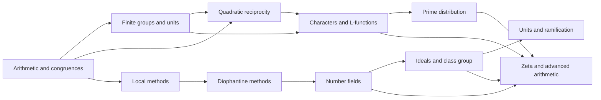

# Meta-Graph: Graduate Number Theory

> **Purpose.** This is a subject-level dependency map for planning a future theorem knowledge graph. It shows a representative route through the field; it is not a complete list of prerequisites, a formal proof dependency database, or a claim that every course follows this order.

## How to read this graph

- **Nodes** are foundational ideas, methods, structural results, or major theorems. A node may later expand into its own proof-level graph.
- An arrow `X → Y` means that X commonly supplies language, a method, a hypothesis, or a result used in understanding or proving Y. The edge table says which role it plays.
- Some edges describe a common proof route or conceptual bridge rather than a logically necessary dependency. The eventual theorem graph should record the exact theorem, hypotheses, source, and proof step for every strict dependency.
- The graph is a DAG at this global overview level. Feedback and revision belong inside proof workflows; they should not be mistaken for a theorem depending on itself.

## Global subject map

## Node register

| ID | Idea, theorem, or method | Role in the subject |
|---|---|---|
| A | Arithmetic and congruences | Build divisibility, gcd, congruence, CRT, and arithmetic functions |
| B | Finite groups and units | Explain multiplicative order, primitive roots, and unit groups modulo n |
| C | Quadratic reciprocity | Connect quadratic residue symbols, Gauss ideas, and prime congruences |
| D | Local methods | Use p-adic completion and Hensel lifting to solve congruences locally |
| E | Diophantine methods | Organize descent, Pell equations, local obstructions, and integral points |
| F | Number fields | Introduce algebraic integers, embeddings, norm, trace, and discriminant |
| G | Ideals and class group | Restore factorization through ideals and measure its failure through the class group |
| H | Units and ramification | Describe unit structure and prime behavior in extensions |
| I | Characters and L-functions | Encode arithmetic data in Dirichlet characters and Euler products |
| J | Prime distribution | Derive prime-counting and progression results from analytic estimates |
| K | Zeta and advanced arithmetic | Extend the architecture to Dedekind zeta functions and modern topics |

## Dependency register

| From → To | Connection type | How the earlier node supports the later node |
|---|---|---|
| A → B (Arithmetic and congruences → Finite groups and units) | Common mathematical dependency | Group structure interprets units and orders. |
| A → C (Arithmetic and congruences → Quadratic reciprocity) | Common mathematical dependency | Congruences host residue symbols. |
| B → C (Finite groups and units → Quadratic reciprocity) | Common mathematical dependency | Cyclic structure supports residue calculations. |
| A → D (Arithmetic and congruences → Local methods) | Common mathematical dependency | Integer congruences pass to local rings. |
| D → E (Local methods → Diophantine methods) | Common mathematical dependency | Local solvability tests Diophantine equations. |
| E → F (Diophantine methods → Number fields) | Common mathematical dependency | Number fields provide a setting for integral equations. |
| F → G (Number fields → Ideals and class group) | Common mathematical dependency | Rings of integers motivate ideal factorization. |
| G → H (Ideals and class group → Units and ramification) | Common mathematical dependency | Ideal theory supports prime decomposition. |
| B → I (Finite groups and units → Characters and L-functions) | Common mathematical dependency | Finite characters encode periodic multiplicative data. |
| C → I (Quadratic reciprocity → Characters and L-functions) | Common mathematical dependency | Reciprocity informs character sums. |
| I → J (Characters and L-functions → Prime distribution) | Common mathematical dependency | L-functions and character orthogonality control primes. |
| F → K (Number fields → Zeta and advanced arithmetic) | Common mathematical dependency | Field invariants define Dedekind zeta functions. |
| G → K (Ideals and class group → Zeta and advanced arithmetic) | Common mathematical dependency | Ideal classes enter zeta factorization. |
| I → K (Characters and L-functions → Zeta and advanced arithmetic) | Common mathematical dependency | Euler products and analytic continuation extend the toolkit. |
| J → K (Prime distribution → Zeta and advanced arithmetic) | Common mathematical dependency | Prime ideal asymptotics are an advanced endpoint. |

## Suggested reading paths

**Core route:** follow the nodes from foundational language toward the central structural theorems, then continue to the advanced endpoint. For a first pass, read the graph left to right and pause at each node to state its hypotheses and output.

**Theorem-focused route:** choose a major theorem node, trace incoming arrows backward to identify imported results, then trace outgoing arrows to see what the theorem enables. Mark which incoming edges are strict dependencies after consulting a proof-level source.

**Bridge route:** follow cross-links between methods and neighboring theories. Treat these as transfer routes: identify exactly what is preserved, what hypotheses are added, and what changes under translation.

## Five-faculty expansion for each theorem node

When a node is selected for a complete Meta-Math walkthrough, preserve the node ID and expand it into a local five-faculty proof graph:

| Faculty | Local responsibility |
|---|---|
| **Ego** | State the precise theorem goal, scope, and proof contract; distinguish the claim from nearby stronger or weaker claims. |
| **Memory** | Retrieve definitions, hypotheses, lemmas, source references, and known examples/counterexamples required by this node. |
| **Intellect** | Select and order proof steps; justify each inference and expose dependency on incoming nodes. |
| **Sense** | Check type/notation consistency, hypothesis use, boundary cases, examples, and whether each intermediate claim is actually supported. |
| **Action** | Execute proof steps, calculations, constructions, or formal checks; emit the verified result and update outgoing dependencies. |

A later graph version should connect global theorem nodes to these local faculty nodes, with typed edges such as `uses`, `specializes`, `generalizes`, `contradicts`, `analogy-only`, and `verified-by`.

## Expansion record

For each node promoted from this map, add a stable theorem or concept ID, exact statement, source and page/section, prerequisite IDs, proof-step graph, explicit hypothesis checks, known failure modes, examples, and verification status. Keep conjectural or analogy-only links visually distinct from proved dependencies.

**Related syllabus:** [`outline.md`](book-outline.md).
