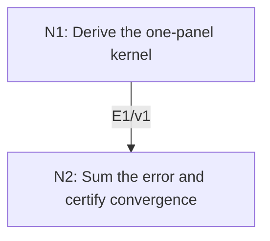

# Composite Trapezoidal Rule with a Certified Error Bound

## An End-to-End Metacognitive Mathematics Walkthrough

**Problem ID:** ON-05  
**Version:** 1  
**Subject:** Optimization and Numerical Analysis  
**Level:** Introductory  
**Status:** Complete authored exposition relative to the declared imports.  
**Evidence:** Mathematical argument and authored teaching traces; no actual multi-agent run, independent review, or proof-assistant certification is claimed.

## 1. Target, definitions, and import contract

For $f\in C^2([a,b])$, $a<b$, let $N\ge1$, $h=(b-a)/N$, and $x_j=a+jh$. Define $T_N=h(f(a)/2+\sum_{j=1}^{N-1}f(x_j)+f(b)/2)$. Prove $|T_N-\int_a^b f(x)\,dx|\le (b-a)h^2\|f''\|_\infty/12$. If $f''\ge0$, also prove $T_N\ge\int_a^b f$. These concern exact sampled values and arithmetic.

### Permitted imports and conventions

Use integration by parts for $C^2$ functions and finite sums. The bound $\|f''\|_\infty$ is finite by continuity on the compact interval. Distinguish quadrature error from errors in function evaluation or floating-point summation, which require separate estimates.

## 2. Intuition and node interaction workflow

A nonnegative kernel expresses the local quadrature error exactly. Its integral gives the constant, and summing local errors gives the global order.

Each mathematical node contains **Ego, Memory, Intellect, Sense, and Action**. The diagram records accepted proof dependencies. Requests to repair an argument belong only to §6; they are not backward proof edges.

### Evidence transfer ledger

| Transfer | Producer and export | Receiving activity | Exact claim and compatibility |
|---|---|---|---|
| T1-2 | N1/v1 · E1/v1 | N2.1 | $\frac h2(f(u)+f(v))-\int_u^v f=\int_u^v K(t)f''(t)\,dt$. Inputs in N2 retain the producer's assumptions; evidence: §4.N1. |

## 3. Node roles and five-faculty contracts

### N1/v1 — Derive the one-panel kernel

**Object and inputs:** One interval $[u,v]$ of length $h$ and $K(t)=(t-u)(v-t)/2$.

**Role and strategy:** Integrate $Kf''$ twice by parts to recover endpoint weights and the exact integral.

**Local obligation:** $\frac h2(f(u)+f(v))-\int_u^v f=\int_u^v K(t)f''(t)\,dt$.

| Faculty | Concrete responsibility |
|---|---|
| Ego | Publish E1/v1 only with its stated domain and assumptions: $\frac h2(f(u)+f(v))-\int_u^v f=\int_u^v K(t)f''(t)\,dt$. |
| Memory | One interval $[u,v]$ of length $h$ and $K(t)=(t-u)(v-t)/2$. Preserve the §1 conventions and incoming export versions. |
| Intellect | Integrate $Kf''$ twice by parts to recover endpoint weights and the exact integral. |
| Sense | The boundary values are $K(u)=K(v)=0$, $K'(u)=h/2$, $K'(v)=-h/2$, and $K''=-1$. |
| Action | Execute activities N1.1–N1.2 in §4.N1; preserve the displayed calculations as evidence. |

**Export E1/v1:** $\frac h2(f(u)+f(v))-\int_u^v f=\int_u^v K(t)f''(t)\,dt$. Evidence: the complete local derivation in §4.N1.

**Acceptance gate:** Establish the local obligation through every numbered activity below and discharge this concrete check: The boundary values are $K(u)=K(v)=0$, $K'(u)=h/2$, $K'(v)=-h/2$, and $K''=-1$.

**Targeted repair:** If the sign of the error is uncertain, recompute the endpoint derivatives of $K$ before taking absolute values. Withhold E1 and its dependent exports until the correction has been checked; a revised export receives a new version.

### N2/v1 — Sum the error and certify convergence

**Object and inputs:** E1/v1 on each of the $N$ equal panels. Incoming proof exports: E1/v1 at N2.1.

**Role and strategy:** Add exact identities, then use nonnegativity of the kernel for magnitude and sign.

**Local obligation:** The stated absolute error and convex-function overestimate hold; in particular $T_N\to\int_a^b f$.

| Faculty | Concrete responsibility |
|---|---|
| Ego | Publish E2/v1 only with its stated domain and assumptions: The stated absolute error and convex-function overestimate hold; in particular $T_N\to\int_a^b f$. |
| Memory | E1/v1 on each of the $N$ equal panels. Preserve the §1 conventions and incoming export versions. |
| Intellect | Add exact identities, then use nonnegativity of the kernel for magnitude and sign. |
| Sense | There are $N=(b-a)/h$ panels, so the local $h^3$ bound becomes a global $h^2$ bound. |
| Action | Execute activities N2.1–N2.2 in §4.N2; preserve the displayed calculations as evidence. |

**Export E2/v1:** The stated absolute error and convex-function overestimate hold; in particular $T_N\to\int_a^b f$. Evidence: the complete local derivation in §4.N2.

**Acceptance gate:** Establish the local obligation through every numbered activity below and discharge this concrete check: There are $N=(b-a)/h$ panels, so the local $h^3$ bound becomes a global $h^2$ bound.

**Targeted repair:** If the local $h^3$ rate is reported as the global rate, multiply by the number of panels and restore the $h^2$ bound. Withhold E2 and its dependent exports until the correction has been checked; a revised export receives a new version.

## 4. Continuous mathematical proof

The following activities form one continuous proof. Intermediate claims are established where used, except for the explicitly permitted imports in §1.

### §4.N1 — Derive the one-panel kernel

1. **N1.1.** Integration by parts gives $\int_u^v Kf''=-\int_u^v K'f'$, since $K$ vanishes at the endpoints. Integrating again gives $-[K'f]_u^v+\int_u^v K''f$.

2. **N1.2.** Using the displayed endpoint derivatives and $K''=-1$ yields $(h/2)(f(u)+f(v))-\int_u^v f$, exactly the local error with the sign $T-I$. Also $K\ge0$ and, after setting $s=t-u$, $\int_u^v K=\frac12\int_0^h s(h-s)\,ds=h^3/12$.

### §4.N2 — Sum the error and certify convergence

1. **N2.1.** Summing the one-panel trapezoids counts each interior sample twice with weight $h/2$, producing $T_N$. The exact error is the sum of the panel kernel integrals. Its absolute value is bounded by $N(h^3/12)\|f''\|_\infty=(b-a)h^2\|f''\|_\infty/12$.

2. **N2.2.** If $f''\ge0$, every kernel integral is nonnegative, proving the overestimate. Since $h\to0$ as $N\to\infty$, the absolute bound also proves convergence. The smoothness and fixed interval make the same derivative bound valid for all $N$.

## 5. Worked instance and boundary audit

For $f(x)=x^2$ on $[0,1]$ and $N=2$, $T_2=\tfrac12(0+\tfrac14+\tfrac12)=3/8$, while the integral is $1/3$. The error is $1/24$, exactly the bound $1\cdot(1/2)^2\cdot2/12=1/24$. Convexity correctly predicts an overestimate.

### Boundary or failed-inference witness

For $f(x)=|x|$ on $[-1,1]$, the one-panel trapezoid is $2$ and the integral is $1$. Although $f''=0$ away from zero, the function is not $C^2$; treating its a.e. second derivative as a classical uniform bound would incorrectly predict zero error.

## 6. Illustrative interaction and repair trace

**Trace status:** Authored illustration, not a logged agent execution. The rejected candidate below is outside the accepted DAG.

**Rejected N1 shortcut:** use $f''=0$ almost everywhere in the $C^2$ kernel formula for $|x|$. **Diagnosis:** Memory silently replaced classical regularity by an a.e. derivative without the needed absolute-continuity bridge. **Repair:** keep the stated $C^2$ hypothesis; for $|x|$, split at its corner and integrate the two affine pieces separately, obtaining the exact value $1$. That split is a separate valid computation, not a proof of the unqualified bound.

After the corrected argument is supplied, Ego may publish a hypothetical v2 export, Memory replaces the rejected version, and Action rechecks each descendant in §2. The accepted exposition in this file is v1; this scenario does not claim an actual revision or execution occurred.

## 7. Evidence ledger and reusable exports

| Item | Evidence and scope | Remaining limitation |
|---|---|---|
| Target theorem | §4, under exactly the §1 hypotheses and imports | Authored mathematical exposition; no independent or formal verification |
| E1–E2 | Local proofs §4.N1–§4.N2; version 1 | Imports remain attached to each reuse |
| Worked instance | Explicit computation or construction in §5 | Illustrates the mechanism; does not prove the universal theorem |
| Repair | Rejected inference, witness, and correction in §6 | Teaching scenario rather than empirical agent evidence |

**Reusable target:** Preserve `ON-05/v1`, the exact statement in §1, its assumptions, and this proof when reusing the result.

**Next direction:** Develop adaptive panel selection from local derivative bounds, then add explicit evaluation and roundoff error terms for numerical certification.

## 8. Sources and navigation

The proof and faculty decomposition are authored for this collection. The following primary teaching sources support further study; exact imports are specified in §1.

[Boyd and Vandenberghe, Convex Optimization](https://web.stanford.edu/~boyd/cvxbook/) for convexity, optimality, and descent; [University of Maryland, Scientific Computing I](https://www.math.umd.edu/~mariakc/Spring2020Class.html) for the numerical-analysis setting. The estimates used here are derived explicitly in §4.

**Local imported proof modules:** None. Supporting external results are specified in §1.

[Five-project subject index](problems.md) · [Project README](../README.md) · [Graduate subject outline](../../book/outline.md)
