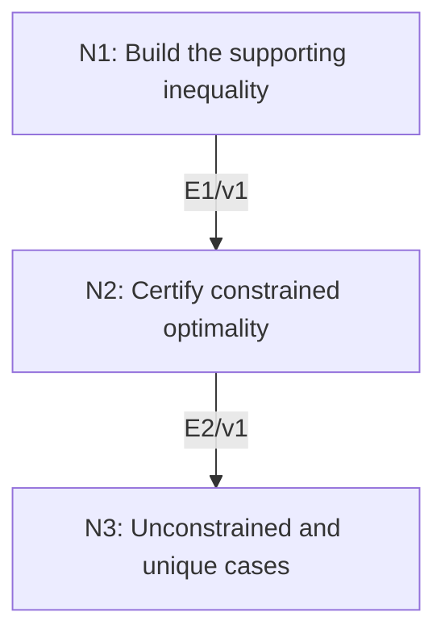

# First-Order Characterization of Convex Minimizers

## An End-to-End Metacognitive Mathematics Walkthrough

**Problem ID:** ON-01  
**Version:** 1  
**Subject:** Optimization and Numerical Analysis  
**Level:** Introductory  
**Status:** Complete authored exposition relative to the declared imports.  
**Evidence:** Mathematical argument and authored teaching traces; no actual multi-agent run, independent review, or proof-assistant certification is claimed.

## 1. Target, definitions, and import contract

Let $f:\mathbb R^d\to\mathbb R$ be differentiable and convex, and let $C\subset\mathbb R^d$ be nonempty and convex. For $x_*\in C$, prove that $x_*$ minimizes $f$ over $C$ if and only if $\langle\nabla f(x_*),y-x_*\rangle\ge0$ for every $y\in C$. In particular, on $C=\mathbb R^d$ this is equivalent to $\nabla f(x_*)=0$. If $f$ is strictly convex on $C$, there is at most one minimizer.

### Permitted imports and conventions

Convexity means $f((1-t)x+ty)\le(1-t)f(x)+tf(y)$ for $0\le t\le1$; strict convexity makes it strict for distinct points and $0<t<1$. Use differentiation along line segments and the elementary Euclidean inner product. This is a characterization at a proposed point, not an existence theorem for arbitrary $C$.

## 2. Intuition and node interaction workflow

A supporting affine function supplies global sufficiency. Feasible line segments supply the converse even when the minimizer is on the boundary.

Each mathematical node contains **Ego, Memory, Intellect, Sense, and Action**. The diagram records accepted proof dependencies. Requests to repair an argument belong only to §6; they are not backward proof edges.

### Evidence transfer ledger

| Transfer | Producer and export | Receiving activity | Exact claim and compatibility |
|---|---|---|---|
| T1-2 | N1/v1 · E1/v1 | N2.2 | $f(y)\ge f(x)+\langle\nabla f(x),y-x\rangle$. Inputs in N2 retain the producer's assumptions; evidence: §4.N1. |
| T2-3 | N2/v1 · E2/v1 | N3.1 | $x_*$ is a global minimizer over $C$ exactly when all feasible directional inner products are nonnegative. Inputs in N3 retain the producer's assumptions; evidence: §4.N2. |

## 3. Node roles and five-faculty contracts

### N1/v1 — Build the supporting inequality

**Object and inputs:** Differentiable convex $f$ and any $x,y\in\mathbb R^d$.

**Role and strategy:** Divide the convex secant inequality by its positive parameter and let it tend to zero.

**Local obligation:** $f(y)\ge f(x)+\langle\nabla f(x),y-x\rangle$.

| Faculty | Concrete responsibility |
|---|---|
| Ego | Publish E1/v1 only with its stated domain and assumptions: $f(y)\ge f(x)+\langle\nabla f(x),y-x\rangle$. |
| Memory | Differentiable convex $f$ and any $x,y\in\mathbb R^d$. Preserve the §1 conventions and incoming export versions. |
| Intellect | Divide the convex secant inequality by its positive parameter and let it tend to zero. |
| Sense | The parameter approaches zero through positive values; a one-sided segment is sufficient. |
| Action | Execute activities N1.1–N1.2 in §4.N1; preserve the displayed calculations as evidence. |

**Export E1/v1:** $f(y)\ge f(x)+\langle\nabla f(x),y-x\rangle$. Evidence: the complete local derivation in §4.N1.

**Acceptance gate:** Establish the local obligation through every numbered activity below and discharge this concrete check: The parameter approaches zero through positive values; a one-sided segment is sufficient.

**Targeted repair:** If a local Taylor approximation is used as a global lower bound, replace it by this convexity argument; Taylor’s remainder has no automatic sign. Withhold E1 and its dependent exports until the correction has been checked; a revised export receives a new version.

### N2/v1 — Certify constrained optimality

**Object and inputs:** E1/v1, convex $C$, and a proposed $x_*\in C$. Incoming proof exports: E1/v1 at N2.2.

**Role and strategy:** Use feasible directional derivatives for necessity and the global support for sufficiency.

**Local obligation:** $x_*$ is a global minimizer over $C$ exactly when all feasible directional inner products are nonnegative.

| Faculty | Concrete responsibility |
|---|---|
| Ego | Publish E2/v1 only with its stated domain and assumptions: $x_*$ is a global minimizer over $C$ exactly when all feasible directional inner products are nonnegative. |
| Memory | E1/v1, convex $C$, and a proposed $x_*\in C$. Preserve the §1 conventions and incoming export versions. |
| Intellect | Use feasible directional derivatives for necessity and the global support for sufficiency. |
| Sense | A boundary minimizer need not have zero gradient; only feasible directions are tested. |
| Action | Execute activities N2.1–N2.2 in §4.N2; preserve the displayed calculations as evidence. |

**Export E2/v1:** $x_*$ is a global minimizer over $C$ exactly when all feasible directional inner products are nonnegative. Evidence: the complete local derivation in §4.N2.

**Acceptance gate:** Establish the local obligation through every numbered activity below and discharge this concrete check: A boundary minimizer need not have zero gradient; only feasible directions are tested.

**Targeted repair:** If stationarity is imposed at the boundary, restore the feasible-direction inequality instead of demanding all directions have zero derivative. Withhold E2 and its dependent exports until the correction has been checked; a revised export receives a new version.

### N3/v1 — Unconstrained and unique cases

**Object and inputs:** E2/v1, and strict convexity when asserting uniqueness. Incoming proof exports: E2/v1 at N3.1.

**Role and strategy:** Test the negative gradient as a direction, and use a midpoint to rule out two distinct minimizers.

**Local obligation:** For $C=\mathbb R^d$, zero gradient is equivalent to optimality; strict convexity gives at most one minimizer.

| Faculty | Concrete responsibility |
|---|---|
| Ego | Publish E3/v1 only with its stated domain and assumptions: For $C=\mathbb R^d$, zero gradient is equivalent to optimality; strict convexity gives at most one minimizer. |
| Memory | E2/v1, and strict convexity when asserting uniqueness. Preserve the §1 conventions and incoming export versions. |
| Intellect | Test the negative gradient as a direction, and use a midpoint to rule out two distinct minimizers. |
| Sense | Uniqueness does not imply existence; for example a function on an open feasible set can have an unattained infimum. |
| Action | Execute activities N3.1–N3.2 in §4.N3; preserve the displayed calculations as evidence. |

**Export E3/v1:** For $C=\mathbb R^d$, zero gradient is equivalent to optimality; strict convexity gives at most one minimizer. Evidence: the complete local derivation in §4.N3.

**Acceptance gate:** Establish the local obligation through every numbered activity below and discharge this concrete check: Uniqueness does not imply existence; for example a function on an open feasible set can have an unattained infimum.

**Targeted repair:** If a unique minimizer is declared without an existence argument, retain the precise at-most-one conclusion. Withhold E3 and its dependent exports until the correction has been checked; a revised export receives a new version.

## 4. Continuous mathematical proof

The following activities form one continuous proof. Intermediate claims are established where used, except for the explicitly permitted imports in §1.

### §4.N1 — Build the supporting inequality

1. **N1.1.** For $0<t\le1$, convexity gives $f(x+t(y-x))-f(x)\le t(f(y)-f(x))$. Divide by $t>0$.

2. **N1.2.** Differentiability at $x$ makes the left quotient tend to $\langle\nabla f(x),y-x\rangle$ as $t\downarrow0$. Rearrangement yields the supporting inequality for every $x,y$.

### §4.N2 — Certify constrained optimality

1. **N2.1.** If $x_*$ minimizes $f$, then for $y\in C$ the segment $x_*+t(y-x_*)$ remains feasible. Its difference quotient from $x_*$ is nonnegative for $t>0$. Taking the limit gives $\langle\nabla f(x_*),y-x_*\rangle\ge0$.

2. **N2.2.** Conversely, if those inequalities hold, E1 gives $f(y)\ge f(x_*)+\langle\nabla f(x_*),y-x_*\rangle\ge f(x_*)$ for every $y\in C$. This is the required global conclusion.

### §4.N3 — Unconstrained and unique cases

1. **N3.1.** In the unconstrained case substitute $y=x_*-\nabla f(x_*)$ in E2 to get $-\|\nabla f(x_*)\|^2\ge0$, hence the gradient is zero. The converse follows immediately from E2.

2. **N3.2.** If distinct $x_*,z_*$ both minimize and $f$ is strictly convex on $C$, their midpoint lies in $C$ and has strictly smaller value than the average of their equal minimum values, a contradiction. This proves at-most-one, completing the theorem.

## 5. Worked instance and boundary audit

For $f(x)=(x+1)^2$ and $C=[0,\infty)$, choose $x_*=0$. The derivative is $2$, not zero, but $f'(0)(y-0)=2y\ge0$ for all feasible $y$. The theorem certifies the boundary minimizer; strict convexity makes it unique.

### Boundary or failed-inference witness

Without convexity of $f$, zero gradient need not indicate a minimum: $f(x)=-x^2$ has $f'(0)=0$ and a strict maximum at zero. Existence also fails for the strictly convex $f(x)=x^2$ on $C=(0,1)$, whose infimum is not attained.

## 6. Illustrative interaction and repair trace

**Trace status:** Authored illustration, not a logged agent execution. The rejected candidate below is outside the accepted DAG.

**Rejected N2 claim:** a constrained optimum must satisfy $\nabla f=0$. The worked boundary example refutes it. **Diagnosis:** Intellect tested infeasible negative directions. **Repair:** test only $y-x_*$ with $y\in C$ and prove the variational inequality. This replaces the invalid candidate with the exact §1 statement; the unconstrained zero-gradient corollary still holds separately.

After the corrected argument is supplied, Ego may publish a hypothetical v2 export, Memory replaces the rejected version, and Action rechecks each descendant in §2. The accepted exposition in this file is v1; this scenario does not claim an actual revision or execution occurred.

## 7. Evidence ledger and reusable exports

| Item | Evidence and scope | Remaining limitation |
|---|---|---|
| Target theorem | §4, under exactly the §1 hypotheses and imports | Authored mathematical exposition; no independent or formal verification |
| E1–E3 | Local proofs §4.N1–§4.N3; version 1 | Imports remain attached to each reuse |
| Worked instance | Explicit computation or construction in §5 | Illustrates the mechanism; does not prove the universal theorem |
| Repair | Rejected inference, witness, and correction in §6 | Teaching scenario rather than empirical agent evidence |

**Reusable target:** Preserve `ON-01/v1`, the exact statement in §1, its assumptions, and this proof when reusing the result.

**Next direction:** Add normal cones or convex inequality constraints to develop constrained optimality without confusing boundary points with unconstrained stationary points.

## 8. Sources and navigation

The proof and faculty decomposition are authored for this collection. The following primary teaching sources support further study; exact imports are specified in §1.

[Boyd and Vandenberghe, Convex Optimization](https://web.stanford.edu/~boyd/cvxbook/) for convexity, optimality, and descent; [University of Maryland, Scientific Computing I](https://www.math.umd.edu/~mariakc/Spring2020Class.html) for the numerical-analysis setting. The estimates used here are derived explicitly in §4.

**Local imported proof modules:** None. Supporting external results are specified in §1.

[Five-project subject index](problems.md) · [Project README](../README.md) · [Graduate subject outline](../../book/outline.md)
