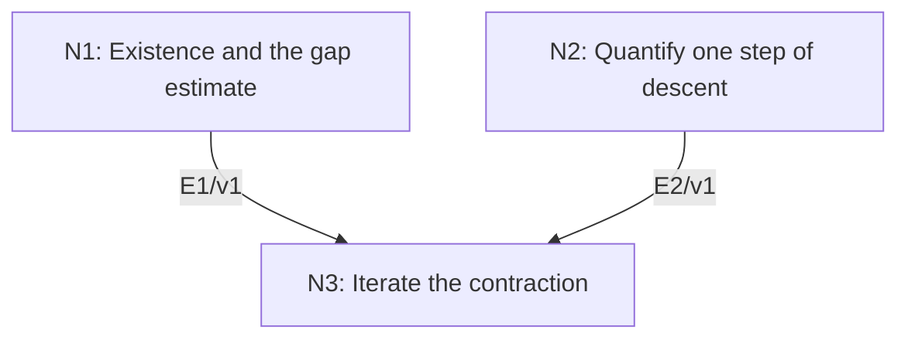

# Linear Convergence of Gradient Descent

## An End-to-End Metacognitive Mathematics Walkthrough

**Problem ID:** ON-03  
**Version:** 1  
**Subject:** Optimization and Numerical Analysis  
**Level:** Intermediate  
**Status:** Complete authored exposition relative to the declared imports.  
**Evidence:** Mathematical argument and authored teaching traces; no actual multi-agent run, independent review, or proof-assistant certification is claimed.

## 1. Target, definitions, and import contract

Let $f:\mathbb R^d\to\mathbb R$ be $C^1$, $\mu$-strongly convex, and have an $L$-Lipschitz gradient, with $0<\mu\le L$. Strong convexity here means $f(y)\ge f(x)+\langle\nabla f(x),y-x\rangle+(\mu/2)\|y-x\|^2$ for every $x,y$. Prove there is a unique minimizer $x_*$ and, for exact-arithmetic iterates $x_{k+1}=x_k-\nabla f(x_k)/L$, $f(x_k)-f(x_*)\le(1-\mu/L)^k(f(x_0)-f(x_*))$. Also $x_k\to x_*$. Interpret the bound at $k=0$ as equality, including when $\mu=L$.

### Permitted imports and conventions

Use the fundamental theorem of calculus along a segment, Cauchy–Schwarz, and attainment of the minimum of a continuous function on a compact set. The gradient Lipschitz property is $\|\nabla f(x)-\nabla f(y)\|\le L\|x-y\|$. All norms are Euclidean. The theorem concerns exact iterations and does not certify rounding-error behavior.

## 2. Intuition and node interaction workflow

Smoothness turns a gradient step into a quantified decrease. Strong convexity both guarantees an optimum and links the remaining objective gap to the gradient size.

Each mathematical node contains **Ego, Memory, Intellect, Sense, and Action**. The diagram records accepted proof dependencies. Requests to repair an argument belong only to §6; they are not backward proof edges.

### Evidence transfer ledger

| Transfer | Producer and export | Receiving activity | Exact claim and compatibility |
|---|---|---|---|
| T1-3 | N1/v1 · E1/v1 | N3.1 | A unique $x_*$ exists, $\nabla f(x_*)=0$, and $f(x)-f(x_*)\le\Vert\nabla f(x)\Vert^2/(2\mu)$. Inputs in N3 retain the producer's assumptions; evidence: §4.N1. |
| T2-3 | N2/v1 · E2/v1 | N3.1 | $f(x-\nabla f(x)/L)\le f(x)-\Vert\nabla f(x)\Vert^2/(2L)$. Inputs in N3 retain the producer's assumptions; evidence: §4.N2. |

## 3. Node roles and five-faculty contracts

### N1/v1 — Existence and the gap estimate

**Object and inputs:** Strong convexity with $\mu>0$.

**Role and strategy:** Use a quadratic lower bound for coercivity, then minimize the quadratic support model.

**Local obligation:** A unique $x_*$ exists, $\nabla f(x_*)=0$, and $f(x)-f(x_*)\le\|\nabla f(x)\|^2/(2\mu)$.

| Faculty | Concrete responsibility |
|---|---|
| Ego | Publish E1/v1 only with its stated domain and assumptions: A unique $x_*$ exists, $\nabla f(x_*)=0$, and $f(x)-f(x_*)\le\Vert\nabla f(x)\Vert^2/(2\mu)$. |
| Memory | Strong convexity with $\mu>0$. Preserve the §1 conventions and incoming export versions. |
| Intellect | Use a quadratic lower bound for coercivity, then minimize the quadratic support model. |
| Sense | The lower bound must grow at infinity; a merely convex function need not attain its infimum. |
| Action | Execute activities N1.1–N1.2 in §4.N1; preserve the displayed calculations as evidence. |

**Export E1/v1:** A unique $x_*$ exists, $\nabla f(x_*)=0$, and $f(x)-f(x_*)\le\|\nabla f(x)\|^2/(2\mu)$. Evidence: the complete local derivation in §4.N1.

**Acceptance gate:** Establish the local obligation through every numbered activity below and discharge this concrete check: The lower bound must grow at infinity; a merely convex function need not attain its infimum.

**Targeted repair:** If the sign of the gradient-gap estimate is reversed, complete the square explicitly; the resulting bound is a lower bound on gradient size in terms of the gap. Withhold E1 and its dependent exports until the correction has been checked; a revised export receives a new version.

### N2/v1 — Quantify one step of descent

**Object and inputs:** An $L$-Lipschitz gradient and $s=-\nabla f(x)/L$.

**Role and strategy:** Integrate the gradient difference along a segment to derive the descent lemma.

**Local obligation:** $f(x-\nabla f(x)/L)\le f(x)-\|\nabla f(x)\|^2/(2L)$.

| Faculty | Concrete responsibility |
|---|---|
| Ego | Publish E2/v1 only with its stated domain and assumptions: $f(x-\nabla f(x)/L)\le f(x)-\Vert\nabla f(x)\Vert^2/(2L)$. |
| Memory | An $L$-Lipschitz gradient and $s=-\nabla f(x)/L$. Preserve the §1 conventions and incoming export versions. |
| Intellect | Integrate the gradient difference along a segment to derive the descent lemma. |
| Sense | The factor $1/2$ comes from integrating $t$ from zero to one; the step is exactly $1/L$. |
| Action | Execute activities N2.1–N2.2 in §4.N2; preserve the displayed calculations as evidence. |

**Export E2/v1:** $f(x-\nabla f(x)/L)\le f(x)-\|\nabla f(x)\|^2/(2L)$. Evidence: the complete local derivation in §4.N2.

**Acceptance gate:** Establish the local obligation through every numbered activity below and discharge this concrete check: The factor $1/2$ comes from integrating $t$ from zero to one; the step is exactly $1/L$.

**Targeted repair:** If arbitrary positive step sizes are declared descending, retain the smoothness quadratic term and verify its coefficient before choosing a step. Withhold E2 and its dependent exports until the correction has been checked; a revised export receives a new version.

### N3/v1 — Iterate the contraction

**Object and inputs:** E1/v1 and E2/v1 for every iterate. Incoming proof exports: E1/v1 at N3.1, E2/v1 at N3.1.

**Role and strategy:** Combine the gap-gradient inequality with one-step descent, then control distance by strong convexity at the minimizer.

**Local obligation:** The stated geometric objective bound holds and $\|x_k-x_*\|^2\le2(f(x_k)-f(x_*))/\mu\to0$.

| Faculty | Concrete responsibility |
|---|---|
| Ego | Publish E3/v1 only with its stated domain and assumptions: The stated geometric objective bound holds and $\Vertx_k-x_*\Vert^2\le2(f(x_k)-f(x_*))/\mu\to0$. |
| Memory | E1/v1 and E2/v1 for every iterate. Preserve the §1 conventions and incoming export versions. |
| Intellect | Combine the gap-gradient inequality with one-step descent, then control distance by strong convexity at the minimizer. |
| Sense | Objective convergence alone is not automatically convergence of points; the quadratic growth estimate supplies that bridge. |
| Action | Execute activities N3.1–N3.2 in §4.N3; preserve the displayed calculations as evidence. |

**Export E3/v1:** The stated geometric objective bound holds and $\|x_k-x_*\|^2\le2(f(x_k)-f(x_*))/\mu\to0$. Evidence: the complete local derivation in §4.N3.

**Acceptance gate:** Establish the local obligation through every numbered activity below and discharge this concrete check: Objective convergence alone is not automatically convergence of points; the quadratic growth estimate supplies that bridge.

**Targeted repair:** If point convergence is inferred solely from function values, insert the positive quadratic growth bound with its factor $\mu/2$. Withhold E3 and its dependent exports until the correction has been checked; a revised export receives a new version.

## 4. Continuous mathematical proof

The following activities form one continuous proof. Intermediate claims are established where used, except for the explicitly permitted imports in §1.

### §4.N1 — Existence and the gap estimate

1. **N1.1.** The strong-convexity inequality at $x=0$ gives $f(y)\ge f(0)+\langle\nabla f(0),y\rangle+(\mu/2)\|y\|^2\to\infty$ as $\|y\|\to\infty$. Choose a ball outside which $f>f(0)$; compact attainment inside it gives a global minimizer. Differentiability gives zero gradient there. Strict convexity, which follows from strong convexity, gives uniqueness (or apply the quadratic lower bound at either minimizer).

2. **N1.2.** For $g=\nabla f(x)$, strong convexity at $x$ and $y=x_*$ gives $f(x_*)\ge f(x)+\langle g,x_*-x\rangle+(\mu/2)\|x_*-x\|^2\ge f(x)-\|g\|^2/(2\mu)$ by completing the square. Rearrangement proves the gap estimate.

### §4.N2 — Quantify one step of descent

1. **N2.1.** For any vector $s$, the fundamental theorem gives $f(x+s)-f(x)-\langle\nabla f(x),s\rangle=\int_0^1\langle\nabla f(x+ts)-\nabla f(x),s\rangle\,dt$. Its absolute value is at most $\int_0^1 Lt\|s\|^2dt=(L/2)\|s\|^2$.

2. **N2.2.** Substitute $s=-\nabla f(x)/L$. The linear term is $-\|\nabla f(x)\|^2/L$ and the quadratic term is $\|\nabla f(x)\|^2/(2L)$, giving the claimed decrease.

### §4.N3 — Iterate the contraction

1. **N3.1.** Put $\Delta_k=f(x_k)-f(x_*)\ge0$. E2 and E1 give $\Delta_{k+1}\le\Delta_k-\|\nabla f(x_k)\|^2/(2L)\le(1-\mu/L)\Delta_k$. Induction gives the geometric bound. If $\mu=L$, the first step has gap zero and all later iterates are the minimizer.

2. **N3.2.** Strong convexity at $x_*$, where the gradient is zero, gives $\Delta_k\ge(\mu/2)\|x_k-x_*\|^2$. The objective bound therefore implies convergence of the iterates themselves. This completes the existence, rate, and convergence claims.

## 5. Worked instance and boundary audit

For $f(x,y)=(x^2+4y^2)/2$, take $\mu=1$, $L=4$. The iteration sends $(x,y)$ to $(3x/4,0)$. From $(1,1)$ the first objective drops from $5/2$ to $9/32$, below the certified upper bound $(3/4)(5/2)=15/8$. Later the actual remaining gap shrinks by $9/16$ per step, so the theorem’s $3/4$ factor is conservative.

### Boundary or failed-inference witness

An arbitrary large step fails even for $f(x)=x^2/2$. With step size $3$ the iteration is $x_{k+1}=-2x_k$, and the objective grows by a factor of four unless $x_0=0$. The prescribed step and smoothness bound cannot be discarded.

## 6. Illustrative interaction and repair trace

**Trace status:** Authored illustration, not a logged agent execution. The rejected candidate below is outside the accepted DAG.

**Rejected N3 argument:** decreasing objective values guarantee convergence to the unique optimum with a geometric rate. Monotone numbers alone provide neither conclusion. **Diagnosis:** Intellect omitted the quantitative gradient-gap bridge. **Repair:** use E1 to obtain the actual contraction factor and the strong-convexity distance estimate. This completes the original theorem under its existing assumptions; recheck both objective and point convergence.

After the corrected argument is supplied, Ego may publish a hypothetical v2 export, Memory replaces the rejected version, and Action rechecks each descendant in §2. The accepted exposition in this file is v1; this scenario does not claim an actual revision or execution occurred.

## 7. Evidence ledger and reusable exports

| Item | Evidence and scope | Remaining limitation |
|---|---|---|
| Target theorem | §4, under exactly the §1 hypotheses and imports | Authored mathematical exposition; no independent or formal verification |
| E1–E3 | Local proofs §4.N1–§4.N3; version 1 | Imports remain attached to each reuse |
| Worked instance | Explicit computation or construction in §5 | Illustrates the mechanism; does not prove the universal theorem |
| Repair | Rejected inference, witness, and correction in §6 | Teaching scenario rather than empirical agent evidence |

**Reusable target:** Preserve `ON-03/v1`, the exact statement in §1, its assumptions, and this proof when reusing the result.

**Next direction:** Investigate accelerated methods or inexact gradients with newly stated error bounds; do not transfer this exact-arithmetic rate unchanged.

## 8. Sources and navigation

The proof and faculty decomposition are authored for this collection. The following primary teaching sources support further study; exact imports are specified in §1.

[Boyd and Vandenberghe, Convex Optimization](https://web.stanford.edu/~boyd/cvxbook/) for convexity, optimality, and descent; [University of Maryland, Scientific Computing I](https://www.math.umd.edu/~mariakc/Spring2020Class.html) for the numerical-analysis setting. The estimates used here are derived explicitly in §4.

**Local imported proof modules:** None. Supporting external results are specified in §1.

[Five-project subject index](problems.md) · [Project README](../README.md) · [Graduate subject outline](../../book/outline.md)
