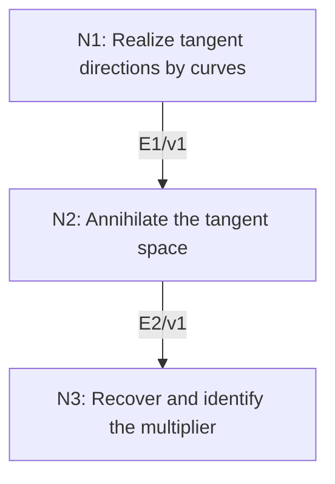

# Lagrange Multipliers under the Full-Rank Condition

## An End-to-End Metacognitive Mathematics Walkthrough

**Problem ID:** ON-02  
**Version:** 1  
**Subject:** Optimization and Numerical Analysis  
**Level:** Intermediate  
**Status:** Complete authored exposition relative to the declared imports.  
**Evidence:** Mathematical argument and authored teaching traces; no actual multi-agent run, independent review, or proof-assistant certification is claimed.

## 1. Target, definitions, and import contract

Let $f:U\to\mathbb R$ and $h:U\to\mathbb R^m$ be $C^1$ on open $U\subset\mathbb R^d$, with $1\le m<d$. Suppose $h(x_*)=0$, $Dh(x_*)$ has rank $m$, and $x_*$ is a local extremum of $f$ on $h^{-1}(0)$. Prove there is a unique $\lambda\in\mathbb R^m$ with $\nabla f(x_*)=Dh(x_*)^T\lambda$. This is a necessary condition, not a general sufficient condition.

### Permitted imports and conventions

Import the implicit function theorem: an invertible $m\times m$ coordinate block of $Dh(x_*)$ gives a local $C^1$ parametrization of the zero set as a graph, whose derivative is obtained by differentiating $h=0$. Use the chain rule and finite-dimensional linear algebra: the row space of a full-row-rank matrix $A$ is $(\ker A)^\perp$. This identity follows from containment plus dimensions $m$ on both sides.

## 2. Intuition and node interaction workflow

The rank condition makes every vector in the linearized constraint kernel the velocity of an actual feasible curve. Stationarity along those curves forces the gradient into the constraint row space.

Each mathematical node contains **Ego, Memory, Intellect, Sense, and Action**. The diagram records accepted proof dependencies. Requests to repair an argument belong only to §6; they are not backward proof edges.

### Evidence transfer ledger

| Transfer | Producer and export | Receiving activity | Exact claim and compatibility |
|---|---|---|---|
| T1-2 | N1/v1 · E1/v1 | N2.1 | For every $v\in\ker A$ there is a $C^1$ feasible curve $\gamma$ through $x_*$ with $\gamma'(0)=v$. Inputs in N2 retain the producer's assumptions; evidence: §4.N1. |
| T2-3 | N2/v1 · E2/v1 | N3.1 | $\nabla f(x_*)\in(\ker A)^\perp$. Inputs in N3 retain the producer's assumptions; evidence: §4.N2. |

## 3. Node roles and five-faculty contracts

### N1/v1 — Realize tangent directions by curves

**Object and inputs:** $A=Dh(x_*)$ of rank $m$, and $v\in\ker A$.

**Role and strategy:** Use the implicit graph to convert a linearized feasible direction into a genuinely feasible curve.

**Local obligation:** For every $v\in\ker A$ there is a $C^1$ feasible curve $\gamma$ through $x_*$ with $\gamma'(0)=v$.

| Faculty | Concrete responsibility |
|---|---|
| Ego | Publish E1/v1 only with its stated domain and assumptions: For every $v\in\ker A$ there is a $C^1$ feasible curve $\gamma$ through $x_*$ with $\gamma'(0)=v$. |
| Memory | $A=Dh(x_*)$ of rank $m$, and $v\in\ker A$. Preserve the §1 conventions and incoming export versions. |
| Intellect | Use the implicit graph to convert a linearized feasible direction into a genuinely feasible curve. |
| Sense | The invertible coordinate block is guaranteed by rank $m$; without it, the kernel may overestimate actual tangent directions. |
| Action | Execute activities N1.1–N1.2 in §4.N1; preserve the displayed calculations as evidence. |

**Export E1/v1:** For every $v\in\ker A$ there is a $C^1$ feasible curve $\gamma$ through $x_*$ with $\gamma'(0)=v$. Evidence: the complete local derivation in §4.N1.

**Acceptance gate:** Establish the local obligation through every numbered activity below and discharge this concrete check: The invertible coordinate block is guaranteed by rank $m$; without it, the kernel may overestimate actual tangent directions.

**Targeted repair:** If a kernel vector is declared tangent without a feasible curve, construct it through the implicit graph and check the full-rank hypothesis. Withhold E1 and its dependent exports until the correction has been checked; a revised export receives a new version.

### N2/v1 — Annihilate the tangent space

**Object and inputs:** E1/v1 and local constrained extremality. Incoming proof exports: E1/v1 at N2.1.

**Role and strategy:** Differentiate the objective along each two-sided feasible curve.

**Local obligation:** $\nabla f(x_*)\in(\ker A)^\perp$.

| Faculty | Concrete responsibility |
|---|---|
| Ego | Publish E2/v1 only with its stated domain and assumptions: $\nabla f(x_*)\in(\ker A)^\perp$. |
| Memory | E1/v1 and local constrained extremality. Preserve the §1 conventions and incoming export versions. |
| Intellect | Differentiate the objective along each two-sided feasible curve. |
| Sense | Both signs of the curve parameter are available locally, allowing a zero derivative rather than a one-sided inequality. |
| Action | Execute activities N2.1–N2.2 in §4.N2; preserve the displayed calculations as evidence. |

**Export E2/v1:** $\nabla f(x_*)\in(\ker A)^\perp$. Evidence: the complete local derivation in §4.N2.

**Acceptance gate:** Establish the local obligation through every numbered activity below and discharge this concrete check: Both signs of the curve parameter are available locally, allowing a zero derivative rather than a one-sided inequality.

**Targeted repair:** If an ambient extremum is assumed instead of a constrained one, apply stationarity only to the feasible curves already constructed. Withhold E2 and its dependent exports until the correction has been checked; a revised export receives a new version.

### N3/v1 — Recover and identify the multiplier

**Object and inputs:** E2/v1 and rank $A=m$. Incoming proof exports: E2/v1 at N3.1.

**Role and strategy:** Identify the orthogonal complement of the kernel with the image of $A^T$.

**Local obligation:** There is a unique $\lambda$ with $\nabla f(x_*)=A^T\lambda$.

| Faculty | Concrete responsibility |
|---|---|
| Ego | Publish E3/v1 only with its stated domain and assumptions: There is a unique $\lambda$ with $\nabla f(x_*)=A^T\lambda$. |
| Memory | E2/v1 and rank $A=m$. Preserve the §1 conventions and incoming export versions. |
| Intellect | Identify the orthogonal complement of the kernel with the image of $A^T$. |
| Sense | Uniqueness of the multiplier uses injectivity of $A^T$, not uniqueness of the constrained optimum. |
| Action | Execute activities N3.1–N3.2 in §4.N3; preserve the displayed calculations as evidence. |

**Export E3/v1:** There is a unique $\lambda$ with $\nabla f(x_*)=A^T\lambda$. Evidence: the complete local derivation in §4.N3.

**Acceptance gate:** Establish the local obligation through every numbered activity below and discharge this concrete check: Uniqueness of the multiplier uses injectivity of $A^T$, not uniqueness of the constrained optimum.

**Targeted repair:** If multiplier existence is treated as sufficient for optimality, retain only the necessary condition and perform a separate second-order or convexity analysis. Withhold E3 and its dependent exports until the correction has been checked; a revised export receives a new version.

## 4. Continuous mathematical proof

The following activities form one continuous proof. Intermediate claims are established where used, except for the explicitly permitted imports in §1.

### §4.N1 — Realize tangent directions by curves

1. **N1.1.** After permuting coordinates write $x=(y,z)$ with $y\in\mathbb R^m$ and $D_yh(x_*)$ invertible. The implicit function theorem writes nearby feasible points as $(\phi(z),z)$, with $\phi(z_*)=y_*$. Differentiating $h(\phi(z),z)=0$ gives $D\phi(z_*)=-(D_yh)^{-1}D_zh$, all derivatives evaluated at $x_*$.

2. **N1.2.** Write $v=(v_y,v_z)$. The equation $Av=0$ says $v_y=D\phi(z_*)v_z$. Hence $\gamma(t)=(\phi(z_*+tv_z),z_*+tv_z)$ is feasible for small positive and negative $t$, passes through $x_*$, and has derivative $v$.

### §4.N2 — Annihilate the tangent space

1. **N2.1.** For each $v\in\ker A$, choose the curve from E1. The scalar $C^1$ function $t\mapsto f(\gamma(t))$ has a local extremum at the interior parameter value zero. Its derivative is therefore zero.

2. **N2.2.** The chain rule gives that derivative as $\langle\nabla f(x_*),v\rangle$. Since $v$ was arbitrary in $\ker A$, the gradient annihilates that kernel.

### §4.N3 — Recover and identify the multiplier

1. **N3.1.** For any $\lambda$ and $v\in\ker A$, $\langle A^T\lambda,v\rangle=\langle\lambda,Av\rangle=0$, so $\operatorname{im}A^T\subset(\ker A)^\perp$. The two spaces have dimension $m$, giving equality. E2 therefore supplies a multiplier.

2. **N3.2.** If $A^T\lambda=A^T\mu$, then $A^T(\lambda-\mu)=0$. Full row rank makes $A^T$ injective, so $\lambda=\mu$. No conclusion that every multiplier solution is an extremum has been used.

## 5. Worked instance and boundary audit

Minimize $f(x,y)=x^2+y^2$ subject to $h(x,y)=x+y-1=0$. The gradient equation is $(2x,2y)=\lambda(1,1)$, hence $x=y=1/2$ and $\lambda=1$. Substituting $y=1-x$ gives $f=2(x-1/2)^2+1/2$, separately verifying that this stationary point is the global minimum.

### Boundary or failed-inference witness

If rank fails, take $f(x,y)=x$ and $h(x,y)=x^2+y^2$. The feasible set is the single point $(0,0)$, which is both a constrained minimum and maximum, but $\nabla f=(1,0)$ while $Dh=(0,0)$, so no multiplier exists. Sufficiency also fails: for $f(x,y)=x^3$ subject to $y=0$, the origin satisfies the multiplier equation but is not an extremum.

## 6. Illustrative interaction and repair trace

**Trace status:** Authored illustration, not a logged agent execution. The rejected candidate below is outside the accepted DAG.

**Rejected N1 inference:** every vector in $\ker Dh$ is the velocity of a feasible curve, without a rank condition. The single-point constraint has $\ker Dh=\mathbb R^2$ at zero but only zero feasible velocities. **Repair:** invoke full rank and the implicit graph exactly as N1 does. The original theorem is preserved; the rank-free extension is rejected. Recheck tangent annihilation and multiplier existence.

After the corrected argument is supplied, Ego may publish a hypothetical v2 export, Memory replaces the rejected version, and Action rechecks each descendant in §2. The accepted exposition in this file is v1; this scenario does not claim an actual revision or execution occurred.

## 7. Evidence ledger and reusable exports

| Item | Evidence and scope | Remaining limitation |
|---|---|---|
| Target theorem | §4, under exactly the §1 hypotheses and imports | Authored mathematical exposition; no independent or formal verification |
| E1–E3 | Local proofs §4.N1–§4.N3; version 1 | Imports remain attached to each reuse |
| Worked instance | Explicit computation or construction in §5 | Illustrates the mechanism; does not prove the universal theorem |
| Repair | Rejected inference, witness, and correction in §6 | Teaching scenario rather than empirical agent evidence |

**Reusable target:** Preserve `ON-02/v1`, the exact statement in §1, its assumptions, and this proof when reusing the result.

**Next direction:** Develop second-order conditions on the tangent space, explicitly separating necessary and sufficient tests.

## 8. Sources and navigation

The proof and faculty decomposition are authored for this collection. The following primary teaching sources support further study; exact imports are specified in §1.

[Boyd and Vandenberghe, Convex Optimization](https://web.stanford.edu/~boyd/cvxbook/) for convexity, optimality, and descent; [University of Maryland, Scientific Computing I](https://www.math.umd.edu/~mariakc/Spring2020Class.html) for the numerical-analysis setting. The estimates used here are derived explicitly in §4.

**Local imported proof modules:** None. Supporting external results are specified in §1.

[Five-project subject index](problems.md) · [Project README](../README.md) · [Graduate subject outline](../../book/outline.md)
