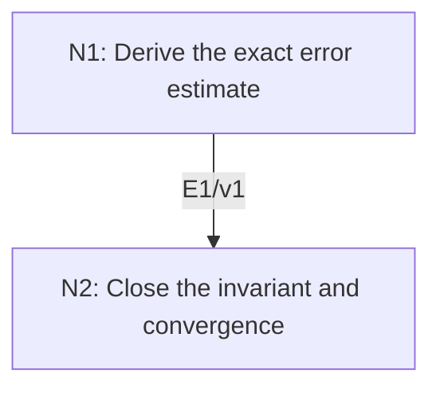

# Local Quadratic Convergence of Newton’s Method

## An End-to-End Metacognitive Mathematics Walkthrough

**Problem ID:** ON-04  
**Version:** 1  
**Subject:** Optimization and Numerical Analysis  
**Level:** Intermediate  
**Status:** Complete authored exposition relative to the declared imports.  
**Evidence:** Mathematical argument and authored teaching traces; no actual multi-agent run, independent review, or proof-assistant certification is claimed.

## 1. Target, definitions, and import contract

Let $f$ be $C^2$ on an open interval containing $[\alpha-r,\alpha+r]$, where $r>0$ and $f(\alpha)=0$. Suppose $|f'(x)|\ge m>0$ and $|f''(x)|\le M$ on that closed interval, with $q=Mr/(2m)<1$. For every $x_0$ in the interval, the exact Newton iteration $x_{k+1}=x_k-f(x_k)/f'(x_k)$ is well defined, stays in the interval, and converges to $\alpha$, with $|x_{k+1}-\alpha|\le (M/(2m))|x_k-\alpha|^2$.

### Permitted imports and conventions

Use the fundamental theorem of calculus and its estimate $|f'(u)-f'(v)|\le M|u-v|$ on the interval, obtained by integrating $f''$. No existence of a root is inferred from numerical residuals: the theorem assumes the root $\alpha$ and proves convergence near it. Every simple root has some neighborhood satisfying these hypotheses by continuity and a sufficiently small radius.

## 2. Intuition and node interaction workflow

Express the next error as an integral of derivative differences. The quadratic estimate then proves its own invariant neighborhood, avoiding a circular assumption that all iterates remain near the root.

Each mathematical node contains **Ego, Memory, Intellect, Sense, and Action**. The diagram records accepted proof dependencies. Requests to repair an argument belong only to §6; they are not backward proof edges.

### Evidence transfer ledger

| Transfer | Producer and export | Receiving activity | Exact claim and compatibility |
|---|---|---|---|
| T1-2 | N1/v1 · E1/v1 | N2.1 | For $N(x)=x-f(x)/f'(x)$, $\|N(x)-\alpha\|\le (M/(2m))\|x-\alpha\|^2$. Inputs in N2 retain the producer's assumptions; evidence: §4.N1. |

## 3. Node roles and five-faculty contracts

### N1/v1 — Derive the exact error estimate

**Object and inputs:** $x\in[\alpha-r,\alpha+r]$ and $f(\alpha)=0$.

**Role and strategy:** Subtract the secant integral from the tangent term and bound the derivative variation.

**Local obligation:** For $N(x)=x-f(x)/f'(x)$, $|N(x)-\alpha|\le (M/(2m))|x-\alpha|^2$.

| Faculty | Concrete responsibility |
|---|---|
| Ego | Publish E1/v1 only with its stated domain and assumptions: For $N(x)=x-f(x)/f'(x)$, $\|N(x)-\alpha\|\le (M/(2m))\|x-\alpha\|^2$. |
| Memory | $x\in[\alpha-r,\alpha+r]$ and $f(\alpha)=0$. Preserve the §1 conventions and incoming export versions. |
| Intellect | Subtract the secant integral from the tangent term and bound the derivative variation. |
| Sense | The denominator stays away from zero by $m$; the entire integration segment stays in the stated interval. |
| Action | Execute activities N1.1–N1.2 in §4.N1; preserve the displayed calculations as evidence. |

**Export E1/v1:** For $N(x)=x-f(x)/f'(x)$, $|N(x)-\alpha|\le (M/(2m))|x-\alpha|^2$. Evidence: the complete local derivation in §4.N1.

**Acceptance gate:** Establish the local obligation through every numbered activity below and discharge this concrete check: The denominator stays away from zero by $m$; the entire integration segment stays in the stated interval.

**Targeted repair:** If a Taylor remainder is used without a bound over the whole segment, use this integral identity with the explicit uniform bound $M$. Withhold E1 and its dependent exports until the correction has been checked; a revised export receives a new version.

### N2/v1 — Close the invariant and convergence

**Object and inputs:** E1/v1 and $q=Mr/(2m)<1$. Incoming proof exports: E1/v1 at N2.1.

**Role and strategy:** Inductively keep every error within the radius, then sum no errors at all: directly contract their magnitudes.

**Local obligation:** All iterates exist, $|x_k-\alpha|\le q^k|x_0-\alpha|\to0$, and the quadratic bound holds at every step.

| Faculty | Concrete responsibility |
|---|---|
| Ego | Publish E2/v1 only with its stated domain and assumptions: All iterates exist, $\|x_k-\alpha\|\le q^k\|x_0-\alpha\|\to0$, and the quadratic bound holds at every step. |
| Memory | E1/v1 and $q=Mr/(2m)<1$. Preserve the §1 conventions and incoming export versions. |
| Intellect | Inductively keep every error within the radius, then sum no errors at all: directly contract their magnitudes. |
| Sense | Proving the estimate at one point is insufficient unless its next iterate stays where the hypotheses hold. |
| Action | Execute activities N2.1–N2.2 in §4.N2; preserve the displayed calculations as evidence. |

**Export E2/v1:** All iterates exist, $|x_k-\alpha|\le q^k|x_0-\alpha|\to0$, and the quadratic bound holds at every step. Evidence: the complete local derivation in §4.N2.

**Acceptance gate:** Establish the local obligation through every numbered activity below and discharge this concrete check: Proving the estimate at one point is insufficient unless its next iterate stays where the hypotheses hold.

**Targeted repair:** If local convergence is concluded while the iterates may leave the neighborhood, choose and prove an invariant radius before repeating the estimate. Withhold E2 and its dependent exports until the correction has been checked; a revised export receives a new version.

## 4. Continuous mathematical proof

The following activities form one continuous proof. Intermediate claims are established where used, except for the explicitly permitted imports in §1.

### §4.N1 — Derive the exact error estimate

1. **N1.1.** Let $e=x-\alpha$. The fundamental theorem gives $f(x)=\int_\alpha^x f'(t)\,dt$. Therefore $N(x)-\alpha=[e f'(x)-f(x)]/f'(x)=\bigl(\int_\alpha^x(f'(x)-f'(t))\,dt\bigr)/f'(x)$.

2. **N1.2.** The absolute numerator is at most the integral of $M|x-t|$ along the segment, namely $M|e|^2/2$. Divide by $|f'(x)|\ge m$ to obtain the error estimate. This remains valid for $x<\alpha$ after taking the absolute value of the oriented integral.

### §4.N2 — Close the invariant and convergence

1. **N2.1.** If $|x_k-\alpha|\le r$, E1 gives $|x_{k+1}-\alpha|\le(M/(2m))|x_k-\alpha|^2\le q|x_k-\alpha|\le qr<r$ (with immediate equality to zero allowed). The initial point satisfies the premise, so induction proves that every denominator is nonzero and every iterate remains in the interval.

2. **N2.2.** The same estimate yields $|x_k-\alpha|\le q^k|x_0-\alpha|$, proving convergence. At each step E1 supplies the stronger quadratic error inequality. If $M=0$, the first step reaches the root exactly. Finally a simple root has $|f'(\alpha)|>0$; continuity gives a neighborhood with a positive derivative bound, bounded $f''$, and after shrinking the radius, $q<1$.

## 5. Worked instance and boundary audit

For $f(x)=x^2-2$, take $\alpha=\sqrt2$ and $r=1/4$. On that interval $|f'|\ge2(\sqrt2-1/4)>2$, so $m=2$ is valid; $M=2$ and $q=1/8$. Starting at $x_0=3/2$ gives $x_1=17/12$ and $x_2=577/408$. The exact identity $x_{k+1}-\sqrt2=(x_k-\sqrt2)^2/(2x_k)$ displays the quadratic mechanism.

### Boundary or failed-inference witness

At the multiple root of $f(x)=x^2$, Newton gives $x_{k+1}=x_k/2$ for $x_k\ne0$, only linear convergence. The derivative lower bound fails in every neighborhood of zero. Starting far away can also break local convergence; this theorem does not promise a global basin.

## 6. Illustrative interaction and repair trace

**Trace status:** Authored illustration, not a logged agent execution. The rejected candidate below is outside the accepted DAG.

**Rejected N2 claim:** the quadratic error formula proves convergence from every initial guess. **Sense:** its constants were established only on a fixed interval, and outside it the denominator may vanish. **Repair:** prove the radius invariant using $q<1$ before iteration. This supplies the missing step for the stated local theorem; it does not extend the theorem globally. Recheck each use of E1 along the orbit.

After the corrected argument is supplied, Ego may publish a hypothetical v2 export, Memory replaces the rejected version, and Action rechecks each descendant in §2. The accepted exposition in this file is v1; this scenario does not claim an actual revision or execution occurred.

## 7. Evidence ledger and reusable exports

| Item | Evidence and scope | Remaining limitation |
|---|---|---|
| Target theorem | §4, under exactly the §1 hypotheses and imports | Authored mathematical exposition; no independent or formal verification |
| E1–E2 | Local proofs §4.N1–§4.N2; version 1 | Imports remain attached to each reuse |
| Worked instance | Explicit computation or construction in §5 | Illustrates the mechanism; does not prove the universal theorem |
| Repair | Rejected inference, witness, and correction in §6 | Teaching scenario rather than empirical agent evidence |

**Reusable target:** Preserve `ON-04/v1`, the exact statement in §1, its assumptions, and this proof when reusing the result.

**Next direction:** Extend the argument to vector Newton methods using an invertible Jacobian and a controlled inverse, with explicit matrix norm bounds.

## 8. Sources and navigation

The proof and faculty decomposition are authored for this collection. The following primary teaching sources support further study; exact imports are specified in §1.

[Boyd and Vandenberghe, Convex Optimization](https://web.stanford.edu/~boyd/cvxbook/) for convexity, optimality, and descent; [University of Maryland, Scientific Computing I](https://www.math.umd.edu/~mariakc/Spring2020Class.html) for the numerical-analysis setting. The estimates used here are derived explicitly in §4.

**Local imported proof modules:** None. Supporting external results are specified in §1.

[Five-project subject index](problems.md) · [Project README](../README.md) · [Graduate subject outline](../../book/outline.md)
