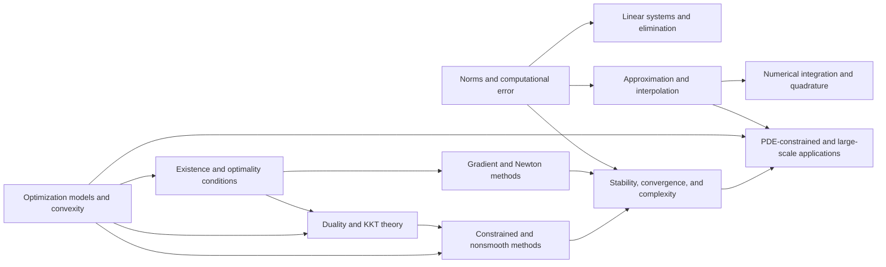

# Meta-Graph: Optimization and Numerical Analysis

> **Purpose.** This is a subject-level dependency map for planning a future theorem knowledge graph. It shows a representative route through the field; it is not a complete list of prerequisites, a formal proof dependency database, or a claim that every course follows this order.

## How to read this graph

- **Nodes** are foundational ideas, methods, structural results, or major theorems. A node may later expand into its own proof-level graph.
- An arrow `X → Y` means that X commonly supplies language, a method, a hypothesis, or a result used in understanding or proving Y. The edge table says which role it plays.
- Some edges describe a common proof route or conceptual bridge rather than a logically necessary dependency. The eventual theorem graph should record the exact theorem, hypotheses, source, and proof step for every strict dependency.
- The graph is a DAG at this global overview level. Feedback and revision belong inside proof workflows; they should not be mistaken for a theorem depending on itself.

## Global subject map

## Node register

| ID | Idea, theorem, or method | Role in the subject |
|---|---|---|
| A | Norms and computational error | Quantify residuals, conditioning, and stability |
| B | Linear systems and elimination | Solve finite-dimensional equations reliably |
| C | Approximation and interpolation | Represent functions by finite data or basis expansions |
| D | Numerical integration and quadrature | Approximate integrals with error guarantees |
| E | Optimization models and convexity | Formulate objectives, constraints, and convex structure |
| F | Existence and optimality conditions | Derive minimizers and first/second-order tests |
| G | Duality and KKT theory | Relate primal constraints to multipliers and certificates |
| H | Gradient and Newton methods | Construct iterative optimization algorithms |
| I | Constrained and nonsmooth methods | Handle boundaries, inequalities, and nonsmooth objectives |
| J | Stability, convergence, and complexity | Prove algorithms approach solutions at controlled cost |
| K | PDE-constrained and large-scale applications | Combine discretization with optimization |

## Dependency register

| From → To | Connection type | How the earlier node supports the later node |
|---|---|---|
| A → B (Norms and computational error → Linear systems and elimination) | Common mathematical dependency | Conditioning predicts linear solve sensitivity. |
| C → D (Approximation and interpolation → Numerical integration and quadrature) | Common mathematical dependency | Quadrature uses approximation and interpolation ideas. |
| A → C (Norms and computational error → Approximation and interpolation) | Common mathematical dependency | Normed error controls approximation quality. |
| E → F (Optimization models and convexity → Existence and optimality conditions) | Common mathematical dependency | Convexity and compactness support existence and optimality. |
| F → G (Existence and optimality conditions → Duality and KKT theory) | Common mathematical dependency | Lagrange multipliers encode constraints. |
| E → G (Optimization models and convexity → Duality and KKT theory) | Common mathematical dependency | Convex duality yields bounds and certificates. |
| F → H (Existence and optimality conditions → Gradient and Newton methods) | Common mathematical dependency | Derivatives provide descent and Newton directions. |
| G → I (Duality and KKT theory → Constrained and nonsmooth methods) | Common mathematical dependency | KKT conditions guide constrained algorithms. |
| E → I (Optimization models and convexity → Constrained and nonsmooth methods) | Common mathematical dependency | Nonsmooth convex analysis extends optimization models. |
| A → J (Norms and computational error → Stability, convergence, and complexity) | Common mathematical dependency | Conditioning affects convergence and accuracy. |
| H → J (Gradient and Newton methods → Stability, convergence, and complexity) | Common mathematical dependency | Iteration analysis establishes rates. |
| I → J (Constrained and nonsmooth methods → Stability, convergence, and complexity) | Common mathematical dependency | Globalization and nonsmooth convergence require stability tools. |
| C → K (Approximation and interpolation → PDE-constrained and large-scale applications) | Common mathematical dependency | Finite elements and discretization rely on approximation. |
| E → K (Optimization models and convexity → PDE-constrained and large-scale applications) | Common mathematical dependency | Optimal control and inverse problems are optimization models. |
| J → K (Stability, convergence, and complexity → PDE-constrained and large-scale applications) | Common mathematical dependency | Convergence analysis validates large-scale computations. |

## Suggested reading paths

**Core route:** follow the nodes from foundational language toward the central structural theorems, then continue to the advanced endpoint. For a first pass, read the graph left to right and pause at each node to state its hypotheses and output.

**Theorem-focused route:** choose a major theorem node, trace incoming arrows backward to identify imported results, then trace outgoing arrows to see what the theorem enables. Mark which incoming edges are strict dependencies after consulting a proof-level source.

**Bridge route:** follow cross-links between methods and neighboring theories. Treat these as transfer routes: identify exactly what is preserved, what hypotheses are added, and what changes under translation.

## Five-component expansion for each theorem node

When a node is selected for a complete Meta-Math walkthrough, preserve the node ID and expand it into a local five-component proof graph:

| Component | Local responsibility |
|---|---|
| **Contract** | State the precise theorem goal, scope, and proof contract; distinguish the claim from nearby stronger or weaker claims. |
| **Knowledge** | Retrieve definitions, hypotheses, lemmas, source references, and known examples/counterexamples required by this node. |
| **Strategy** | Select and order proof steps; justify each inference and expose dependency on incoming nodes. |
| **Validation** | Check type/notation consistency, hypothesis use, boundary cases, examples, and whether each intermediate claim is actually supported. |
| **Execution** | Execute proof steps, calculations, constructions, or formal checks; emit the verified result and update outgoing dependencies. |

A later graph version should connect global theorem nodes to these local component nodes, with typed edges such as `uses`, `specializes`, `generalizes`, `contradicts`, `analogy-only`, and `verified-by`.

## Expansion record

For each node promoted from this map, add a stable theorem or concept ID, exact statement, source and page/section, prerequisite IDs, proof-step graph, explicit hypothesis checks, known failure modes, examples, and verification status. Keep conjectural or analogy-only links visually distinct from proved dependencies.

**Related syllabus:** [`outline.md`](book-outline.md).
