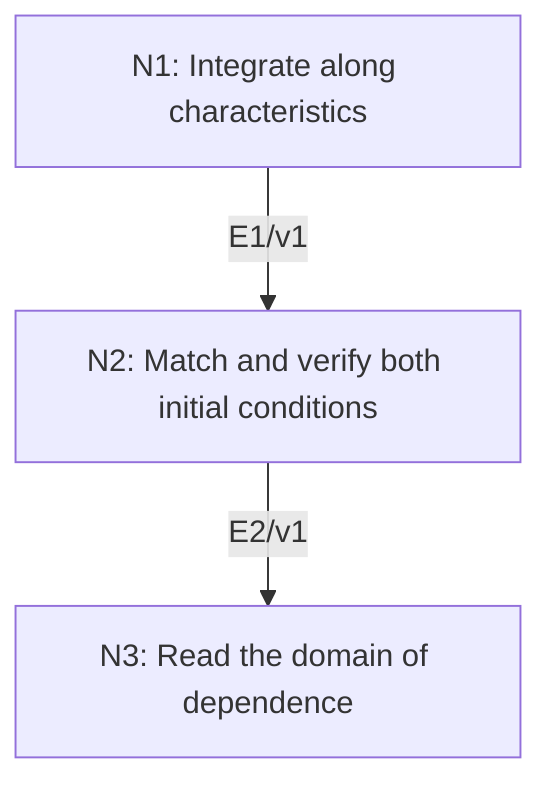

# d’Alembert’s Formula and Finite Propagation

## An End-to-End Metacognitive Mathematics Walkthrough

**Problem ID:** PDE-05  
**Version:** 1  
**Subject:** Partial Differential Equations  
**Level:** Intermediate  
**Status:** Complete authored exposition relative to the declared imports.  
**Evidence:** Mathematical argument and authored teaching traces; no actual multi-agent run, independent review, or proof-assistant certification is claimed.

## 1. Target, definitions, and import contract

For $c>0$, $f\in C^2(\mathbb R)$ and $g\in C^1(\mathbb R)$, prove that the unique $C^2$ solution on $\mathbb R\times[0,\infty)$ of $u_{tt}=c^2u_{xx}$, $u(x,0)=f(x)$, $u_t(x,0)=g(x)$, is $u(x,t)=\tfrac12[f(x-ct)+f(x+ct)]+\tfrac1{2c}\int_{x-ct}^{x+ct}g(s)ds$. Prove that $u(x,t)$ depends only on the initial data in $[x-ct,x+ct]$; compactly supported initial data in $[-R,R]$ yield support inside $[-R-ct,R+ct]$.

### Permitted imports and conventions

Use the chain rule, the fundamental theorem for variable-endpoint integrals, and integration of $U_{\xi\eta}=0$ in characteristic coordinates. The latter integration is proved below on the half-plane corresponding to $t>0$; no assumption that the solution separates globally is imported. $C^2$ at $t=0$ means the derivatives extend continuously from the half-plane.

## 2. Intuition and node interaction workflow

Characteristic coordinates factor the wave operator. The initial displacement fixes the sum of the two traveling waves; the initial velocity fixes their derivative difference.

Each mathematical node contains **Ego, Memory, Intellect, Sense, and Action**. The diagram records accepted proof dependencies. Requests to repair an argument belong only to §6; they are not backward proof edges.

### Evidence transfer ledger

| Transfer | Producer and export | Receiving activity | Exact claim and compatibility |
|---|---|---|---|
| T1-2 | N1/v1 · E1/v1 | N2.1 | Every candidate has the form $u(x,t)=A(x-ct)+B(x+ct)$ for $t>0$, with $C^2$ functions $A,B$. Inputs in N2 retain the producer's assumptions; evidence: §4.N1. |
| T2-3 | N2/v1 · E2/v1 | N3.1 | The displayed formula is the only possible solution and is a $C^2$ solution with the prescribed data. Inputs in N3 retain the producer's assumptions; evidence: §4.N2. |

## 3. Node roles and five-faculty contracts

### N1/v1 — Integrate along characteristics

**Object and inputs:** Any $C^2$ candidate solution, with $\xi=x-ct$, $\eta=x+ct$, and $U(\xi,\eta)=u((\xi+\eta)/2,(\eta-\xi)/(2c))$.

**Role and strategy:** Factor the differential operator and integrate its vanishing mixed derivative on $\eta>\xi$.

**Local obligation:** Every candidate has the form $u(x,t)=A(x-ct)+B(x+ct)$ for $t>0$, with $C^2$ functions $A,B$.

| Faculty | Concrete responsibility |
|---|---|
| Ego | Publish E1/v1 only with its stated domain and assumptions: Every candidate has the form $u(x,t)=A(x-ct)+B(x+ct)$ for $t>0$, with $C^2$ functions $A,B$. |
| Memory | Any $C^2$ candidate solution, with $\xi=x-ct$, $\eta=x+ct$, and $U(\xi,\eta)=u((\xi+\eta)/2,(\eta-\xi)/(2c))$. Preserve the §1 conventions and incoming export versions. |
| Intellect | Factor the differential operator and integrate its vanishing mixed derivative on $\eta>\xi$. |
| Sense | The transformed domain is a half-plane; justify separation there rather than presuming a rectangular global domain. |
| Action | Execute activities N1.1–N1.2 in §4.N1; preserve the displayed calculations as evidence. |

**Export E1/v1:** Every candidate has the form $u(x,t)=A(x-ct)+B(x+ct)$ for $t>0$, with $C^2$ functions $A,B$. Evidence: the complete local derivation in §4.N1.

**Acceptance gate:** Establish the local obligation through every numbered activity below and discharge this concrete check: The transformed domain is a half-plane; justify separation there rather than presuming a rectangular global domain.

**Targeted repair:** If separation is asserted without checking the transformed domain, use connected characteristic intervals to integrate each derivative. Withhold E1 and its dependent exports until the correction has been checked; a revised export receives a new version.

### N2/v1 — Match and verify both initial conditions

**Object and inputs:** E1/v1 and $f,g$ on the initial line. Incoming proof exports: E1/v1 at N2.1.

**Role and strategy:** Solve for the derivatives of the traveling-wave components and substitute their antiderivatives.

**Local obligation:** The displayed formula is the only possible solution and is a $C^2$ solution with the prescribed data.

| Faculty | Concrete responsibility |
|---|---|
| Ego | Publish E2/v1 only with its stated domain and assumptions: The displayed formula is the only possible solution and is a $C^2$ solution with the prescribed data. |
| Memory | E1/v1 and $f,g$ on the initial line. Preserve the §1 conventions and incoming export versions. |
| Intellect | Solve for the derivatives of the traveling-wave components and substitute their antiderivatives. |
| Sense | The initial velocity fixes opposite signs for the two waves; the integral coefficient is $1/(2c)$. |
| Action | Execute activities N2.1–N2.2 in §4.N2; preserve the displayed calculations as evidence. |

**Export E2/v1:** The displayed formula is the only possible solution and is a $C^2$ solution with the prescribed data. Evidence: the complete local derivation in §4.N2.

**Acceptance gate:** Establish the local obligation through every numbered activity below and discharge this concrete check: The initial velocity fixes opposite signs for the two waves; the integral coefficient is $1/(2c)$.

**Targeted repair:** If only the initial displacement is matched, compute the time derivative at zero and fix the relative sign and factor using $g$. Withhold E2 and its dependent exports until the correction has been checked; a revised export receives a new version.

### N3/v1 — Read the domain of dependence

**Object and inputs:** E2/v1 and the explicit endpoints and integral interval. Incoming proof exports: E2/v1 at N3.1.

**Role and strategy:** Locate every initial value used by the solution and compare two data sets on that interval.

**Local obligation:** Only initial data in $[x-ct,x+ct]$ affect $u(x,t)$, and the stated support bound holds.

| Faculty | Concrete responsibility |
|---|---|
| Ego | Publish E3/v1 only with its stated domain and assumptions: Only initial data in $[x-ct,x+ct]$ affect $u(x,t)$, and the stated support bound holds. |
| Memory | E2/v1 and the explicit endpoints and integral interval. Preserve the §1 conventions and incoming export versions. |
| Intellect | Locate every initial value used by the solution and compare two data sets on that interval. |
| Sense | Finite propagation is a support statement in space-time; it does not assert that the solution itself stays constant inside the cone. |
| Action | Execute activities N3.1–N3.2 in §4.N3; preserve the displayed calculations as evidence. |

**Export E3/v1:** Only initial data in $[x-ct,x+ct]$ affect $u(x,t)$, and the stated support bound holds. Evidence: the complete local derivation in §4.N3.

**Acceptance gate:** Establish the local obligation through every numbered activity below and discharge this concrete check: Finite propagation is a support statement in space-time; it does not assert that the solution itself stays constant inside the cone.

**Targeted repair:** If the support is claimed to stay inside its initial interval, expand the interval by the characteristic distance $ct$. Withhold E3 and its dependent exports until the correction has been checked; a revised export receives a new version.

## 4. Continuous mathematical proof

The following activities form one continuous proof. Intermediate claims are established where used, except for the explicitly permitted imports in §1.

### §4.N1 — Integrate along characteristics

1. **N1.1.** The chain rule gives $u_{tt}-c^2u_{xx}=-4c^2U_{\xi\eta}$, so the mixed derivative vanishes on $\eta>\xi$. For fixed $\xi$, $U_\xi(\xi,\eta)$ is constant on the connected interval $\eta>\xi$. Denote it by $a(\xi)$; locally one can evaluate at a fixed admissible $\eta$, so $a$ is $C^1$.

2. **N1.2.** Choose an antiderivative $A$ of $a$. Then $U-A$ has zero $\xi$ derivative. For each fixed $\eta$, the interval $\xi<\eta$ is connected, so $U(\xi,\eta)-A(\xi)$ depends only on $\eta$; call it $B(\eta)$. Local evaluation shows $B$ is $C^2$. Thus $U=A+B$ on the half-plane. Continuity extends the corresponding identities to $t=0$.

### §4.N2 — Match and verify both initial conditions

1. **N2.1.** At $t=0$, $A(x)+B(x)=f(x)$ and $-cA'(x)+cB'(x)=g(x)$. Differentiating the first identity and solving gives $A'=(f'-g/c)/2$, $B'=(f'+g/c)/2$. If $G(x)=\int_0^x g(s)ds$, integration gives $A=f/2-G/(2c)+C$ and $B=f/2+G/(2c)-C$.

2. **N2.2.** Substitution at $x-ct$ and $x+ct$ cancels $C$ and gives d’Alembert’s formula. Conversely these $A,B$ are $C^2$ because $f\in C^2$ and $G\in C^2$. Each traveling wave satisfies $u_{tt}=c^2u_{xx}$ by direct differentiation, and the two initial identities hold. Thus a solution exists and every candidate equals it, proving uniqueness.

### §4.N3 — Read the domain of dependence

1. **N3.1.** The formula uses $f$ only at the two endpoints and $g$ only inside the closed interval. Therefore two admissible initial data sets agreeing on that interval produce the same value at $(x,t)$.

2. **N3.2.** If $f,g$ vanish outside $[-R,R]$ and $x>R+ct$, then the entire integration interval and both endpoints lie to the right of $R$, so every term is zero. The same holds for $x<-R-ct$. Hence the support at time $t$ is contained in the enlarged interval, proving finite propagation.

## 5. Worked instance and boundary audit

For $c=1$, $f=0$, and $g(s)=\cos s$, the formula gives $u(x,t)=(\sin(x+t)-\sin(x-t))/2=\cos x\sin t$. Then $u_{tt}=-\cos x\sin t=u_{xx}$, $u(x,0)=0$, and $u_t(x,0)=\cos x$.

### Boundary or failed-inference witness

Initial displacement alone does not determine a wave solution. Both $u=0$ and $u=t$ have zero initial displacement and satisfy the wave equation, but their initial velocities differ. Prescribing both $f$ and $g$ is essential.

## 6. Illustrative interaction and repair trace

**Trace status:** Authored illustration, not a logged agent execution. The rejected candidate below is outside the accepted DAG.

**Rejected N2 solution:** keep only $[f(x-ct)+f(x+ct)]/2$ even when $g\ne0$. Its time derivative at zero is zero, so it fails the velocity datum. **Diagnosis:** Action matched only half the initial contract. **Repair:** solve the two derivative equations and add the integral of $g$ with coefficient $1/(2c)$. Recheck the PDE, both initial data, and the interval used for finite propagation.

After the corrected argument is supplied, Ego may publish a hypothetical v2 export, Memory replaces the rejected version, and Action rechecks each descendant in §2. The accepted exposition in this file is v1; this scenario does not claim an actual revision or execution occurred.

## 7. Evidence ledger and reusable exports

| Item | Evidence and scope | Remaining limitation |
|---|---|---|
| Target theorem | §4, under exactly the §1 hypotheses and imports | Authored mathematical exposition; no independent or formal verification |
| E1–E3 | Local proofs §4.N1–§4.N3; version 1 | Imports remain attached to each reuse |
| Worked instance | Explicit computation or construction in §5 | Illustrates the mechanism; does not prove the universal theorem |
| Repair | Rejected inference, witness, and correction in §6 | Teaching scenario rather than empirical agent evidence |

**Reusable target:** Preserve `PDE-05/v1`, the exact statement in §1, its assumptions, and this proof when reusing the result.

**Next direction:** Extend characteristic reasoning to inhomogeneous forcing with Duhamel’s principle, using a new source-term contract.

## 8. Sources and navigation

The proof and faculty decomposition are authored for this collection. The following primary teaching sources support further study; exact imports are specified in §1.

[Leon Simon, Lectures on PDE](https://math.stanford.edu/~lms/lecs-on-pde.pdf), for elliptic, weak, and parabolic methods. Classical calculus and the explicitly stated Hilbert-space imports are used below; the displayed PDE arguments are developed in full.

**Local imported proof modules:** None. Supporting external results are specified in §1.

[Five-project subject index](problems.md) · [Project README](../README.md) · [Graduate subject outline](../../book/outline.md)
