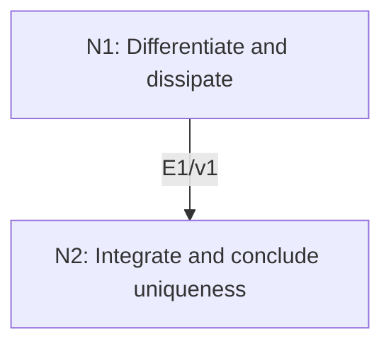

# Energy Decay and Uniqueness for the Heat Equation

## An End-to-End Metacognitive Mathematics Walkthrough

**Problem ID:** PDE-03  
**Version:** 1  
**Subject:** Partial Differential Equations  
**Level:** Intermediate  
**Status:** Complete authored exposition relative to the declared imports.  
**Evidence:** Mathematical argument and authored teaching traces; no actual multi-agent run, independent review, or proof-assistant certification is claimed.

## 1. Target, definitions, and import contract

Let $\Omega\subset\mathbb R^d$ be bounded with $C^1$ boundary, $T>0$, and $\kappa>0$. Suppose real $u,v$ have continuous spatial derivatives through order two and time derivative through order one on $\overline\Omega\times[0,T]$, solve $u_t-\kappa\Delta u=v_t-\kappa\Delta v$, and agree on the lateral boundary. Prove $\|u(\cdot,t)-v(\cdot,t)\|_2^2+2\kappa\int_0^t\|\nabla(u-v)(\cdot,s)\|_2^2ds=\|u(\cdot,0)-v(\cdot,0)\|_2^2$. In particular equal initial data imply $u=v$.

### Permitted imports and conventions

Use differentiation under an integral for continuous derivatives on the compact cylinder, Green’s integration-by-parts identity on the $C^1$ domain for the stated regularity, and the fundamental theorem of calculus. The difference $w=u-v$ solves a homogeneous heat equation with zero boundary values. No existence result or unbounded-domain uniqueness is asserted here.

## 2. Intuition and node interaction workflow

The squared $L^2$ difference is an energy. Its derivative is the negative of a nonnegative gradient integral, so identical initial states cannot separate.

Each mathematical node contains **Ego, Memory, Intellect, Sense, and Action**. The diagram records accepted proof dependencies. Requests to repair an argument belong only to §6; they are not backward proof edges.

### Evidence transfer ledger

| Transfer | Producer and export | Receiving activity | Exact claim and compatibility |
|---|---|---|---|
| T1-2 | N1/v1 · E1/v1 | N2.1 | $E(t)=\int_\Omega w^2$ satisfies $E'(t)=-2\kappa\int_\Omega\|\nabla w\|^2$. Inputs in N2 retain the producer's assumptions; evidence: §4.N1. |

## 3. Node roles and five-faculty contracts

### N1/v1 — Differentiate and dissipate

**Object and inputs:** $w=u-v$, $w_t=\kappa\Delta w$, and $w|_{\partial\Omega}=0$.

**Role and strategy:** Multiply by the solution difference and transfer one spatial derivative by Green’s formula.

**Local obligation:** $E(t)=\int_\Omega w^2$ satisfies $E'(t)=-2\kappa\int_\Omega|\nabla w|^2$.

| Faculty | Concrete responsibility |
|---|---|
| Ego | Publish E1/v1 only with its stated domain and assumptions: $E(t)=\int_\Omega w^2$ satisfies $E'(t)=-2\kappa\int_\Omega\|\nabla w\|^2$. |
| Memory | $w=u-v$, $w_t=\kappa\Delta w$, and $w\|_{\partial\Omega}=0$. Preserve the §1 conventions and incoming export versions. |
| Intellect | Multiply by the solution difference and transfer one spatial derivative by Green’s formula. |
| Sense | The boundary term vanishes because $w=0$, not because its normal derivative is assumed zero. |
| Action | Execute activities N1.1–N1.2 in §4.N1; preserve the displayed calculations as evidence. |

**Export E1/v1:** $E(t)=\int_\Omega w^2$ satisfies $E'(t)=-2\kappa\int_\Omega|\nabla w|^2$. Evidence: the complete local derivation in §4.N1.

**Acceptance gate:** Establish the local obligation through every numbered activity below and discharge this concrete check: The boundary term vanishes because $w=0$, not because its normal derivative is assumed zero.

**Targeted repair:** If the boundary term is simply omitted, write it explicitly and use the equality of boundary data to make the difference vanish there. Withhold E1 and its dependent exports until the correction has been checked; a revised export receives a new version.

### N2/v1 — Integrate and conclude uniqueness

**Object and inputs:** E1/v1 and nonnegativity of both energy and dissipation. Incoming proof exports: E1/v1 at N2.1.

**Role and strategy:** Integrate the identity from zero to $t$, then use continuity to upgrade an $L^2$ zero to pointwise equality.

**Local obligation:** The stated energy identity holds, and equal initial data give equality of the two classical solutions.

| Faculty | Concrete responsibility |
|---|---|
| Ego | Publish E2/v1 only with its stated domain and assumptions: The stated energy identity holds, and equal initial data give equality of the two classical solutions. |
| Memory | E1/v1 and nonnegativity of both energy and dissipation. Preserve the §1 conventions and incoming export versions. |
| Intellect | Integrate the identity from zero to $t$, then use continuity to upgrade an $L^2$ zero to pointwise equality. |
| Sense | An integral norm equal to zero gives a.e. equality first; continuity supplies equality at every interior point and the boundary data cover the boundary. |
| Action | Execute activities N2.1–N2.2 in §4.N2; preserve the displayed calculations as evidence. |

**Export E2/v1:** The stated energy identity holds, and equal initial data give equality of the two classical solutions. Evidence: the complete local derivation in §4.N2.

**Acceptance gate:** Establish the local obligation through every numbered activity below and discharge this concrete check: An integral norm equal to zero gives a.e. equality first; continuity supplies equality at every interior point and the boundary data cover the boundary.

**Targeted repair:** If equality almost everywhere is treated as pointwise without regularity, use continuity explicitly or state uniqueness only in the appropriate equivalence class. Withhold E2 and its dependent exports until the correction has been checked; a revised export receives a new version.

## 4. Continuous mathematical proof

The following activities form one continuous proof. Intermediate claims are established where used, except for the explicitly permitted imports in §1.

### §4.N1 — Differentiate and dissipate

1. **N1.1.** The regularity and compactness allow $E'(t)=2\int_\Omega w w_t=2\kappa\int_\Omega w\Delta w$.

2. **N1.2.** Green’s identity gives $\int_\Omega w\Delta w=\int_{\partial\Omega}w\partial_\nu w-\int_\Omega|\nabla w|^2$. The boundary value of $w$ is zero, so the boundary integral vanishes. This proves the exact energy derivative.

### §4.N2 — Integrate and conclude uniqueness

1. **N2.1.** Integrating E1 yields $E(t)+2\kappa\int_0^t\int_\Omega|\nabla w(x,s)|^2\,dx\,ds=E(0)$. This proves the claimed stability identity and $E(t)\le E(0)$.

2. **N2.2.** If the initial data agree, $E(0)=0$. Nonnegativity forces $E(t)=0$ for each $t$. Were continuous $w$ nonzero at an interior point, it would be bounded away from zero on a small ball, making the integral positive. Thus $w=0$ inside, and it is zero on the boundary by assumption.

## 5. Worked instance and boundary audit

On $(0,\pi)$ with $\kappa=1$, take $u(x,t)=e^{-t}\sin x$ and $v=0$. Then $E(t)=(\pi/2)e^{-2t}$, and $\|u_x(\cdot,t)\|_2^2=(\pi/2)e^{-2t}$. Hence $E(t)+2\int_0^t\|u_x\|_2^2ds=\pi/2=E(0)$, checking the constants and sign.

### Boundary or failed-inference witness

If boundary equality is removed, $u(x,t)=x$ and $v=0$ on $(0,1)$ are both time-independent heat solutions. Their difference has constant energy $1/3$, while its gradient integral is one. The missing boundary flux equals one and exactly cancels the dissipation term; it cannot be discarded.

## 6. Illustrative interaction and repair trace

**Trace status:** Authored illustration, not a logged agent execution. The rejected candidate below is outside the accepted DAG.

**Rejected N1 identity:** $E'=-2\kappa\|\nabla w\|_2^2$ for arbitrary boundary data. **Sense witness:** $w=x$ on $(0,1)$. **Repair:** retain the flux term in Green’s identity and then use the actual homogeneous difference boundary condition from §1. Recheck the integrated identity and uniqueness. This repairs the proof of the stated class, not a broader uniqueness claim.

After the corrected argument is supplied, Ego may publish a hypothetical v2 export, Memory replaces the rejected version, and Action rechecks each descendant in §2. The accepted exposition in this file is v1; this scenario does not claim an actual revision or execution occurred.

## 7. Evidence ledger and reusable exports

| Item | Evidence and scope | Remaining limitation |
|---|---|---|
| Target theorem | §4, under exactly the §1 hypotheses and imports | Authored mathematical exposition; no independent or formal verification |
| E1–E2 | Local proofs §4.N1–§4.N2; version 1 | Imports remain attached to each reuse |
| Worked instance | Explicit computation or construction in §5 | Illustrates the mechanism; does not prove the universal theorem |
| Repair | Rejected inference, witness, and correction in §6 | Teaching scenario rather than empirical agent evidence |

**Reusable target:** Preserve `PDE-03/v1`, the exact statement in §1, its assumptions, and this proof when reusing the result.

**Next direction:** Extend the energy method to weak parabolic solutions by justifying time testing through approximation.

## 8. Sources and navigation

The proof and faculty decomposition are authored for this collection. The following primary teaching sources support further study; exact imports are specified in §1.

[Leon Simon, Lectures on PDE](https://math.stanford.edu/~lms/lecs-on-pde.pdf), for elliptic, weak, and parabolic methods. Classical calculus and the explicitly stated Hilbert-space imports are used below; the displayed PDE arguments are developed in full.

**Local imported proof modules:** None. Supporting external results are specified in §1.

[Five-project subject index](problems.md) · [Project README](../README.md) · [Graduate subject outline](../../book/outline.md)
