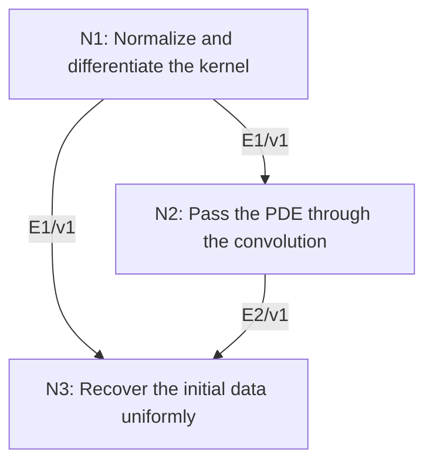

# The Gaussian Heat Kernel as an Initial-Value Solution

## An End-to-End Metacognitive Mathematics Walkthrough

**Problem ID:** PDE-04  
**Version:** 1  
**Subject:** Partial Differential Equations  
**Level:** Intermediate  
**Status:** Complete authored exposition relative to the declared imports.  
**Evidence:** Mathematical argument and authored teaching traces; no actual multi-agent run, independent review, or proof-assistant certification is claimed.

## 1. Target, definitions, and import contract

For $\kappa>0$ and bounded uniformly continuous $f:\mathbb R^d\to\mathbb R$, define $G_t(z)=(4\pi\kappa t)^{-d/2}\exp(-\|z\|^2/(4\kappa t))$ and $u(x,t)=\int_{\mathbb R^d}G_t(x-y)f(y)\,dy$ for $t>0$. Prove this integral exists, $u$ is smooth for $t>0$, $u_t=\kappa\Delta u$, $\|u(\cdot,t)\|_\infty\le\|f\|_\infty$, and $u(\cdot,t)\to f$ uniformly as $t\downarrow0$. This project constructs a solution and does not assert uniqueness among all unrestricted whole-space solutions.

### Permitted imports and conventions

Import the Gaussian integral $\int_{\mathbb R^d}e^{-\|z\|^2}\,dz=\pi^{d/2}$, Euclidean change of variables, dominated convergence, and differentiation under an integral when derivatives have a locally uniform integrable majorant. Polynomials times Gaussians are integrable; their tails tend to zero by integrability. Uniform continuity means one $\delta$ works for all spatial points.

## 2. Intuition and node interaction workflow

The Gaussian simultaneously solves the PDE and has total mass one. Its shrinking tails transfer uniform continuity of the initial data into uniform convergence.

Each mathematical node contains **Ego, Memory, Intellect, Sense, and Action**. The diagram records accepted proof dependencies. Requests to repair an argument belong only to §6; they are not backward proof edges.

### Evidence transfer ledger

| Transfer | Producer and export | Receiving activity | Exact claim and compatibility |
|---|---|---|---|
| T1-2 | N1/v1 · E1/v1 | N2.1 | $G_t>0$, $\int G_t=1$, and $\partial_tG_t=\kappa\Delta G_t$. Inputs in N2 retain the producer's assumptions; evidence: §4.N1. |
| T1-3 | N1/v1 · E1/v1 | N3.1 | $G_t>0$, $\int G_t=1$, and $\partial_tG_t=\kappa\Delta G_t$. Inputs in N3 retain the producer's assumptions; evidence: §4.N1. |
| T2-3 | N2/v1 · E2/v1 | N3.1 | $u$ exists absolutely, is smooth for $t>0$, satisfies the heat equation, and obeys the sup-norm bound. Inputs in N3 retain the producer's assumptions; evidence: §4.N2. |

## 3. Node roles and five-faculty contracts

### N1/v1 — Normalize and differentiate the kernel

**Object and inputs:** $G_t$ for $t>0$ and fixed $\kappa>0$.

**Role and strategy:** Compute the mass by scaling and compare the time derivative with the spatial Laplacian.

**Local obligation:** $G_t>0$, $\int G_t=1$, and $\partial_tG_t=\kappa\Delta G_t$.

| Faculty | Concrete responsibility |
|---|---|
| Ego | Publish E1/v1 only with its stated domain and assumptions: $G_t>0$, $\int G_t=1$, and $\partial_tG_t=\kappa\Delta G_t$. |
| Memory | $G_t$ for $t>0$ and fixed $\kappa>0$. Preserve the §1 conventions and incoming export versions. |
| Intellect | Compute the mass by scaling and compare the time derivative with the spatial Laplacian. |
| Sense | The coefficient $4\kappa t$ controls both the mass normalization and the PDE coefficient. |
| Action | Execute activities N1.1–N1.2 in §4.N1; preserve the displayed calculations as evidence. |

**Export E1/v1:** $G_t>0$, $\int G_t=1$, and $\partial_tG_t=\kappa\Delta G_t$. Evidence: the complete local derivation in §4.N1.

**Acceptance gate:** Establish the local obligation through every numbered activity below and discharge this concrete check: The coefficient $4\kappa t$ controls both the mass normalization and the PDE coefficient.

**Targeted repair:** If the kernel normalization or diffusivity disagrees, recompute both derivatives and the scaled mass together. Withhold E1 and its dependent exports until the correction has been checked; a revised export receives a new version.

### N2/v1 — Pass the PDE through the convolution

**Object and inputs:** E1/v1 and bounded $f$. Incoming proof exports: E1/v1 at N2.1.

**Role and strategy:** Bound convolution by kernel mass and justify differentiation on compact positive-time neighborhoods.

**Local obligation:** $u$ exists absolutely, is smooth for $t>0$, satisfies the heat equation, and obeys the sup-norm bound.

| Faculty | Concrete responsibility |
|---|---|
| Ego | Publish E2/v1 only with its stated domain and assumptions: $u$ exists absolutely, is smooth for $t>0$, satisfies the heat equation, and obeys the sup-norm bound. |
| Memory | E1/v1 and bounded $f$. Preserve the §1 conventions and incoming export versions. |
| Intellect | Bound convolution by kernel mass and justify differentiation on compact positive-time neighborhoods. |
| Sense | Time neighborhoods must stay away from zero; derivative kernels become singular as $t\downarrow0$. |
| Action | Execute activities N2.1–N2.2 in §4.N2; preserve the displayed calculations as evidence. |

**Export E2/v1:** $u$ exists absolutely, is smooth for $t>0$, satisfies the heat equation, and obeys the sup-norm bound. Evidence: the complete local derivation in §4.N2.

**Acceptance gate:** Establish the local obligation through every numbered activity below and discharge this concrete check: Time neighborhoods must stay away from zero; derivative kernels become singular as $t\downarrow0$.

**Targeted repair:** If differentiation is justified by pointwise smoothness alone, supply the positive-time Gaussian majorant before passing the derivative through the integral. Withhold E2 and its dependent exports until the correction has been checked; a revised export receives a new version.

### N3/v1 — Recover the initial data uniformly

**Object and inputs:** E1/v1 mass and bounded uniform continuity of $f$. Incoming proof exports: E1/v1 at N3.1, E2/v1 at N3.1.

**Role and strategy:** Split the convolution error into a uniformly small near part and a vanishing Gaussian tail.

**Local obligation:** $\sup_x|u(x,t)-f(x)|\to0$ as $t\downarrow0$.

| Faculty | Concrete responsibility |
|---|---|
| Ego | Publish E3/v1 only with its stated domain and assumptions: $\sup_x\|u(x,t)-f(x)\|\to0$ as $t\downarrow0$. |
| Memory | E1/v1 mass and bounded uniform continuity of $f$. Preserve the §1 conventions and incoming export versions. |
| Intellect | Split the convolution error into a uniformly small near part and a vanishing Gaussian tail. |
| Sense | The same $\delta$ must work for every $x$; pointwise continuity does not provide a uniform conclusion. |
| Action | Execute activities N3.1–N3.2 in §4.N3; preserve the displayed calculations as evidence. |

**Export E3/v1:** $\sup_x|u(x,t)-f(x)|\to0$ as $t\downarrow0$. Evidence: the complete local derivation in §4.N3.

**Acceptance gate:** Establish the local obligation through every numbered activity below and discharge this concrete check: The same $\delta$ must work for every $x$; pointwise continuity does not provide a uniform conclusion.

**Targeted repair:** If a point-dependent continuity radius is used in a supremum estimate, invoke uniform continuity and repeat the split with one global radius. Withhold E3 and its dependent exports until the correction has been checked; a revised export receives a new version.

## 4. Continuous mathematical proof

The following activities form one continuous proof. Intermediate claims are established where used, except for the explicitly permitted imports in §1.

### §4.N1 — Normalize and differentiate the kernel

1. **N1.1.** Set $z=\sqrt{4\kappa t}\,w$. The Gaussian integral gives $\int G_t(z)dz=\pi^{-d/2}\int e^{-\|w\|^2}dw=1$. Positivity is immediate.

2. **N1.2.** Differentiation gives $\partial_tG_t=G_t(-d/(2t)+\|z\|^2/(4\kappa t^2))$ and $\Delta G_t=G_t(-d/(2\kappa t)+\|z\|^2/(4\kappa^2t^2))$. These formulas prove the PDE identity. Higher derivatives are finite sums of polynomial factors times a Gaussian with powers of $t$ in their coefficients.

### §4.N2 — Pass the PDE through the convolution

1. **N2.1.** Absolute integrability follows from $\int|G_t(x-y)f(y)|dy\le\|f\|_\infty\int G_t=\|f\|_\infty$, which also proves the sup-norm bound.

2. **N2.2.** Fix a compact set of $x$ values and $0<a\le t\le b<\infty$. Every fixed derivative of $G_t(x-y)$ is bounded there by a constant times a polynomial in $\|y\|$ times $e^{-c\|y\|^2}$, for some $c>0$: bounded $x$ and positive lower and upper time bounds permit absorbing shifts and powers into a slower Gaussian. Multiplying by bounded $f$ gives an integrable majorant. Differentiation under the integral is therefore valid for every order locally. E1 then gives $u_t-\kappa\Delta u=\int(\partial_tG_t-\kappa\Delta G_t)f=0$.

### §4.N3 — Recover the initial data uniformly

1. **N3.1.** Using mass one, write $u(x,t)-f(x)=\int G_t(z)(f(x-z)-f(x))dz$. Given $\varepsilon>0$, choose $\delta>0$ with $|f(x-z)-f(x)|<\varepsilon$ whenever $\|z\|<\delta$, uniformly in $x$. The integral over that region has absolute value at most $\varepsilon$.

2. **N3.2.** The remaining part has absolute value at most $2\|f\|_\infty\int_{\|z\|\ge\delta}G_t(z)dz$. Scaling expresses the last integral as $\pi^{-d/2}\int_{\|w\|\ge\delta/\sqrt{4\kappa t}}e^{-\|w\|^2}dw$, which tends to zero. The bound is independent of $x$, proving uniform convergence. Define $u(x,0)=f(x)$ to attach the initial data.

## 5. Worked instance and boundary audit

In one dimension with $\kappa=1$ and $f(x)=e^{-x^2}$, completing the square inside the Gaussian convolution gives $u(x,t)=(1+4t)^{-1/2}\exp(-x^2/(1+4t))$. The Gaussian integral supplies the prefactor. This broadens and decreases in amplitude, tends to the original Gaussian as $t\downarrow0$, and direct differentiation confirms $u_t=u_{xx}$.

### Boundary or failed-inference witness

For discontinuous $f=1_{(0,\infty)}$ in one dimension, symmetry gives $u(0,t)=1/2$ for every $t>0$, whereas $f(0)=0$. The uniform initial-data conclusion is false. The convolution still exists and solves the PDE at positive time, illustrating which conclusion uses continuity.

## 6. Illustrative interaction and repair trace

**Trace status:** Authored illustration, not a logged agent execution. The rejected candidate below is outside the accepted DAG.

**Rejected N3 claim:** mass one alone implies uniform recovery of every bounded $f$. **Sense witness:** the step function at the origin. **Diagnosis:** Intellect omitted the near-field continuity estimate. **Repair:** use bounded uniform continuity as explicitly assumed and the near/tail decomposition. Recheck only the initial-data export; the positive-time kernel and PDE calculations remain valid under boundedness.

After the corrected argument is supplied, Ego may publish a hypothetical v2 export, Memory replaces the rejected version, and Action rechecks each descendant in §2. The accepted exposition in this file is v1; this scenario does not claim an actual revision or execution occurred.

## 7. Evidence ledger and reusable exports

| Item | Evidence and scope | Remaining limitation |
|---|---|---|
| Target theorem | §4, under exactly the §1 hypotheses and imports | Authored mathematical exposition; no independent or formal verification |
| E1–E3 | Local proofs §4.N1–§4.N3; version 1 | Imports remain attached to each reuse |
| Worked instance | Explicit computation or construction in §5 | Illustrates the mechanism; does not prove the universal theorem |
| Repair | Rejected inference, witness, and correction in §6 | Teaching scenario rather than empirical agent evidence |

**Reusable target:** Preserve `PDE-04/v1`, the exact statement in §1, its assumptions, and this proof when reusing the result.

**Next direction:** Prove a uniqueness theorem in a specified bounded solution class, or extend convergence to $L^p$ initial data using approximation.

## 8. Sources and navigation

The proof and faculty decomposition are authored for this collection. The following primary teaching sources support further study; exact imports are specified in §1.

[Leon Simon, Lectures on PDE](https://math.stanford.edu/~lms/lecs-on-pde.pdf), for elliptic, weak, and parabolic methods. Classical calculus and the explicitly stated Hilbert-space imports are used below; the displayed PDE arguments are developed in full.

**Local imported proof modules:** None. Supporting external results are specified in §1.

[Five-project subject index](problems.md) · [Project README](../README.md) · [Graduate subject outline](../../book/outline.md)
