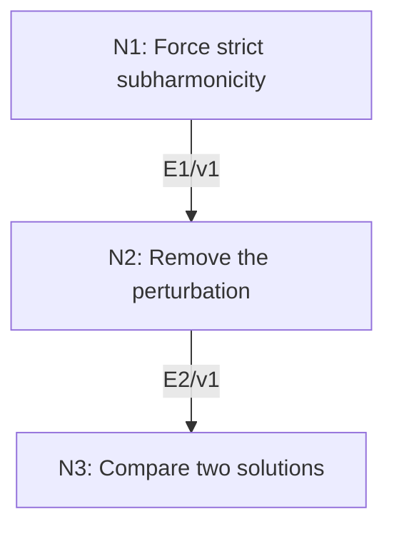

# Weak Maximum Principle and Dirichlet Uniqueness

## An End-to-End Metacognitive Mathematics Walkthrough

**Problem ID:** PDE-01  
**Version:** 1  
**Subject:** Partial Differential Equations  
**Level:** Introductory  
**Status:** Complete authored exposition relative to the declared imports.  
**Evidence:** Mathematical argument and authored teaching traces; no actual multi-agent run, independent review, or proof-assistant certification is claimed.

## 1. Target, definitions, and import contract

Let $\Omega\subset\mathbb R^d$ be a nonempty bounded open set and $u\in C^2(\Omega)\cap C(\overline\Omega)$. If $\Delta u\ge0$ in $\Omega$, prove $\max_{\overline\Omega}u=\max_{\partial\Omega}u$. Deduce uniqueness in this class for a prescribed Laplacian and prescribed continuous boundary values. No boundary smoothness or connectedness is needed for this weak principle.

### Permitted imports and conventions

Use compact attainment of extrema on closed bounded subsets of Euclidean space. At an interior local maximum of a $C^2$ function, each pure second derivative is nonpositive, hence so is the Laplacian. The bounded open set has compact nonempty boundary. This is a maximum-location result, not the strong maximum principle about interior constancy.

## 2. Intuition and node interaction workflow

A non-strict differential inequality does not directly rule out an interior maximum. Add a small strictly subharmonic quadratic, then remove the perturbation.

Each mathematical node contains **Ego, Memory, Intellect, Sense, and Action**. The diagram records accepted proof dependencies. Requests to repair an argument belong only to §6; they are not backward proof edges.

### Evidence transfer ledger

| Transfer | Producer and export | Receiving activity | Exact claim and compatibility |
|---|---|---|---|
| T1-2 | N1/v1 · E1/v1 | N2.1 | $\max_{\overline\Omega}u_\varepsilon=\max_{\partial\Omega}u_\varepsilon$. Inputs in N2 retain the producer's assumptions; evidence: §4.N1. |
| T2-3 | N2/v1 · E2/v1 | N3.1 | $\max_{\overline\Omega}u=\max_{\partial\Omega}u$. Inputs in N3 retain the producer's assumptions; evidence: §4.N2. |

## 3. Node roles and five-faculty contracts

### N1/v1 — Force strict subharmonicity

**Object and inputs:** $u_\varepsilon(x)=u(x)+\varepsilon\|x\|^2$ with $\varepsilon>0$.

**Role and strategy:** Use the positive Laplacian of the quadratic to contradict the second-derivative test at an interior maximum.

**Local obligation:** $\max_{\overline\Omega}u_\varepsilon=\max_{\partial\Omega}u_\varepsilon$.

| Faculty | Concrete responsibility |
|---|---|
| Ego | Publish E1/v1 only with its stated domain and assumptions: $\max_{\overline\Omega}u_\varepsilon=\max_{\partial\Omega}u_\varepsilon$. |
| Memory | $u_\varepsilon(x)=u(x)+\varepsilon\Vertx\Vert^2$ with $\varepsilon>0$. Preserve the §1 conventions and incoming export versions. |
| Intellect | Use the positive Laplacian of the quadratic to contradict the second-derivative test at an interior maximum. |
| Sense | The maximum exists on the compact closure; $\Delta u_\varepsilon\ge2d\varepsilon>0$ rules out every interior maximizing point. |
| Action | Execute activities N1.1–N1.2 in §4.N1; preserve the displayed calculations as evidence. |

**Export E1/v1:** $\max_{\overline\Omega}u_\varepsilon=\max_{\partial\Omega}u_\varepsilon$. Evidence: the complete local derivation in §4.N1.

**Acceptance gate:** Establish the local obligation through every numbered activity below and discharge this concrete check: The maximum exists on the compact closure; $\Delta u_\varepsilon\ge2d\varepsilon>0$ rules out every interior maximizing point.

**Targeted repair:** If $\Delta u\ge0$ alone is claimed to contradict an interior maximum, restore the strictly positive perturbation first. Withhold E1 and its dependent exports until the correction has been checked; a revised export receives a new version.

### N2/v1 — Remove the perturbation

**Object and inputs:** E1/v1 and $R^2=\max_{\overline\Omega}\|x\|^2<\infty$. Incoming proof exports: E1/v1 at N2.1.

**Role and strategy:** Bound the perturbation uniformly so its effect vanishes as $\varepsilon\downarrow0$.

**Local obligation:** $\max_{\overline\Omega}u=\max_{\partial\Omega}u$.

| Faculty | Concrete responsibility |
|---|---|
| Ego | Publish E2/v1 only with its stated domain and assumptions: $\max_{\overline\Omega}u=\max_{\partial\Omega}u$. |
| Memory | E1/v1 and $R^2=\max_{\overline\Omega}\Vertx\Vert^2<\infty$. Preserve the §1 conventions and incoming export versions. |
| Intellect | Bound the perturbation uniformly so its effect vanishes as $\varepsilon\downarrow0$. |
| Sense | The error bound must be independent of the point $x$. Boundedness of the domain provides that control. |
| Action | Execute activities N2.1–N2.2 in §4.N2; preserve the displayed calculations as evidence. |

**Export E2/v1:** $\max_{\overline\Omega}u=\max_{\partial\Omega}u$. Evidence: the complete local derivation in §4.N2.

**Acceptance gate:** Establish the local obligation through every numbered activity below and discharge this concrete check: The error bound must be independent of the point $x$. Boundedness of the domain provides that control.

**Targeted repair:** If the quadratic perturbation is removed without a uniform bound, record $R$ before taking the limit. Withhold E2 and its dependent exports until the correction has been checked; a revised export receives a new version.

### N3/v1 — Compare two solutions

**Object and inputs:** E2/v1 and $u,v$ with equal Laplacians and equal boundary values in the stated class. Incoming proof exports: E2/v1 at N3.1.

**Role and strategy:** Apply the maximum principle to the difference and its negative.

**Local obligation:** $u=v$ on $\overline\Omega$, so the classical Dirichlet problem has at most one solution in this class.

| Faculty | Concrete responsibility |
|---|---|
| Ego | Publish E3/v1 only with its stated domain and assumptions: $u=v$ on $\overline\Omega$, so the classical Dirichlet problem has at most one solution in this class. |
| Memory | E2/v1 and $u,v$ with equal Laplacians and equal boundary values in the stated class. Preserve the §1 conventions and incoming export versions. |
| Intellect | Apply the maximum principle to the difference and its negative. |
| Sense | Both signs are needed: one application gives only one ordering. |
| Action | Execute activities N3.1–N3.2 in §4.N3; preserve the displayed calculations as evidence. |

**Export E3/v1:** $u=v$ on $\overline\Omega$, so the classical Dirichlet problem has at most one solution in this class. Evidence: the complete local derivation in §4.N3.

**Acceptance gate:** Establish the local obligation through every numbered activity below and discharge this concrete check: Both signs are needed: one application gives only one ordering.

**Targeted repair:** If uniqueness is inferred from only $w\le0$, apply the same argument to $-w$ before exporting equality. Withhold E3 and its dependent exports until the correction has been checked; a revised export receives a new version.

## 4. Continuous mathematical proof

The following activities form one continuous proof. Intermediate claims are established where used, except for the explicitly permitted imports in §1.

### §4.N1 — Force strict subharmonicity

1. **N1.1.** The perturbed function is continuous on the compact closure, so it attains a maximum. At an interior maximum its Hessian has nonpositive diagonal entries, giving $\Delta u_\varepsilon\le0$.

2. **N1.2.** But $\Delta u_\varepsilon=\Delta u+2d\varepsilon>0$ everywhere inside. Hence no maximizing point is interior; a maximizing point lies on the boundary, proving the export.

### §4.N2 — Remove the perturbation

1. **N2.1.** For every $x\in\overline\Omega$, E1 gives $u(x)\le u_\varepsilon(x)\le\max_{\partial\Omega}u+\varepsilon R^2$. Let $\varepsilon\downarrow0$ to obtain $u(x)\le\max_{\partial\Omega}u$.

2. **N2.2.** Taking the maximum over the closure gives one inequality, and inclusion of the boundary in the closure gives the reverse. This proves the maximum principle.

### §4.N3 — Compare two solutions

1. **N3.1.** The difference $w=u-v$ has $\Delta w=0$ and zero boundary values. Apply E2 to $w$ to get $w\le0$.

2. **N3.2.** Apply it to $-w$, whose Laplacian also vanishes, to get $-w\le0$. Thus $w=0$. This proves uniqueness without asserting existence for arbitrary data.

## 5. Worked instance and boundary audit

On the unit disk in $\mathbb R^2$, $u(x,y)=x^2+y^2$ has $\Delta u=4$ and maximum one on the boundary. For harmonic boundary data given by the restriction of $x$, the function $u(x,y)=x$ is a solution, and the comparison argument proves it is the only one in the stated class.

### Boundary or failed-inference witness

Boundedness cannot simply be dropped. On the upper half-plane, $u(x,y)=y$ is harmonic and continuous up to the boundary, where it is zero, but it is positive and unbounded inside. Compact maximum attainment and the uniform perturbation bound both fail.

## 6. Illustrative interaction and repair trace

**Trace status:** Authored illustration, not a logged agent execution. The rejected candidate below is outside the accepted DAG.

**Rejected N1 argument:** an interior maximum contradicts $\Delta u\ge0$. A constant function has interior maxima and $\Delta u=0$, so the claimed contradiction is invalid. **Repair:** use $u_\varepsilon$ to obtain strict positivity, prove boundary attainment there, and then remove the perturbation. This fixes the proof while leaving the target weak maximum principle unchanged; recheck E2 and the uniqueness corollary.

After the corrected argument is supplied, Ego may publish a hypothetical v2 export, Memory replaces the rejected version, and Action rechecks each descendant in §2. The accepted exposition in this file is v1; this scenario does not claim an actual revision or execution occurred.

## 7. Evidence ledger and reusable exports

| Item | Evidence and scope | Remaining limitation |
|---|---|---|
| Target theorem | §4, under exactly the §1 hypotheses and imports | Authored mathematical exposition; no independent or formal verification |
| E1–E3 | Local proofs §4.N1–§4.N3; version 1 | Imports remain attached to each reuse |
| Worked instance | Explicit computation or construction in §5 | Illustrates the mechanism; does not prove the universal theorem |
| Repair | Rejected inference, witness, and correction in §6 | Teaching scenario rather than empirical agent evidence |

**Reusable target:** Preserve `PDE-01/v1`, the exact statement in §1, its assumptions, and this proof when reusing the result.

**Next direction:** Develop comparison for nonzero forcing or the strong maximum principle with its additional connectedness and argument.

## 8. Sources and navigation

The proof and faculty decomposition are authored for this collection. The following primary teaching sources support further study; exact imports are specified in §1.

[Leon Simon, Lectures on PDE](https://math.stanford.edu/~lms/lecs-on-pde.pdf), for elliptic, weak, and parabolic methods. Classical calculus and the explicitly stated Hilbert-space imports are used below; the displayed PDE arguments are developed in full.

**Local imported proof modules:** None. Supporting external results are specified in §1.

[Five-project subject index](problems.md) · [Project README](../README.md) · [Graduate subject outline](../../book/outline.md)
