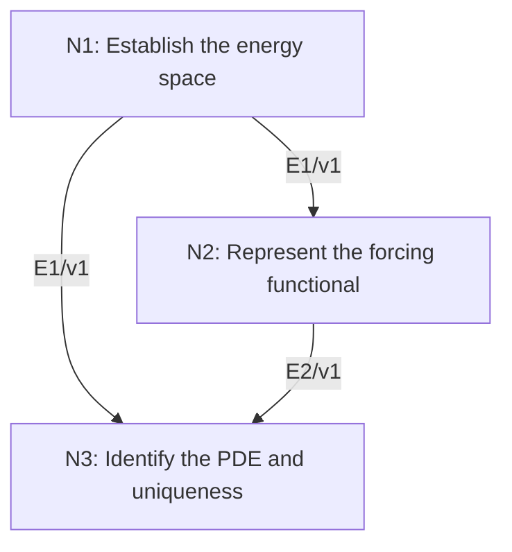

# Existence and Uniqueness for the Weak Poisson Problem

## An End-to-End Metacognitive Mathematics Walkthrough

**Problem ID:** PDE-02  
**Version:** 1  
**Subject:** Partial Differential Equations  
**Level:** Advanced  
**Status:** Complete authored exposition relative to the declared imports.  
**Evidence:** Mathematical argument and authored teaching traces; no actual multi-agent run, independent review, or proof-assistant certification is claimed.

## 1. Target, definitions, and import contract

Let $\Omega\subset\mathbb R^d$ be nonempty, bounded, and open, and let real $f\in L^2(\Omega)$. Prove there is a unique $u\in H_0^1(\Omega)$ such that $\int_\Omega\nabla u\cdot\nabla v=\int_\Omega fv$ for every $v\in H_0^1(\Omega)$. If $\Omega$ lies inside a cube of side $L$, prove $\|\nabla u\|_2\le L\|f\|_2$. This is a weak solution of $-\Delta u=f$ with zero boundary condition encoded by $H_0^1$.

### Permitted imports and conventions

Define $H^1(\Omega)$ as the $L^2$ functions whose distributional first derivatives lie in $L^2$, with norm squared $\|u\|_2^2+\|\nabla u\|_2^2$. Import completeness of this Sobolev space; $H_0^1$ is the closure of $C_c^\infty(\Omega)$ in that norm. Import the real Hilbert-space Riesz theorem FA-03: a bounded linear functional on a Hilbert space is inner product with a unique vector, of equal norm. Use Cauchy–Schwarz, Fubini on smooth functions, and the one-dimensional fundamental theorem. The needed Poincaré bound is proved here.

## 2. Intuition and node interaction workflow

The gradient form becomes an inner product once a Poincaré estimate controls the missing $L^2$ part. Riesz representation then constructs the weak solution directly.

Each mathematical node contains **Ego, Memory, Intellect, Sense, and Action**. The diagram records accepted proof dependencies. Requests to repair an argument belong only to §6; they are not backward proof edges.

### Evidence transfer ledger

| Transfer | Producer and export | Receiving activity | Exact claim and compatibility |
|---|---|---|---|
| T1-2 | N1/v1 · E1/v1 | N2.1 | $\Vertv\Vert_2\le L\Vert\nabla v\Vert_2$ on $H_0^1$, and $a(u,v)=\int\nabla u\cdot\nabla v$ is a complete inner product there. Inputs in N2 retain the producer's assumptions; evidence: §4.N1. |
| T1-3 | N1/v1 · E1/v1 | N3.2 | $\Vertv\Vert_2\le L\Vert\nabla v\Vert_2$ on $H_0^1$, and $a(u,v)=\int\nabla u\cdot\nabla v$ is a complete inner product there. Inputs in N3 retain the producer's assumptions; evidence: §4.N1. |
| T2-3 | N2/v1 · E2/v1 | N3.1 | There exists $u\in H_0^1$ with $a(u,v)=\ell(v)$ for all $v$, and $\Vert\nabla u\Vert_2\le L\Vertf\Vert_2$. Inputs in N3 retain the producer's assumptions; evidence: §4.N2. |

## 3. Node roles and five-faculty contracts

### N1/v1 — Establish the energy space

**Object and inputs:** A cube $Q$ of side $L$ containing $\Omega$ and smooth compactly supported test functions extended by zero to $Q$.

**Role and strategy:** Integrate along one coordinate to prove Poincaré, then use density and equivalent norms.

**Local obligation:** $\|v\|_2\le L\|\nabla v\|_2$ on $H_0^1$, and $a(u,v)=\int\nabla u\cdot\nabla v$ is a complete inner product there.

| Faculty | Concrete responsibility |
|---|---|
| Ego | Publish E1/v1 only with its stated domain and assumptions: $\Vertv\Vert_2\le L\Vert\nabla v\Vert_2$ on $H_0^1$, and $a(u,v)=\int\nabla u\cdot\nabla v$ is a complete inner product there. |
| Memory | A cube $Q$ of side $L$ containing $\Omega$ and smooth compactly supported test functions extended by zero to $Q$. Preserve the §1 conventions and incoming export versions. |
| Intellect | Integrate along one coordinate to prove Poincaré, then use density and equivalent norms. |
| Sense | Zero extension is used first only for compactly supported smooth functions; the general inequality follows by the defining closure. |
| Action | Execute activities N1.1–N1.2 in §4.N1; preserve the displayed calculations as evidence. |

**Export E1/v1:** $\|v\|_2\le L\|\nabla v\|_2$ on $H_0^1$, and $a(u,v)=\int\nabla u\cdot\nabla v$ is a complete inner product there. Evidence: the complete local derivation in §4.N1.

**Acceptance gate:** Establish the local obligation through every numbered activity below and discharge this concrete check: Zero extension is used first only for compactly supported smooth functions; the general inequality follows by the defining closure.

**Targeted repair:** If the gradient seminorm is called a norm without justification, prove Poincaré first; constants are not automatically excluded in other Sobolev spaces. Withhold E1 and its dependent exports until the correction has been checked; a revised export receives a new version.

### N2/v1 — Represent the forcing functional

**Object and inputs:** E1/v1 and $\ell(v)=\int_\Omega fv$. Incoming proof exports: E1/v1 at N2.1.

**Role and strategy:** Bound the forcing in the energy norm and apply the declared Hilbert representation theorem.

**Local obligation:** There exists $u\in H_0^1$ with $a(u,v)=\ell(v)$ for all $v$, and $\|\nabla u\|_2\le L\|f\|_2$.

| Faculty | Concrete responsibility |
|---|---|
| Ego | Publish E2/v1 only with its stated domain and assumptions: There exists $u\in H_0^1$ with $a(u,v)=\ell(v)$ for all $v$, and $\Vert\nabla u\Vert_2\le L\Vertf\Vert_2$. |
| Memory | E1/v1 and $\ell(v)=\int_\Omega fv$. Preserve the §1 conventions and incoming export versions. |
| Intellect | Bound the forcing in the energy norm and apply the declared Hilbert representation theorem. |
| Sense | The functional is defined on equivalence classes and bounded in the gradient norm, not merely in the $L^2$ norm. |
| Action | Execute activities N2.1–N2.2 in §4.N2; preserve the displayed calculations as evidence. |

**Export E2/v1:** There exists $u\in H_0^1$ with $a(u,v)=\ell(v)$ for all $v$, and $\|\nabla u\|_2\le L\|f\|_2$. Evidence: the complete local derivation in §4.N2.

**Acceptance gate:** Establish the local obligation through every numbered activity below and discharge this concrete check: The functional is defined on equivalence classes and bounded in the gradient norm, not merely in the $L^2$ norm.

**Targeted repair:** If the functional is represented using the usual $H^1$ inner product, change to $a$; otherwise an unwanted zeroth-order term appears. Withhold E2 and its dependent exports until the correction has been checked; a revised export receives a new version.

### N3/v1 — Identify the PDE and uniqueness

**Object and inputs:** E2/v1 and the definition of distributional Laplacian. Incoming proof exports: E1/v1 at N3.2, E2/v1 at N3.1.

**Role and strategy:** Test against compactly supported smooth functions and against the difference of two proposed solutions.

**Local obligation:** The vector $u$ solves $-\Delta u=f$ in distributions and is the unique stated weak solution.

| Faculty | Concrete responsibility |
|---|---|
| Ego | Publish E3/v1 only with its stated domain and assumptions: The vector $u$ solves $-\Delta u=f$ in distributions and is the unique stated weak solution. |
| Memory | E2/v1 and the definition of distributional Laplacian. Preserve the §1 conventions and incoming export versions. |
| Intellect | Test against compactly supported smooth functions and against the difference of two proposed solutions. |
| Sense | The conclusion is weak existence; no $C^2$ regularity or pointwise boundary trace on a rough domain is inferred. |
| Action | Execute activities N3.1–N3.2 in §4.N3; preserve the displayed calculations as evidence. |

**Export E3/v1:** The vector $u$ solves $-\Delta u=f$ in distributions and is the unique stated weak solution. Evidence: the complete local derivation in §4.N3.

**Acceptance gate:** Establish the local obligation through every numbered activity below and discharge this concrete check: The conclusion is weak existence; no $C^2$ regularity or pointwise boundary trace on a rough domain is inferred.

**Targeted repair:** If a weak solution is promoted to a classical one, remove that unsupported conclusion or supply a separate regularity theorem with its required domain assumptions. Withhold E3 and its dependent exports until the correction has been checked; a revised export receives a new version.

## 4. Continuous mathematical proof

The following activities form one continuous proof. Intermediate claims are established where used, except for the explicitly permitted imports in §1.

### §4.N1 — Establish the energy space

1. **N1.1.** After translating the cube, take $Q=(0,L)^d$. For $v\in C_c^\infty(\Omega)$ extended by zero, $v(x_1,x')=\int_0^{x_1}\partial_1v(s,x')\,ds$. Cauchy–Schwarz gives $|v(x_1,x')|^2\le L\int_0^L|\partial_1v(s,x')|^2ds$. Integrate over $x_1$ and $x'$ to obtain $\|v\|_2^2\le L^2\|\partial_1v\|_2^2\le L^2\|\nabla v\|_2^2$.

2. **N1.2.** Approximate any $v\in H_0^1$ by such smooth functions in the $H^1$ norm. Passing to the norm limit preserves the inequality. Therefore $\|\nabla v\|_2=0$ forces $v=0$, and the gradient norm is equivalent to the complete $H^1$ norm on its closed subspace $H_0^1$. A gradient-Cauchy sequence is $H^1$-Cauchy by the inequality and converges in both norms. Thus $a$ is a Hilbert inner product.

### §4.N2 — Represent the forcing functional

1. **N2.1.** Cauchy–Schwarz and E1 give $|\ell(v)|\le\|f\|_2\|v\|_2\le L\|f\|_2\|\nabla v\|_2$. Thus $\ell$ is a bounded linear functional on the real Hilbert space with inner product $a$.

2. **N2.2.** Apply FA-03 to obtain a unique representing vector $u$ with $\ell(v)=a(v,u)=a(u,v)$, since the form is symmetric. The norm equality in Riesz yields $\|\nabla u\|_2=\|\ell\|\le L\|f\|_2$. This is exactly the asserted variational equation.

### §4.N3 — Identify the PDE and uniqueness

1. **N3.1.** For $\varphi\in C_c^\infty(\Omega)\subset H_0^1$, the distribution $-\Delta u$ acts by $\int\nabla u\cdot\nabla\varphi$. The variational identity equals $\int f\varphi$, proving the distributional equation. Membership in $H_0^1$ is the specified homogeneous boundary condition.

2. **N3.2.** If $u_1,u_2$ solve the equation, their difference $w$ satisfies $a(w,v)=0$ for every $v\in H_0^1$. Choosing $v=w$ gives $\|\nabla w\|_2^2=0$, and E1 gives $w=0$. This independently verifies uniqueness and closes the problem.

## 5. Worked instance and boundary audit

On $\Omega=(0,1)$ with $f=1$, let $u(x)=x(1-x)/2$. It belongs to $H_0^1$: smooth cutoffs near the endpoints converge in $H^1$, since $u$ vanishes linearly there and the cutoff-derivative errors are supported on intervals of vanishing length. It satisfies $-u''=1$. Integration by parts against smooth compactly supported $v$ gives $\int u'v'=\int v$, and density extends this to all $H_0^1$. Its energy norm is $\|u'\|_2=1/\sqrt{12}\le1=L\|f\|_2$.

### Boundary or failed-inference witness

On $H^1(\Omega)$ instead of $H_0^1$, a nonzero constant has zero gradient, so the energy form is not an inner product. Testing the same proposed equation with $v=1$ would require $\int f=0$, a compatibility condition absent from the Dirichlet theorem. Changing the space changes the problem.

## 6. Illustrative interaction and repair trace

**Trace status:** Authored illustration, not a logged agent execution. The rejected candidate below is outside the accepted DAG.

**Rejected N1 export:** the gradient norm is complete and positive on all $H^1$. **Sense:** nonzero constants have norm zero in that seminorm. **Repair:** retain $H_0^1$ and the explicit Poincaré estimate before applying Riesz. The original weak Dirichlet target is unchanged. Recheck the forcing bound, representation, and uniqueness downstream.

After the corrected argument is supplied, Ego may publish a hypothetical v2 export, Memory replaces the rejected version, and Action rechecks each descendant in §2. The accepted exposition in this file is v1; this scenario does not claim an actual revision or execution occurred.

## 7. Evidence ledger and reusable exports

| Item | Evidence and scope | Remaining limitation |
|---|---|---|
| Target theorem | §4, under exactly the §1 hypotheses and imports | Authored mathematical exposition; no independent or formal verification |
| E1–E3 | Local proofs §4.N1–§4.N3; version 1 | Imports remain attached to each reuse |
| Worked instance | Explicit computation or construction in §5 | Illustrates the mechanism; does not prove the universal theorem |
| Repair | Rejected inference, witness, and correction in §6 | Teaching scenario rather than empirical agent evidence |

**Reusable target:** Preserve `PDE-02/v1`, the exact statement in §1, its assumptions, and this proof when reusing the result.

**Next direction:** Develop Lax–Milgram for nonsymmetric coercive forms, or establish additional regularity under smoother domain and forcing assumptions.

## 8. Sources and navigation

The proof and faculty decomposition are authored for this collection. The following primary teaching sources support further study; exact imports are specified in §1.

[Leon Simon, Lectures on PDE](https://math.stanford.edu/~lms/lecs-on-pde.pdf), for elliptic, weak, and parabolic methods. Classical calculus and the explicitly stated Hilbert-space imports are used below; the displayed PDE arguments are developed in full.

**Local imported proof modules:** [FA-03 — Riesz Representation in Hilbert Spaces](../../../../2-Analysis/Functional-Analysis-and-Measure-Theory/projects/markdown/riesz-representation-hilbert-spaces.md)

[Five-project subject index](problems.md) · [Project README](../README.md) · [Graduate subject outline](../../book/outline.md)
