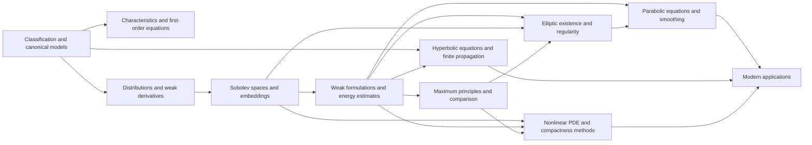

# Meta-Graph: Partial Differential Equations

> **Purpose.** This is a subject-level dependency map for planning a future theorem knowledge graph. It shows a representative route through the field; it is not a complete list of prerequisites, a formal proof dependency database, or a claim that every course follows this order.

## How to read this graph

- **Nodes** are foundational ideas, methods, structural results, or major theorems. A node may later expand into its own proof-level graph.
- An arrow `X → Y` means that X commonly supplies language, a method, a hypothesis, or a result used in understanding or proving Y. The edge table says which role it plays.
- Some edges describe a common proof route or conceptual bridge rather than a logically necessary dependency. The eventual theorem graph should record the exact theorem, hypotheses, source, and proof step for every strict dependency.
- The graph is a DAG at this global overview level. Feedback and revision belong inside proof workflows; they should not be mistaken for a theorem depending on itself.

## Global subject map

## Node register

| ID | Idea, theorem, or method | Role in the subject |
|---|---|---|
| A | Classification and canonical models | Sort equations by order and type |
| B | Characteristics and first-order equations | Track propagation along curves |
| C | Distributions and weak derivatives | Extend derivatives to nonsmooth solutions |
| D | Sobolev spaces and embeddings | Measure weak regularity and compactness |
| E | Weak formulations and energy estimates | Convert PDEs to variational identities |
| F | Elliptic existence and regularity | Prove solvability and smoothness for elliptic problems |
| G | Maximum principles and comparison | Control solutions by boundary or initial data |
| H | Parabolic equations and smoothing | Study diffusion, evolution, and regularization |
| I | Hyperbolic equations and finite propagation | Study waves, energy, and domains of dependence |
| J | Nonlinear PDE and compactness methods | Handle nonlinearities, weak limits, and uniqueness |
| K | Modern applications | Connect PDE to geometry, fluids, and calculus of variations |

## Dependency register

| From → To | Connection type | How the earlier node supports the later node |
|---|---|---|
| A → B (Classification and canonical models → Characteristics and first-order equations) | Common mathematical dependency | First-order type yields characteristic curves. |
| A → C (Classification and canonical models → Distributions and weak derivatives) | Common mathematical dependency | Weak formulations generalize classical derivatives. |
| C → D (Distributions and weak derivatives → Sobolev spaces and embeddings) | Common mathematical dependency | Weak derivatives define Sobolev spaces. |
| D → E (Sobolev spaces and embeddings → Weak formulations and energy estimates) | Common mathematical dependency | Sobolev structure supports variational formulations. |
| E → F (Weak formulations and energy estimates → Elliptic existence and regularity) | Common mathematical dependency | Energy methods and coercivity yield elliptic existence. |
| D → F (Sobolev spaces and embeddings → Elliptic existence and regularity) | Common mathematical dependency | Embeddings and estimates enable elliptic regularity. |
| G → F (Maximum principles and comparison → Elliptic existence and regularity) | Common mathematical dependency | Comparison controls uniqueness and bounds. |
| E → G (Weak formulations and energy estimates → Maximum principles and comparison) | Common mathematical dependency | Weak solutions admit comparison principles. |
| E → H (Weak formulations and energy estimates → Parabolic equations and smoothing) | Common mathematical dependency | Energy estimates control parabolic evolution. |
| F → H (Elliptic existence and regularity → Parabolic equations and smoothing) | Common mathematical dependency | Elliptic estimates support spatial regularity of evolution. |
| A → I (Classification and canonical models → Hyperbolic equations and finite propagation) | Common mathematical dependency | Hyperbolic type determines characteristic propagation. |
| E → I (Weak formulations and energy estimates → Hyperbolic equations and finite propagation) | Common mathematical dependency | Energy identities yield wave well-posedness. |
| D → J (Sobolev spaces and embeddings → Nonlinear PDE and compactness methods) | Common mathematical dependency | Compact embeddings support nonlinear limit arguments. |
| E → J (Weak formulations and energy estimates → Nonlinear PDE and compactness methods) | Common mathematical dependency | Weak compactness and energy estimates pass to limits. |
| G → J (Maximum principles and comparison → Nonlinear PDE and compactness methods) | Common mathematical dependency | Comparison and monotonicity can give uniqueness. |
| H → K (Parabolic equations and smoothing → Modern applications) | Common mathematical dependency | Diffusion links to geometric flows and probability. |
| I → K (Hyperbolic equations and finite propagation → Modern applications) | Common mathematical dependency | Wave propagation links to physics. |
| J → K (Nonlinear PDE and compactness methods → Modern applications) | Common mathematical dependency | Nonlinear techniques support fluids and geometric PDE. |

## Suggested reading paths

**Core route:** follow the nodes from foundational language toward the central structural theorems, then continue to the advanced endpoint. For a first pass, read the graph left to right and pause at each node to state its hypotheses and output.

**Theorem-focused route:** choose a major theorem node, trace incoming arrows backward to identify imported results, then trace outgoing arrows to see what the theorem enables. Mark which incoming edges are strict dependencies after consulting a proof-level source.

**Bridge route:** follow cross-links between methods and neighboring theories. Treat these as transfer routes: identify exactly what is preserved, what hypotheses are added, and what changes under translation.

## Five-faculty expansion for each theorem node

When a node is selected for a complete Meta-Math walkthrough, preserve the node ID and expand it into a local five-faculty proof graph:

| Faculty | Local responsibility |
|---|---|
| **Ego** | State the precise theorem goal, scope, and proof contract; distinguish the claim from nearby stronger or weaker claims. |
| **Memory** | Retrieve definitions, hypotheses, lemmas, source references, and known examples/counterexamples required by this node. |
| **Intellect** | Select and order proof steps; justify each inference and expose dependency on incoming nodes. |
| **Sense** | Check type/notation consistency, hypothesis use, boundary cases, examples, and whether each intermediate claim is actually supported. |
| **Action** | Execute proof steps, calculations, constructions, or formal checks; emit the verified result and update outgoing dependencies. |

A later graph version should connect global theorem nodes to these local faculty nodes, with typed edges such as `uses`, `specializes`, `generalizes`, `contradicts`, `analogy-only`, and `verified-by`.

## Expansion record

For each node promoted from this map, add a stable theorem or concept ID, exact statement, source and page/section, prerequisite IDs, proof-step graph, explicit hypothesis checks, known failure modes, examples, and verification status. Keep conjectural or analogy-only links visually distinct from proved dependencies.

**Related syllabus:** [`outline.md`](book-outline.md).
