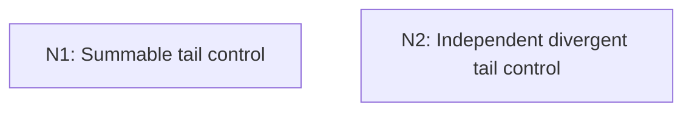

# The Two Borel–Cantelli Lemmas

## An End-to-End Metacognitive Mathematics Walkthrough

**Problem ID:** PS-01  
**Version:** 1  
**Subject:** Probability and Stochastic Processes  
**Level:** Introductory  
**Status:** Complete authored exposition relative to the declared imports.  
**Evidence:** Mathematical argument and authored teaching traces; no actual multi-agent run, independent review, or proof-assistant certification is claimed.

## 1. Target, definitions, and import contract

For events $A_n$ on a probability space, write $\{A_n\text{ i.o.}\}=\bigcap_{N\ge1}\bigcup_{n\ge N}A_n$. Prove: (i) if $\sum_n\mathbb P(A_n)<\infty$, then $\mathbb P(A_n\text{ i.o.})=0$; (ii) if the events are mutually independent and $\sum_n\mathbb P(A_n)=\infty$, then $\mathbb P(A_n\text{ i.o.})=1$. Mutual independence means every finite subcollection has product probability, including the corresponding complements.

### Permitted imports and conventions

Use countable subadditivity, continuity of probability along monotone event sequences, finite-product independence, and $1-p\le e^{-p}$ for $0\le p\le1$. These follow respectively from countable additivity and elementary real analysis. The first direction has no independence assumption.

## 2. Intuition and node interaction workflow

The summable case bounds the entire tail union. The independent divergent case instead bounds the probability that an entire long tail block contains no occurrence.

Each mathematical node contains **Ego, Memory, Intellect, Sense, and Action**. The diagram records accepted proof dependencies. Requests to repair an argument belong only to §6; they are not backward proof edges.

### Evidence transfer ledger

| Transfer | Producer and export | Receiving activity | Exact claim and compatibility |
|---|---|---|---|
| Independent branches | No inter-node import | Each branch starts from §1 | These nodes prove separate directions of the theorem; neither uses the other as a premise. |

## 3. Node roles and five-faculty contracts

### N1/v1 — Summable tail control

**Object and inputs:** $\sum_n\mathbb P(A_n)<\infty$ and $B_N=\bigcup_{n\ge N}A_n$.

**Role and strategy:** Bound a tail union and let the summable tail vanish.

**Local obligation:** Under summability, $\mathbb P(A_n\text{ i.o.})=0$.

| Faculty | Concrete responsibility |
|---|---|
| Ego | Publish E1/v1 only with its stated domain and assumptions: Under summability, $\mathbb P(A_n\text{ i.o.})=0$. |
| Memory | $\sum_n\mathbb P(A_n)<\infty$ and $B_N=\bigcup_{n\ge N}A_n$. Preserve the §1 conventions and incoming export versions. |
| Intellect | Bound a tail union and let the summable tail vanish. |
| Sense | No products or independence are used in this direction. |
| Action | Execute activities N1.1–N1.2 in §4.N1; preserve the displayed calculations as evidence. |

**Export E1/v1:** Under summability, $\mathbb P(A_n\text{ i.o.})=0$. Evidence: the complete local derivation in §4.N1.

**Acceptance gate:** Establish the local obligation through every numbered activity below and discharge this concrete check: No products or independence are used in this direction.

**Targeted repair:** If independence is imposed in this branch, remove it from the local inputs: the union bound already supplies the full conclusion. Withhold E1 and its dependent exports until the correction has been checked; a revised export receives a new version.

### N2/v1 — Independent divergent tail control

**Object and inputs:** Mutual independence and $\sum_n\mathbb P(A_n)=\infty$.

**Role and strategy:** Estimate the complementary event of no occurrence in a finite tail block and then exhaust the tail.

**Local obligation:** Under independence and divergence, $\mathbb P(A_n\text{ i.o.})=1$.

| Faculty | Concrete responsibility |
|---|---|
| Ego | Publish E2/v1 only with its stated domain and assumptions: Under independence and divergence, $\mathbb P(A_n\text{ i.o.})=1$. |
| Memory | Mutual independence and $\sum_n\mathbb P(A_n)=\infty$. Preserve the §1 conventions and incoming export versions. |
| Intellect | Estimate the complementary event of no occurrence in a finite tail block and then exhaust the tail. |
| Sense | Divergence of the series alone does not give the finite product identity; mutual independence is used there. |
| Action | Execute activities N2.1–N2.2 in §4.N2; preserve the displayed calculations as evidence. |

**Export E2/v1:** Under independence and divergence, $\mathbb P(A_n\text{ i.o.})=1$. Evidence: the complete local derivation in §4.N2.

**Acceptance gate:** Establish the local obligation through every numbered activity below and discharge this concrete check: Divergence of the series alone does not give the finite product identity; mutual independence is used there.

**Targeted repair:** If the product step is used for dependent events, withhold this export and either verify independence or use a separately justified dependence condition. Withhold E2 and its dependent exports until the correction has been checked; a revised export receives a new version.

## 4. Continuous mathematical proof

The following activities form one continuous proof. Intermediate claims are established where used, except for the explicitly permitted imports in §1.

### §4.N1 — Summable tail control

1. **N1.1.** Countable subadditivity gives $\mathbb P(B_N)\le\sum_{n\ge N}\mathbb P(A_n)$. The right side tends to zero because the series converges.

2. **N1.2.** The events $B_N$ decrease and their intersection is the infinitely-often event. Continuity from above yields its probability as $\lim_N\mathbb P(B_N)=0$.

### §4.N2 — Independent divergent tail control

1. **N2.1.** Fix $N$. For $m\ge N$, independence gives $\mathbb P(\bigcap_{n=N}^m A_n^c)=\prod_{n=N}^m(1-\mathbb P(A_n))\le\exp(-\sum_{n=N}^m\mathbb P(A_n))$. Divergence makes this tend to zero as $m\to\infty$.

2. **N2.2.** By continuity from above, $\mathbb P(\bigcap_{n\ge N}A_n^c)=0$, so $\mathbb P(B_N)=1$. The intersection of the countably many probability-one events $B_N$ still has probability one, proving the second assertion.

## 5. Worked instance and boundary audit

For independent fair coin tosses, let $A_n$ be the event that toss $n$ is heads. The sum of probabilities diverges, so heads occur infinitely often almost surely. For a separate sequence of events $B_n$ with $\mathbb P(B_n)=2^{-n}$, the sum is finite, so only finitely many $B_n$ occur almost surely regardless of their dependence.

### Boundary or failed-inference witness

Let $A_n=A$ for every $n$, where $\mathbb P(A)=1/2$. Then $\sum_n\mathbb P(A_n)=\infty$, but the infinitely-often event is just $A$, of probability $1/2$. This disproves the divergent implication without a dependence hypothesis.

## 6. Illustrative interaction and repair trace

**Trace status:** Authored illustration, not a logged agent execution. The rejected candidate below is outside the accepted DAG.

**Rejected N2 inference:** a divergent sum of probabilities implies probability one of infinitely many occurrences without independence. **Sense witness:** identical events $A_n=A$. **Diagnosis:** Intellect replaced the probability of an intersection by a product without authorization. **Repair:** use mutual independence only in the second branch, as in §1. The first branch remains valid for arbitrary dependence; its export need not be revised.

After the corrected argument is supplied, Ego may publish a hypothetical v2 export, Memory replaces the rejected version, and Action rechecks each descendant in §2. The accepted exposition in this file is v1; this scenario does not claim an actual revision or execution occurred.

## 7. Evidence ledger and reusable exports

| Item | Evidence and scope | Remaining limitation |
|---|---|---|
| Target theorem | §4, under exactly the §1 hypotheses and imports | Authored mathematical exposition; no independent or formal verification |
| E1–E2 | Local proofs §4.N1–§4.N2; version 1 | Imports remain attached to each reuse |
| Worked instance | Explicit computation or construction in §5 | Illustrates the mechanism; does not prove the universal theorem |
| Repair | Rejected inference, witness, and correction in §6 | Teaching scenario rather than empirical agent evidence |

**Reusable target:** Preserve `PS-01/v1`, the exact statement in §1, its assumptions, and this proof when reusing the result.

**Next direction:** Apply the summable half to error events in PS-02; the probability bound must be summable over all sample sizes.

## 8. Sources and navigation

The proof and faculty decomposition are authored for this collection. The following primary teaching sources support further study; exact imports are specified in §1.

[Amir Dembo, Probability Theory: STAT310/MATH230 notes](https://stanford.edu/~montanar/TEACHING/Stat310A/lnotes.pdf) for measure-theoretic probability and limit arguments; [Stanford STAT310C syllabus and lecture materials](https://web.stanford.edu/class/stats310c/syllabus.html) for martingale inequalities and stopping theorems. The versions and proofs used in this collection are stated explicitly.

**Local imported proof modules:** None. Supporting external results are specified in §1.

[Five-project subject index](problems.md) · [Project README](../README.md) · [Graduate subject outline](../../book/outline.md)
