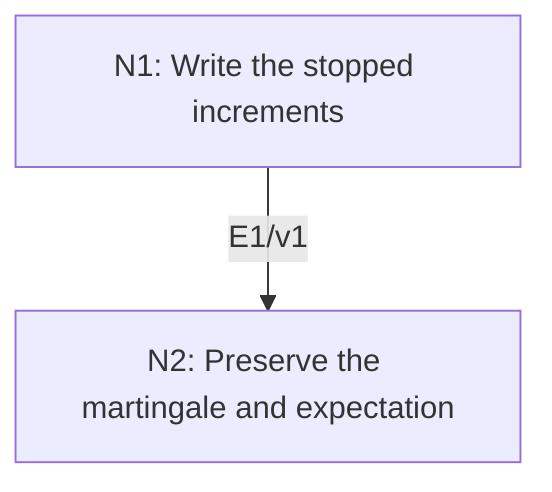

# Optional Stopping for Bounded Stopping Times

## An End-to-End Metacognitive Mathematics Walkthrough

**Problem ID:** PS-03  
**Version:** 1  
**Subject:** Probability and Stochastic Processes  
**Level:** Intermediate  
**Status:** Complete authored exposition relative to the declared imports.  
**Evidence:** Mathematical argument and authored teaching traces; no actual multi-agent run, independent review, or proof-assistant certification is claimed.

## 1. Target, definitions, and import contract

Let $(M_n,\mathcal F_n)_{n\ge0}$ be an integrable real martingale: $M_n$ is $\mathcal F_n$-measurable, $\mathbb E|M_n|<\infty$, and $\mathbb E[M_n\mid\mathcal F_{n-1}]=M_{n-1}$. Let $\tau$ be a stopping time with integer values and $0\le\tau\le N$ almost surely for some deterministic finite $N$. Prove $\mathbb EM_\tau=\mathbb EM_0$. Also prove $(M_{n\wedge\tau})$ is a martingale.

### Permitted imports and conventions

Use linearity and the tower property of conditional expectation, and the pull-out property for bounded measurable factors. A stopping time means $\{\tau\le n\}\in\mathcal F_n$. Finite sums of integrable variables are integrable. The boundedness condition is on the time, not on sample values of the martingale.

## 2. Intuition and node interaction workflow

Stopping retains exactly those increments whose inclusion was decided before the next increment was observed. That predictability preserves their zero conditional means.

Each mathematical node contains **Ego, Memory, Intellect, Sense, and Action**. The diagram records accepted proof dependencies. Requests to repair an argument belong only to §6; they are not backward proof edges.

### Evidence transfer ledger

| Transfer | Producer and export | Receiving activity | Exact claim and compatibility |
|---|---|---|---|
| T1-2 | N1/v1 · E1/v1 | N2.1 | $M_{n\wedge\tau}=M_0+\sum_{k=1}^nD_k1_{\{\tau\ge k\}}$, with each stopped increment conditionally mean zero. Inputs in N2 retain the producer's assumptions; evidence: §4.N1. |

## 3. Node roles and five-faculty contracts

### N1/v1 — Write the stopped increments

**Object and inputs:** $D_k=M_k-M_{k-1}$ and stopping time $\tau\le N$.

**Role and strategy:** Telescope the stopped path with indicators known at the preceding time.

**Local obligation:** $M_{n\wedge\tau}=M_0+\sum_{k=1}^nD_k1_{\{\tau\ge k\}}$, with each stopped increment conditionally mean zero.

| Faculty | Concrete responsibility |
|---|---|
| Ego | Publish E1/v1 only with its stated domain and assumptions: $M_{n\wedge\tau}=M_0+\sum_{k=1}^nD_k1_{\{\tau\ge k\}}$, with each stopped increment conditionally mean zero. |
| Memory | $D_k=M_k-M_{k-1}$ and stopping time $\tau\le N$. Preserve the §1 conventions and incoming export versions. |
| Intellect | Telescope the stopped path with indicators known at the preceding time. |
| Sense | $\{\tau\ge k\}=\{\tau\le k-1\}^c$ belongs to $\mathcal F_{k-1}$; using $\{\tau=k\}$ instead would not have that predictability. |
| Action | Execute activities N1.1–N1.2 in §4.N1; preserve the displayed calculations as evidence. |

**Export E1/v1:** $M_{n\wedge\tau}=M_0+\sum_{k=1}^nD_k1_{\{\tau\ge k\}}$, with each stopped increment conditionally mean zero. Evidence: the complete local derivation in §4.N1.

**Acceptance gate:** Establish the local obligation through every numbered activity below and discharge this concrete check: $\{\tau\ge k\}=\{\tau\le k-1\}^c$ belongs to $\mathcal F_{k-1}$; using $\{\tau=k\}$ instead would not have that predictability.

**Targeted repair:** If a future-dependent indicator is pulled out of conditional expectation, replace it with the actual predictable inclusion event and verify its sigma-algebra. Withhold E1 and its dependent exports until the correction has been checked; a revised export receives a new version.

### N2/v1 — Preserve the martingale and expectation

**Object and inputs:** E1/v1 and the deterministic bound $\tau\le N$. Incoming proof exports: E1/v1 at N2.1.

**Role and strategy:** Use the increment calculation for the stopped process, then evaluate at the finite horizon $N$.

**Local obligation:** The stopped process is an integrable martingale and $\mathbb EM_\tau=\mathbb EM_0$.

| Faculty | Concrete responsibility |
|---|---|
| Ego | Publish E2/v1 only with its stated domain and assumptions: The stopped process is an integrable martingale and $\mathbb EM_\tau=\mathbb EM_0$. |
| Memory | E1/v1 and the deterministic bound $\tau\le N$. Preserve the §1 conventions and incoming export versions. |
| Intellect | Use the increment calculation for the stopped process, then evaluate at the finite horizon $N$. |
| Sense | No limit of expectations at an unbounded time is taken; the final stopped variable equals $M_{N\wedge\tau}$. |
| Action | Execute activities N2.1–N2.2 in §4.N2; preserve the displayed calculations as evidence. |

**Export E2/v1:** The stopped process is an integrable martingale and $\mathbb EM_\tau=\mathbb EM_0$. Evidence: the complete local derivation in §4.N2.

**Acceptance gate:** Establish the local obligation through every numbered activity below and discharge this concrete check: No limit of expectations at an unbounded time is taken; the final stopped variable equals $M_{N\wedge\tau}$.

**Targeted repair:** If boundedness of $\tau$ is removed, stop at $\tau\wedge n$ first and state the additional integrability condition needed for any subsequent limit. Withhold E2 and its dependent exports until the correction has been checked; a revised export receives a new version.

## 4. Continuous mathematical proof

The following activities form one continuous proof. Intermediate claims are established where used, except for the explicitly permitted imports in §1.

### §4.N1 — Write the stopped increments

1. **N1.1.** On a path with $\tau=t$, the sum includes exactly increments $1$ through $\min(n,t)$, so it telescopes to $M_{n\wedge t}$. The indicator $1_{\{\tau\ge k\}}$ is bounded and $\mathcal F_{k-1}$-measurable by the stopping-time property.

2. **N1.2.** The martingale property gives $\mathbb E[D_k\mid\mathcal F_{k-1}]=0$. Pulling out the indicator yields $\mathbb E[D_k1_{\{\tau\ge k\}}\mid\mathcal F_{k-1}]=0$. Each product is integrable because its magnitude is at most $|D_k|$.

### §4.N2 — Preserve the martingale and expectation

1. **N2.1.** The finite-sum expression proves integrability and adaptation of $M_{n\wedge\tau}$. Its increment from $n-1$ to $n$ is $D_n1_{\{\tau\ge n\}}$, with conditional expectation zero by E1. Thus it is a martingale.

2. **N2.2.** Take expectations of the E1 identity at $n=N$. Each increment expectation is zero by the tower property. Since $N\wedge\tau=\tau$ almost surely, the left side is $\mathbb EM_\tau$, proving the equality.

## 5. Worked instance and boundary audit

Let $M_n$ be the simple symmetric random walk started at zero, and let $\tau$ be the first time it reaches $+1$, capped at time two. The stopped values are $+1$ with probability $1/2$, $0$ with probability $1/4$, and $-2$ with probability $1/4$. Their expectation is $1/2-1/2=0=M_0$, matching the theorem.

### Boundary or failed-inference witness

For fair coin tosses, set $M_n=2^n1_{\{\text{first }n\text{ tosses are tails}\}}$, so $M_0=1$. It is a nonnegative martingale because the next step doubles with probability $1/2$ and becomes zero otherwise. If $\tau$ is the first head, $\mathbb P(\tau>n)=2^{-n}$, so $\tau<\infty$ almost surely, but $M_\tau=0$ and its expectation is not one. Almost sure finiteness is insufficient.

## 6. Illustrative interaction and repair trace

**Trace status:** Authored illustration, not a logged agent execution. The rejected candidate below is outside the accepted DAG.

**Rejected N2 limit:** $M_{\tau\wedge n}\to M_\tau$ almost surely, therefore their expectations converge. The doubling example has expectation one at every finite stopped horizon but limit expectation zero. **Diagnosis:** Sense finds an invalid exchange without uniform integrability or domination. **Repair:** use the stated deterministic bound $N$, avoiding the limit entirely. An unbounded-time theorem would require a separately proved stronger contract.

After the corrected argument is supplied, Ego may publish a hypothetical v2 export, Memory replaces the rejected version, and Action rechecks each descendant in §2. The accepted exposition in this file is v1; this scenario does not claim an actual revision or execution occurred.

## 7. Evidence ledger and reusable exports

| Item | Evidence and scope | Remaining limitation |
|---|---|---|
| Target theorem | §4, under exactly the §1 hypotheses and imports | Authored mathematical exposition; no independent or formal verification |
| E1–E2 | Local proofs §4.N1–§4.N2; version 1 | Imports remain attached to each reuse |
| Worked instance | Explicit computation or construction in §5 | Illustrates the mechanism; does not prove the universal theorem |
| Repair | Rejected inference, witness, and correction in §6 | Teaching scenario rather than empirical agent evidence |

**Reusable target:** Preserve `PS-03/v1`, the exact statement in §1, its assumptions, and this proof when reusing the result.

**Next direction:** Extend to uniformly integrable martingales and unbounded stopping times, explicitly proving the expectation-limit passage.

## 8. Sources and navigation

The proof and faculty decomposition are authored for this collection. The following primary teaching sources support further study; exact imports are specified in §1.

[Amir Dembo, Probability Theory: STAT310/MATH230 notes](https://stanford.edu/~montanar/TEACHING/Stat310A/lnotes.pdf) for measure-theoretic probability and limit arguments; [Stanford STAT310C syllabus and lecture materials](https://web.stanford.edu/class/stats310c/syllabus.html) for martingale inequalities and stopping theorems. The versions and proofs used in this collection are stated explicitly.

**Local imported proof modules:** None. Supporting external results are specified in §1.

[Five-project subject index](problems.md) · [Project README](../README.md) · [Graduate subject outline](../../book/outline.md)
