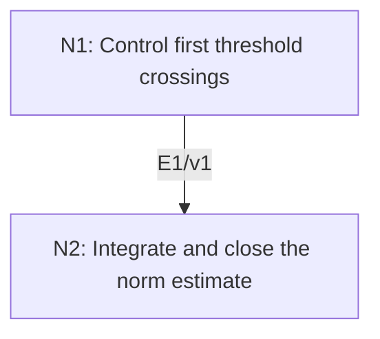

# Doob’s L2 Maximal Inequality

## An End-to-End Metacognitive Mathematics Walkthrough

**Problem ID:** PS-04  
**Version:** 1  
**Subject:** Probability and Stochastic Processes  
**Level:** Advanced  
**Status:** Complete authored exposition relative to the declared imports.  
**Evidence:** Mathematical argument and authored teaching traces; no actual multi-agent run, independent review, or proof-assistant certification is claimed.

## 1. Target, definitions, and import contract

For a real square-integrable martingale $(M_k,\mathcal F_k)_{k=0}^N$ at a deterministic finite horizon, prove $\mathbb E[\max_{0\le k\le N}|M_k|^2]\le4\mathbb E|M_N|^2$. The maximum includes the initial value, and the constant is independent of $N$.

### Permitted imports and conventions

Use the tower and pull-out properties of conditional expectation, $|\mathbb E[Z\mid\mathcal F]|\le\mathbb E[|Z|\mid\mathcal F]$, Cauchy–Schwarz, and Tonelli for nonnegative integrands. The tail formula $\mathbb EZ^2=\int_0^\infty2\lambda\mathbb P(Z>\lambda)d\lambda$ follows by integrating $Z^2=\int_0^Z2\lambda d\lambda$ and applying Tonelli. No optional-stopping theorem is needed for the proof.

## 2. Intuition and node interaction workflow

Partition the first crossing of a threshold by its time. Conditional expectation transfers that crossing value to the terminal absolute value; integrating thresholds produces the $L^2$ estimate.

Each mathematical node contains **Ego, Memory, Intellect, Sense, and Action**. The diagram records accepted proof dependencies. Requests to repair an argument belong only to §6; they are not backward proof edges.

### Evidence transfer ledger

| Transfer | Producer and export | Receiving activity | Exact claim and compatibility |
|---|---|---|---|
| T1-2 | N1/v1 · E1/v1 | N2.1 | $\lambda\mathbb P(Y^*>\lambda)\le\mathbb E[Y_N1_{\{Y^*>\lambda\}}]$. Inputs in N2 retain the producer's assumptions; evidence: §4.N1. |

## 3. Node roles and five-faculty contracts

### N1/v1 — Control first threshold crossings

**Object and inputs:** $Y_k=|M_k|$, $Y^*=\max_{0\le k\le N}Y_k$, and $\lambda>0$.

**Role and strategy:** Use disjoint first-crossing events, each measurable at its crossing time.

**Local obligation:** $\lambda\mathbb P(Y^*>\lambda)\le\mathbb E[Y_N1_{\{Y^*>\lambda\}}]$.

| Faculty | Concrete responsibility |
|---|---|
| Ego | Publish E1/v1 only with its stated domain and assumptions: $\lambda\mathbb P(Y^*>\lambda)\le\mathbb E[Y_N1_{\{Y^*>\lambda\}}]$. |
| Memory | $Y_k=\|M_k\|$, $Y^*=\max_{0\le k\le N}Y_k$, and $\lambda>0$. Preserve the §1 conventions and incoming export versions. |
| Intellect | Use disjoint first-crossing events, each measurable at its crossing time. |
| Sense | For each $k$, $\mathbb E[Y_N\mid\mathcal F_k]\ge Y_k$ follows from the martingale property and conditional absolute-value inequality. |
| Action | Execute activities N1.1–N1.2 in §4.N1; preserve the displayed calculations as evidence. |

**Export E1/v1:** $\lambda\mathbb P(Y^*>\lambda)\le\mathbb E[Y_N1_{\{Y^*>\lambda\}}]$. Evidence: the complete local derivation in §4.N1.

**Acceptance gate:** Establish the local obligation through every numbered activity below and discharge this concrete check: For each $k$, $\mathbb E[Y_N\mid\mathcal F_k]\ge Y_k$ follows from the martingale property and conditional absolute-value inequality.

**Targeted repair:** If the whole crossing event is treated as measurable at every time, partition it by first-crossing time before applying conditional expectation. Withhold E1 and its dependent exports until the correction has been checked; a revised export receives a new version.

### N2/v1 — Integrate and close the norm estimate

**Object and inputs:** E1/v1, finite horizon, and square integrability of every $M_k$. Incoming proof exports: E1/v1 at N2.1.

**Role and strategy:** Integrate the tail bound and apply Cauchy–Schwarz, justifying division by the maximal norm.

**Local obligation:** $\|Y^*\|_2\le2\|M_N\|_2$, hence the claimed squared bound.

| Faculty | Concrete responsibility |
|---|---|
| Ego | Publish E2/v1 only with its stated domain and assumptions: $\VertY^*\Vert_2\le2\VertM_N\Vert_2$, hence the claimed squared bound. |
| Memory | E1/v1, finite horizon, and square integrability of every $M_k$. Preserve the §1 conventions and incoming export versions. |
| Intellect | Integrate the tail bound and apply Cauchy–Schwarz, justifying division by the maximal norm. |
| Sense | $Y^*$ is in $L^2$ before division because $(Y^*)^2\le\sum_{k=0}^N\|M_k\|^2$; this avoids a circular finiteness argument. |
| Action | Execute activities N2.1–N2.2 in §4.N2; preserve the displayed calculations as evidence. |

**Export E2/v1:** $\|Y^*\|_2\le2\|M_N\|_2$, hence the claimed squared bound. Evidence: the complete local derivation in §4.N2.

**Acceptance gate:** Establish the local obligation through every numbered activity below and discharge this concrete check: $Y^*$ is in $L^2$ before division because $(Y^*)^2\le\sum_{k=0}^N|M_k|^2$; this avoids a circular finiteness argument.

**Targeted repair:** If division is performed before maximal integrability is known, first use the finite sum of squared values, then handle the zero-norm case separately. Withhold E2 and its dependent exports until the correction has been checked; a revised export receives a new version.

## 4. Continuous mathematical proof

The following activities form one continuous proof. Intermediate claims are established where used, except for the explicitly permitted imports in §1.

### §4.N1 — Control first threshold crossings

1. **N1.1.** Let $A_k=\{Y_0\le\lambda,\ldots,Y_{k-1}\le\lambda,Y_k>\lambda\}$, with the previous conditions empty for $k=0$. These disjoint events lie in $\mathcal F_k$ and their union is $\{Y^*>\lambda\}$. On $A_k$, $Y_k>\lambda$.

2. **N1.2.** By conditional expectation, $\mathbb E[Y_N1_{A_k}]=\mathbb E[\mathbb E(Y_N\mid\mathcal F_k)1_{A_k}]\ge\mathbb E[Y_k1_{A_k}]\ge\lambda\mathbb P(A_k)$. Summing the finitely many inequalities gives the export.

### §4.N2 — Integrate and close the norm estimate

1. **N2.1.** The finite-sum bound makes $A=\|Y^*\|_2$ finite. Multiply E1 by $2$ and integrate $\lambda$ over $(0,\infty)$. The tail formula and Tonelli give $A^2\le2\int_0^\infty\mathbb E[Y_N1_{\{Y^*>\lambda\}}]d\lambda=2\mathbb E[Y_NY^*]$.

2. **N2.2.** Cauchy–Schwarz bounds the final expression by $2\|Y_N\|_2 A$. If $A=0$, the conclusion is immediate. Otherwise divide by $A$ to obtain $A\le2\|Y_N\|_2$ and square. The factor four and horizon independence follow.

## 5. Worked instance and boundary audit

For a symmetric random walk with two increments and $M_0=0$, paths $++$ and $--$ have squared maximum four, while $+-$ and $-+$ have squared maximum one. Thus $\mathbb E(Y^*)^2=(4+4+1+1)/4=5/2$. The terminal second moment is two, and $5/2\le4\cdot2=8$. The bound controls the whole path, not merely its endpoint.

### Boundary or failed-inference witness

Adaptation alone is insufficient. The deterministic process $M_0=1,M_1=0$ is adapted and square-integrable but not a martingale. Its maximal square is one while its terminal square is zero, contradicting the claimed inequality without the martingale hypothesis.

## 6. Illustrative interaction and repair trace

**Trace status:** Authored illustration, not a logged agent execution. The rejected candidate below is outside the accepted DAG.

**Rejected N1 inequality:** $\mathbb E[Y_N\mid\mathcal F_k]\ge Y_k$ holds for any adapted process. The deterministic decay example disproves it. **Repair:** derive it from $M_k=\mathbb E[M_N\mid\mathcal F_k]$ and the conditional absolute-value inequality, exactly as the import contract allows for a martingale. Recheck the crossing bound and integrated estimate under those hypotheses.

After the corrected argument is supplied, Ego may publish a hypothetical v2 export, Memory replaces the rejected version, and Action rechecks each descendant in §2. The accepted exposition in this file is v1; this scenario does not claim an actual revision or execution occurred.

## 7. Evidence ledger and reusable exports

| Item | Evidence and scope | Remaining limitation |
|---|---|---|
| Target theorem | §4, under exactly the §1 hypotheses and imports | Authored mathematical exposition; no independent or formal verification |
| E1–E2 | Local proofs §4.N1–§4.N2; version 1 | Imports remain attached to each reuse |
| Worked instance | Explicit computation or construction in §5 | Illustrates the mechanism; does not prove the universal theorem |
| Repair | Rejected inference, witness, and correction in §6 | Teaching scenario rather than empirical agent evidence |

**Reusable target:** Preserve `PS-04/v1`, the exact statement in §1, its assumptions, and this proof when reusing the result.

**Next direction:** Use the inequality to control convergence of martingale approximations or construct stochastic integrals in $L^2$.

## 8. Sources and navigation

The proof and faculty decomposition are authored for this collection. The following primary teaching sources support further study; exact imports are specified in §1.

[Amir Dembo, Probability Theory: STAT310/MATH230 notes](https://stanford.edu/~montanar/TEACHING/Stat310A/lnotes.pdf) for measure-theoretic probability and limit arguments; [Stanford STAT310C syllabus and lecture materials](https://web.stanford.edu/class/stats310c/syllabus.html) for martingale inequalities and stopping theorems. The versions and proofs used in this collection are stated explicitly.

**Local imported proof modules:** None. Supporting external results are specified in §1.

[Five-project subject index](problems.md) · [Project README](../README.md) · [Graduate subject outline](../../book/outline.md)
