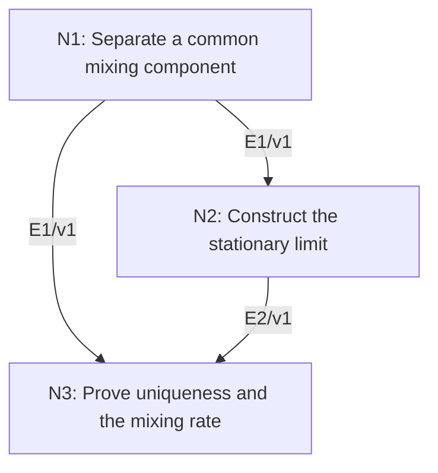

# Stationary Distribution and Mixing of a Positive Finite Markov Chain

## An End-to-End Metacognitive Mathematics Walkthrough

**Problem ID:** PS-05  
**Version:** 1  
**Subject:** Probability and Stochastic Processes  
**Level:** Intermediate  
**Status:** Complete authored exposition relative to the declared imports.  
**Evidence:** Mathematical argument and authored teaching traces; no actual multi-agent run, independent review, or proof-assistant certification is claimed.

## 1. Target, definitions, and import contract

Let $P=(P_{ij})_{i,j=1}^d$ be a row-stochastic matrix with every entry strictly positive. For row probability vectors, prove that there is a unique stationary distribution $\pi$ with $\pi P=\pi$, and $\|\mu P^n-\pi\|_1\le(1-\delta)^n\|\mu-\pi\|_1$ for every initial distribution $\mu$ and $n\ge0$, where $\varepsilon=\min_{i,j}P_{ij}$ and $\delta=d\varepsilon\in(0,1]$. If $\delta=1$, convergence is exact after one step; the exponent-zero factor at $n=0$ is interpreted as one.

### Permitted imports and conventions

Use completeness of finite-dimensional Euclidean space, closedness of the probability simplex, the triangle inequality, and the geometric series. Total variation distance on this finite set is one half of the $\ell^1$ distance. No spectral or Perron–Frobenius theorem is imported; the fixed point is constructed by a Cauchy estimate.

## 2. Intuition and node interaction workflow

Every row contains the same positive uniform component. Removing it leaves a stochastic remainder that cannot enlarge distance, so each step contracts by a common factor.

Each mathematical node contains **Ego, Memory, Intellect, Sense, and Action**. The diagram records accepted proof dependencies. Requests to repair an argument belong only to §6; they are not backward proof edges.

### Evidence transfer ledger

| Transfer | Producer and export | Receiving activity | Exact claim and compatibility |
|---|---|---|---|
| T1-2 | N1/v1 · E1/v1 | N2.1 | If $\delta<1$, $P=\delta U+(1-\delta)Q$ for a stochastic $Q$, and $\Vert\mu P-\nu P\Vert_1\le(1-\delta)\Vert\mu-\nu\Vert_1$. Inputs in N2 retain the producer's assumptions; evidence: §4.N1. |
| T1-3 | N1/v1 · E1/v1 | N3.1 | If $\delta<1$, $P=\delta U+(1-\delta)Q$ for a stochastic $Q$, and $\Vert\mu P-\nu P\Vert_1\le(1-\delta)\Vert\mu-\nu\Vert_1$. Inputs in N3 retain the producer's assumptions; evidence: §4.N1. |
| T2-3 | N2/v1 · E2/v1 | N3.1 | $\mu_n$ converges to a probability vector $\pi$ with $\pi P=\pi$. Inputs in N3 retain the producer's assumptions; evidence: §4.N2. |

## 3. Node roles and five-faculty contracts

### N1/v1 — Separate a common mixing component

**Object and inputs:** $\varepsilon>0$, $\delta=d\varepsilon$, and the matrix $U$ whose every entry is $1/d$.

**Role and strategy:** Write $P$ as a convex combination of a uniform reset and a stochastic residual.

**Local obligation:** If $\delta<1$, $P=\delta U+(1-\delta)Q$ for a stochastic $Q$, and $\|\mu P-\nu P\|_1\le(1-\delta)\|\mu-\nu\|_1$.

| Faculty | Concrete responsibility |
|---|---|
| Ego | Publish E1/v1 only with its stated domain and assumptions: If $\delta<1$, $P=\delta U+(1-\delta)Q$ for a stochastic $Q$, and $\Vert\mu P-\nu P\Vert_1\le(1-\delta)\Vert\mu-\nu\Vert_1$. |
| Memory | $\varepsilon>0$, $\delta=d\varepsilon$, and the matrix $U$ whose every entry is $1/d$. Preserve the §1 conventions and incoming export versions. |
| Intellect | Write $P$ as a convex combination of a uniform reset and a stochastic residual. |
| Sense | The case $\delta=1$ must be handled before dividing by $1-\delta$. |
| Action | Execute activities N1.1–N1.2 in §4.N1; preserve the displayed calculations as evidence. |

**Export E1/v1:** If $\delta<1$, $P=\delta U+(1-\delta)Q$ for a stochastic $Q$, and $\|\mu P-\nu P\|_1\le(1-\delta)\|\mu-\nu\|_1$. Evidence: the complete local derivation in §4.N1.

**Acceptance gate:** Establish the local obligation through every numbered activity below and discharge this concrete check: The case $\delta=1$ must be handled before dividing by $1-\delta$.

**Targeted repair:** If strict positivity is replaced by nonnegativity, check whether $\varepsilon$ becomes zero; the strict contraction may then disappear. Withhold E1 and its dependent exports until the correction has been checked; a revised export receives a new version.

### N2/v1 — Construct the stationary limit

**Object and inputs:** E1/v1 with $q=1-\delta\in[0,1)$ and $\mu_n=\mu_0P^n$. Incoming proof exports: E1/v1 at N2.1.

**Role and strategy:** Bound consecutive differences geometrically and sum the tail to prove convergence inside the simplex.

**Local obligation:** $\mu_n$ converges to a probability vector $\pi$ with $\pi P=\pi$.

| Faculty | Concrete responsibility |
|---|---|
| Ego | Publish E2/v1 only with its stated domain and assumptions: $\mu_n$ converges to a probability vector $\pi$ with $\pi P=\pi$. |
| Memory | E1/v1 with $q=1-\delta\in[0,1)$ and $\mu_n=\mu_0P^n$. Preserve the §1 conventions and incoming export versions. |
| Intellect | Bound consecutive differences geometrically and sum the tail to prove convergence inside the simplex. |
| Sense | Consecutive differences tending to zero is not enough; the summable geometric tail provides the Cauchy property. |
| Action | Execute activities N2.1–N2.2 in §4.N2; preserve the displayed calculations as evidence. |

**Export E2/v1:** $\mu_n$ converges to a probability vector $\pi$ with $\pi P=\pi$. Evidence: the complete local derivation in §4.N2.

**Acceptance gate:** Establish the local obligation through every numbered activity below and discharge this concrete check: Consecutive differences tending to zero is not enough; the summable geometric tail provides the Cauchy property.

**Targeted repair:** If convergence is inferred from small single increments, insert the displayed tail sum; it is the missing uniform bound over later indices. Withhold E2 and its dependent exports until the correction has been checked; a revised export receives a new version.

### N3/v1 — Prove uniqueness and the mixing rate

**Object and inputs:** E1/v1 and a stationary $\pi$ from E2/v1. Incoming proof exports: E1/v1 at N3.1, E2/v1 at N3.1.

**Role and strategy:** Iterate the contraction against a fixed point and compare any two fixed points.

**Local obligation:** $\pi$ is unique and the stated geometric mixing estimate holds for all initial distributions.

| Faculty | Concrete responsibility |
|---|---|
| Ego | Publish E3/v1 only with its stated domain and assumptions: $\pi$ is unique and the stated geometric mixing estimate holds for all initial distributions. |
| Memory | E1/v1 and a stationary $\pi$ from E2/v1. Preserve the §1 conventions and incoming export versions. |
| Intellect | Iterate the contraction against a fixed point and compare any two fixed points. |
| Sense | The norm is on row distributions, consistent with the stochastic convention; no column convention is silently substituted. |
| Action | Execute activities N3.1–N3.2 in §4.N3; preserve the displayed calculations as evidence. |

**Export E3/v1:** $\pi$ is unique and the stated geometric mixing estimate holds for all initial distributions. Evidence: the complete local derivation in §4.N3.

**Acceptance gate:** Establish the local obligation through every numbered activity below and discharge this concrete check: The norm is on row distributions, consistent with the stochastic convention; no column convention is silently substituted.

**Targeted repair:** If existence of a stationary vector is assumed while proving convergence, use E2’s actual limit construction before invoking stationarity in the estimate. Withhold E3 and its dependent exports until the correction has been checked; a revised export receives a new version.

## 4. Continuous mathematical proof

The following activities form one continuous proof. Intermediate claims are established where used, except for the explicitly permitted imports in §1.

### §4.N1 — Separate a common mixing component

1. **N1.1.** Row sums give $d\varepsilon\le1$. If $\delta=1$, every row entry must equal $1/d$, so $P=U$. Otherwise define $Q_{ij}=(P_{ij}-\varepsilon)/(1-\delta)$. Its entries are nonnegative and each row sums to one, proving the decomposition.

2. **N1.2.** For any row vector $z$, $\|zQ\|_1\le\sum_j\sum_i|z_i|Q_{ij}=\sum_i|z_i|=\|z\|_1$. For probability vectors $\mu,\nu$, $(\mu-\nu)U=0$, since their coordinates both sum to one. The decomposition therefore gives the contraction.

### §4.N2 — Construct the stationary limit

1. **N2.1.** For $q\in(0,1)$, contraction gives $\|\mu_{n+1}-\mu_n\|_1\le q^n\|\mu_1-\mu_0\|_1$. Therefore for $m>n$, $\|\mu_m-\mu_n\|_1\le q^n\|\mu_1-\mu_0\|_1/(1-q)$. This tends to zero uniformly in $m>n$, so the sequence is Cauchy.

2. **N2.2.** The simplex is closed in a complete finite-dimensional space, so the limit $\pi$ is a probability vector. Multiplication by $P$ is continuous; taking limits of $\mu_{n+1}=\mu_nP$ yields stationarity. If $q=0$, $P=U$ and every distribution becomes the uniform distribution in one step, giving the same conclusion directly.

### §4.N3 — Prove uniqueness and the mixing rate

1. **N3.1.** If $\pi'$ is another stationary distribution, contraction gives $\|\pi-\pi'\|_1\le q\|\pi-\pi'\|_1$. Since $q<1$, the norm is zero, proving uniqueness.

2. **N3.2.** For any $\mu$, repeatedly compare $\mu P^n$ with $\pi P^n=\pi$ to obtain $\|\mu P^n-\pi\|_1\le q^n\|\mu-\pi\|_1$. When $q=0$ the direct one-step conclusion applies. Thus existence, uniqueness, and the quantitative rate are all established.

## 5. Worked instance and boundary audit

For $P=\bigl(\begin{smallmatrix}3/4&1/4\\1/2&1/2\end{smallmatrix}\bigr)$, $\varepsilon=1/4$, $\delta=1/2$, and $q=1/2$. Solving $\pi P=\pi$ gives $\pi=(2/3,1/3)$. For $\mu=(1,0)$, the initial $\ell^1$ distance is $2/3$; after one step it is $|3/4-2/3|+|1/4-1/3|=1/6\le(1/2)(2/3)$.

### Boundary or failed-inference witness

The nonnegative stochastic matrix $\bigl(\begin{smallmatrix}0&1\\1&0\end{smallmatrix}\bigr)$ has stationary distribution $(1/2,1/2)$ but alternates forever from $(1,0)$. Strict positivity is a sufficient mixing assumption here. It is not necessary for all mixing chains, but dropping it without a substitute invalidates this argument.

## 6. Illustrative interaction and repair trace

**Trace status:** Authored illustration, not a logged agent execution. The rejected candidate below is outside the accepted DAG.

**Rejected N2 claim:** every finite irreducible Markov chain converges to stationarity. The two-state alternating chain is irreducible but periodic. **Diagnosis:** Memory omitted the mixing condition. **Repair:** use the strict-positive-entry contract, which yields $q<1$ directly. Recheck the geometric tail and the final rate; a broader irreducible aperiodic theorem would need a separate proof.

After the corrected argument is supplied, Ego may publish a hypothetical v2 export, Memory replaces the rejected version, and Action rechecks each descendant in §2. The accepted exposition in this file is v1; this scenario does not claim an actual revision or execution occurred.

## 7. Evidence ledger and reusable exports

| Item | Evidence and scope | Remaining limitation |
|---|---|---|
| Target theorem | §4, under exactly the §1 hypotheses and imports | Authored mathematical exposition; no independent or formal verification |
| E1–E3 | Local proofs §4.N1–§4.N3; version 1 | Imports remain attached to each reuse |
| Worked instance | Explicit computation or construction in §5 | Illustrates the mechanism; does not prove the universal theorem |
| Repair | Rejected inference, witness, and correction in §6 | Teaching scenario rather than empirical agent evidence |

**Reusable target:** Preserve `PS-05/v1`, the exact statement in §1, its assumptions, and this proof when reusing the result.

**Next direction:** Extend the same method when a power $P^m$ is strictly positive, yielding mixing bounds in blocks of $m$ steps.

## 8. Sources and navigation

The proof and faculty decomposition are authored for this collection. The following primary teaching sources support further study; exact imports are specified in §1.

[Amir Dembo, Probability Theory: STAT310/MATH230 notes](https://stanford.edu/~montanar/TEACHING/Stat310A/lnotes.pdf) for measure-theoretic probability and limit arguments; [Stanford STAT310C syllabus and lecture materials](https://web.stanford.edu/class/stats310c/syllabus.html) for martingale inequalities and stopping theorems. The versions and proofs used in this collection are stated explicitly.

**Local imported proof modules:** None. Supporting external results are specified in §1.

[Five-project subject index](problems.md) · [Project README](../README.md) · [Graduate subject outline](../../book/outline.md)
