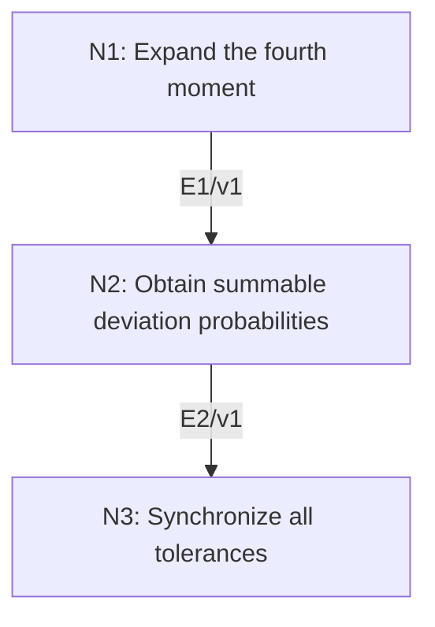

# Strong Law for IID Variables with a Finite Fourth Moment

## An End-to-End Metacognitive Mathematics Walkthrough

**Problem ID:** PS-02  
**Version:** 1  
**Subject:** Probability and Stochastic Processes  
**Level:** Intermediate  
**Status:** Complete authored exposition relative to the declared imports.  
**Evidence:** Mathematical argument and authored teaching traces; no actual multi-agent run, independent review, or proof-assistant certification is claimed.

## 1. Target, definitions, and import contract

Let $(X_n)_{n\ge1}$ be independent identically distributed real random variables with $\mathbb E|X_1|^4<\infty$ and mean $\mu$. Prove $n^{-1}\sum_{j=1}^n X_j\to\mu$ almost surely. This is the finite-fourth-moment version, not the optimal integrability form of the strong law.

### Permitted imports and conventions

Import PS-01(i): summable event probabilities imply only finitely many occurrences almost surely. Use linearity of expectation, factorization of expectations of independent integrable products, and Markov’s inequality for nonnegative $Z$: $\mathbb P(Z>a)\le\mathbb EZ/a$ for $a>0$, obtained by $Z\ge a1_{\{Z>a\}}$ and integration. Lower moments are finite by Hölder on a probability space. Centering preserves a finite fourth moment via $|x-y|^4\le8(|x|^4+|y|^4)$.

## 2. Intuition and node interaction workflow

The fourth moment supplies a summable $n^{-2}$ deviation bound. A countable collection of tolerances then upgrades eventual control to almost sure convergence.

Each mathematical node contains **Ego, Memory, Intellect, Sense, and Action**. The diagram records accepted proof dependencies. Requests to repair an argument belong only to §6; they are not backward proof edges.

### Evidence transfer ledger

| Transfer | Producer and export | Receiving activity | Exact claim and compatibility |
|---|---|---|---|
| T1-2 | N1/v1 · E1/v1 | N2.1 | $\mathbb ES_n^4=n m_4+3n(n-1)\sigma^4$. Inputs in N2 retain the producer's assumptions; evidence: §4.N1. |
| T2-3 | N2/v1 · E2/v1 | N3.1 | $\sum_n\mathbb P(\|S_n/n\|>\varepsilon)<\infty$. Inputs in N3 retain the producer's assumptions; evidence: §4.N2. |

## 3. Node roles and five-faculty contracts

### N1/v1 — Expand the fourth moment

**Object and inputs:** $Y_j=X_j-\mu$, $S_n=\sum_{j=1}^nY_j$, $\sigma^2=\mathbb EY_1^2$, and $m_4=\mathbb EY_1^4$.

**Role and strategy:** Classify the index multiplicities in the fourth-power expansion and use centering to eliminate singleton factors.

**Local obligation:** $\mathbb ES_n^4=n m_4+3n(n-1)\sigma^4$.

| Faculty | Concrete responsibility |
|---|---|
| Ego | Publish E1/v1 only with its stated domain and assumptions: $\mathbb ES_n^4=n m_4+3n(n-1)\sigma^4$. |
| Memory | $Y_j=X_j-\mu$, $S_n=\sum_{j=1}^nY_j$, $\sigma^2=\mathbb EY_1^2$, and $m_4=\mathbb EY_1^4$. Preserve the §1 conventions and incoming export versions. |
| Intellect | Classify the index multiplicities in the fourth-power expansion and use centering to eliminate singleton factors. |
| Sense | Independence and zero means eliminate terms with any index appearing exactly once; pair terms have combinatorial coefficient six. |
| Action | Execute activities N1.1–N1.2 in §4.N1; preserve the displayed calculations as evidence. |

**Export E1/v1:** $\mathbb ES_n^4=n m_4+3n(n-1)\sigma^4$. Evidence: the complete local derivation in §4.N1.

**Acceptance gate:** Establish the local obligation through every numbered activity below and discharge this concrete check: Independence and zero means eliminate terms with any index appearing exactly once; pair terms have combinatorial coefficient six.

**Targeted repair:** If all cross terms are discarded, restore the paired-index terms; centering kills singletons, not products of squares. Withhold E1 and its dependent exports until the correction has been checked; a revised export receives a new version.

### N2/v1 — Obtain summable deviation probabilities

**Object and inputs:** E1/v1 and any fixed $\varepsilon>0$. Incoming proof exports: E1/v1 at N2.1.

**Role and strategy:** Apply Markov to the fourth power of the centered sample mean.

**Local obligation:** $\sum_n\mathbb P(|S_n/n|>\varepsilon)<\infty$.

| Faculty | Concrete responsibility |
|---|---|
| Ego | Publish E2/v1 only with its stated domain and assumptions: $\sum_n\mathbb P(\|S_n/n\|>\varepsilon)<\infty$. |
| Memory | E1/v1 and any fixed $\varepsilon>0$. Preserve the §1 conventions and incoming export versions. |
| Intellect | Apply Markov to the fourth power of the centered sample mean. |
| Sense | The bound must be summable in $n$; a variance-based $1/n$ bound is insufficient for this direct argument. |
| Action | Execute activities N2.1–N2.2 in §4.N2; preserve the displayed calculations as evidence. |

**Export E2/v1:** $\sum_n\mathbb P(|S_n/n|>\varepsilon)<\infty$. Evidence: the complete local derivation in §4.N2.

**Acceptance gate:** Establish the local obligation through every numbered activity below and discharge this concrete check: The bound must be summable in $n$; a variance-based $1/n$ bound is insufficient for this direct argument.

**Targeted repair:** If the proof applies Borel–Cantelli to a nonsummable upper bound, use the fourth-moment estimate instead of merely a variance estimate. Withhold E2 and its dependent exports until the correction has been checked; a revised export receives a new version.

### N3/v1 — Synchronize all tolerances

**Object and inputs:** E2/v1 for each $\varepsilon=1/r$, $r\in\mathbb N$. Incoming proof exports: E2/v1 at N3.1.

**Role and strategy:** Intersect countably many full-probability events so that every required accuracy holds along the same sample path.

**Local obligation:** $S_n/n\to0$ almost surely, equivalently the sample mean converges to $\mu$.

| Faculty | Concrete responsibility |
|---|---|
| Ego | Publish E3/v1 only with its stated domain and assumptions: $S_n/n\to0$ almost surely, equivalently the sample mean converges to $\mu$. |
| Memory | E2/v1 for each $\varepsilon=1/r$, $r\in\mathbb N$. Preserve the §1 conventions and incoming export versions. |
| Intellect | Intersect countably many full-probability events so that every required accuracy holds along the same sample path. |
| Sense | An uncountable intersection of probability-one events is not justified by countable additivity. |
| Action | Execute activities N3.1–N3.2 in §4.N3; preserve the displayed calculations as evidence. |

**Export E3/v1:** $S_n/n\to0$ almost surely, equivalently the sample mean converges to $\mu$. Evidence: the complete local derivation in §4.N3.

**Acceptance gate:** Establish the local obligation through every numbered activity below and discharge this concrete check: An uncountable intersection of probability-one events is not justified by countable additivity.

**Targeted repair:** If different null sets are silently ignored for every real tolerance, replace the uncountable family by the countable tolerances $1/r$. Withhold E3 and its dependent exports until the correction has been checked; a revised export receives a new version.

## 4. Continuous mathematical proof

The following activities form one continuous proof. Intermediate claims are established where used, except for the explicitly permitted imports in §1.

### §4.N1 — Expand the fourth moment

1. **N1.1.** Expand $(\sum_jY_j)^4$. If an index occurs once in a term, independence factors out its zero mean, so that term has expectation zero. The surviving terms are the $n$ fourth powers $Y_j^4$ and terms with two distinct indices each repeated twice.

2. **N1.2.** For each unordered pair $i<j$, there are $4!/(2!2!)=6$ placements, and the expectation of $Y_i^2Y_j^2$ is $\sigma^4$. Thus the total is $n m_4+6\binom n2\sigma^4=n m_4+3n(n-1)\sigma^4$. All terms are integrable by the declared moment and independence.

### §4.N2 — Obtain summable deviation probabilities

1. **N2.1.** Markov’s inequality and E1 give $\mathbb P(|S_n/n|>\varepsilon)\le[n m_4+3n(n-1)\sigma^4]/(\varepsilon^4 n^4)\le(m_4+3\sigma^4)/(\varepsilon^4n^2)$.

2. **N2.2.** The series $\sum_n n^{-2}$ converges, so these probabilities are summable. PS-01(i) now says that, for this fixed tolerance, $|S_n/n|>\varepsilon$ occurs only finitely often outside a null set.

### §4.N3 — Synchronize all tolerances

1. **N3.1.** For each integer $r\ge1$, let $E_r$ be the probability-one event on which eventually $|S_n/n|\le1/r$. The event $E=\bigcap_{r\ge1}E_r$ has probability one because its complement is a countable union of null sets.

2. **N3.2.** Fix a sample point in $E$ and any $\delta>0$. Choose $r$ with $1/r<\delta$. The eventual bound on that path yields $|S_n/n|<\delta$ for all sufficiently large $n$. Thus $S_n/n\to0$ on $E$, and adding $\mu$ proves the theorem.

## 5. Worked instance and boundary audit

For IID Bernoulli$(1/2)$ variables, $\mu=1/2$, $\sigma^2=1/4$, and $m_4=1/16$. Thus $\mathbb ES_n^4=(3n^2-2n)/16$, and $\mathbb P(|n^{-1}\sum X_j-1/2|>\varepsilon)\le3/(16\varepsilon^4n^2)$. Summability proves that the empirical proportion converges almost surely to $1/2$.

### Boundary or failed-inference witness

If all variables are the same nonconstant Bernoulli variable $Z$, they are identically distributed with every moment finite, but their sample mean is always $Z$, not its mean $1/2$. Independence is essential to this theorem. Conversely failure of a fourth moment does not itself refute a strong law; it only falls outside this proved version.

## 6. Illustrative interaction and repair trace

**Trace status:** Authored illustration, not a logged agent execution. The rejected candidate below is outside the accepted DAG.

**Rejected N2 shortcut:** Chebyshev gives $C/n$, so Borel–Cantelli proves almost sure convergence. The series of those upper bounds diverges, leaving its hypothesis unproved. **Repair:** under the stated fourth-moment assumption, use E1 to obtain the summable $C_\varepsilon/n^2$ bound. This repairs the proof without strengthening the stated theorem. Recheck the countable tolerance intersection afterward.

After the corrected argument is supplied, Ego may publish a hypothetical v2 export, Memory replaces the rejected version, and Action rechecks each descendant in §2. The accepted exposition in this file is v1; this scenario does not claim an actual revision or execution occurred.

## 7. Evidence ledger and reusable exports

| Item | Evidence and scope | Remaining limitation |
|---|---|---|
| Target theorem | §4, under exactly the §1 hypotheses and imports | Authored mathematical exposition; no independent or formal verification |
| E1–E3 | Local proofs §4.N1–§4.N3; version 1 | Imports remain attached to each reuse |
| Worked instance | Explicit computation or construction in §5 | Illustrates the mechanism; does not prove the universal theorem |
| Repair | Rejected inference, witness, and correction in §6 | Teaching scenario rather than empirical agent evidence |

**Reusable target:** Preserve `PS-02/v1`, the exact statement in §1, its assumptions, and this proof when reusing the result.

**Next direction:** Prove the optimal IID strong law under a finite first moment using truncation and a different summability argument; do not label this restricted proof as that stronger theorem.

## 8. Sources and navigation

The proof and faculty decomposition are authored for this collection. The following primary teaching sources support further study; exact imports are specified in §1.

[Amir Dembo, Probability Theory: STAT310/MATH230 notes](https://stanford.edu/~montanar/TEACHING/Stat310A/lnotes.pdf) for measure-theoretic probability and limit arguments; [Stanford STAT310C syllabus and lecture materials](https://web.stanford.edu/class/stats310c/syllabus.html) for martingale inequalities and stopping theorems. The versions and proofs used in this collection are stated explicitly.

**Local imported proof modules:** [PS-01 — The Two Borel–Cantelli Lemmas](borel-cantelli-lemmas.md)

[Five-project subject index](problems.md) · [Project README](../README.md) · [Graduate subject outline](../../book/outline.md)
