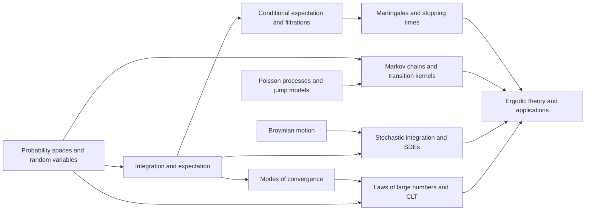

# Meta-Graph: Probability and Stochastic Processes

> **Purpose.** This is a subject-level dependency map for planning a future theorem knowledge graph. It shows a representative route through the field; it is not a complete list of prerequisites, a formal proof dependency database, or a claim that every course follows this order.

## How to read this graph

- **Nodes** are foundational ideas, methods, structural results, or major theorems. A node may later expand into its own proof-level graph.
- An arrow `X → Y` means that X commonly supplies language, a method, a hypothesis, or a result used in understanding or proving Y. The edge table says which role it plays.
- Some edges describe a common proof route or conceptual bridge rather than a logically necessary dependency. The eventual theorem graph should record the exact theorem, hypotheses, source, and proof step for every strict dependency.
- The graph is a DAG at this global overview level. Feedback and revision belong inside proof workflows; they should not be mistaken for a theorem depending on itself.

## Global subject map

## Node register

| ID | Idea, theorem, or method | Role in the subject |
|---|---|---|
| A | Probability spaces and random variables | Set measurable foundations for randomness |
| B | Integration and expectation | Define moments and probability integrals |
| C | Modes of convergence | Distinguish almost-sure, probabilistic, and distributional limits |
| D | Laws of large numbers and CLT | Describe asymptotic averages and fluctuations |
| E | Conditional expectation and filtrations | Formalize information over time |
| F | Martingales and stopping times | Model fair processes and optional sampling |
| G | Markov chains and transition kernels | Encode memoryless evolution |
| H | Poisson processes and jump models | Model random event arrivals |
| I | Brownian motion | Construct continuous Gaussian paths |
| J | Stochastic integration and SDEs | Integrate along random paths and define diffusions |
| K | Ergodic theory and applications | Connect long-time averages to stationary behavior |

## Dependency register

| From → To | Connection type | How the earlier node supports the later node |
|---|---|---|
| A → B (Probability spaces and random variables → Integration and expectation) | Common mathematical dependency | Expectation is integration on probability spaces. |
| B → C (Integration and expectation → Modes of convergence) | Common mathematical dependency | Integrability controls convergence of random variables. |
| C → D (Modes of convergence → Laws of large numbers and CLT) | Common mathematical dependency | Convergence modes are hypotheses in limit theorems. |
| A → D (Probability spaces and random variables → Laws of large numbers and CLT) | Common mathematical dependency | Independence and probability axioms drive LLN and CLT. |
| E → F (Conditional expectation and filtrations → Martingales and stopping times) | Common mathematical dependency | Filtrations define adapted martingales and stopping times. |
| B → E (Integration and expectation → Conditional expectation and filtrations) | Common mathematical dependency | Conditional expectation is an L1 projection. |
| F → K (Martingales and stopping times → Ergodic theory and applications) | Common mathematical dependency | Martingale convergence supports long-time limits. |
| G → K (Markov chains and transition kernels → Ergodic theory and applications) | Common mathematical dependency | Invariant distributions govern Markov long-term behavior. |
| A → G (Probability spaces and random variables → Markov chains and transition kernels) | Common mathematical dependency | Transition kernels act on measurable state spaces. |
| H → G (Poisson processes and jump models → Markov chains and transition kernels) | Common mathematical dependency | Poisson arrivals form a jump-process model. |
| I → J (Brownian motion → Stochastic integration and SDEs) | Common mathematical dependency | Brownian motion is the basic integrator. |
| B → J (Integration and expectation → Stochastic integration and SDEs) | Common mathematical dependency | Integrability defines stochastic integrals. |
| J → K (Stochastic integration and SDEs → Ergodic theory and applications) | Common mathematical dependency | Generators and semigroups link diffusion to long-time behavior. |
| D → K (Laws of large numbers and CLT → Ergodic theory and applications) | Common mathematical dependency | Limit theorems support statistical applications. |

## Suggested reading paths

**Core route:** follow the nodes from foundational language toward the central structural theorems, then continue to the advanced endpoint. For a first pass, read the graph left to right and pause at each node to state its hypotheses and output.

**Theorem-focused route:** choose a major theorem node, trace incoming arrows backward to identify imported results, then trace outgoing arrows to see what the theorem enables. Mark which incoming edges are strict dependencies after consulting a proof-level source.

**Bridge route:** follow cross-links between methods and neighboring theories. Treat these as transfer routes: identify exactly what is preserved, what hypotheses are added, and what changes under translation.

## Five-faculty expansion for each theorem node

When a node is selected for a complete Meta-Math walkthrough, preserve the node ID and expand it into a local five-faculty proof graph:

| Faculty | Local responsibility |
|---|---|
| **Ego** | State the precise theorem goal, scope, and proof contract; distinguish the claim from nearby stronger or weaker claims. |
| **Memory** | Retrieve definitions, hypotheses, lemmas, source references, and known examples/counterexamples required by this node. |
| **Intellect** | Select and order proof steps; justify each inference and expose dependency on incoming nodes. |
| **Sense** | Check type/notation consistency, hypothesis use, boundary cases, examples, and whether each intermediate claim is actually supported. |
| **Action** | Execute proof steps, calculations, constructions, or formal checks; emit the verified result and update outgoing dependencies. |

A later graph version should connect global theorem nodes to these local faculty nodes, with typed edges such as `uses`, `specializes`, `generalizes`, `contradicts`, `analogy-only`, and `verified-by`.

## Expansion record

For each node promoted from this map, add a stable theorem or concept ID, exact statement, source and page/section, prerequisite IDs, proof-step graph, explicit hypothesis checks, known failure modes, examples, and verification status. Keep conjectural or analogy-only links visually distinct from proved dependencies.

**Related syllabus:** [`outline.md`](book-outline.md).
