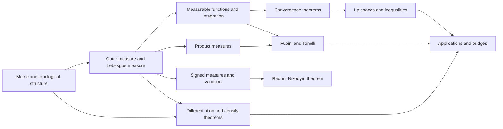

# Meta-Graph: Real Analysis

> **Purpose.** This is a subject-level dependency map for planning a future theorem knowledge graph. It shows a representative route through the field; it is not a complete list of prerequisites, a formal proof dependency database, or a claim that every course follows this order.

## How to read this graph

- **Nodes** are foundational ideas, methods, structural results, or major theorems. A node may later expand into its own proof-level graph.
- An arrow `X → Y` means that X commonly supplies language, a method, a hypothesis, or a result used in understanding or proving Y. The edge table says which role it plays.
- Some edges describe a common proof route or conceptual bridge rather than a logically necessary dependency. The eventual theorem graph should record the exact theorem, hypotheses, source, and proof step for every strict dependency.
- The graph is a DAG at this global overview level. Feedback and revision belong inside proof workflows; they should not be mistaken for a theorem depending on itself.

## Global subject map

## Node register

| ID | Idea, theorem, or method | Role in the subject |
|---|---|---|
| A | Metric and topological structure | Establish completeness, compactness, and continuity |
| B | Outer measure and Lebesgue measure | Construct length and measurable sets |
| C | Measurable functions and integration | Define Lebesgue integration by approximation |
| D | Convergence theorems | Control limits of integrals |
| E | Lp spaces and inequalities | Build function spaces and quantitative estimates |
| F | Product measures | Integrate on product spaces |
| G | Fubini and Tonelli | Interchange iterated integrals under precise hypotheses |
| H | Signed measures and variation | Extend integration to signed and complex measures |
| I | Radon–Nikodym theorem | Represent absolutely continuous measures by densities |
| J | Differentiation and density theorems | Recover local behavior from averages |
| K | Applications and bridges | Connect measure theory to probability, Fourier analysis, and PDE |

## Dependency register

| From → To | Connection type | How the earlier node supports the later node |
|---|---|---|
| A → B (Metric and topological structure → Outer measure and Lebesgue measure) | Common mathematical dependency | Topological regularity supports measure construction. |
| B → C (Outer measure and Lebesgue measure → Measurable functions and integration) | Common mathematical dependency | Measurability is the domain of Lebesgue integration. |
| C → D (Measurable functions and integration → Convergence theorems) | Common mathematical dependency | Approximation proves convergence theorems. |
| D → E (Convergence theorems → Lp spaces and inequalities) | Common mathematical dependency | Integral convergence controls Lp approximation. |
| B → F (Outer measure and Lebesgue measure → Product measures) | Common mathematical dependency | Product measure extends measure to product spaces. |
| F → G (Product measures → Fubini and Tonelli) | Common mathematical dependency | Product construction enables iterated integration. |
| C → G (Measurable functions and integration → Fubini and Tonelli) | Common mathematical dependency | Integrability assumptions justify exchanging integrals. |
| H → I (Signed measures and variation → Radon–Nikodym theorem) | Common mathematical dependency | Absolute continuity yields density representation. |
| B → H (Outer measure and Lebesgue measure → Signed measures and variation) | Common mathematical dependency | Measure construction supports signed measures. |
| A → J (Metric and topological structure → Differentiation and density theorems) | Common mathematical dependency | Balls and local topology define differentiation bases. |
| B → J (Outer measure and Lebesgue measure → Differentiation and density theorems) | Common mathematical dependency | Lebesgue differentiation uses measure estimates. |
| J → K (Differentiation and density theorems → Applications and bridges) | Common mathematical dependency | Differentiation supports density and maximal estimates. |
| E → K (Lp spaces and inequalities → Applications and bridges) | Common mathematical dependency | Lp foundations bridge to functional and harmonic analysis. |
| G → K (Fubini and Tonelli → Applications and bridges) | Common mathematical dependency | Iterated integration underpins probability and PDE. |

## Suggested reading paths

**Core route:** follow the nodes from foundational language toward the central structural theorems, then continue to the advanced endpoint. For a first pass, read the graph left to right and pause at each node to state its hypotheses and output.

**Theorem-focused route:** choose a major theorem node, trace incoming arrows backward to identify imported results, then trace outgoing arrows to see what the theorem enables. Mark which incoming edges are strict dependencies after consulting a proof-level source.

**Bridge route:** follow cross-links between methods and neighboring theories. Treat these as transfer routes: identify exactly what is preserved, what hypotheses are added, and what changes under translation.

## Five-faculty expansion for each theorem node

When a node is selected for a complete Meta-Math walkthrough, preserve the node ID and expand it into a local five-faculty proof graph:

| Faculty | Local responsibility |
|---|---|
| **Ego** | State the precise theorem goal, scope, and proof contract; distinguish the claim from nearby stronger or weaker claims. |
| **Memory** | Retrieve definitions, hypotheses, lemmas, source references, and known examples/counterexamples required by this node. |
| **Intellect** | Select and order proof steps; justify each inference and expose dependency on incoming nodes. |
| **Sense** | Check type/notation consistency, hypothesis use, boundary cases, examples, and whether each intermediate claim is actually supported. |
| **Action** | Execute proof steps, calculations, constructions, or formal checks; emit the verified result and update outgoing dependencies. |

A later graph version should connect global theorem nodes to these local faculty nodes, with typed edges such as `uses`, `specializes`, `generalizes`, `contradicts`, `analogy-only`, and `verified-by`.

## Expansion record

For each node promoted from this map, add a stable theorem or concept ID, exact statement, source and page/section, prerequisite IDs, proof-step graph, explicit hypothesis checks, known failure modes, examples, and verification status. Keep conjectural or analogy-only links visually distinct from proved dependencies.

**Related syllabus:** [`outline.md`](book-outline.md).
