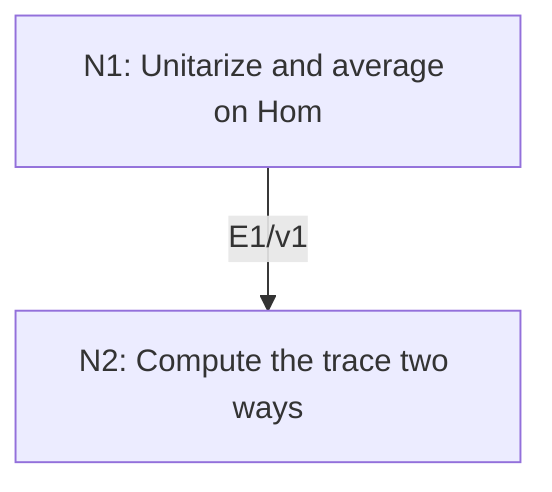

# Orthogonality of Irreducible Characters

## An End-to-End Metacognitive Mathematics Walkthrough

**Problem ID:** RT-03  
**Version:** 1  
**Subject:** Representation Theory and Lie Theory  
**Level:** Intermediate  
**Status:** Complete authored exposition relative to the declared imports.  
**Evidence:** Mathematical argument and authored teaching traces; no actual multi-agent run, independent review, or proof-assistant certification is claimed.

## 1. Target, definitions, and import contract

Let $G$ be a finite group and $V,W$ finite-dimensional irreducible complex representations. For $\chi_V(g)=\operatorname{tr}\rho_V(g)$, prove $|G|^{-1}\sum_{g\in G}\overline{\chi_V(g)}\chi_W(g)=1$ if $V\cong W$ and $0$ otherwise.

### Permitted imports and conventions

Import RT-02: the complex vector space $\operatorname{Hom}_G(V,W)$ has dimension one or zero in the stated cases. Use finite-dimensional trace, rank of an idempotent, and positive-definite Hermitian forms. An idempotent decomposes its space into image and kernel and has trace equal to image dimension; this is justified in the proof.

## 2. Intuition and node interaction workflow

Average the group action on the space of all linear maps. Its image consists of intertwiners, and its trace can also be computed from the two characters.

Each mathematical node contains **Ego, Memory, Intellect, Sense, and Action**. The diagram records accepted proof dependencies. Requests to repair an argument belong only to §6; they are not backward proof edges.

### Evidence transfer ledger

| Transfer | Producer and export | Receiving activity | Exact claim and compatibility |
|---|---|---|---|
| T1-2 | N1/v1 · E1/v1 | N2.1 | $P(A)=\|G\|^{-1}\sum_g g\cdot A$ is a projection onto $\operatorname{Hom}_G(V,W)$, and $\chi_V(g^{-1})=\overline{\chi_V(g)}$. Inputs in N2 retain the producer's assumptions; evidence: §4.N1. |

## 3. Node roles and five-faculty contracts

### N1/v1 — Unitarize and average on Hom

**Object and inputs:** $\operatorname{Hom}_{\mathbb C}(V,W)$ with $g\cdot A=\rho_W(g)A\rho_V(g)^{-1}$.

**Role and strategy:** Average positive forms to compare inverse traces with conjugates, and average the Hom action to project onto invariants.

**Local obligation:** $P(A)=|G|^{-1}\sum_g g\cdot A$ is a projection onto $\operatorname{Hom}_G(V,W)$, and $\chi_V(g^{-1})=\overline{\chi_V(g)}$.

| Faculty | Concrete responsibility |
|---|---|
| Ego | Publish E1/v1 only with its stated domain and assumptions: $P(A)=\|G\|^{-1}\sum_g g\cdot A$ is a projection onto $\operatorname{Hom}_G(V,W)$, and $\chi_V(g^{-1})=\overline{\chi_V(g)}$. |
| Memory | $\operatorname{Hom}_{\mathbb C}(V,W)$ with $g\cdot A=\rho_W(g)A\rho_V(g)^{-1}$. Preserve the §1 conventions and incoming export versions. |
| Intellect | Average positive forms to compare inverse traces with conjugates, and average the Hom action to project onto invariants. |
| Sense | Every summand of the averaged form is positive on a nonzero vector; finiteness makes the sum well defined. |
| Action | Execute activities N1.1–N1.2 in §4.N1; preserve the displayed calculations as evidence. |

**Export E1/v1:** $P(A)=|G|^{-1}\sum_g g\cdot A$ is a projection onto $\operatorname{Hom}_G(V,W)$, and $\chi_V(g^{-1})=\overline{\chi_V(g)}$. Evidence: the complete local derivation in §4.N1.

**Acceptance gate:** Establish the local obligation through every numbered activity below and discharge this concrete check: Every summand of the averaged form is positive on a nonzero vector; finiteness makes the sum well defined.

**Targeted repair:** If an arbitrary initial inner product is assumed invariant, perform the finite-group averaging before identifying inverse and conjugate traces. Withhold E1 and its dependent exports until the correction has been checked; a revised export receives a new version.

### N2/v1 — Compute the trace two ways

**Object and inputs:** E1/v1 and the Hom dimension from RT-02. Incoming proof exports: E1/v1 at N2.1.

**Role and strategy:** Use a matrix-unit basis to factor the trace of left-right multiplication.

**Local obligation:** The normalized character inner product equals $\dim\operatorname{Hom}_G(V,W)$ and hence the claimed Kronecker value.

| Faculty | Concrete responsibility |
|---|---|
| Ego | Publish E2/v1 only with its stated domain and assumptions: The normalized character inner product equals $\dim\operatorname{Hom}_G(V,W)$ and hence the claimed Kronecker value. |
| Memory | E1/v1 and the Hom dimension from RT-02. Preserve the §1 conventions and incoming export versions. |
| Intellect | Use a matrix-unit basis to factor the trace of left-right multiplication. |
| Sense | Character conjugation belongs on $V$, the representation appearing with an inverse in the Hom action. |
| Action | Execute activities N2.1–N2.2 in §4.N2; preserve the displayed calculations as evidence. |

**Export E2/v1:** The normalized character inner product equals $\dim\operatorname{Hom}_G(V,W)$ and hence the claimed Kronecker value. Evidence: the complete local derivation in §4.N2.

**Acceptance gate:** Establish the local obligation through every numbered activity below and discharge this concrete check: Character conjugation belongs on $V$, the representation appearing with an inverse in the Hom action.

**Targeted repair:** If the inner product is written without conjugation, restore the inverse representation in the Hom action and recompute its trace. Withhold E2 and its dependent exports until the correction has been checked; a revised export receives a new version.

## 4. Continuous mathematical proof

The following activities form one continuous proof. Intermediate claims are established where used, except for the explicitly permitted imports in §1.

### §4.N1 — Unitarize and average on Hom

1. **N1.1.** Start with a positive Hermitian form on each representation and replace it by the sum $\sum_g\langle\rho(g)v,\rho(g)w\rangle$. This remains positive definite and is invariant by reindexing. In orthonormal bases every $\rho(g)$ is unitary, so the trace of its inverse is the complex conjugate of its trace.

2. **N1.2.** The conjugation formula defines a representation on Hom. Reindexing the average shows $P(A)$ is fixed by every group element. A fixed $A$ is unchanged by averaging; fixedness is exactly $A\rho_V(g)=\rho_W(g)A$. Therefore $P^2=P$ and its image is the intertwiner space.

### §4.N2 — Compute the trace two ways

1. **N2.1.** For matrices $B$ on $W$ and $C$ on $V$, the diagonal coefficient of $A\mapsto BAC$ on the matrix unit $E_{ij}$ is $B_{ii}C_{jj}$. Summing over $i,j$ yields $\operatorname{tr}(A\mapsto BAC)=\operatorname{tr}B\operatorname{tr}C$. Thus $\operatorname{tr}P=|G|^{-1}\sum_g\chi_W(g)\chi_V(g^{-1})$.

2. **N2.2.** Because $P$ is idempotent, every $A$ is the sum $P(A)+(A-P(A))$ from image and kernel, with zero intersection. Relative to that decomposition, $P$ has identity and zero blocks, so its trace is the dimension of its image. E1 and RT-02 now give the desired zero or one, and the inverse-trace identity gives the stated conjugated formula.

## 5. Worked instance and boundary audit

For $C_3=\langle g\rangle$, let $\chi_r(g^j)=\omega^{rj}$ for $r=0,1,2$. The inner product of $\chi_r$ and $\chi_s$ is $(1+\omega^{s-r}+\omega^{2(s-r)})/3$. It is one when $r=s$ and zero otherwise by the geometric sum identity.

### Boundary or failed-inference witness

Without complex conjugation, the supposed self-inner-product of $\chi_1$ for $C_3$ would be $(1+\omega^2+\omega)/3=0$, although the representation is nonzero irreducible. The conjugation is essential.

## 6. Illustrative interaction and repair trace

**Trace status:** Authored illustration, not a logged agent execution. The rejected candidate below is outside the accepted DAG.

**Rejected N2 calculation:** $\operatorname{tr}(g\cdot A)=\chi_V(g)\chi_W(g)$. **Sense witness:** the zero self-inner-product above. **Diagnosis:** Action lost the inverse matrix acting on the domain. **Repair:** retain $\rho_V(g)^{-1}$ in the matrix-unit calculation, then use unitarity to conjugate its character. The corrected trace proves the original target; recheck the final orthogonality export.

After the corrected argument is supplied, Ego may publish a hypothetical v2 export, Memory replaces the rejected version, and Action rechecks each descendant in §2. The accepted exposition in this file is v1; this scenario does not claim an actual revision or execution occurred.

## 7. Evidence ledger and reusable exports

| Item | Evidence and scope | Remaining limitation |
|---|---|---|
| Target theorem | §4, under exactly the §1 hypotheses and imports | Authored mathematical exposition; no independent or formal verification |
| E1–E2 | Local proofs §4.N1–§4.N2; version 1 | Imports remain attached to each reuse |
| Worked instance | Explicit computation or construction in §5 | Illustrates the mechanism; does not prove the universal theorem |
| Repair | Rejected inference, witness, and correction in §6 | Teaching scenario rather than empirical agent evidence |

**Reusable target:** Preserve `RT-03/v1`, the exact statement in §1, its assumptions, and this proof when reusing the result.

**Next direction:** Derive multiplicities by taking inner products with irreducible characters after complete reducibility is established.

## 8. Sources and navigation

The proof and faculty decomposition are authored for this collection. The following primary teaching sources support further study; exact imports are specified in §1.

[Etingof and collaborators, Introduction to Representation Theory](https://math.mit.edu/~etingof/reprbook.pdf), sections on representations, characters, and $\mathfrak{sl}_2$; [MIT Lie Groups and Lie Algebras I lecture notes](https://ocw.mit.edu/courses/18-745-lie-groups-and-lie-algebras-i-fall-2020/lists/lecture-notes/) for solvable Lie algebras.

**Local imported proof modules:** [RT-02 — Schur’s Lemma and Scalar Endomorphisms](schur-lemma.md)

[Five-project subject index](problems.md) · [Project README](../README.md) · [Graduate subject outline](../../book/outline.md)
