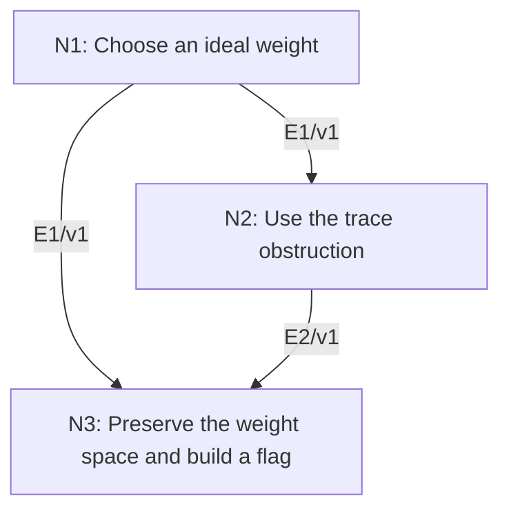

# Lie’s Theorem for Solvable Complex Lie Algebras

## An End-to-End Metacognitive Mathematics Walkthrough

**Problem ID:** RT-04  
**Version:** 1  
**Subject:** Representation Theory and Lie Theory  
**Level:** Advanced  
**Status:** Complete authored exposition relative to the declared imports.  
**Evidence:** Mathematical argument and authored teaching traces; no actual multi-agent run, independent review, or proof-assistant certification is claimed.

## 1. Target, definitions, and import contract

Let $\mathfrak g$ be a finite-dimensional solvable complex Lie algebra and $\rho:\mathfrak g\to\mathfrak{gl}(V)$ a representation on a nonzero finite-dimensional complex vector space. There is a common eigenvector: some $v\ne0$ and linear $\lambda:\mathfrak g\to\mathbb C$ satisfy $\rho(y)v=\lambda(y)v$ for all $y$. Consequently there is a basis in which every $\rho(y)$ is upper triangular. Solvable means the iterated derived series eventually becomes zero.

### Permitted imports and conventions

Use eigenvalue existence over $\mathbb C$, trace of a commutator equal to zero, induction on dimension, and the representation identity $\rho([x,y])=[\rho(x),\rho(y)]$. Write $yv$ for $\rho(y)v$. A subalgebra of a solvable algebra is solvable. A nonzero solvable algebra has $[\mathfrak g,\mathfrak g]\ne\mathfrak g$, since equality would make its derived series constant and nonzero.

## 2. Intuition and node interaction workflow

An ideal of codimension one provides a weight vector by induction. A trace calculation prevents the remaining direction from changing that weight, enabling one last eigenvector selection.

Each mathematical node contains **Ego, Memory, Intellect, Sense, and Action**. The diagram records accepted proof dependencies. Requests to repair an argument belong only to §6; they are not backward proof edges.

### Evidence transfer ledger

| Transfer | Producer and export | Receiving activity | Exact claim and compatibility |
|---|---|---|---|
| T1-2 | N1/v1 · E1/v1 | N2.1 | There exist $x$ with $\mathfrak g=\mathfrak h\oplus\mathbb Cx$, a nonzero $v_0$, and a linear weight $\lambda$ on $\mathfrak h$ with $yv_0=\lambda(y)v_0$. Inputs in N2 retain the producer's assumptions; evidence: §4.N1. |
| T1-3 | N1/v1 · E1/v1 | N3.1 | There exist $x$ with $\mathfrak g=\mathfrak h\oplus\mathbb Cx$, a nonzero $v_0$, and a linear weight $\lambda$ on $\mathfrak h$ with $yv_0=\lambda(y)v_0$. Inputs in N3 retain the producer's assumptions; evidence: §4.N1. |
| T2-3 | N2/v1 · E2/v1 | N3.1 | $\lambda([x,y])=0$ for every $y\in\mathfrak h$. Inputs in N3 retain the producer's assumptions; evidence: §4.N2. |

## 3. Node roles and five-faculty contracts

### N1/v1 — Choose an ideal weight

**Object and inputs:** Induction on $d=\dim\mathfrak g$ and a hyperplane $\mathfrak h\supset[\mathfrak g,\mathfrak g]$.

**Role and strategy:** Reduce the Lie algebra dimension, then record the orbit of a weight vector under the missing direction.

**Local obligation:** There exist $x$ with $\mathfrak g=\mathfrak h\oplus\mathbb Cx$, a nonzero $v_0$, and a linear weight $\lambda$ on $\mathfrak h$ with $yv_0=\lambda(y)v_0$.

| Faculty | Concrete responsibility |
|---|---|
| Ego | Publish E1/v1 only with its stated domain and assumptions: There exist $x$ with $\mathfrak g=\mathfrak h\oplus\mathbb Cx$, a nonzero $v_0$, and a linear weight $\lambda$ on $\mathfrak h$ with $yv_0=\lambda(y)v_0$. |
| Memory | Induction on $d=\dim\mathfrak g$ and a hyperplane $\mathfrak h\supset[\mathfrak g,\mathfrak g]$. Preserve the §1 conventions and incoming export versions. |
| Intellect | Reduce the Lie algebra dimension, then record the orbit of a weight vector under the missing direction. |
| Sense | $\mathfrak h$ is an ideal because every bracket with it lies in $[\mathfrak g,\mathfrak g]$; induction decreases algebra dimension. |
| Action | Execute activities N1.1–N1.2 in §4.N1; preserve the displayed calculations as evidence. |

**Export E1/v1:** There exist $x$ with $\mathfrak g=\mathfrak h\oplus\mathbb Cx$, a nonzero $v_0$, and a linear weight $\lambda$ on $\mathfrak h$ with $yv_0=\lambda(y)v_0$. Evidence: the complete local derivation in §4.N1.

**Acceptance gate:** Establish the local obligation through every numbered activity below and discharge this concrete check: $\mathfrak h$ is an ideal because every bracket with it lies in $[\mathfrak g,\mathfrak g]$; induction decreases algebra dimension.

**Targeted repair:** If an arbitrary hyperplane is assumed ideal, choose one containing the derived algebra before applying the commutator calculation. Withhold E1 and its dependent exports until the correction has been checked; a revised export receives a new version.

### N2/v1 — Use the trace obstruction

**Object and inputs:** E1/v1 and $W=\operatorname{span}\{v_0,xv_0,x^2v_0,\ldots\}$. Incoming proof exports: E1/v1 at N2.1.

**Role and strategy:** Triangularize the ideal action on a finite cyclic span and take traces of commutators there.

**Local obligation:** $\lambda([x,y])=0$ for every $y\in\mathfrak h$.

| Faculty | Concrete responsibility |
|---|---|
| Ego | Publish E2/v1 only with its stated domain and assumptions: $\lambda([x,y])=0$ for every $y\in\mathfrak h$. |
| Memory | E1/v1 and $W=\operatorname{span}\{v_0,xv_0,x^2v_0,\ldots\}$. Preserve the §1 conventions and incoming export versions. |
| Intellect | Triangularize the ideal action on a finite cyclic span and take traces of commutators there. |
| Sense | The finite span $W$ is invariant under both $x$ and $\mathfrak h$, so restricted commutator traces are legitimate. |
| Action | Execute activities N2.1–N2.3 in §4.N2; preserve the displayed calculations as evidence. |

**Export E2/v1:** $\lambda([x,y])=0$ for every $y\in\mathfrak h$. Evidence: the complete local derivation in §4.N2.

**Acceptance gate:** Establish the local obligation through every numbered activity below and discharge this concrete check: The finite span $W$ is invariant under both $x$ and $\mathfrak h$, so restricted commutator traces are legitimate.

**Targeted repair:** If a trace is taken on a noninvariant partial span, first pass to the full finite cyclic space $W$ and establish both invariances. Withhold E2 and its dependent exports until the correction has been checked; a revised export receives a new version.

### N3/v1 — Preserve the weight space and build a flag

**Object and inputs:** E1/v1 and E2/v1; $E=\{v:yv=\lambda(y)v\text{ for all }y\in\mathfrak h\}$. Incoming proof exports: E1/v1 at N3.1, E2/v1 at N3.1.

**Role and strategy:** Use the vanished commutator weights to show $xE\subset E$, then repeat on quotient spaces.

**Local obligation:** A common eigenvector exists, and the representation admits a full invariant flag and upper-triangular matrices.

| Faculty | Concrete responsibility |
|---|---|
| Ego | Publish E3/v1 only with its stated domain and assumptions: A common eigenvector exists, and the representation admits a full invariant flag and upper-triangular matrices. |
| Memory | E1/v1 and E2/v1; $E=\{v:yv=\lambda(y)v\text{ for all }y\in\mathfrak h\}$. Preserve the §1 conventions and incoming export versions. |
| Intellect | Use the vanished commutator weights to show $xE\subset E$, then repeat on quotient spaces. |
| Sense | $E\ne0$ since it contains $v_0$; the final induction decreases representation dimension. |
| Action | Execute activities N3.1–N3.2 in §4.N3; preserve the displayed calculations as evidence. |

**Export E3/v1:** A common eigenvector exists, and the representation admits a full invariant flag and upper-triangular matrices. Evidence: the complete local derivation in §4.N3.

**Acceptance gate:** Establish the local obligation through every numbered activity below and discharge this concrete check: $E\ne0$ since it contains $v_0$; the final induction decreases representation dimension.

**Targeted repair:** If $E$ is claimed invariant without E2, restore the commutator term and use its zero weight; otherwise the eigenvector argument is unsupported. Withhold E3 and its dependent exports until the correction has been checked; a revised export receives a new version.

## 4. Continuous mathematical proof

The following activities form one continuous proof. Intermediate claims are established where used, except for the explicitly permitted imports in §1.

### §4.N1 — Choose an ideal weight

1. **N1.1.** When $\mathfrak g=0$, any nonzero vector works. For $d>0$, solvability makes the derived algebra proper. Choose a hyperplane $\mathfrak h$ containing it and $x$ outside. The hyperplane is an ideal and solvable, of dimension $d-1$.

2. **N1.2.** Apply the induction hypothesis to the restriction of the representation to $\mathfrak h$. It gives $v_0\ne0$ with $yv_0=\lambda(y)v_0$. The scalar function $\lambda$ is linear because the representation is linear and $v_0$ is nonzero.

### §4.N2 — Use the trace obstruction

1. **N2.1.** Put $v_j=x^jv_0$. Induction on $j$, simultaneously for every $y\in\mathfrak h$, gives $yv_j-\lambda(y)v_j\in\operatorname{span}(v_0,\ldots,v_{j-1})$. Indeed $yxv_{j-1}=x(yv_{j-1})+[y,x]v_{j-1}$; the first term has the required leading part and the second lies in the previous span because $[y,x]\in\mathfrak h$ and the induction hypothesis applies to it.

2. **N2.2.** Let $m\ge1$ be the first index where $v_m$ depends on its predecessors. It exists by finite dimension. Then $v_0,\ldots,v_{m-1}$ form a basis of $W$, which is $x$-invariant and, by the preceding formula, $\mathfrak h$-invariant. For $y\in\mathfrak h$, its action on $W$ is triangular with all diagonal entries $\lambda(y)$.

3. **N2.3.** The action of $[x,y]$ on $W$ is the commutator of the two restricted operators, so its trace is zero. It also has trace $m\lambda([x,y])$, since $[x,y]\in\mathfrak h$. Characteristic zero gives $\lambda([x,y])=0$.

### §4.N3 — Preserve the weight space and build a flag

1. **N3.1.** For $v\in E$ and $y\in\mathfrak h$, $y(xv)=x(yv)+[y,x]v=\lambda(y)xv+\lambda([y,x])v=\lambda(y)xv$. Thus $xE\subset E$. On this nonzero finite-dimensional complex space, $x$ has an eigenvector $v$. Since $\mathfrak g=\mathfrak h+\mathbb Cx$, it is a common eigenvector for all of $\mathfrak g$, completing the induction on $d$.

2. **N3.2.** The line $\mathbb Cv$ is invariant. To triangularize, induct separately on $\dim V$: the quotient $V/\mathbb Cv$ has a representation of the same solvable algebra and a full invariant flag by induction. Lift its flag and prepend $\mathbb Cv$. A basis adapted to this flag makes all representing matrices upper triangular.

## 5. Worked instance and boundary audit

Let $\mathfrak g$ be the upper-triangular $2\times2$ complex matrices acting on $\mathbb C^2$. Its derived algebra consists of strictly upper-triangular matrices, whose mutual brackets vanish, so it is solvable. The vector $e_1$ is a common eigenvector with weight $\lambda\bigl(\begin{smallmatrix}a&b\\0&d\end{smallmatrix}\bigr)=a$. The invariant flag is $0\subset\mathbb Ce_1\subset\mathbb C^2$.

### Boundary or failed-inference witness

The standard representation of $\mathfrak{sl}_2(\mathbb C)$ has no common eigenvector: the raising matrix kills only $\mathbb Ce_1$, whereas the lowering matrix sends $e_1$ to $e_2$. This Lie algebra is not solvable. Over $\mathbb R$, even a one-dimensional abelian algebra can act by a rotation without a real eigenvector.

## 6. Illustrative interaction and repair trace

**Trace status:** Authored illustration, not a logged agent execution. The rejected candidate below is outside the accepted DAG.

**Rejected N3 step:** the $\mathfrak h$-weight space is automatically invariant under $x$. The identity $y(xv)=\lambda(y)xv+\lambda([y,x])v$ exposes the missing term. **Diagnosis:** Intellect omitted the trace obstruction. **Repair:** establish N2 on the invariant cyclic span, then substitute $\lambda([y,x])=0$. This fills a genuine logical gap under the original hypotheses; recheck the common eigenvector and flag exports.

After the corrected argument is supplied, Ego may publish a hypothetical v2 export, Memory replaces the rejected version, and Action rechecks each descendant in §2. The accepted exposition in this file is v1; this scenario does not claim an actual revision or execution occurred.

## 7. Evidence ledger and reusable exports

| Item | Evidence and scope | Remaining limitation |
|---|---|---|
| Target theorem | §4, under exactly the §1 hypotheses and imports | Authored mathematical exposition; no independent or formal verification |
| E1–E3 | Local proofs §4.N1–§4.N3; version 1 | Imports remain attached to each reuse |
| Worked instance | Explicit computation or construction in §5 | Illustrates the mechanism; does not prove the universal theorem |
| Repair | Rejected inference, witness, and correction in §6 | Teaching scenario rather than empirical agent evidence |

**Reusable target:** Preserve `RT-04/v1`, the exact statement in §1, its assumptions, and this proof when reusing the result.

**Next direction:** Compare this invariant-flag theorem with the highest-weight structure of nonsolvable $\mathfrak{sl}_2$ in RT-05.

## 8. Sources and navigation

The proof and faculty decomposition are authored for this collection. The following primary teaching sources support further study; exact imports are specified in §1.

[Etingof and collaborators, Introduction to Representation Theory](https://math.mit.edu/~etingof/reprbook.pdf), sections on representations, characters, and $\mathfrak{sl}_2$; [MIT Lie Groups and Lie Algebras I lecture notes](https://ocw.mit.edu/courses/18-745-lie-groups-and-lie-algebras-i-fall-2020/lists/lecture-notes/) for solvable Lie algebras.

**Local imported proof modules:** None. Supporting external results are specified in §1.

[Five-project subject index](problems.md) · [Project README](../README.md) · [Graduate subject outline](../../book/outline.md)
