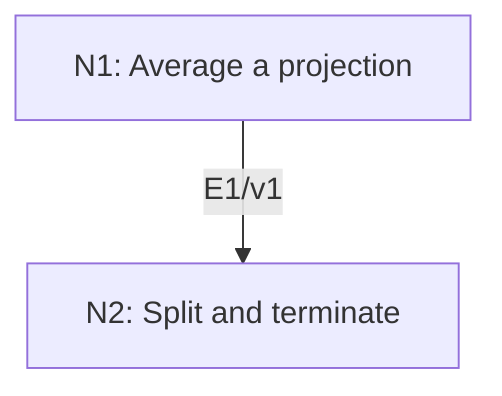

# Maschke’s Complete Reducibility Theorem

## An End-to-End Metacognitive Mathematics Walkthrough

**Problem ID:** RT-01  
**Version:** 1  
**Subject:** Representation Theory and Lie Theory  
**Level:** Introductory  
**Status:** Complete authored exposition relative to the declared imports.  
**Evidence:** Mathematical argument and authored teaching traces; no actual multi-agent run, independent review, or proof-assistant certification is claimed.

## 1. Target, definitions, and import contract

Let $G$ be a finite group, $k$ a field in which $|G|$ is invertible, and $V$ a finite-dimensional $k$-representation. Every invariant subspace $W$ has an invariant complement, and $V$ is a direct sum of irreducible representations. A representation is a homomorphism $\rho:G\to\mathrm{GL}(V)$; irreducible means nonzero with no proper nonzero invariant subspace.

### Permitted imports and conventions

Use finite-dimensional basis extension to choose a linear projection onto a subspace, invariance under reindexing a finite group sum, and induction on dimension. The field may have positive characteristic provided it does not divide $|G|$.

## 2. Intuition and node interaction workflow

An arbitrary projection need not respect the group action. Averaging its conjugates creates a projection that does.

Each mathematical node contains **Ego, Memory, Intellect, Sense, and Action**. The diagram records accepted proof dependencies. Requests to repair an argument belong only to §6; they are not backward proof edges.

### Evidence transfer ledger

| Transfer | Producer and export | Receiving activity | Exact claim and compatibility |
|---|---|---|---|
| T1-2 | N1/v1 · E1/v1 | N2.1 | $P=\|G\|^{-1}\sum_g\rho(g)p\rho(g)^{-1}$ is equivariant, has image $W$, and restricts to the identity on $W$. Inputs in N2 retain the producer's assumptions; evidence: §4.N1. |

## 3. Node roles and five-faculty contracts

### N1/v1 — Average a projection

**Object and inputs:** An invariant $W\subset V$ and any linear projection $p:V\to W$ with $p|_W=\mathrm{id}$.

**Role and strategy:** Average $\rho(g)p\rho(g)^{-1}$ to enforce equivariance without losing the restriction to $W$.

**Local obligation:** $P=|G|^{-1}\sum_g\rho(g)p\rho(g)^{-1}$ is equivariant, has image $W$, and restricts to the identity on $W$.

| Faculty | Concrete responsibility |
|---|---|
| Ego | Publish E1/v1 only with its stated domain and assumptions: $P=\|G\|^{-1}\sum_g\rho(g)p\rho(g)^{-1}$ is equivariant, has image $W$, and restricts to the identity on $W$. |
| Memory | An invariant $W\subset V$ and any linear projection $p:V\to W$ with $p\|_W=\mathrm{id}$. Preserve the §1 conventions and incoming export versions. |
| Intellect | Average $\rho(g)p\rho(g)^{-1}$ to enforce equivariance without losing the restriction to $W$. |
| Sense | Division by $\|G\|$ must be legal, and each conjugate must still land in $W$. |
| Action | Execute activities N1.1–N1.2 in §4.N1; preserve the displayed calculations as evidence. |

**Export E1/v1:** $P=|G|^{-1}\sum_g\rho(g)p\rho(g)^{-1}$ is equivariant, has image $W$, and restricts to the identity on $W$. Evidence: the complete local derivation in §4.N1.

**Acceptance gate:** Establish the local obligation through every numbered activity below and discharge this concrete check: Division by $|G|$ must be legal, and each conjugate must still land in $W$.

**Targeted repair:** If $p$ is assumed equivariant from basis extension alone, replace it by the conjugation average and verify the reindexing. Withhold E1 and its dependent exports until the correction has been checked; a revised export receives a new version.

### N2/v1 — Split and terminate

**Object and inputs:** E1/v1 and finite $\dim V$. Incoming proof exports: E1/v1 at N2.1.

**Role and strategy:** Use the equivariant kernel as a complement, then induct on dimension.

**Local obligation:** $V=W\oplus\ker P$ as representations, and every such $V$ is a finite direct sum of irreducibles.

| Faculty | Concrete responsibility |
|---|---|
| Ego | Publish E2/v1 only with its stated domain and assumptions: $V=W\oplus\ker P$ as representations, and every such $V$ is a finite direct sum of irreducibles. |
| Memory | E1/v1 and finite $\dim V$. Preserve the §1 conventions and incoming export versions. |
| Intellect | Use the equivariant kernel as a complement, then induct on dimension. |
| Sense | The recursive decomposition terminates because each proper nonzero summand has smaller dimension. |
| Action | Execute activities N2.1–N2.2 in §4.N2; preserve the displayed calculations as evidence. |

**Export E2/v1:** $V=W\oplus\ker P$ as representations, and every such $V$ is a finite direct sum of irreducibles. Evidence: the complete local derivation in §4.N2.

**Acceptance gate:** Establish the local obligation through every numbered activity below and discharge this concrete check: The recursive decomposition terminates because each proper nonzero summand has smaller dimension.

**Targeted repair:** If repeated splitting is asserted to terminate without a measure, use the strictly decreasing dimensions of the summands. Withhold E2 and its dependent exports until the correction has been checked; a revised export receives a new version.

## 4. Continuous mathematical proof

The following activities form one continuous proof. Intermediate claims are established where used, except for the explicitly permitted imports in §1.

### §4.N1 — Average a projection

1. **N1.1.** Choose a vector-space complement by extending a basis of $W$, and let $p$ be its projection. Each conjugate of $p$ lands in $W$, since $W$ is invariant under every $\rho(g)$. On $w\in W$, that conjugate sends $w$ to itself. Thus the average $P$ also maps into $W$ and is the identity there.

2. **N1.2.** For $h\in G$, conjugating $P$ by $\rho(h)$ replaces the index $g$ by $hg$, a permutation of $G$. Therefore $P$ commutes with $\rho(h)$. Its restriction to its image is the identity, so $P^2=P$ and $\operatorname{im}P=W$.

### §4.N2 — Split and terminate

1. **N2.1.** Every $v$ decomposes as $Pv+(v-Pv)$, with the first term in $W$ and the second in $\ker P$. Their intersection is zero because $P|_W$ is the identity. If $u\in\ker P$, then $P\rho(g)u=\rho(g)Pu=0$, so the complement is invariant.

2. **N2.2.** For $\dim V=0$ the decomposition is the empty sum. A nonzero irreducible $V$ is already one summand. Otherwise choose a proper nonzero invariant $W$, split it as above, and apply the induction hypothesis to both summands of strictly smaller positive dimension. This yields a finite irreducible decomposition.

## 5. Worked instance and boundary audit

Let $G=C_2$ act on $k^2$ by swapping coordinates, with $\operatorname{char}k\ne2$. For $W=k(1,1)$, start with $p(x,y)=(x,x)$. Averaging its two conjugates gives $P(x,y)=((x+y)/2,(x+y)/2)$. Its kernel is $k(1,-1)$, yielding the trivial and sign summands.

### Boundary or failed-inference witness

Over $\mathbb F_p$, let a generator of $C_p$ act by $T=I+N$ on a two-dimensional space, where $N e_2=e_1$ and $N e_1=0$. Then $T^p=I$. The invariant line $k e_1$ has no invariant complement: any complementary line has a vector $e_2+a e_1$, whose image differs by $e_1$ and cannot stay in that line. Here $|G|=0$ in the field.

## 6. Illustrative interaction and repair trace

**Trace status:** Authored illustration, not a logged agent execution. The rejected candidate below is outside the accepted DAG.

**Rejected N1 candidate:** the same average proves complete reducibility in every characteristic. **Sense:** the unipotent $C_p$ example contradicts the conclusion and $1/|G|$ is undefined. **Repair:** retain the stated invertibility assumption; no averaging repair exists for that counterexample under the broader claim. Recheck the complement and recursive decomposition with the correct field contract.

After the corrected argument is supplied, Ego may publish a hypothetical v2 export, Memory replaces the rejected version, and Action rechecks each descendant in §2. The accepted exposition in this file is v1; this scenario does not claim an actual revision or execution occurred.

## 7. Evidence ledger and reusable exports

| Item | Evidence and scope | Remaining limitation |
|---|---|---|
| Target theorem | §4, under exactly the §1 hypotheses and imports | Authored mathematical exposition; no independent or formal verification |
| E1–E2 | Local proofs §4.N1–§4.N2; version 1 | Imports remain attached to each reuse |
| Worked instance | Explicit computation or construction in §5 | Illustrates the mechanism; does not prove the universal theorem |
| Repair | Rejected inference, witness, and correction in §6 | Teaching scenario rather than empirical agent evidence |

**Reusable target:** Preserve `RT-01/v1`, the exact statement in §1, its assumptions, and this proof when reusing the result.

**Next direction:** Use invariant complements to decompose finite-group representations before character calculations; this does not itself prove the corresponding claim for arbitrary Lie algebras.

## 8. Sources and navigation

The proof and faculty decomposition are authored for this collection. The following primary teaching sources support further study; exact imports are specified in §1.

[Etingof and collaborators, Introduction to Representation Theory](https://math.mit.edu/~etingof/reprbook.pdf), sections on representations, characters, and $\mathfrak{sl}_2$; [MIT Lie Groups and Lie Algebras I lecture notes](https://ocw.mit.edu/courses/18-745-lie-groups-and-lie-algebras-i-fall-2020/lists/lecture-notes/) for solvable Lie algebras.

**Local imported proof modules:** None. Supporting external results are specified in §1.

[Five-project subject index](problems.md) · [Project README](../README.md) · [Graduate subject outline](../../book/outline.md)
